# 🚀 FastAPI 大师课：第96课：关系函数

在本节课中我们将要学习如何在 SQLModel 模型里建立关系函数，让 `Room` 和 `Booking` 不只在数据库层面通过外键相连，还能在 Python 代码里互相访问。上一节我们介绍了带 `room_id` 外键的 `Booking` 模型，本节我们来看看怎样把这个数据库连接真正落实到 Python 对象关系上，让代码可以从一条预订找到对应房间，也可以从一个房间找到它下面的所有预订。

## 🧭 FastAPI 大师课：第96课：从外键到对象关系

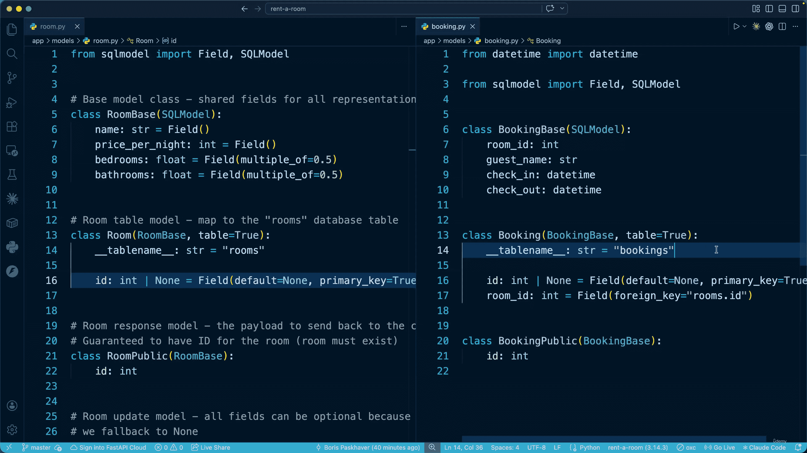

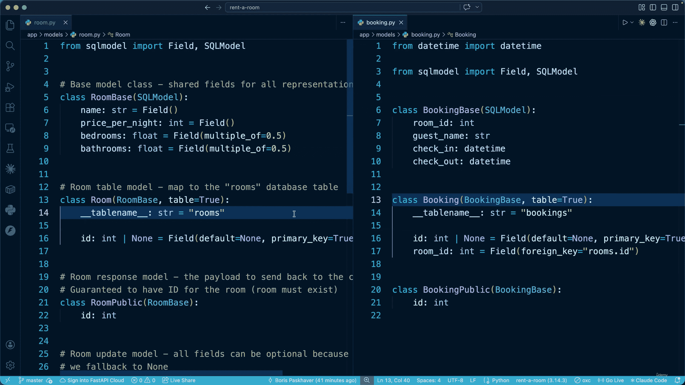

上一节我们定义了一个 `Booking` 模型，并且给它加上了 `room_id` 外键。这个外键的作用是建立数据库表之间的连接，让数据库知道预订表和房间表是有关联的。

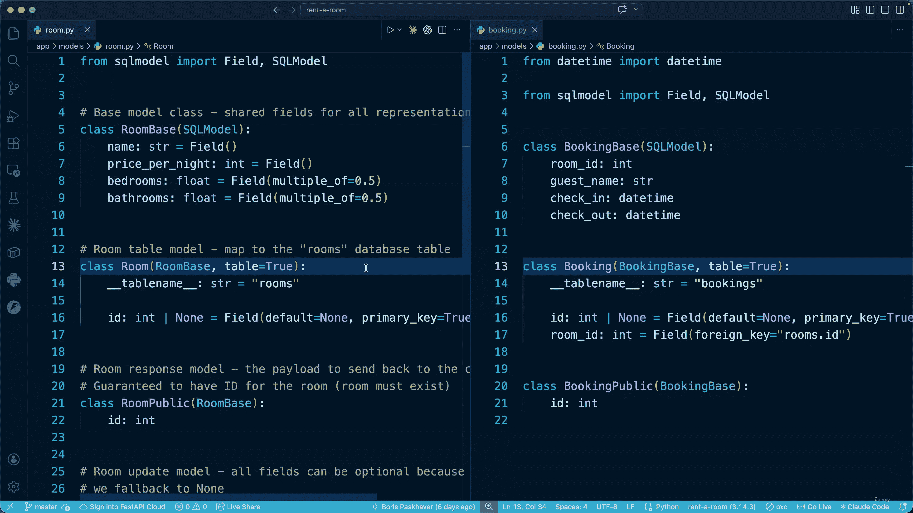

不过，这个连接目前只存在于数据库层面，还没有在 Python 代码里建立对应的关联。也就是说，我们现在还不能从一个 `Booking` 对象直接走到它对应的 `Room`，也不能从一个 `Room` 对象直接拿到它下面的所有 `Booking`。本课要解决的就是这个问题。

可以先把 ORM 关系理解成一句大白话：数据库里存的是外键地址，Python 模型里要提供导航入口。

> 外键是数据库层面的连接，关系属性是 Python 对象层面的连接。数据库里的 `bookings` 表只存 `room_id`，但 Python 代码希望通过 `.room` 或 `.bookings` 直接访问另一侧的模型对象。

本课的目标很明确：当 SQLModel 从某张表里取出一行数据，并创建出 `Room` 实例或 `Booking` 实例之后，我们希望能够访问一个补充属性，从而拿到另一侧的模型对象。下面列出本课要建立的两个访问方向，帮助先建立整体印象。

- 如果取出的是一条 `Booking`，我们希望可以访问类似 `.room` 的属性，从而走到对应的房间记录，并拿到房间的补充数据。
- 如果取出的是一条 `Room` 记录，我们希望可以访问类似 `.bookings` 的属性，从而找到这个房间的全部预订，并且这些预订都以 `Booking` 模型实例的形式表示。

## 🎯 FastAPI 大师课：第96课：本课目标与补充属性

上一节我们介绍了外键只是数据库表之间的连接，本节我们来看看这个连接在 Python 对象里应该表现成什么样。这里的核心是补充属性：模型实例本身对应数据库表里的一行，而关系属性让我们从这一行导航到另一侧的模型。

需要特别注意的是，这个关系从不同方向看，含义并不完全相同。一个单独的 `Booking` 只会连接到一个 `Room`，并且只连接一个房间。可是同一个 `Room` 可以拥有多个 `Booking`，在类似 Airbnb 的平台里，同一个房间、同一套房子可以被很多不同预订租出去。

所以，从单条预订行的角度看，它连接的是一个唯一房间，因此我们希望有一个属性可以访问那个房间。反过来，当我们从数据库取出一条房间记录并创建 `Room` 实例时，我们希望有一个叫 `bookings` 的复数属性，因为一个房间不会永远只有一个预订，它可能有多个预订，也可能有很多预订，形成一个预订集合。

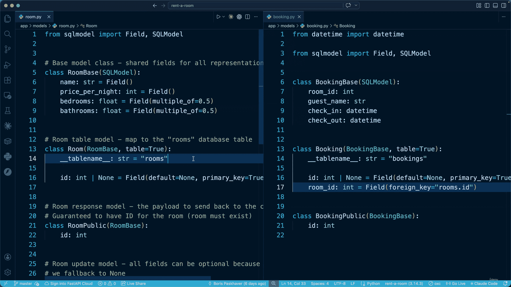

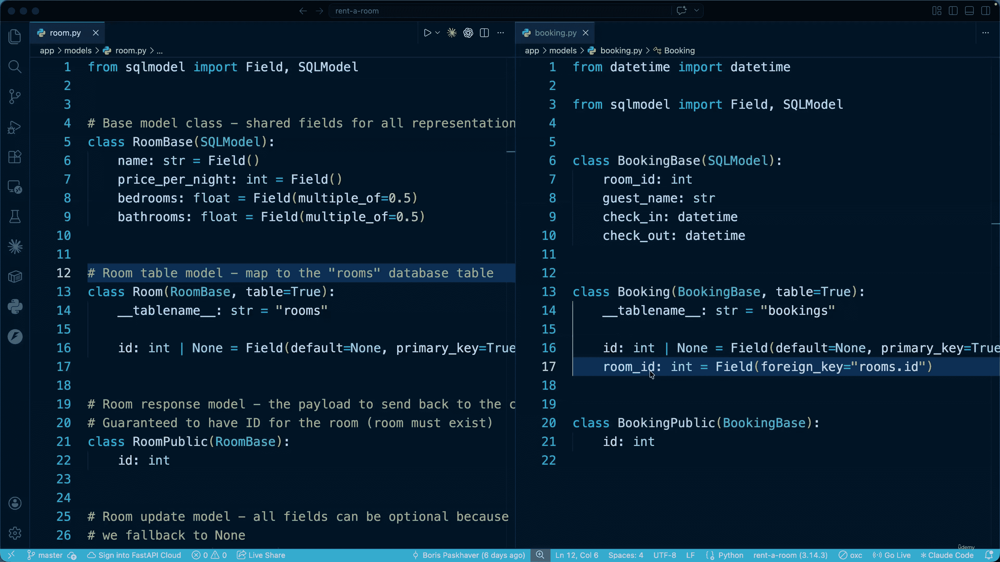

这就是我们常说的“一对多关系”。一个房间是一个实体，数据库里只有一条房间记录，但它可以关联很多条预订记录。用公式表示就是：

\[
Room \quad 1 \longrightarrow N \quad Booking
\]

而从 `Booking` 模型的角度看，它又是“一对一关系”：一条预订对应一个房间。用公式表示就是：

\[
Booking \quad 1 \longrightarrow 1 \quad Room
\]

一旦我们在模型定义里建立了这些关系，就可以在路由处理器等 Python 代码里，拿着一个模型对象进行遍历，访问另一侧模型或者另一侧模型的集合。下面列出关系建立之后的几个直接效果，方便理解它为什么有用。

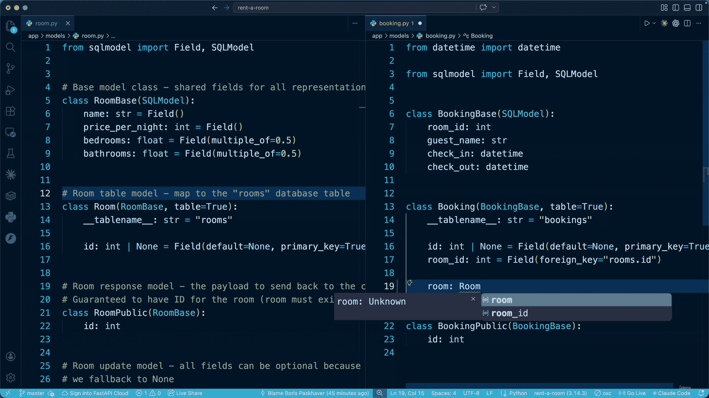

- 拿到 `Booking` 实例后，可以通过关系属性访问对应的 `Room` 实例。
- 拿到 `Room` 实例后，可以通过关系属性访问它下面的全部 `Booking` 实例。
- 这些访问不需要手写额外查询逻辑，SQLModel 会根据外键关联推断关系。

## 🔗 FastAPI 大师课：第96课：关系方向与一对多

前面说明了关系在两个方向上表现不同，本节我们来看看为什么会出现“一对多”和“一对一”两种视角。这个区别不是矛盾，而是观察方向不同带来的结果。

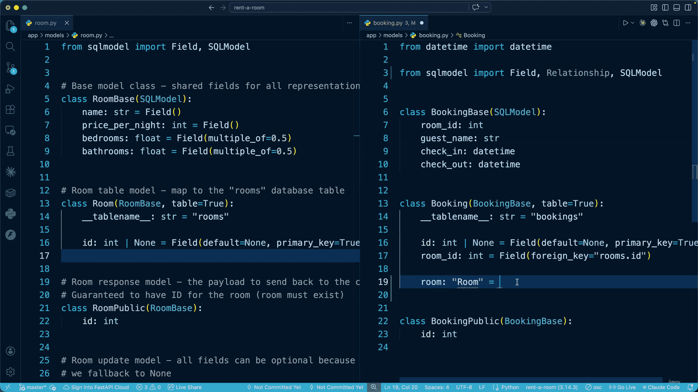

一条单独的 `Booking` 只连接一个 `Room`，所以从预订出发时，我们只需要一个单数属性，例如 `room`。同一个 `Room` 可以被多条 `Booking` 使用，所以从房间出发时，我们需要一个复数属性，例如 `bookings`。这就像同一间房四月可以有一次预订，五月还可以有下一次预订，两次预订共享同一个 `room_id`，但入住时间和退房时间可能不同。

在数据库里，预订表可能会有两条记录，而房间表只有一条记录。下面列出这个例子里两边数据的对应关系，帮助把“一对多”具体化。

- `Room` 表里只有一条房间记录。
- `Booking` 表里可以有多条预订记录。
- 多条 `Booking` 记录共享同一个 `room_id`，因此都指向同一条 `Room` 记录。
- 第一条预订可能在四月，下一条同一房间的预订可能在五月，但房间仍然是同一个。

## 🏨 FastAPI 大师课：第96课：在 Booking 模型上建立 room 属性

理解了关系方向之后，本节我们来看看在 `Booking` 模型上怎么落地 `room` 属性。原文里把两个模型文件并排打开，目的就是确保在关系两边都建立关联，而不是只写一边。

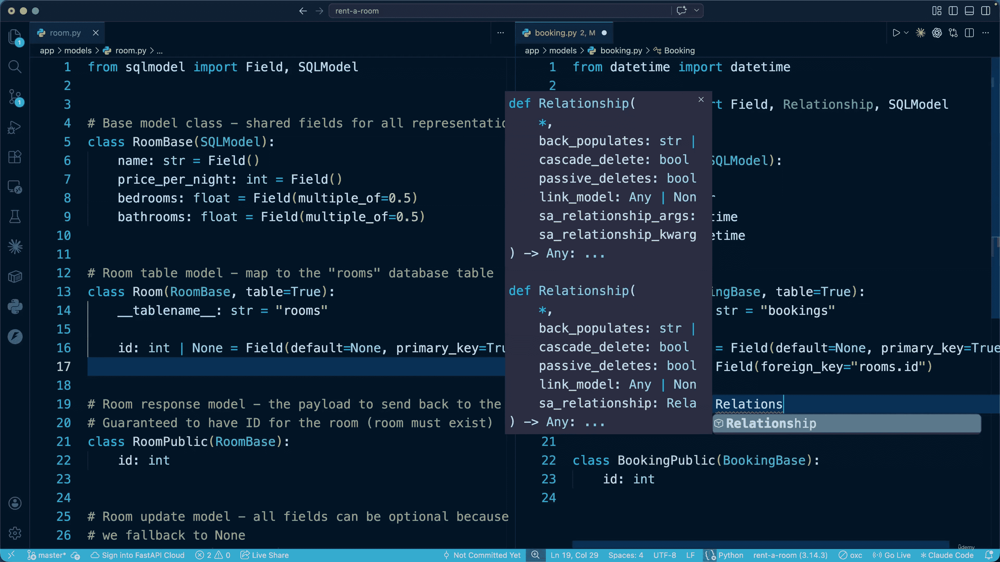

从 `Booking` 开始，我们希望每一条从数据库取出的 `Booking` 记录，都能通过一个叫 `room` 的属性访问对应房间。这里有一个关于类型注解的细节：当然可以把类型声明成 `Room`，但那样就需要从另一个文件导入 `Room` 类。问题在于，之后 `Room` 模型还要定义 `bookings` 属性，而 `bookings` 是 `Booking` 的列表，又需要从 `Booking` 文件导入 `Booking` 类。这样两个文件就会互相导入，形成循环依赖，最终可能导致运行时错误。

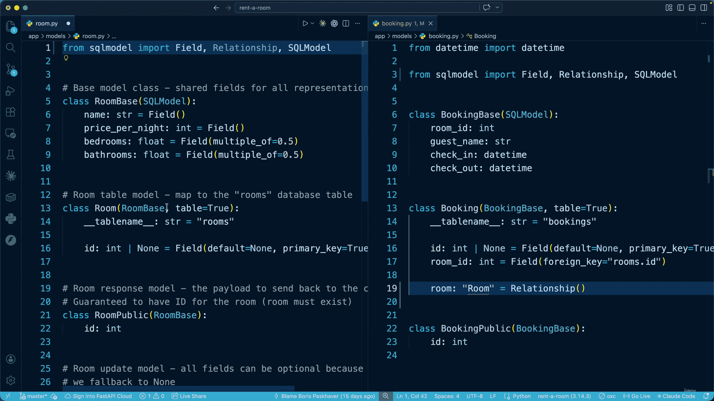

所以这里不直接写出类名，而是把类型写成字符串，例如 `"Room"`。字符串形式会触发类型检查器违规，但这个问题稍后可以修复。这里的意图是：访问 `room` 属性时，返回的是 `Room` 模型实例。

在右侧赋值时，要使用 SQLModel 里的关系构造，而不是 `Field`。下面列出 `Field` 和关系构造的关键区别，帮助避免混淆。

- `Field` 的意图是映射回数据库里的一个列。
- `bookings` 表里不会有一个叫 `room` 的列，它只有 `room_id` 列。
- 我们希望用 `room_id` 这个列的值作为基础，去获取关联的房间。
- 关联房间通过补充的 `room` 属性访问，因此这里应使用关系构造。
- 关系构造表达的含义是：它关联到另一张表，连接到系统里的另一个领域对象。

`Booking` 模型这一侧的关键示意代码如下：

```python
from typing import TYPE_CHECKING
from sqlmodel import SQLModel, Field, Relationship

if TYPE_CHECKING:
    from app.models.room import Room

class Booking(SQLModel, table=True):
    id: int | None = Field(default=None, primary_key=True)
    room_id: int = Field(foreign_key="room.id")

    room: "Room" = Relationship()
```

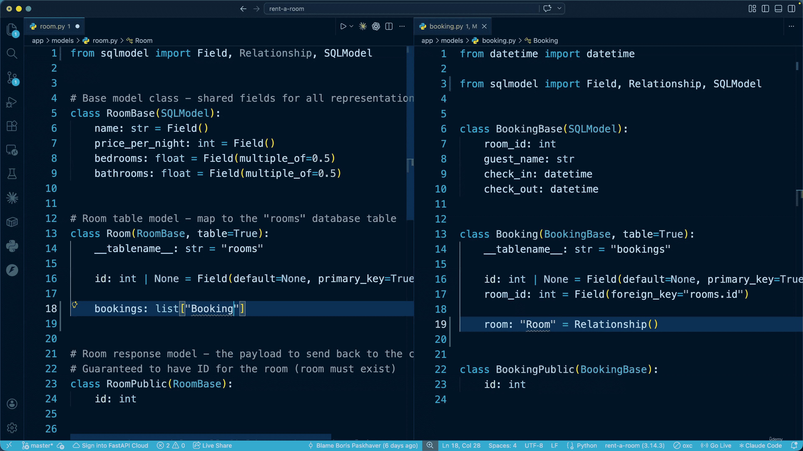

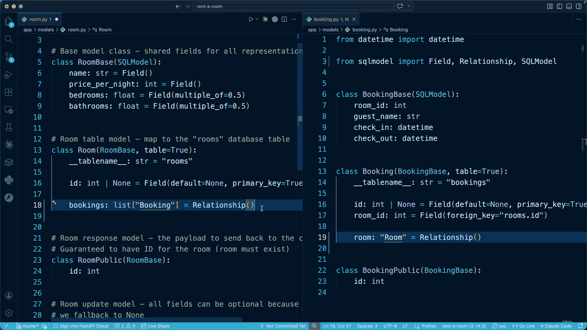

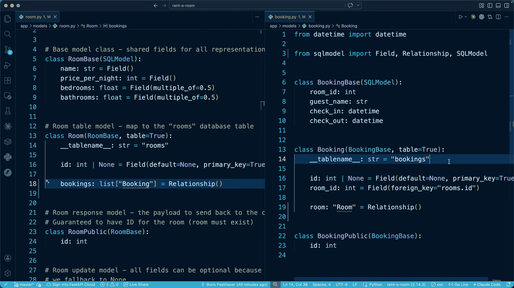

## 🏠 FastAPI 大师课：第96课：在 Room 模型上建立 bookings 属性

`Booking` 这一侧的 `room` 属性定义好之后，本节我们来看看 `Room` 模型反向的 `bookings` 属性。做法是模仿刚才的代码，只是在相反方向上建立关系。

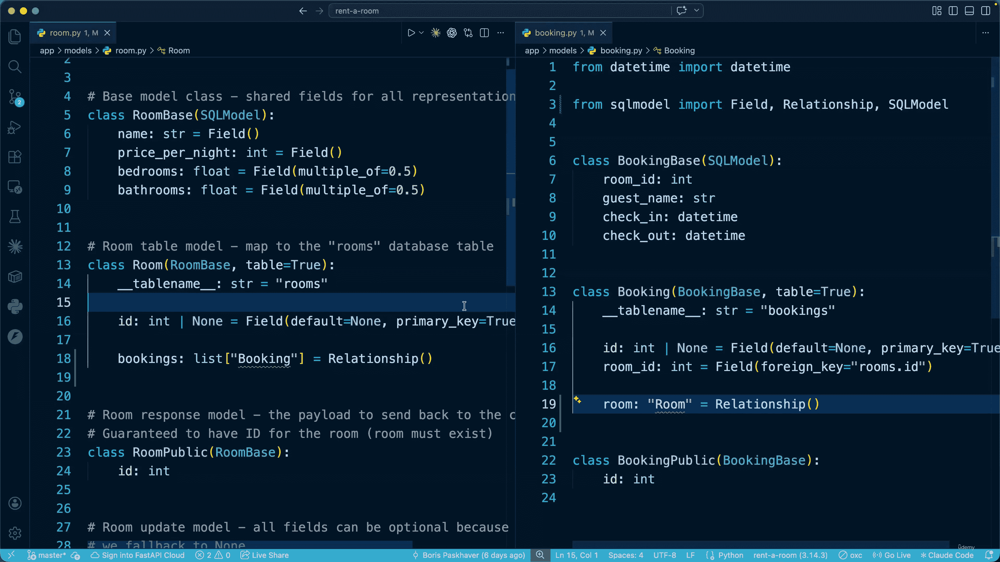

在 `room.py` 里同样需要导入关系构造。需要再次提醒：一个房间不只有一个预订，同一个房间可以被多个预订预订，这些预订共享同一个 `room_id`，但可能有不同的入住时间和退房时间。因此这里定义的属性叫 `bookings`，用复数，因为它表达的是一对多：一个房间拥有多个预订。

这个属性的类型不是单个 `Booking` 实例，而是一个列表，列表里的每一项都是 `Booking` 模型。如果某个房间没有任何预订，也完全没有问题，列表就是空列表。反过来说，一条 `Booking` 不能没有 `Room`，这也是关系方向上的重要差异。

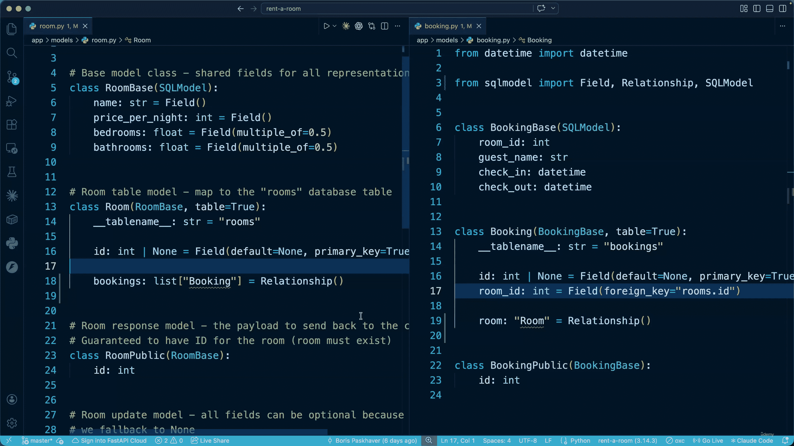

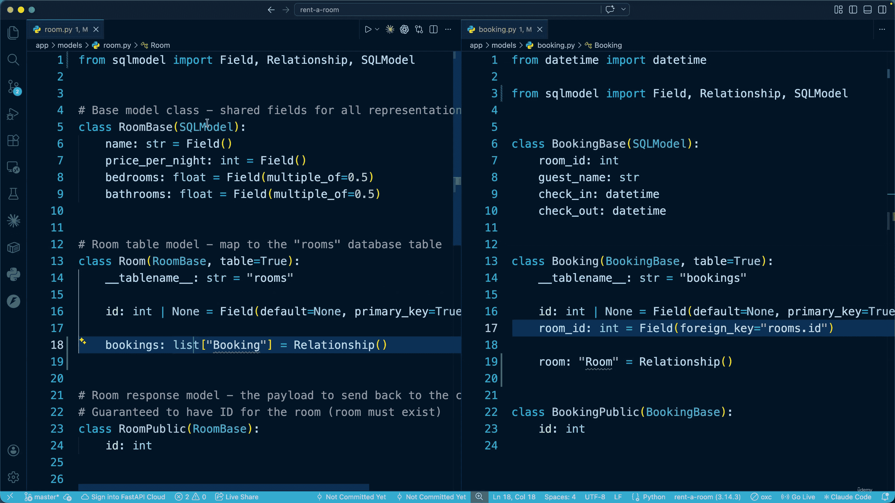

`Room` 模型这一侧的关键示意代码如下：

```python
from typing import TYPE_CHECKING
from sqlmodel import SQLModel, Field, Relationship

if TYPE_CHECKING:
    from app.models.booking import Booking

class Room(SQLModel, table=True):
    id: int | None = Field(default=None, primary_key=True)

    bookings: list["Booking"] = Relationship()
```

## 🧠 FastAPI 大师课：第96课：SQLModel 如何推断关系

两边属性都写出来后，本节我们来看看 SQLModel 为什么能自动推断关系。关键并不在于我们额外写了多少配置，而在于 `Booking` 模型里的 `room_id` 被声明成了外键。

SQLModel 一旦知道 `room_id` 连接到 `Room` 表的 `id` 列，并且知道这是一个外键，它就能在幕后把关系映射回任意一边。换句话说，它从 `Booking` 的角度知道怎样走到对应的 `Room`。它之所以能推断出来，是因为我们告诉了它 `room_id` 是外键；反过来，只要它知道关系的一个方向，就可以推导出反方向。

从 `Room` 出发时，它可以找到所有 `Booking` 模型实例，也就是在 `bookings` 表里查找 `room_id` 等于当前 `Room` 实例的 `id` 的那些行。用大白话讲，SQLModel 能根据这个关联，从任意一边遍历到另一边。下面列出这个推断机制的核心要点，方便复习。

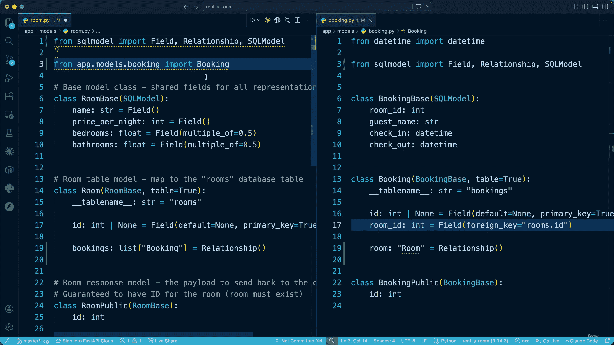

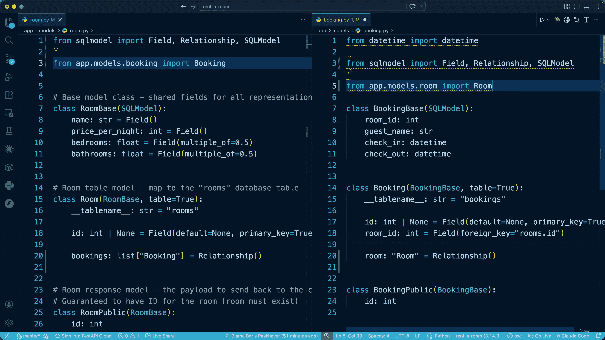

- `room_id` 是外键，指向 `Room` 表的 `id` 列。
- SQLModel 知道这个外键后，就能从 `Booking` 导航到对应的 `Room`。
- SQLModel 知道一个方向后，也能推导反方向。
- 从 `Room` 导航到 `Booking` 时，会查找所有 `room_id` 等于当前房间 `id` 的预订行。
- 因此，既可以由房间得到全部预订，也可以由预订得到房间。

## 🔁 FastAPI 大师课：第96课：循环依赖与类型检查问题

关系能跑通之后，本节我们来看看类型检查器报出的问题以及循环依赖风险。前面的字符串注解虽然绕开了直接导入，但类型检查器，例如 Pylance，并不知道 `"Booking"` 这个构造到底是什么。它知道 `bookings` 属性应该是一个列表，列表元素是某个叫 `Booking` 的类，但它不知道这个类从哪里来。

如果直接在 `room.py` 里写 `from app.models.booking import Booking`，单看一个方向可能没问题，因为 `room.py` 从 `booking.py` 引入了一个构造。但当我们在另一个模型里也采用同样方式，例如在 `booking.py` 里写 `from app.models.room import Room`，两个文件就会互相导入，形成循环依赖。

这种循环依赖可以把它想成一个无限循环：一个文件说请从另一个文件导入，Python 开始解析另一个文件，另一个文件又说请从第一个文件导入，然后又跳回来，再跳过去，形成无限循环。不能出现第一个文件引用第二个文件的导入，同时第二个文件又引用第一个文件的导入，导入关系只能保持单向。

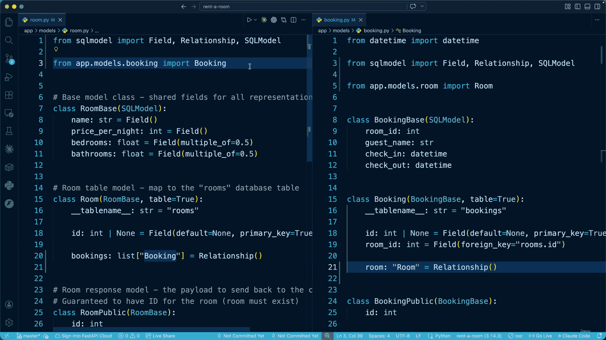

幸运的是，有一个类似“作弊码”的写法可以支持这种类型语法。根本问题只是想解决类型检查，而不是运行时的真实依赖。类型检查器知道 `Booking` 类是什么、来自哪里之后，违规就会消失；同样，类型检查器也能知道 `Room` 类是什么，并能把它和文件第 5 行导入的 `Room` 类关联起来。

关键点在于：运行时并不需要这段导入代码。我们在这个文件里并没有实例化 `Booking`，也没有调用 `Booking` 实例的方法或类方法，只是导入这个类名，用于类型关联。它严格来说只是类型检查需要的名字，不是 FastAPI 应用运行时需要的代码。下面列出这个问题的几个要点，帮助区分类型检查与运行时。

- 字符串注解能避免直接导入，但类型检查器会报违规。
- 直接互相导入会形成循环依赖。
- 循环依赖在 Python 真正运行程序时可能导致运行时错误。
- 这里的导入只在类型检查时需要，运行时并不需要。
- 类型检查器只是分析文件，并不会像运行程序一样同时加载两个文件。

## 🛡️ FastAPI 大师课：第96课：用 TYPE_CHECKING 解决循环导入

理解了循环依赖，本节我们来看看 `TYPE_CHECKING` 如何只让类型检查器看到导入。做法是从 Python 标准库的 `typing` 模块导入一个全大写的常量 `TYPE_CHECKING`。这个模块专门处理 Python 里的类型相关内容。

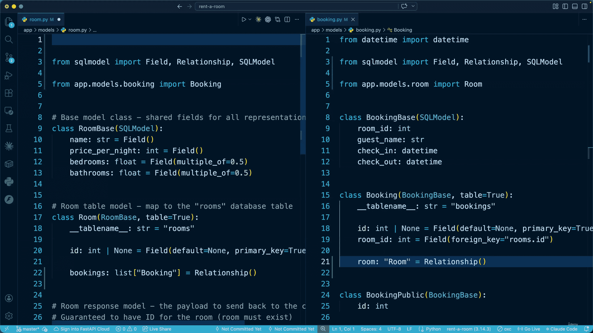

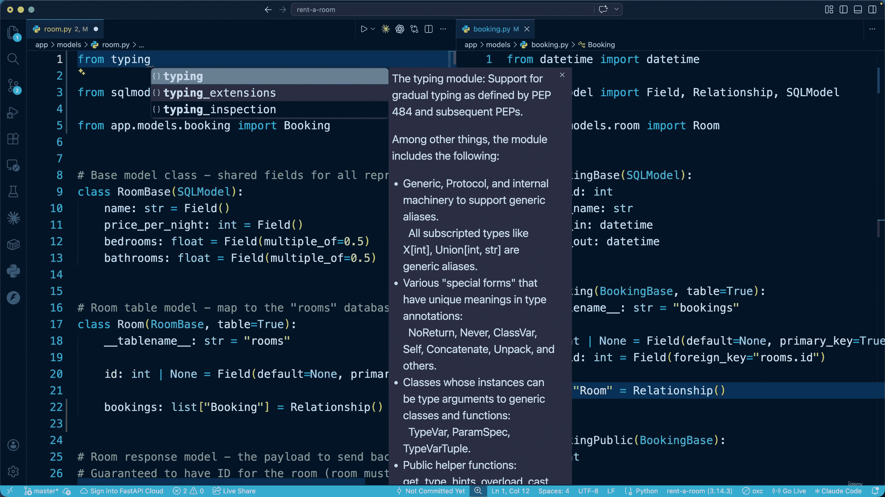

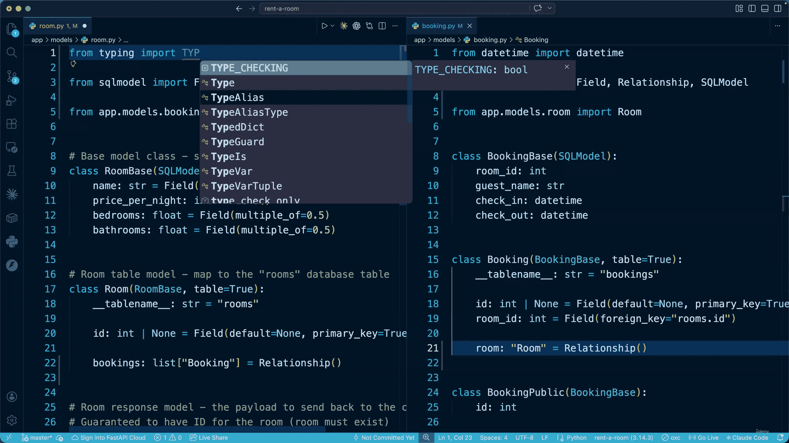

它的工作方式是：当 FastAPI 服务器运行，或者把这个文件当作普通 Python 文件执行时，`TYPE_CHECKING` 会被设置为 `False`。当 Pylance 或类型检查服务器在 VSCode 里以自己的方式执行文件、进行类型检查时，`TYPE_CHECKING` 会被设置为 `True`，因为此时确实处在类型检查上下文中。

因此，我们只在类型检查时执行导入。类型检查器不会像运行时那样同时加载两个文件，它只是分析代码，不真正运行代码，所以从类型检查角度看，循环依赖没有问题；但程序真正运行时，循环依赖不行。于是可以写成 `if TYPE_CHECKING:`，只在类型检查器读取文件时导入 `Booking` 这个名字，让关系属性理解 `Booking` 类代表什么。

当运行 `uv run fastapi dev` 时，FastAPI 应用解析这个文件，`TYPE_CHECKING` 为 `False`，这段导入不会执行，运行时就不会出现循环导入错误。`room.py` 里也重复同样的思路：从 `typing` 导入 `TYPE_CHECKING`，只有当类型检查器读取文件时才为 `True`，普通 Python 执行时为 `False`。仅在类型检查上下文里导入 `Room` 这个名字，用于关系关联。

下面列出 `TYPE_CHECKING` 方案的核心逻辑，方便初学者记住。

- 普通 Python 运行和 FastAPI 运行时，`TYPE_CHECKING` 为 `False`。
- Pylance、VSCode 类型检查等类型检查上下文里，`TYPE_CHECKING` 为 `True`。
- 只有 `TYPE_CHECKING` 为 `True` 时才导入另一侧模型类。
- 运行时不会执行这些导入，因此不会触发循环导入错误。
- 类型检查器能看到这些导入，因此类型违规消失。

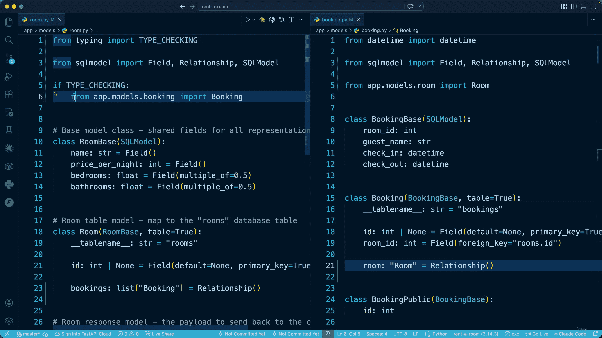

## ✅ FastAPI 大师课：第96课：本课总结

到这里，本课主要内容已经完成，本节我们做一个总结。本节课中我们一起学习了如何在 SQLModel 模型里用关系函数建立双向关系：在 `Booking` 模型上建立 `room` 属性，在 `Room` 模型上建立 `bookings` 属性。

我们还理解了一个房间对应多个预订的一对多关系，以及一条预订对应一个房间的一对一视角。外键 `room_id` 是数据库层面的连接，关系属性是 Python 对象层面的导航入口，SQLModel 能根据外键自动推断两个方向的关系。最后我们处理了字符串类型注解带来的类型检查问题，用 `TYPE_CHECKING` 只在类型检查时导入另一侧模型，避免运行时循环导入错误。下面列出本课最值得记住的几个结论，作为收尾复习。

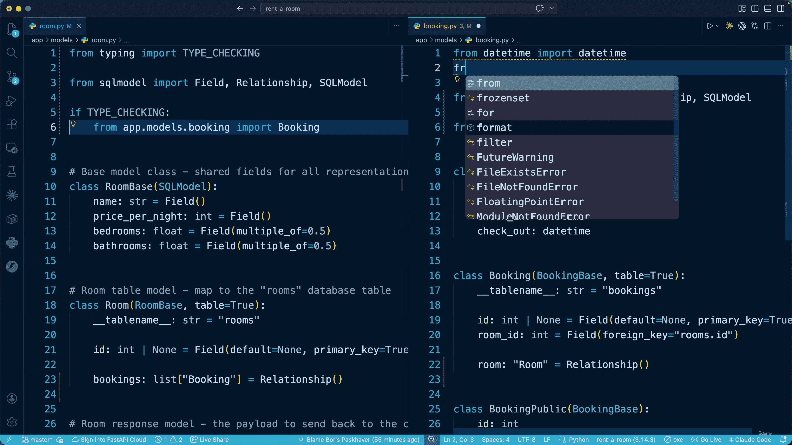

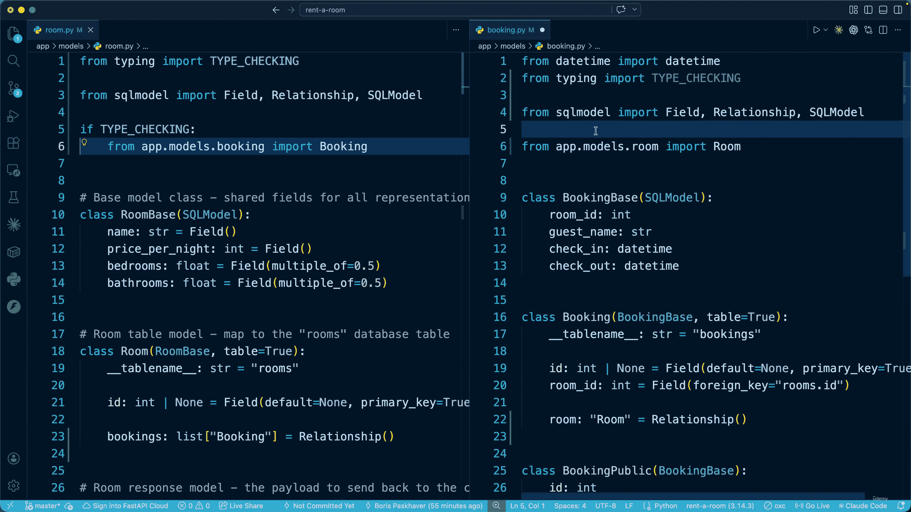

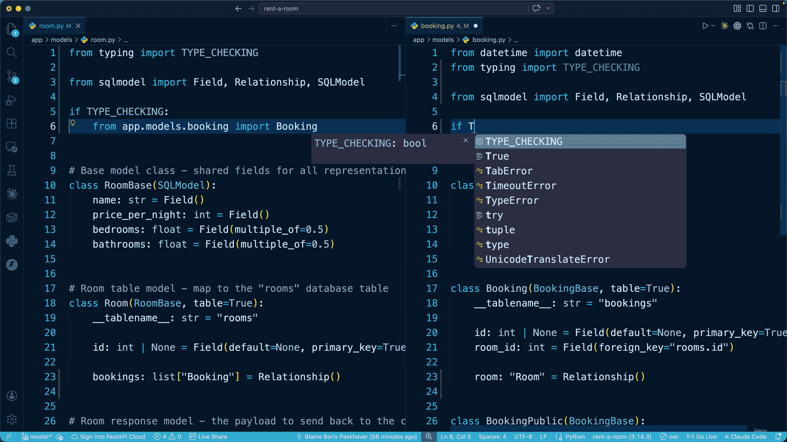

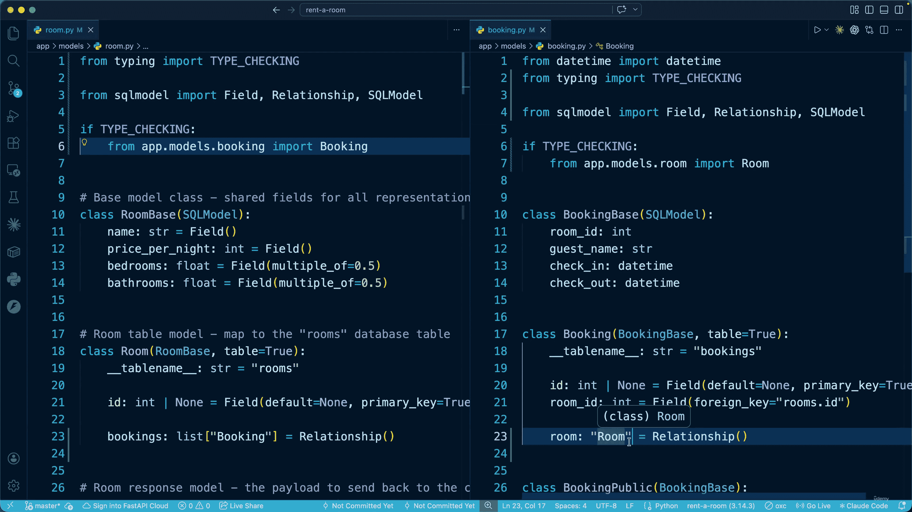

- `Field` 用于映射数据库列，关系属性用于连接另一侧模型。
- `Room` 到 `Booking` 是一对多，`Booking` 到 `Room` 是一对一视角。
- `room: "Room"` 和 `bookings: list["Booking"]` 用字符串注解避免直接循环导入。
- `TYPE_CHECKING` 为 `False` 时运行时不执行导入，为 `True` 时类型检查器执行导入。
- 这样既能通过类型检查，又能保证 FastAPI 实际运行不出现循环导入错误。

