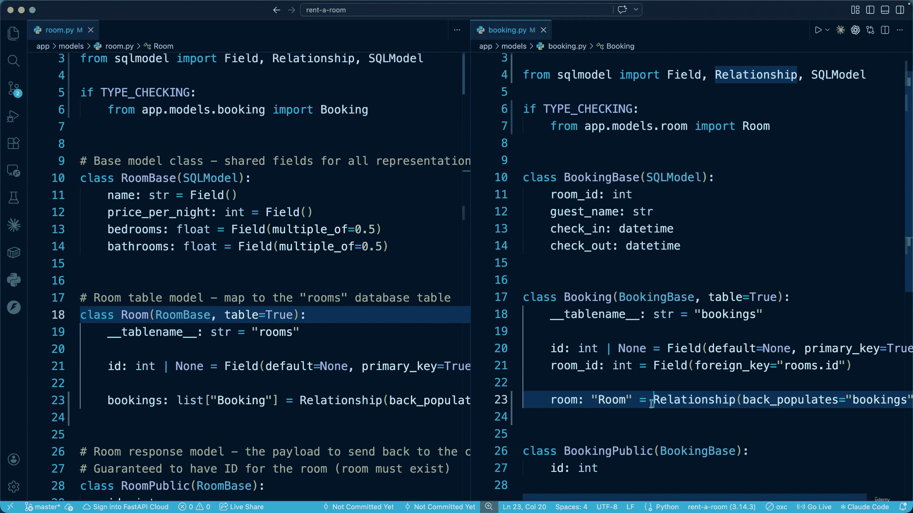
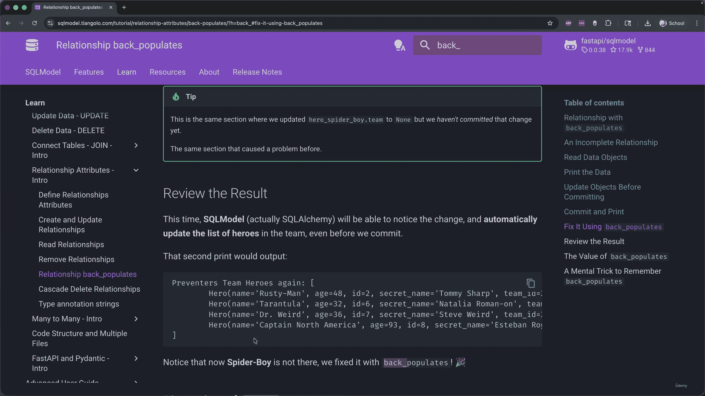
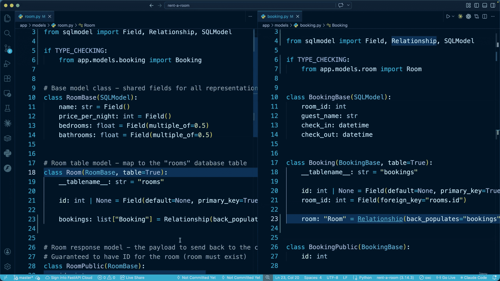

# FastAPI 大师课：第 97-98 节：🔗 理解 back_populates 参数

在本节课中我们将要学习 SQLModel 关系中的一个重要参数，也就是 `back_populates`。这个参数可以说是本节课里最容易让人困惑的部分，因此我们会先把代码写出来，再解释它要完成什么事情，然后结合官方 SQLModel 文档中的例子，说明它在运行时到底有什么作用。最后我们还会看看，如果没有这个参数，两个互相关联的模型实例为什么会出现数据不同步的问题，以及 `back_populates` 是如何解决这个问题的。

## FastAPI 大师课：第 97-98 节：🧭 为什么需要 back_populates

上一节我们已经为两个模型建立了关联关系，本节中我们来看看如何让这两个关联属性在运行时互相感知对方的变化。原文提到，还需要对两个模型上的两个关联属性再做一个更新，而这个更新也许就是本节课最令人困惑的部分。我们先把代码写出来，再讨论它会产生什么效果，同时也会查看官方 SQLModel 文档，因为文档对这段代码的解释更清楚。

对于两个模型中指向另一个模型的关联属性，我们都要添加一个名为 `back_populates` 的参数。这个参数需要传入一个字符串，而这个字符串不是模型名称，也不是数据库表名，而是另一个互补模型中的属性名称。换句话说，我们要寻找的是反向关系，也就是互补模型上那个指回当前模型属性的关系属性。

可以把这个规则概括为下面这个核心概念，它看起来简单，但非常容易把方向弄反。

```text
back_populates 的字符串 = 互补模型中关系属性的名字
```

## FastAPI 大师课：第 97-98 节：🛠️ 在 Room 与 Booking 中加入参数

上一节我们说明了 `back_populates` 接收的是互补模型中的属性名，本节中我们把这个参数具体添加到 `Room` 和 `Booking` 两个模型里。原文中，`Booking` 模型里有一个 `room` 属性，用来指向对应的房间；`Room` 模型里有一个 `bookings` 属性，用来表示这个房间下的所有预订。现在我们要让这两个属性互相知道对方的存在。

在 `Booking` 模型的 `room` 属性上，`back_populates` 要写成字符串 `"bookings"`。这个 `"bookings"` 指向的是 `Room` 模型中的 `bookings` 属性。这里的重点是，字符串写的是属性名，而不是类名，也不是表名。原文特别强调，`room` 这个属性本身是我们自己命名的，而 `back_populates` 中提供的字符串必须准确对应另一个模型里的属性名。



在 `Room` 模型的 `bookings` 属性上，`back_populates` 要写成字符串 `"room"`。这个 `"room"` 指向的是 `Booking` 模型中的 `room` 属性。这样两个关系属性就形成了双向连接，任何一个模型实例发生关系变化时，另一个模型实例在运行时也能得到同步更新。

下面是两个模型添加该参数后的关键代码，供你对照属性名和字符串的对应关系。

```python
class Room(SQLModel, table=True):
    id: int | None = Field(default=None, primary_key=True)
    bookings: list["Booking"] = Relationship(back_populates="room")


class Booking(SQLModel, table=True):
    id: int | None = Field(default=None, primary_key=True)
    room_id: int | None = Field(default=None, foreign_key="room.id")
    room: Room | None = Relationship(back_populates="bookings")
```

可以看到，`Booking.room` 的 `back_populates` 是 `"bookings"`，而 `Room.bookings` 的 `back_populates` 是 `"room"`。这两个字符串正好是对方模型中的关系属性名。原文再次强调，`Booking` 模型上的 `back_populates` 指向的是 `Room` 模型上的 `bookings` 属性，`Room` 模型上的 `back_populates` 指向的是 `Booking` 模型上的 `room` 属性。

## FastAPI 大师课：第 97-98 节：🦸 官方 Team 与 Hero 示例

上一节我们在 `Room` 和 `Booking` 中配置了 `back_populates`，本节中我们来看看官方 SQLModel 文档中的类似例子。原文作者认为官方文档对这段行为的解释更好，尤其是在展示关系属性的时候。官方示例中有一个 `Team` 类，一个团队可以拥有很多超级英雄，因此 `Team` 上有一个 `heroes` 属性，用来指向 `Hero` 类。反过来，任何一个英雄都属于一个团队，因此 `Hero` 上有一个 `team` 属性。

这个例子里，从任意一个模型实例出发，都可以访问到互补模型。若从数据库中查询一条 `Team` 记录，就可以通过 `heroes` 属性拿到英雄实例列表；若查询 `Hero` 表并拿到一个英雄，就可以通过 `team` 关系访问他所属的团队。官方示例当前没有写 `back_populates`，如果加上这个参数，`Team.heroes` 的 `back_populates` 应该写成 `"team"`，`Hero.team` 的 `back_populates` 应该写成 `"heroes"`。

下面是官方示例加上 `back_populates` 后的核心写法，重点是观察两个字符串分别指向哪个属性。

```python
class Team(SQLModel, table=True):
    id: int | None = Field(default=None, primary_key=True)
    heroes: list["Hero"] = Relationship(back_populates="team")


class Hero(SQLModel, table=True):
    id: int | None = Field(default=None, primary_key=True)
    team_id: int | None = Field(default=None, foreign_key="team.id")
    team: Team | None = Relationship(back_populates="heroes")
```

这个例子也说明，`Hero.team` 是一个可选关系，英雄不一定必须属于某个团队。原文还特别对比了我们自己的业务场景：在预订领域里，一条 `Booking` 必须对应一个 `Room`；但在英雄示例中，一个 `Hero` 不一定必须拥有一个 `Team`。这个区别不影响 `back_populates` 的用法，但它有助于理解示例中的可选关系。

## FastAPI 大师课：第 97-98 节：⚠️ 没有 back_populates 时的运行时问题

上一节我们看了官方文档中的团队与英雄关系，本节中我们通过一段路由处理程序来说明缺少 `back_populates` 会发生什么。原文给出一个示例：路由处理程序用 `session.exec` 执行两个独立查询，第一个查询取出名字为 Spider-Boy 的英雄，第二个查询取出包含 Spider-Boy 的团队。这里产生的是两个独立的模型实例，一个是英雄实例，一个是团队实例。

下面按运行时顺序说明这个例子，重点观察两个对象在数据库提交之前是否同步。

- 第一个查询取出英雄 Spider-Boy，得到英雄实例。

- 第二个查询取出包含 Spider-Boy 的团队，得到团队实例。

- 打印团队的所有英雄时，结果中包含 Spider-Boy；反过来打印 Spider-Boy 时，也能看到所属团队。

- 在运行时、提交数据库之前，把 `hero.team` 设置为 `None`，用来表示这个英雄离开了团队，不再与该团队关联。

- 此时打印英雄变量，`hero.team` 会显示为 `None`，因为这个英雄已经不再拥有团队关联；但 `team_id` 仍然等于 2，因为还没有保存到数据库。

- 如果此时打印团队以及它的英雄列表，列表里仍然包含 Spider-Boy，原因是我们只更新了英雄实例，没有反向更新团队实例的 `heroes` 列表。

- 如果提交这条英雄记录，数据库中的 `team_id` 会变成 `NULL`，因为 Spider-Boy 不再拥有团队连接；提交之后重新查询团队，团队才会知道 Spider-Boy 已经不在其中。

原文把这部分行为称为“双向关系只更新了一边”。因为我们只执行了英雄实例上的显式代码，没有同时更新团队实例的 `heroes` 列表，所以团队对象还保留着旧数据。要修复这种不一致，就必须手动告诉团队对象：Spider-Boy 已经声明自己的团队关联为 `None`，因此要把他从团队列表中移除。这种手动管理很麻烦，因为关系存在两边，更新一个模型时还要记得更新另一个模型。

可以用下面的代码片段感受这种不一致，注释里标出了提交前的状态。

```python
hero = session.exec(select(Hero).where(Hero.name == "Spider-Boy")).one()
team = session.exec(select(Team).where(Team.id == hero.team_id)).one()

print(team.heroes)  # [Spider-Boy]
print(hero.team)    # Team(...)

hero.team = None

print(hero.team)     # None
print(hero.team_id)  # 仍然是 2，尚未提交
print(team.heroes)   # 没有 back_populates 时仍包含 Spider-Boy

session.add(hero)
session.commit()
session.refresh(team)
print(team.heroes)   # 提交并刷新后不再包含 Spider-Boy
```

原文指出，数据库最终是事实来源。只要我们提交英雄记录，数据库就会反映英雄不再属于团队；之后重新查询团队，团队就会是最新的。但在提交之前，运行时对象之间确实存在不匹配，确实存在不一致，也确实存在旧数据。如果我们在提交之前继续使用这些对象，就可能因为旧数据而出现错误。

## FastAPI 大师课：第 97-98 节：🔄 back_populates 自动同步互补模型

上一节我们看到，在没有 `back_populates` 时，两个模型实例会在提交前出现不一致，本节中我们来看看 `back_populates` 如何解决这个问题。它的核心作用是：当第一个模型对自身关系做出修改时，`back_populates` 会自动更新互补模型，让互补模型也知道这次变化，从而避免旧数据。

原文再次说明，`back_populates` 参数要设置为互补模型上的属性。对于英雄示例，`Hero.team` 上的 `back_populates` 设置为 `"heroes"`，这样英雄发生变化时，团队实例就知道要更新自己的 `heroes` 列表；反过来，`Team.heroes` 上的 `back_populates` 设置为 `"team"`，这样团队发生变化时，英雄实例就知道要更新自己的 `team` 属性。只要双方都提供 `back_populates`，SQLModel 就会替我们处理互补方向的更新。

下面展示有 `back_populates` 之后的效果。代码仍然是把查询到的英雄实例的 `team` 属性设置为 `None`，但此时立即打印团队，不需要对团队调用任何额外方法，团队实例在运行时内存中就已经自动更新。

```python
hero.team = None

print(hero.team)     # None
print(team.heroes)   # 自动不再包含 Spider-Boy
```

反向操作也是同样的道理。假设团队决定把某个英雄从列表中移除，也就是把这个英雄踢出团队，那么这个英雄的 `team` 属性会自动变成 `None`。这个过程不需要我们为两个模型分别写两遍同步代码，也不需要每次手动维护双向关系。只要两个关系属性都配置了 `back_populates`，SQLModel 就会从一个模型的修改出发，自动处理互补模型的同步变化。

用一句话概括就是：一个模型实例在运行时更新自己，与它存在关系的互补模型实例也会自动更新。这样我们就不必重复写代码，也不必依靠记忆去保证双向关系始终一致。`back_populates` 带来的直接好处，就是防止两个对象各说各话，防止一个对象已经改变而另一个对象还保留旧数据。

## FastAPI 大师课：第 97-98 节：✅ 本节总结



本节课中我们一起学习了 `back_populates` 参数的作用和写法。我们知道了这个参数接收的是互补模型中的关系属性名，`Booking.room` 对应 `"bookings"`，`Room.bookings` 对应 `"room"`，官方 `Team` 与 `Hero` 示例中则是 `"team"` 与 `"heroes"` 互相对应。我们也看到了没有 `back_populates` 时，两个独立查询出来的模型实例可能在提交数据库之前出现数据不同步，一个对象更新了关系，另一个对象却仍然保留旧列表。



最后我们确认了 `back_populates` 的价值：它会在运行时自动更新互补模型，减少手动维护双向关系的麻烦，避免旧数据和由此引发的错误。随着模型关系在代码中建立起来，以后查询一个房间时，获取它的预订会更容易；查询一条预订时，获取它对应的房间也会更容易。

