# 🚀 FastAPI Masterclass：第98-99节：创建预订路由

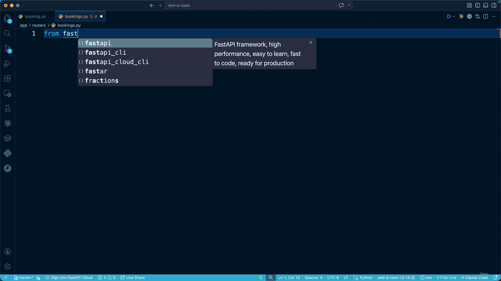

在本节课中我们将要学习如何创建预订路由，并写出两个初始路由。上一节我们介绍了预订模型，本节中我们来看看在预订模型已经准备好之后，如何继续制作预订路由。具体来说，我们会创建一个用于创建预订的 POST 路由，这个路由需要关联的房间 ID；还会创建一个按预订 ID 获取预订的 GET 路由。最后，我们会把这个新路由注册到应用设置中。为了先建立整体印象，本节的主要任务可以用下面的列表梳理：

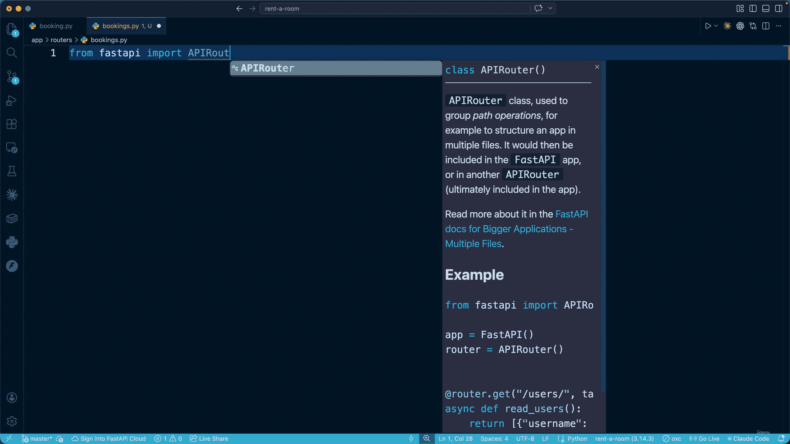

- 在 `app/routers` 目录下新建 `bookings.py` 文件，并初始化预订路由器。

- 编写 `POST /bookings` 路由，用来创建预订，并校验关联房间是否存在。

- 编写 `GET /bookings/{booking_id}` 路由，用来按预订 ID 获取预订。

- 在 `main.py` 中注册这个新的预订路由器，让两个路由生效。

## 🎯 FastAPI Masterclass：第98-99节：本节目标与文件准备

现在预订模型已经处于良好状态，因此可以继续制作预订路由并创建一些初始路由。在本节课中，我们将创建一个用于创建预订的路由，这个路由需要关联的房间 ID；同时还要创建一个按预订 ID 获取预订的路由。再次说明，在文件资源管理器中，所有路由文件都放在 `app/routers` 目录下。因此这里新建一个文件，命名为 `bookings.py`。这个文件就是预订路由器。照这样开始，先写几个确定会需要的导入。首先从 FastAPI 中需要路由器，因此导入 `APIRouter`。并且知道某个时刻会需要 `status` 模块。然后下面开始创建路由器，实例化 `APIRouter`。在这里可以决定一个公共前缀，把前缀设置为 `bookings`。这样附加到这个路由器上的每个路由都会以 `/bookings` 开头。同样可以在这里为所有预订路由添加标签。下面是这个文件开头需要的导入和路由器初始化示例：

```python
from fastapi import APIRouter, status

router = APIRouter(prefix="/bookings", tags=["bookings"])
```

为了清楚这些导入和对象各自的用途，可以先用下面的列表说明它们的作用：

- `APIRouter` 用来创建路由器，并统一管理一组路由。

- `status` 用来引用标准 HTTP 状态码，例如 201、200、404。

- `SessionDep` 是一个依赖类型，声明它以后会运行依赖函数，拿到异步数据库会话。

- `BookingBase` 表示进入服务器的预订 payload 形状，用来做 Pydantic 校验。

- `Booking` 对应数据库中的预订表，是用来和数据库交互的模型类。

- `BookingPublic` 是返回给客户端的公开预订模型。

- `Room` 对应数据库中的房间表，用来校验房间 ID 是否存在。

- `HTTPException` 用来在房间或预订不存在时抛出 HTTP 错误。

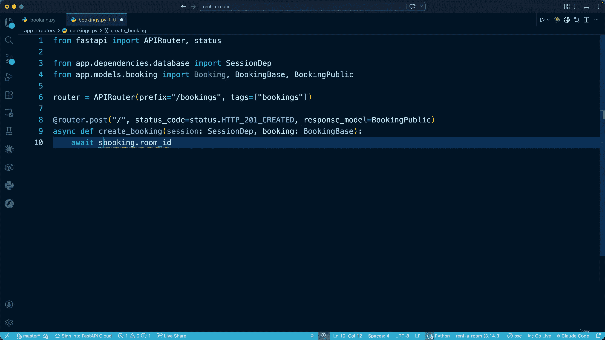

- `Annotated` 和 `Path` 可以用来给路径参数增加更明确的校验规则。

## 📮 FastAPI Masterclass：第98-99节：创建 POST 预订路由

文件与路由器准备好后，本节中我们来看看如何编写创建预订的 POST 路由。为了在服务器上创建新预订，从 POST 路由开始。在代码里写 `@router.post`。这个路由直接写斜杠路由，因为它会被 `/bookings` 前缀修饰。因此这是对 `/bookings` 的 POST 请求。如果成功创建预订，返回状态码 201。在 `status` 中可以取 `status.HTTP_201_CREATED`。并且希望在这里返回之前定义好的 `BookingPublic` 模型，这是模型的公开表示。由此需要导入许多模型。从 `app.models.booking` 导入 `Booking` 模型，稍后需要；还导入 `BookingBase`，因为它表示进入服务器的 payload 形状；然后导入 `BookingPublic`。这一次会比房间部分推进得快一些，因为很多思路应该是复习内容。为了让创建预订的 POST 路由更容易理解，可以按下面的步骤来读：

- 先用装饰器声明 POST 路由、状态码和响应模型。

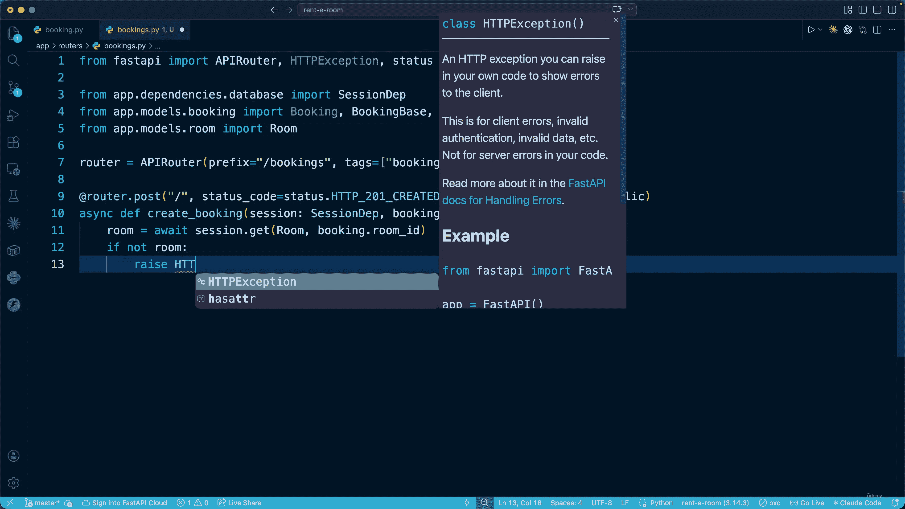

- 再声明异步函数，让函数能够处理异步数据库操作。

- 然后声明会话依赖参数，让 FastAPI 运行依赖函数并注入数据库会话。

- 最后声明预订 payload 参数，让 Pydantic 校验客户端提交的数据形状。

这里对于最终想返回给用户的 `response_model`，它将是 `BookingPublic` 模型的实例。照这样，在装饰器下面立即声明函数，叫 `create_booking`。并且知道这里会与会话交互，因为会话会把新预订模型保存到数据库。再次从 `app.dependencies.database` 导入会话依赖，导入完全相同的 `SessionDep` 类型。提醒一下，它会运行一个依赖函数，使用 `get_session` 函数，授予访问异步会话的权限。这里可以做两件事：第一，声明 `session` 参数；最重要的是，正是 `SessionDep` 这种类型声明会真正运行依赖函数。由于现在是异步会话，记住调用 `get` 或 `commit` 等方法时它们都是可等待的，因此这个函数和这个路由处理函数必须声明为 `async`。这里写 `async`。现在有 `session` 了。下一件需要的是进入服务器的实际预订 payload。客户端会发送创建预订所需的信息，包括房间 ID、客人姓名、入住日期和退房日期。这里声明参数，叫 `booking` 之类。类型是 `BookingBase`，这样 Pydantic 可以验证 payload 形状符合条件。再次说明，如果有额外属性或字段，Pydantic 会剥离它们，生成一个符合模型的对象。这里加冒号并进入函数体。

## 🔍 FastAPI Masterclass：第98-99节：校验房间是否存在

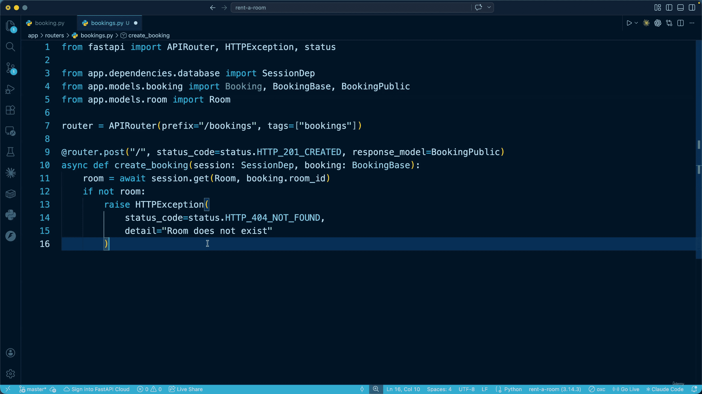

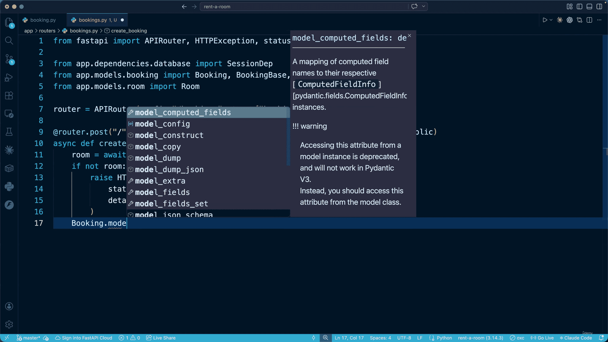

进入函数体后，第一件事是校验房间。为了创建预订，需要房间 ID。而且它实际上应该是有效房间的 ID。payload 可能不正确，包含的房间 ID 不对应房间表中的有效记录。因此第一件事是用预订上的房间 ID 尝试获取房间，以确保它存在。之前我们在房间路由中获取房间时，是从路径参数获取房间 ID。当时字面上像 `/rooms/{room_id}`。现在房间 ID 不在路径参数中，因为路由只是 `/bookings`；但在 `booking` 上，也就是 `BookingBase` 实例上，有所有这些字段，包括房间 ID。因此这里要做的是使用 `session.get` 方法。实际上必须 `await` 它，写 `await session.get`。提醒一下，它允许按记录 ID 查询。第一个参数是对应数据库表的模型。实际要查询 `rooms` 表，因此需要 `Room` 模型。这里还要从 `app.models` 导入 `Room`。只需要对应数据库表 `room` 的实际类。这里可以传入 `Room`，然后 `get` 的第二个参数是实际标识符，从实际 `booking` 的 `room_id` 字段或属性获取。这会返回数据库中的房间，或者如果该 ID 的房间不存在则返回 `None`。校验房间是否存在时，核心逻辑可以概括为下面的公式：

\[
\text{session.get}(\text{Room}, \text{booking.room\_id}) \Rightarrow \text{Room} \mid \text{None}
\]

然后遵循与房间路由非常相似的模式：写 `if not room`，基本意思是如果返回 `None`，表示没找到房间，就抛出 HTTP 异常。因此也从 FastAPI 导入 `HTTPException`。这里抛出该错误类的实例。再次提供状态码，类似 404，即 `status.HTTP_404_NOT_FOUND`，`detail` 类似 `"room does not exist"`。再次说明，如果请求的房间不是数据库中房间表里的有效房间，就不能创建预订，这是这里做的第一项检查。对应代码可以写成这样：

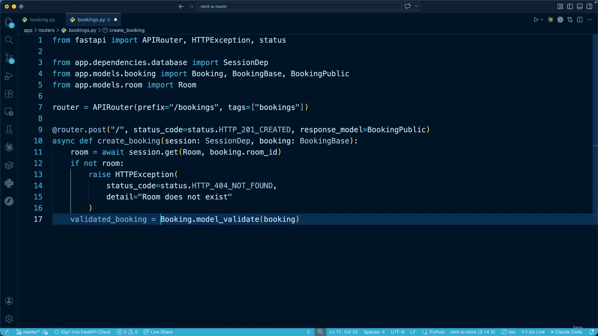

```python
room = await session.get(Room, booking.room_id)

if not room:
    raise HTTPException(
        status_code=status.HTTP_404_NOT_FOUND,
        detail="room does not exist",
    )
```

## 🧩 FastAPI Masterclass：第98-99节：转换数据并保存预订

假设房间有效，下一件事创建实际预订。再次遇到熟悉问题：为了与 `bookings` 表交互，需要使用 `Booking` 模型；但进入服务器的 payload 当前是另一个类或另一种形状，即 `BookingBase`。因此第一件事转换这些数据，或者换一种想法是迁移数据，复制到有效的 `Booking` 实例，即由互补的 `Booking` 类生成的对象。需要记住，每当在 `session` 上调用 `add` 之类的方法，它只能接受对应数据库表的模型对象。它不能接受任何 Pydantic 模型，否则在向服务器请求时会遇到运行时错误。因此下一行使用 `Booking` 类。提醒一下，它有 `model_validate` 方法，接受一个 payload，可以是字典，也可以是另一个 Pydantic 模型实例。这里传入 `booking`，它就会转移所有属性，还会添加 ID 字段，现在设为 `None`，因为进入服务器的 booking payload 里没有 ID。可以把这个变量叫 `validated_booking`。数据形状的转换过程可以用下面的公式表示：

\[
\text{BookingBase} \xrightarrow{\text{Booking.model\_validate}} \text{Booking}
\]

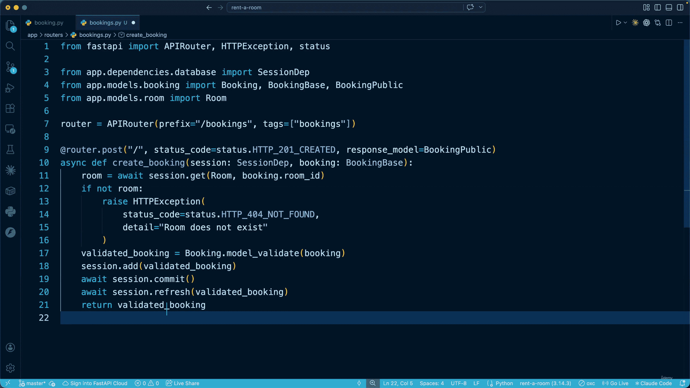

现在有了需要传给下面 `add` 方法的实际对象。取 `session`，调用 `add` 方法，传入 `validated_booking`。再次提醒，`add` 方法不需要 `await`。它不是异步操作，因为没有等待，没有 IO 操作，只是把新预订排队等待保存到数据库。下一行调用 `commit` 实际保存到数据库。这会把新行插入 `bookings` 表。这是可等待操作，不加 `await` 会立刻看到错误，因此要确保加 `await`。然后刷新实际 `validated_booking`，以确保 ID 存在。这里再次 `await` 可等待方法 `refresh` 的调用，`refresh` 接受需要刷新的实际对象，即 `validated_booking`。这会对表发起新请求，正确填充 `validated_booking` 实例的 ID 字段，这样返回时用户会得到有效整数 ID 而不是 `None`。再次说明，这里返回的是 `Booking` 类对象，但这里指定 `response_model` 应该是 `BookingPublic`，因此它会再次把 `Booking` 转换成 `BookingPublic`，然后再转换成 JSON，成为发回客户端的原始数据。这个实现看起来是完整的。保存和返回的过程可以概括为下面的公式：

\[
\text{Booking} \xrightarrow{\text{add/commit/refresh}} \text{带 ID 的 Booking} \xrightarrow{\text{response\_model}} \text{BookingPublic} \xrightarrow{\text{序列化}} \text{JSON}
\]

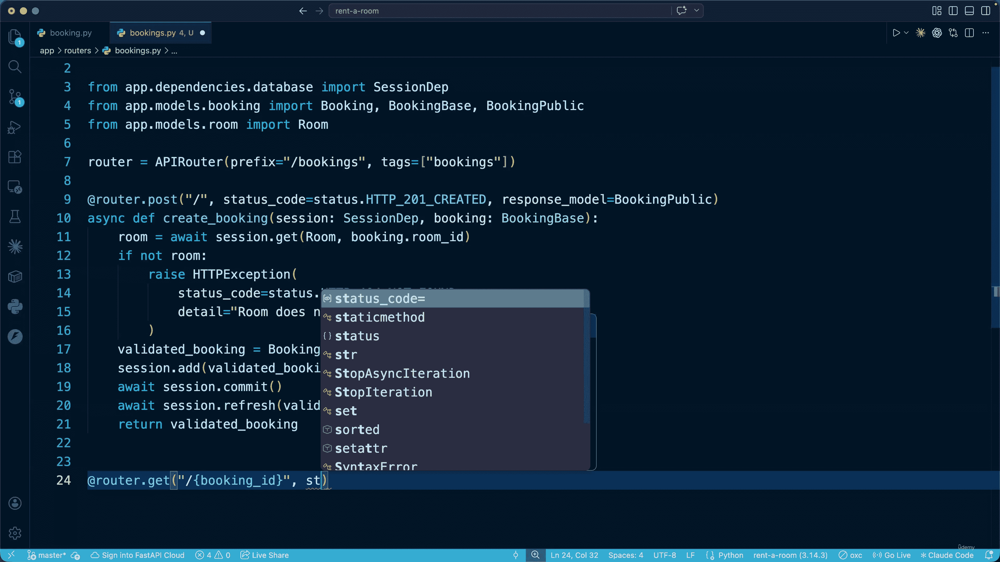

> 提醒：`add()` 只负责把对象放入会话队列，不负责真正写库；真正写库的是 `commit()`，所以 `commit()` 才需要 `await`。

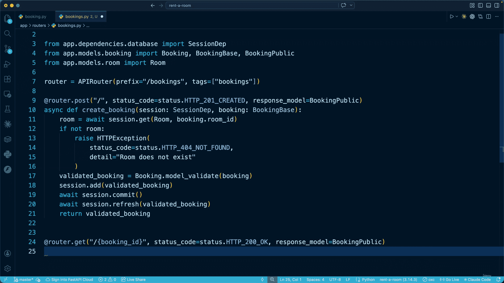

> 提醒：`refresh()` 会重新查询数据库并填充对象上的字段，例如自动生成的 ID，这样返回值才不会是 `None`。

创建预订的完整代码可以参考下面这段：

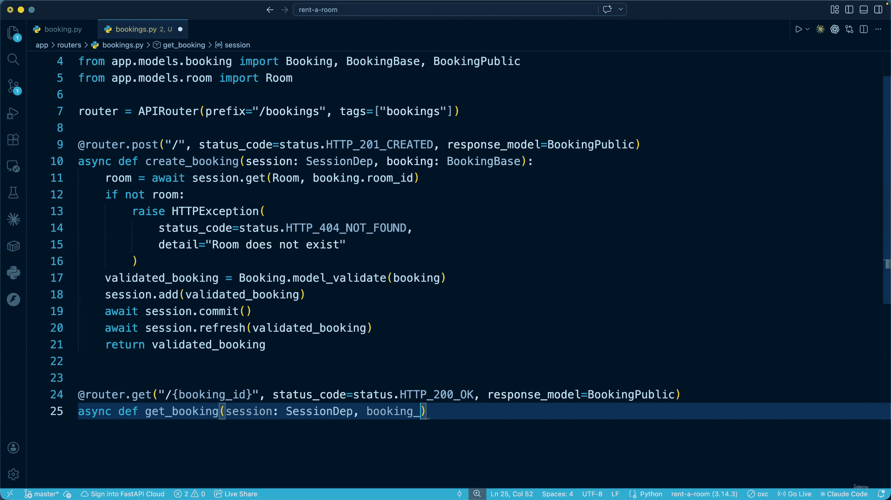

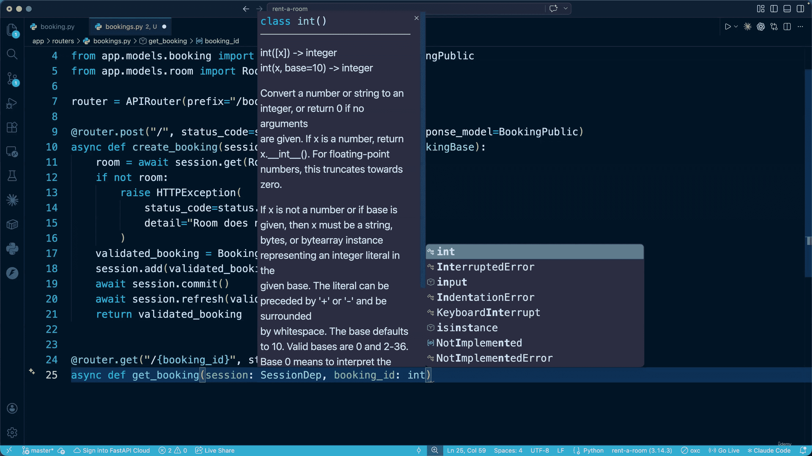

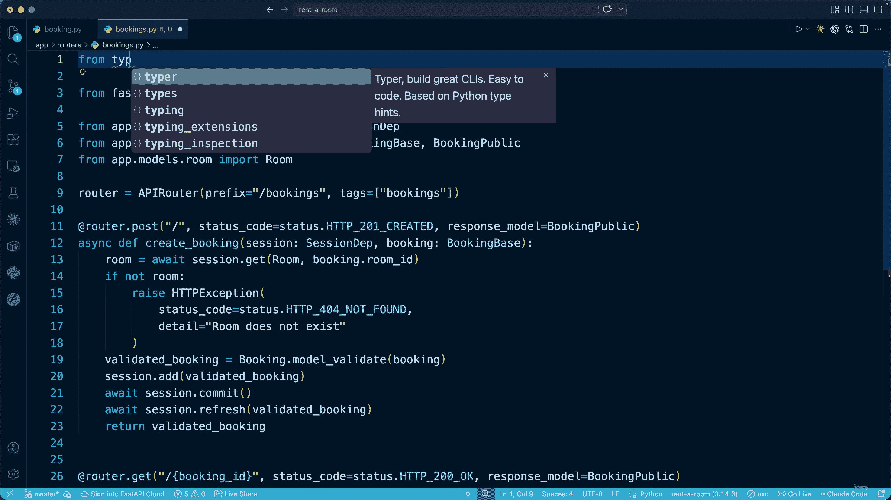

```python
from typing import Annotated
from fastapi import APIRouter, HTTPException, Path, status
from app.models.booking import Booking, BookingBase, BookingPublic
from app.models.room import Room
from app.dependencies.database import SessionDep

router = APIRouter(prefix="/bookings", tags=["bookings"])

@router.post(
    "/",
    status_code=status.HTTP_201_CREATED,
    response_model=BookingPublic,
)
async def create_booking(booking: BookingBase, session: SessionDep):
    room = await session.get(Room, booking.room_id)

    if not room:
        raise HTTPException(
            status_code=status.HTTP_404_NOT_FOUND,
            detail="room does not exist",
        )

    validated_booking = Booking.model_validate(booking)
    session.add(validated_booking)
    await session.commit()
    await session.refresh(validated_booking)

    return validated_booking
```

## 📥 FastAPI Masterclass：第98-99节：创建 GET 预订路由

创建预订的 POST 路由完成后，本节中我们来看看如何编写按 ID 获取预订的 GET 路由。现在一旦创建预订，还想要一个补充路由来获取它。下面再次写 `@router.get`。这里再次可以遵循与房间路由非常相似的模式。会有 `/bookings`，然后斜杠，然后预订标识符。可以作为路径参数提供，因此在花括号里写 `booking_id`。这样它就会作为函数参数可用。如果能够按 ID 检索预订，希望返回状态码 200，即 `status.HTTP_200_OK`。和上面非常像，要确保 `response_model` 是 `BookingPublic` 类。然后下面再次定义 `async` 函数。再次在路由处理函数体中使用 `session`。这个函数可以叫 `get_booking`。再次需要 `session`，类型是 `SessionDep`。然后需要获取实际 `booking_id`，作为路径参数。直接写 `booking_id: int` 完全可以。也可以使用 `Annotated` 写得更明确。例如从 `typing` 导入 `Annotated` 类型。这种方法的优点是，在 `Annotated` 方括号中提供 `int` 后，第二个参数可以提供一个验证函数。例如可能记得 FastAPI 中有 `Path` 函数，为路径参数提供 Pydantic 验证。这里可以提供任意验证，例如 `ge`，即大于等于 1，因为在 SQL 中第一个条目 ID 应该是 1，然后 2，因此 ID 永远不应为负数。这个例子有些过度，是极端示例；如果愿意可以直接标注 `int`，但这里想提醒语法如何工作。现在有 `booking_id` 路径参数。紧接着下面再次使用 `session.get`。这里不像上面路由处理函数那样查询房间，而是实际想按 ID 查询预订。这里传入 `Booking` 模型，第二个参数表示 ID，传入 `booking_id` 路径参数。再次，这会返回预订实例或 `None`。这里赋值给 `booking` 变量，这是可等待操作，因此确保加 `await`。再次遵循与上面非常相似的检查：`if not booking`，意思是如果 `get` 方法返回 `None`，表示该 ID 的预订不存在，就抛出 `HTTPException`。这会非常相似，因此可以复制上面两行异常处理。保留状态码 404 not found，但这里把 `detail` 更新为类似 `"booking does not exist"`。现在如果不进入 `if` 语句，意味着 `booking` 应该是有效的 `Booking` 模型实例，可以简单返回从数据库获取的它。再次，这个方法的 `response_model` 参数会把 `Booking` 模型实例转换成这个形状，然后转换成 JSON。GET 路由的路径参数和查询逻辑可以整理成下面这段代码：

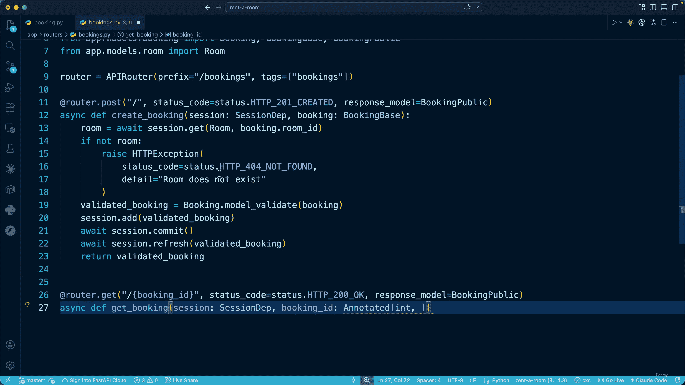

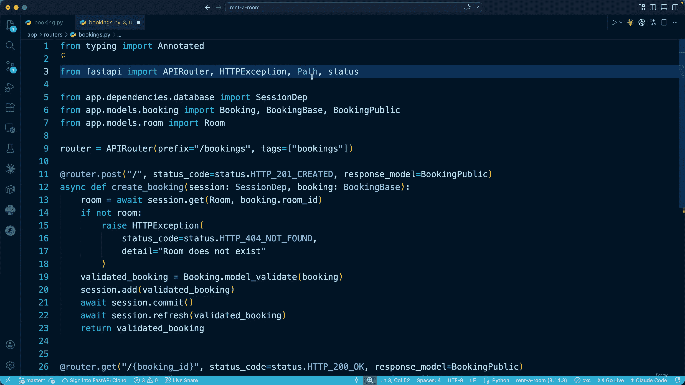

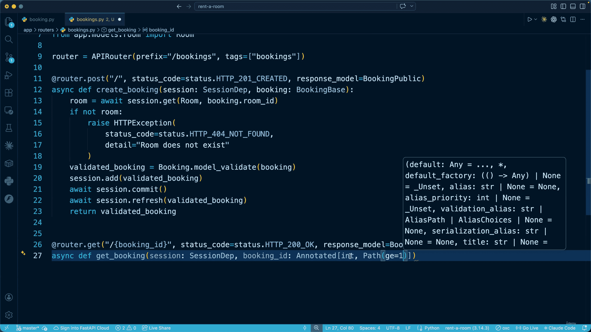

```python
@router.get(
    "/{booking_id}",
    status_code=status.HTTP_200_OK,
    response_model=BookingPublic,
)
async def get_booking(
    booking_id: Annotated[int, Path(ge=1)],
    session: SessionDep,
):
    booking = await session.get(Booking, booking_id)

    if not booking:
        raise HTTPException(
            status_code=status.HTTP_404_NOT_FOUND,
            detail="booking does not exist",
        )

    return booking
```

## 🔗 FastAPI Masterclass：第98-99节：注册预订路由器

两个路由写完后，本节中我们来看看如何把新路由器注册到应用。现在有两个端点：一个创建预订，并使用补充的房间 ID 验证房间存在；创建预订后还可以从数据库获取它。下一节课会测试这两个路由。但趁没忘，还要确保把新预订路由包含到应用设置中。打开 `main.py`，也就是引导应用的地方。这里可以从完全相同的 `routers` 包或目录导入新的 `bookings.py` 文件。然后下面找到所有 `include_router` 调用。这里可以再添加一次 `include_router` 方法调用，从 `bookings.py` 文件访问嵌套 `router`，它附加了 POST 和 GET 两个路由。现在所有内容应该都包含进去了。注册新预订路由时，需要在 `main.py` 中完成下面几件事：

- 从 `app.routers` 导入新的 `bookings` 模块。

- 调用 `app.include_router(bookings.router)`，把预订路由器挂到应用上。

- 确认 POST 和 GET 两个路由都已经附加在这个 `router` 上。

注册代码可以写成下面这样：

```python
from app.routers import bookings

app.include_router(bookings.router)
```

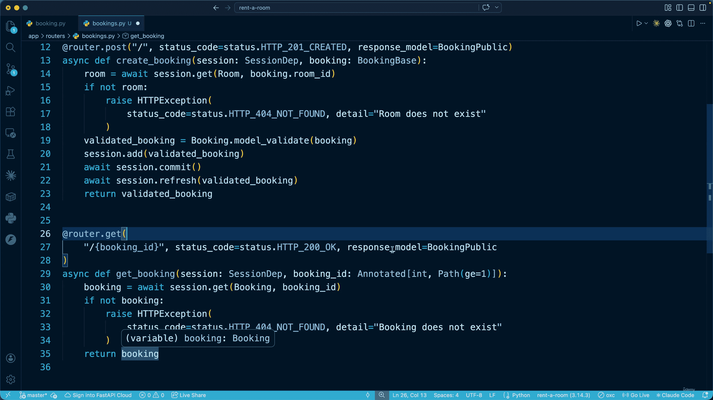

## 🧾 FastAPI Masterclass：第98-99节：本节总结

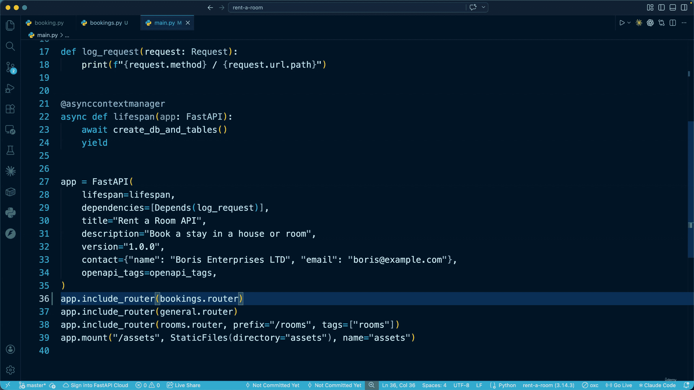

到这里两个路由和注册步骤都完成，本节中我们来看看整体总结。本节课中我们一起学习了如何创建预订路由。我们在 `app/routers/bookings.py` 中创建了预订路由器，设置了 `/bookings` 公共前缀和标签。我们编写了 `POST /bookings` 路由，用 `BookingBase` 接收 payload，用 `session.get(Room, booking.room_id)` 校验房间是否存在，不存在时抛出 404。然后使用 `Booking.model_validate()` 把 `BookingBase` 转成 `Booking`，通过 `add`、`commit`、`refresh` 保存并获取新 ID，最后用 `BookingPublic` 作为响应模型返回。我们还编写了 `GET /bookings/{booking_id}` 路由，用路径参数和 `session.get(Booking, booking_id)` 查询预订，不存在时返回 404，存在时用 `BookingPublic` 返回。最后，我们在 `main.py` 中通过 `include_router` 注册了新的预订路由器。下一节课可以在 Swagger 中测试这两个路由。

