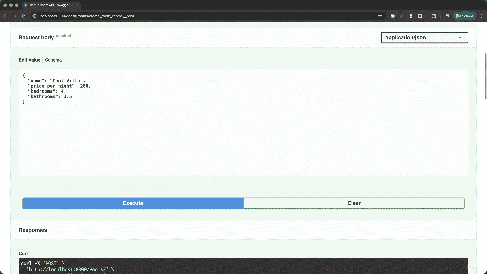
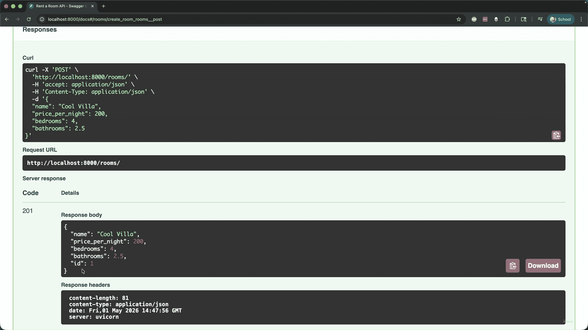
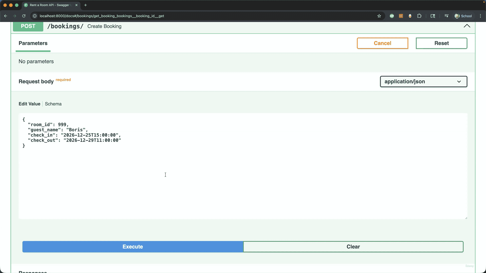
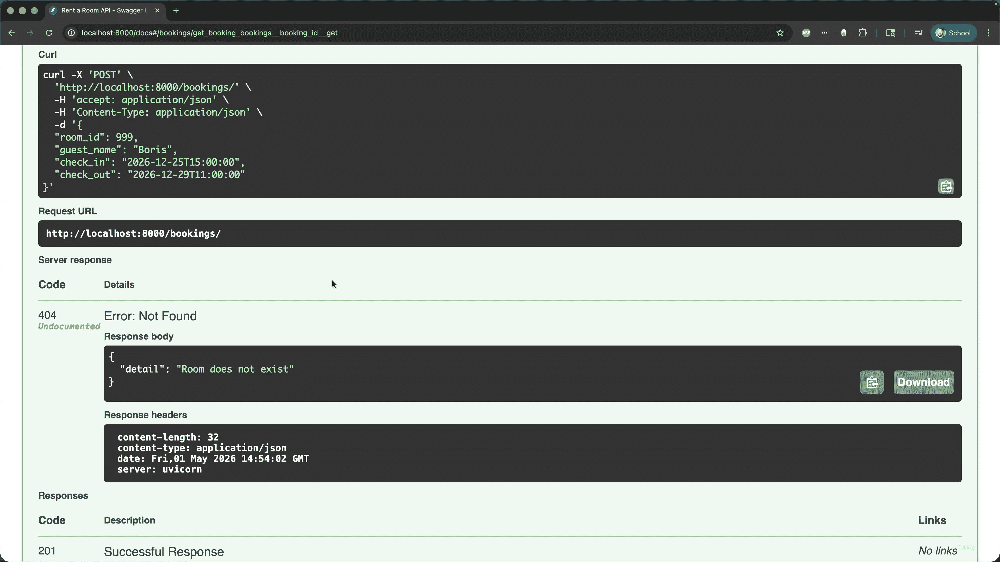
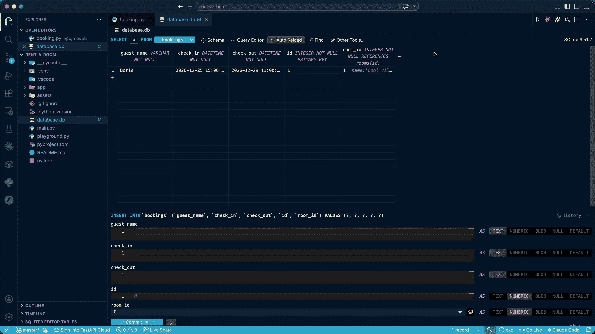

# FastAPI 大师课（第一部分）：第99课：测试预订路由 🧪

在本节课中我们将要学习如何在 Swagger 文档中测试预订相关的两个新路由。整体流程是：先准备一个干净的数据库环境，再创建一个房间并拿到 `room_id`，接着用这个房间 ID 创建预订，然后按 ID 查询预订，最后故意使用无效的房间 ID 验证 404 错误分支。过程中还会理解 Pydantic 模型、ISO 8601 时间字符串和外键关系这几个核心概念。下面按照实际操作顺序展开。

## FastAPI 大师课（第一部分）：第99课：准备干净的数据库环境 🧹

上一段我们说明了本课的整体测试流程，本节先来看测试开始前的环境准备。原文作者提醒，他在本节课开始前删除了数据库 Db 文件，并重启了服务器，因此当前使用的是一套完全干净的数据库。这个动作不是严格必须的，他只是希望读者知道：如果你的数据和示例看起来不完全一样，原因可能就在这里。为了让后续测试有明确起点，以下是他在本节课开始前做过的准备和需要注意的点：

- 删除数据库 Db 文件；

- 重启服务器；

- 当前数据库处于完全干净的状态；





- 删除数据库文件不是严格必要步骤；

- 需要留意自己的数据可能和示例不完全一致。

这些准备动作的目的，是让后续创建房间、创建预订和查询预订时有一个清晰、可复现的起点。完成环境准备后，下一节就可以开始创建房间。

> 提醒：删除数据库文件并重启服务器不是严格必要步骤，这里只是让你知道示例数据为什么可能与你的数据不同。

## FastAPI 大师课（第一部分）：第99课：创建房间并取得 room_id 🏠

上一节我们确认了数据库环境，本节来看看为什么必须先创建一个房间。要创建一条配套的预订记录，必须先有一个房间，因为预订记录需要 `room_id`。这里的核心关系可以写成公式：`booking.room_id → room.id`。在 Swagger 中展开创建房间的路由，点击 Try it out，然后填写一些虚拟数据。示例中填写的是 Cool Villa，每晚 200 美元，4 间卧室，2.5 间浴室。这些数值并不特别重要，它们只是任意填写的示例值。使用 `POST /rooms` 端点创建房间后，可以看到响应中的房间 ID 为 1。这个 ID 就是后面创建预订时要附加的 `room_id`。

创建房间成功后，向下滚动页面，因为预订路由器添加了 bookings 标签，所以两个预订路由会组织在 bookings 标题下面。拿到这个房间 ID 后，下一节就可以用它来创建预订。

## FastAPI 大师课（第一部分）：第99课：用 BookingBase 创建预订 📝

上一节我们拿到了房间 ID，本节开始测试创建预订的 POST 路由。在 bookings 标题下，先测试创建预订的 POST 请求，点击 Try it out。此时 Swagger 会显示名为 `BookingBase` 的 Pydantic 模型结构，这就是客户端创建预订时需要发送给服务器的数据形状。核心流程可以写成下面这样：

```text
客户端 JSON → BookingBase（Pydantic 模型）→ 校验并转换 → 数据库记录
```

在这个请求中，`room_id` 填写刚才创建的有效值 1，其他字段可以随意填写。guest name 填写 Boris。check in 和 check out 字段需要提供表示日期时间或某个时间点的字符串。这里要练习 ISO 8601 时间字符串的写法，它是一种标准化的日期时间表示方式。当前示例暂时忽略时区概念。字符串格式必须写得正确，这样 Pydantic 才能正确解析，并把它转换成 datetime 对象，存储到 Pydantic 模型对应字段上。格式如下：

```text
YYYY-MM-DDTHH:MM:SS
```

具体写法从年份开始，例如 2026，然后写横线、月份 12、横线、日期 25。之后放一个大写字母 T，它表示接下来进入时间部分，可以把它理解成日期和时间的分隔点。时间使用 24 小时制，例如 `15:00:00` 表示下午 3 点，依次写小时、冒号、分钟、冒号、秒。check out 沿用同样的格式，只需调整日期和时间；示例中 check in 是 25 日下午 3 点，check out 是 29 日上午 11 点。这些值同样只是任意填写。完整请求示例可以写成：

```json
{
  "room_id": 1,
  "guest_name": "Boris",
  "check_in": "2026-12-25T15:00:00",
  "check_out": "2026-12-29T11:00:00"
}
```

准备好请求后执行，预期会看到 201 成功状态。下一节我们来看响应体和数据库中的保存结果。

## FastAPI 大师课（第一部分）：第99课：理解 201 响应与外键保存 🔗

上一节我们准备好了创建预订所需的请求数据，本节执行请求并观察结果。提供有效的 `room_id` 后执行请求，应当看到 201 成功状态，同时返回响应体。此时数据库已经成功保存一条新的 bookings 记录，也就是 bookings 表中的一行。可以看到这条记录的 ID 为 1，同时保存了值为 1 的外键，这个外键映射回 rooms 表中 ID 为 1 的第一条房间记录。外键关系可以写成：

```text
bookings.room_id = rooms.id
```

这个结果说明预订创建成功，并且预订记录与房间记录通过外键建立了关联。下一节我们使用 GET 路由把这条预订查询出来。

## FastAPI 大师课（第一部分）：第99课：按 ID 查询单条预订 🔍

上一节我们创建了预订，本节使用 GET 路由进行验证。向下滚动到按 ID 获取单条预订的 GET 路由，展开并点击 Try it out，提供需要的 booking ID。当前只有一条预订，因此填写 1。执行后可以得到 booking 的公开响应结构。这个结构在 POST 响应中已经出现过，但它说明了一个细节：POST 请求传入的数据形状，与服务器返回或 GET 请求返回的数据形状会略有不同，因为返回数据会包含 ID。服务器返回 200，成功获取 ID 为 1 的预订信息。下一节我们测试无效房间 ID 的失败场景。

## FastAPI 大师课（第一部分）：第99课：测试无效 room_id 的 404 分支 🚫

上一节我们验证了正常查询，本节测试错误分支。回想创建预订的 POST 路由，其中会检查 `room_id` 是否有效。再次发送一个创建预订的请求，这次故意使用无效的 `room_id`，例如 999。路由中的逻辑大致如下：

```python
room = session.get(Room, 999)

if room is None:
    raise HTTPException(status_code=404, detail="Room does not exist")
```

`session.get` 方法会查询 rooms 表中是否存在这个 ID。因为不存在 ID 为 999 的行，所以返回 `None`，随后进入路由处理器开头的 if 语句，并抛出 404 异常。执行请求并向下滚动，可以看到 404 错误，表示房间不存在，因此预订没有被创建。如果要在实际数据库中验证，也可以在数据库界面查看。以下是验证时可以观察到的几个点：

- bookings 表中确实存在一条记录；



- room_id 列是外键，引用了 ID 为 1 的房间；

- 在 rooms 表中可以找到 ID 为 1 的房间；

- 房间名称、价格、卧室数量、浴室数量不会在每条预订中重复保存；

- 一张表中的记录可以关联或引用另一张完全独立表中的记录。

这样任何一条预订都能连接回对应的配套房间，而房间记录保存实际信息，从而保证数据合理拆分。这就是外键概念在实际操作中的体现。到这里，房间和配套预订都已经成功创建。

## FastAPI 大师课（第一部分）：第99课：课程总结 ✅





本节课中我们一起学习了如何在 Swagger 中测试预订路由。具体包括：先删除数据库文件并重启服务器准备干净环境；创建房间并取得 `room_id`；理解 `BookingBase` 这个 Pydantic 模型的数据形状；使用 ISO 8601 格式编写 check in 和 check out 时间字符串；通过 `POST /bookings` 创建预订并看到 201 响应；理解 bookings 表通过外键关联 rooms 表；使用 GET 路由按 ID 查询预订并看到 200 响应；最后用无效的 `room_id=999` 验证 404 分支，确认房间不存在时预订不会创建。整套流程完成后，房间和配套预订都成功建立，外键关系也得到实际验证。

