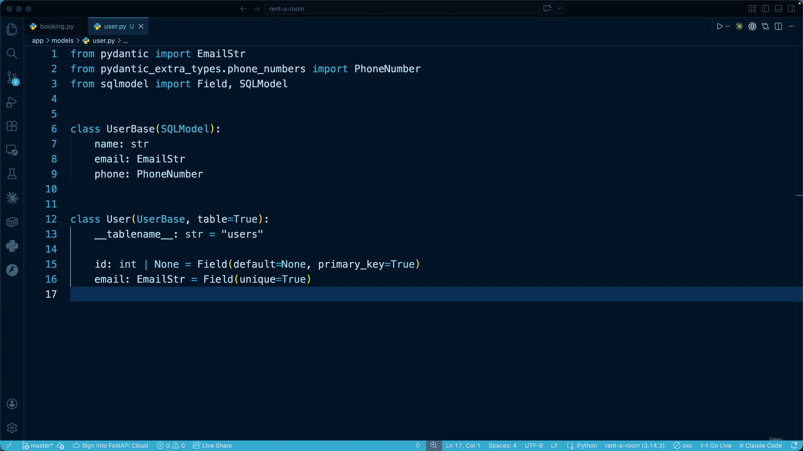
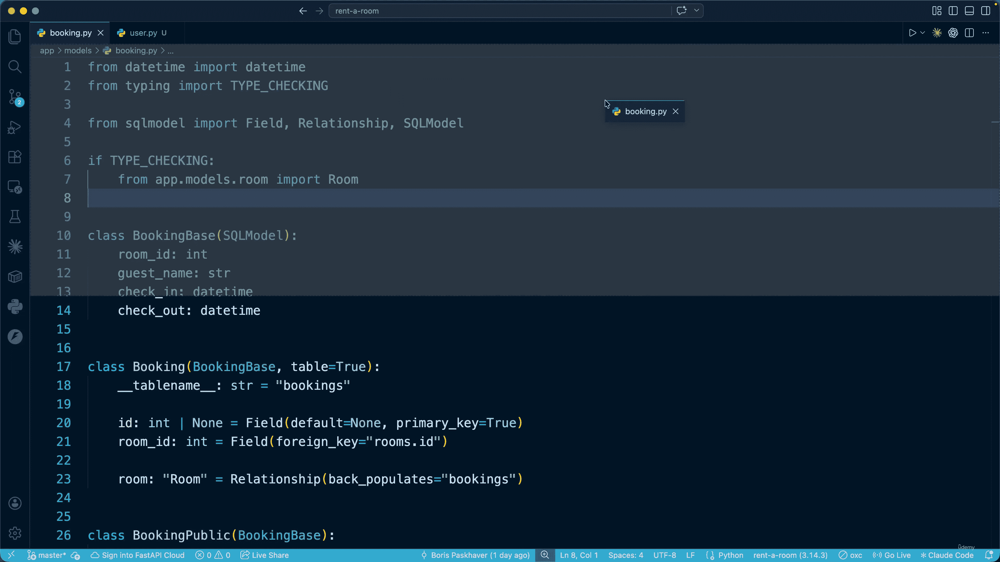
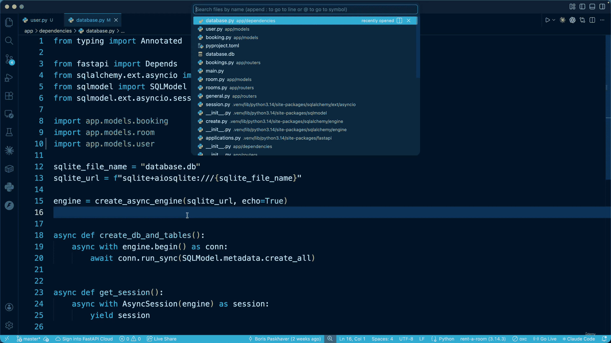
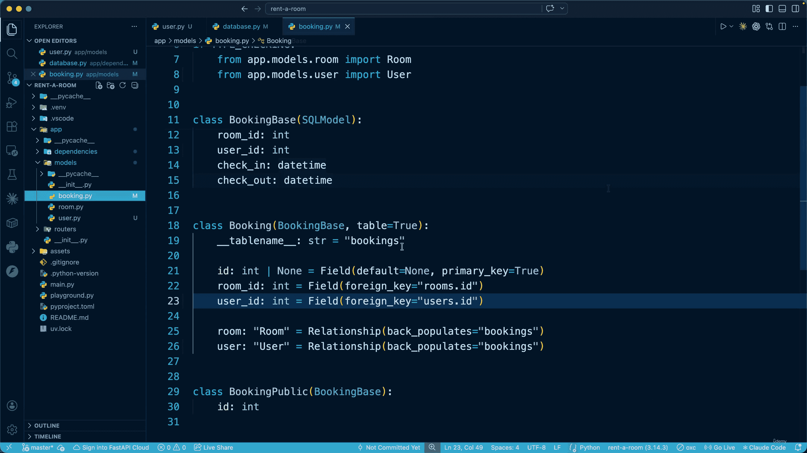
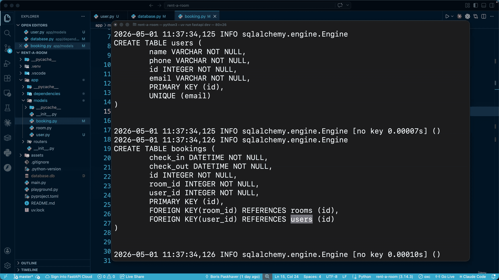

🚀 FastAPI Masterclass Part 2：第102课：创建用户模型

在本节课中，我们将学习如何创建一个新的用户模型，并把它接入到现有的预订系统中。我们会从零开始编写 `user.py` 文件，定义用户的基础字段、数据库映射以及用户与预订之间的关联关系。我们还会顺手改进 Booking 模型，让预订通过外键关联用户，而不是保存一段简单的客人姓名。最后，我们会重置 SQLite 数据库，让 FastAPI 重新生成三张表，验证所有的表结构都符合预期。整个过程会尽量用大白话解释每一步背后的原因。如果你跟着做，你会对 SQLModel 和 Pydantic 的配合有一个清晰的认识。

## 📁 1. 添加 user.py 文件并导入工具类

在上一节课程中，我们已经有了房间模型和预订模型，它们都放在 `app/models` 目录下。现在我们要在这个目录下新增一个文件，用来存放用户相关的模型。这个文件就叫 `user.py`。为什么取这个名字？因为它的主要职责就是定义用户数据结构，让用户这个概念在数据库和接口之间有一个统一的表达。

首先，我们需要导入几个熟悉的工具类。这些工具类我们之前已经用过了，所以它们看起来会非常眼熟。从 `sqlmodel` 中，我们要导入 `Field` 和 `SQLModel`。`Field` 用来给字段添加额外的约束信息，比如默认值、主键、唯一性等；而 `SQLModel` 则是我们所有模型类的基类。

```python
from sqlmodel import Field, SQLModel
```

有了这些导入之后，我们就可以创建一个名为 `UserBase` 的类，并且让它继承 `SQLModel`。这个类本质上就是一个普通的 Pydantic 模型，因为 SQLModel 本身就是基于 Pydantic 构建的，所以它具备 Pydantic 的所有数据验证能力。你可以在任何一个 FastAPI 项目中把它当作一个数据模式来使用，它不依赖于数据库。

在这个基础模型中，我们要定义所有用户都必须要有的公共字段。首先，每个用户都会有一个名字，我们把它设为字符串类型。名字当然可以用数字或者其他类型，但在我们当前的场景下，名字就是一段文本，所以用 `str` 是最合适的。接着，每个用户还会有一个电子邮箱地址，我们也把它定义成一个字段。注意，这里我们先不着急写死类型，因为之后我们会用更专业的类型来替换它。

```python
class UserBase(SQLModel):
    name: str
    email: str
```

看到这里，你可能会好奇，为什么我们只是定义了一个基础模型，不直接把所有字段都放在一个类里？这是因为在 SQLModel 的设计中，我们常常会把“输入模型”“数据库模型”“输出模型”分开，让它们各自承担不同的职责。`UserBase` 就是这些模型之间的公共基础部分，后面创建的 `User` 数据库模型和 `UserPublic` 响应模型都会继承它，从而避免重复代码。

## 🔐 2. 暂时不处理认证，但邮箱要更严谨

在我们的真实业务中，认证是一个绕不开的话题。认证是什么？简单来说，认证就是用户登录系统的过程。你可以想象一下 Airbnb 的使用流程：你先要登录自己的账号，然后才能去下单预订房源。没有登录，系统根本不知道你是谁，也不知道该把预订关联到哪个用户头上。不过，在目前的阶段，我们暂时不打算引入完整的认证机制，而是先把用户模型的基础搭好，让整个数据结构先跑起来。

但有一个地方我们不想放过，那就是邮箱字段。如果我们只是简单地把邮箱定义成 `str`，这其实已经比用错误的类型好多了，但还不够严谨。为什么？因为邮箱并不是一段普通的字符串，它有着固定的格式：前面是用户名部分，然后是 `@` 符号，最后是一个域名。比如 `alice@example.com` 就是典型的三段式结构。如果我们只使用 `str`，那任何字符串都能通过验证，比如 `"hello"` 这种明显不是邮箱的值也会被当作合法数据接收。

Pydantic 非常擅长处理这类数据验证，它自带了很多实用类型，其中就包括专门用于邮箱的类型。我们只需要从 `pydantic` 中导入 `EmailStr`，这个名称是 email string 的缩写。`EmailStr` 会在数据进入服务器时自动检查：首先它必须是一个字符串，其次这个字符串必须遵循合法的邮箱格式。如果我们之后创建了一个 POST 端点，用来创建新用户，那么每次请求到达服务器时，Pydantic 都会先执行这个验证，然后再把请求交给路由处理函数。一旦验证失败，比如用户填写的邮箱缺少 `@`，Pydantic 会立刻抛出错误，路由处理函数根本不会执行。这种提前拦截错误的能力非常有用，可以省去我们在业务逻辑里写一堆手动判断的麻烦。

所以，我们把 `UserBase` 中的邮箱字段改成 `EmailStr`：

```python
from pydantic import EmailStr

class UserBase(SQLModel):
    name: str
    email: EmailStr
```

你可以把 `EmailStr` 想象成一个带有智能检查的字符串，它比 `str` 更专业，也更安全。以后凡是进来做邮箱校验的地方，它都能帮我们挡住明显不合法的那部分输入。

## 📞 3. 给用户加上电话号码字段，并使用 PhoneNumber 类型

除了姓名和邮箱，我们还希望记录用户的电话号码。电话号码同样不是普通字符串，它有特定规则：必须是一串数字，数字之间可能有分隔符，不同的国家或地区还有不同的格式习惯。如果我们用普通的 `str` 来接收电话，那么用户随便输入一些字母也能蒙混过关，这显然不合理。

这时候，我们可以再次借助 Pydantic 的验证能力。不过这次我们要使用的类型不在核心的 `pydantic` 库中，而是在一个补充库 `pydantic-extra-types` 里。为什么会被放在额外库里？原因很简单，Pydantic 的核心开发者不希望把太多额外类型塞进主库，导致主库过于臃肿。这些额外类型是一些相对可选、你可能不会经常用到的验证器，但它们同样属于 Python 生态的一部分。我们把它们放到独立补充库中，按需导入即可。

在我们的项目依赖中，这个库已经通过 `pyproject.toml` 配置好了，所以你不需要额外安装。接下来，我们直接从 `pydantic_extra_types` 中导入电话类型。这个库的内部还做了一个嵌套包，叫做 `phone_numbers`，我们的目标就是从这个包里面导入 `PhoneNumber` 类。

```python
from pydantic_extra_types.phone_numbers import PhoneNumber
```

看到这里，你可能会想，`PhoneNumber` 到底是什么？它是一个类，也是一个复杂的验证器。你可以把它理解成和 `EmailStr` 一样的东西，也可以把它类比成 FastAPI 中的 `Query`、`Cookie`、`Path`。这些东西本质上都是针对某个字段的复杂验证器，它们负责在合适的时候检查字段的值是否合法。所以，我们只要在 `UserBase` 中把 `phone` 字段的类型声明为 `PhoneNumber`，后续的验证就交给它了：

```python
class UserBase(SQLModel):
    name: str
    email: EmailStr
    phone: PhoneNumber
```

现在，每当一个请求到达某个端点，只要它携带了 `phone` 字段，Pydantic 就会检查这个字段是否存在、内容是否是文本、文本是否真正构成了一个合法电话号码。比如数字位数对不对、分隔符是否符合惯例、是不是符合特定国家的号码规则等等。因为这种验证是绑定在模型上的，所以无论这个模型是被用在哪个端点上，只要有人实例化 `UserBase`，验证就会自动生效。换句话说，模型不需要知道自己被哪个端点使用，它只管保证自己的字段是合格的。

## 🗄️ 4. 创建真正与数据库交互的 User 模型

到目前为止，我们定义的 `UserBase` 只是一个普通的基础数据模型，它还不能直接对应数据库中的表。现在，我们要开始创建真正的用户模型了，这个模型将负责与数据库交互。我们把它的类名定为 `User`，并让它继承 `UserBase`。这样，`User` 就会自动获得 `name`、`email`、`phone` 这些字段，并且不需要重复编写这些字段的定义。

接下来，我们需要按照之前创建 `Room` 和 `Booking` 模型时的老规矩，给 `User` 类加上 `table = True`。这个参数非常重要，因为只有设置了 `table = True`，SQLModel 才会把这个类映射成一张真正的数据库表。如果你忘记加这个东西，那这个类就只是一个普通的 Pydantic 模型，根本不会进入数据库。

此外，我们还要为数据库表指定一个复数形式的表名。SQLAlchemy 中有一种惯例，就是表名通常使用复数形式，这样从语义上更自然。我们可以通过设置 `__tablename__` 属性来明确指定表名，类型是字符串。我们这里把表名从默认的 `user` 改成 `users`，因为一张表里会存很多用户，`users` 这个名字更贴切。

```python
class User(UserBase, table=True):
    __tablename__: str = "users"

    id: int | None = Field(default=None, primary_key=True)
```

在上面的代码中，我们还定义了一个 `id` 字段，它用于充当这张表的主键列。这个字段的类型是 `int | None`，为什么不是单纯的 `int`？这是因为 `User` 实例有可能是在保存到数据库之前被创建的，此时数据库还没有分配 ID，所以 `id` 为 `None`；也有可能是从数据库中取出来的已有记录，这时候 `id` 就会有具体的整数值。通过 `Field(default=None, primary_key=True)`，我们告诉 SQLModel：这个字段默认是空值，但它至关重要，是数据库表的主键。

这里有一个小细节值得我们注意：我们在 `User` 中重新覆盖了 `email` 字段，并再次使用了 `EmailStr` 类型。为什么我们明明在 `UserBase` 中已经定义了 `email`，还要在子类中重复一遍？这是因为我们想添加一个数据库层面的约束：确保每个用户的邮箱地址是唯一的。`EmailStr` 是 Pydantic 层面的验证，它只关心字符串格式是否正确，并不关心这个邮箱是否在数据库里已经存在。唯一性约束完全属于数据库的职责，与 Pydantic 无关。所以，我们必须在 `User` 这个数据库模型中重新声明 `email` 字段，并通过 `Field` 给它加上 `unique=True` 配置。

```python
from sqlmodel import Field, SQLModel

class User(UserBase, table=True):
    __tablename__: str = "users"

    id: int | None = Field(default=None, primary_key=True)
    email: EmailStr = Field(unique=True)
```

这样做的实际效果是：如果请求发来一个格式合法的邮箱，比如 `alice@example.com`，但这个邮箱在数据库中已经存在，那么 SQLModel 就会抛出一个单独的异常，因为它违反了唯一性约束。这个异常独立于 Pydantic 的邮箱格式验证，属于数据库那层的东西。有了这个约束，我们就不用自己在代码里写查询去判断邮箱是否重复，数据库会直接帮我们兜底。

## 🔗 5. 建立用户与预订之间的关联关系





用户模型已经具备了基本字段和数据库映射，但还缺少一个重要的东西：它和预订模型之间有什么关系？在我们的业务中，一个用户可以拥有多个预订，而一个预订只能属于一个用户。这种“一对多”的关系非常常见，就像我们之前看到的房间和预订的关系一样。一个房间可以关联多个预订，但每个预订只关联一个房间。现在，用户和预订也要建立类似的关联。

为了在代码中实现这种关联，我们需要修改 `booking.py` 模型文件，同时也要回头调整 `user.py`。我们先从 `user.py` 这边开始，因为我们需要在 `User` 类中增加一个属性，用来表示该用户的所有预订。

为了实现类型提示，我们需要使用 `TYPE_CHECKING`。这是一种特殊的技术，它可以让 Python 在类型检查时导入某些模块，但在运行时不会真正导入，从而避免潜在的循环导入问题。我们需要在 `user.py` 的开头加上这段代码：

```python
from typing import TYPE_CHECKING, List

if TYPE_CHECKING:
    from app.models.booking import Booking
```

为什么要这样写？因为 `User` 和 `Booking` 是互相依赖的：`User` 中要引用 `Booking`，而 `Booking` 中也要引用 `User`。如果在这里直接导入 `Booking`，很容易引发循环导入错误。使用 `TYPE_CHECKING` 之后，Python 在真正运行的时候不会导入 `Booking`，但类型检查器和 IDE 却能够正确识别类型。

接下来，我们要使用 `relationship` 函数，它是 SQLModel 提供的一个方便工具，用于建立数据库模型之间的对象关系。我们先从 `sqlmodel` 中导入 `relationship`：

```python
from sqlmodel import Field, Relationship, SQLModel
```

现在，在 `User` 类中添加 `bookings` 属性。这个属性的类型是一个列表，列表中的每一项都是 `Booking` 的实例。如果用户没有任何预订，这个列表就是空的。通过这个属性，我们可以从任意一个用户实例出发，轻松获取该用户的全部预订记录，就像在房间模型中可以通过 `bookings` 获取该房间的所有预订一样。

```python
class User(UserBase, table=True):
    __tablename__: str = "users"

    id: int | None = Field(default=None, primary_key=True)
    email: EmailStr = Field(unique=True)

    bookings: List["Booking"] = Relationship(back_populates="user")
```

这里我们给 `bookings` 赋值为 `Relationship(back_populates="user")`。其中 `back_populates` 指定的是互补模型上用来反向查找的属性名。也就是说，在 `Booking` 模型中，会有一个 `user` 属性，当我们拿到一个 `Booking` 实例时，可以通过 `booking.user` 找到这个预订对应的用户。`bookings` 和 `user` 这两个属性互为镜像，共同完成双向导航。

接下来我们转向 `booking.py`，因为我们要在 `Booking` 模型中也加入对应的关系。在 `Booking` 模型中，我们需要添加一个 `user` 属性，类型为 `User`，并通过 `relationship` 指向用户实例。同时，我们要导入 `User` 模型，并且为了保持一致性，我们也需要使用 `TYPE_CHECKING` 做条件导入。这样，每个预订实例都能通过 `user` 属性访问到它所属的用户，而每个用户实例也能通过 `bookings` 属性访问到它的全部预订。

```python
from typing import TYPE_CHECKING, List, Optional
from sqlmodel import Field, Relationship, SQLModel

if TYPE_CHECKING:
    from app.models.user import User

class BookingBase(SQLModel):
    check_in: datetime
    check_out: datetime
    room_id: int = Field(foreign_key="rooms.id")

class Booking(BookingBase, table=True):
    __tablename__: str = "bookings"

    id: int | None = Field(default=None, primary_key=True)
    room_id: int = Field(foreign_key="rooms.id")
    user_id: int = Field(foreign_key="users.id")

    room: "Room" = Relationship(back_populates="bookings")
    user: "User" = Relationship(back_populates="bookings")
```

看到这里，你可能会注意到，我们在 `User` 模型中通过 `bookings` 与 `Booking` 关联，而在 `Booking` 模型中通过 `user` 与 `User` 关联。这两个关系其实是成对出现的，所以我们在 `Room` 模型中已经用过的 `back_populates` 参数在这里也有完全相同的含义。一个房间可以有很多预订，一个用户也可以有很多预订；反过来，一个预订只有一个房间，也只有一个用户。这样，我们的模型就形成了完整的关系网。

## 📦 6. 添加 UserPublic 响应模型

我们已经有了 `UserBase` 和 `User`，接下来还需要一个专门用于接口响应的模型。这是为什么？因为在实际开发中，我们通常不希望把数据库模型的所有字段都直接暴露给客户端。比如，数据库模型可能包含一些内部字段，或者我们只想返回一部分核心信息。为了避免这种额外复杂度，我们可以创建一个继承 `UserBase` 的新模型，命名为 `UserPublic`。

`UserPublic` 和之前的 `RoomPublic`、`BookingPublic` 模式非常相似。它继承了 `UserBase` 的所有字段，并且额外增加一个 `id` 字段，这个字段被声明为整数类型，并且总是存在。也就是说，当接口需要返回用户信息时，我们可以使用这个模型作为统一的响应格式。

```python
class UserPublic(UserBase):
    id: int
```

这个模型虽然看起来很简单，但它在接口设计中的作用很大。当我们的用户端点收到请求并完成处理后，我们可以把数据库查询到的 `User` 对象转换成 `UserPublic` 对象，这样客户端看到的就是一个稳定、干净的用户数据格式，不包含任何数据库专属信息。以后如果我们要调整数据库结构，也不会直接影响到客户端接口。

## 🔄 7. 注册用户模型并调整 Booking 模型

完成 `user.py` 后，我们还有一个很重要的步骤：让 FastAPI 在启动时能识别到这个新模型。要做到这一点，我们需要在 `database.py` 中导入 `app.models.user` 模块。为什么需要这样导入？因为 SQLModel 在创建数据库表之前，需要知道所有应该创建的表。如果某个模型没有被导入，SQLModel 根本不知道它的存在，自然也就不会为它生成表。

所以，我们在 `database.py` 中加入一行导入语句：

```python
import app.models.user
```

这样做的效果是，当 Python 加载 `database.py` 时，它会顺带读取 `app.models.user` 文件的内容，从而把 `User` 模型注册到 SQLModel 中。等到后续执行建表代码时，SQLModel 就会在数据库中生成 `users` 表。这行导入语句非常关键，不要遗漏。



到此为止，我们的用户模型文件就基本完成了。不过，这里还遗留了一个与预订模型相关的细节，差点被我忘掉。我们需要回去修改 `booking.py` 中的预订模型，因为现在我们已经有了真正的外键指向用户表中的用户，原本用来存储客人姓名的 `guest_name` 字段就不再必要了。它只是我们当初开始搭建示例时的一个临时产物，用来在预订中保存客人的姓名。现在，预订只需要存储房间的 ID 和用户的 ID，就可以完整地表达出预订关系了。

这也意味着，以后当客户端发送 POST 请求到 `/bookings` 端点时，请求负载中不仅要提供 `room_id`，还要提供 `user_id`。否则，系统怎么知道这个预订对应的用户是谁？所以，新的预订负载应该包含以下四个内容：

- `room_id`：房间的 ID。
- `user_id`：用户的 ID。
- `check_in`：入住时间。
- `check_out`：退房时间。

我们在 `BookingBase` 中添加 `user_id` 字段，它的类型是整数，表示用户的 ID。

然后，在 `Booking` 类中也要添加 `user_id` 字段。这个字段会映射到 `bookings` 表中的一列，和 `room_id` 列一样，是一个具体的数据库列。现在 `bookings` 表会有两个外键：`room_id` 引用 `rooms` 表的 `id` 列，`user_id` 引用 `users` 表的 `id` 列。正是这两列，把预订和房间、用户都连接起来了。

其实，从逻辑上说，我们应该先写这个外键字段，因为它才是真正让关联存在的东西。`relationship` 关系是锦上添花，它让我们可以方便地从一个预订导航到用户，但如果缺少了外键，这个关系就没有实际支撑。外键字段建立了真实的数据库约束，它保证 `bookings` 表中的 `user_id` 列里的任何整数，都必须是 `users` 表中存在的有效用户 ID 记录。这样，数据库就能从底层保证数据完整性。

## 🧹 8. 重置 SQLite 数据库，让表结构重新生成

修改完模型之后，我们保存所有文件。这时你会发现，当前的数据库还是旧的表结构。如果你查看 `bookings` 表，里面还留有旧数据，比如 `guest_name` 那样的字段。在真实项目中，数据库结构发生变化时，你通常需要使用迁移工具来处理，比如 Alembic。不过现在我们使用的是 SQLite，而且我们的代码和数据都是可以随时丢弃的，所以处理起来就简单粗暴多了。

最简单的办法是什么？直接删除数据库文件，然后重启服务器，让 FastAPI 重新生成所有表。这样做的好处是，我们能确保新模型中的所有约束和关联都完整地建立起来，包括新的 `user_id` 外键列。我们来演示一下：先在终端中按 `Ctrl+C` 停掉当前运行的服务器，然后删除那个 `.db` 文件。

接下来，我们重新启动 FastAPI 开发服务器，执行命令：

```bash
uv run fastapi dev
```

服务器启动后，FastAPI 会发现数据库文件不存在了，于是它会自动帮我们创建三张全新的表。FastAPI 会创建三张表，分别是：

- `rooms` 表：保存房间数据。
- `users` 表：保存用户数据。
- `bookings` 表：保存预订数据，同时连接房间和用户。

在 `users` 表中，你会发现我们在模型中定义的所有字段都一一对应存在，包括 `email` 列上的唯一约束。而在 `bookings` 表中，你可以看到它现在已经不止一个外键了，而是有两个外键：`room_id` 和 `user_id`。其中 `room_id` 指向 `rooms` 表，`user_id` 指向 `users` 表。



这一切都验证无误后，我们的用户模型和相应的关联关系就准备好了。现在，所有的模型结构清晰，关系完整，可以继续往下开发了。下一步，我们将会创建一个新的用户路由，用来在网站上创建新用户。通过这个路由，客户端可以发送带用户信息的请求，我们的系统会创建对应的用户记录，并返回一个规范的响应。

## 🎯 总结

本节课我们完成了一个非常重要的步骤：从零创建了用户模型。首先，我们建立了 `UserBase` 基础模型，定义了用户的名字、邮箱和电话字段；接着，我们引入了 `EmailStr` 和 `PhoneNumber` 类型，让 Pydantic 在数据入口处就能校验邮箱格式和电话号码格式。然后，我们创建了数据库模型 `User`，通过 `table=True` 把它映射到 `users` 表，设置了主键 `id`，并通过 `Field(unique=True)` 确保邮箱在数据库层面唯一。

我们还为 `User` 和 `Booking` 建立了双向关系：一个用户可以有多个预订，一个预订只能属于一个用户。通过在两个模型之间使用 `relationship` 和 `back_populates`，我们可以在代码中自由地双向导航。同时，我们添加了 `UserPublic` 响应模型，用于将来接口返回统一格式的用户数据。



最后，我们修改了 `Booking` 模型，用 `user_id` 外键替代了临时的 `guest_name` 字段，并删除了旧数据库、重启了服务器，最终看到 FastAPI 自动创建了包含正确外键的三张表。整个过程中，我们特别关注了 Pydantic 验证与数据库约束之间的区别，也理解了外键与关系之间的合作关系。下一节课，我们将基于这些模型创建用户相关的路由，实现真正的用户创建功能。
