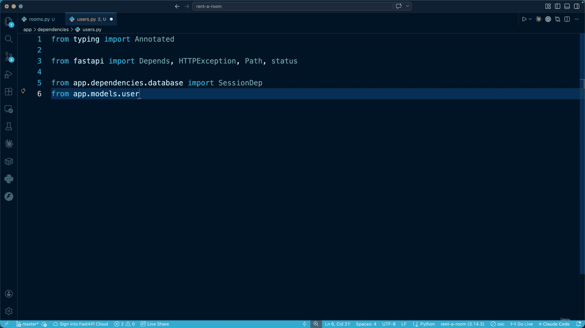
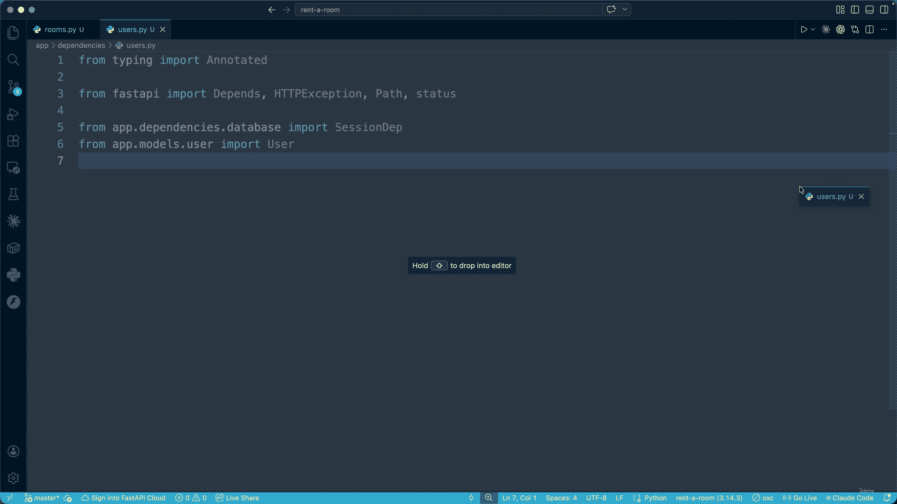
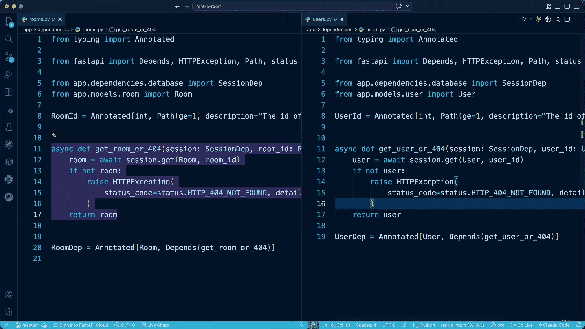

# 🧩 FastAPI 大师课：103：提取依赖

## 📖 FastAPI 大师课：103：课程概述

在本节课中我们将要学习如何把 FastAPI 路由文件里的依赖定义提取到独立文件中，让路由文件更小、更专注。下一节课我们会创建新的用户路由，用来支持创建用户、获取用户，以及获取某个用户的预订记录。不过在进入用户路由之前，本节课先在房间路由里做一次快速重构，并把这次重构形成的模式沿用到后续用户路由中。

理解本节课的目标后，本节先看当前房间路由文件的结构，弄清楚哪些代码属于路由处理器，哪些代码属于依赖定义。这样后续拆分时就不会把职责混在一起。

## 🗂️ FastAPI 大师课：103：当前房间路由的结构

上一节说明了本节课的目标，本节来看 `app/routers/rooms.py` 的现状。在这个文件里向下滚动，可以看到下方是各个路由处理器，同时文件里还放着一些依赖定义。也就是说，路由定义和依赖定义目前混在同一个文件中，文件职责并不单一。

当前房间依赖的核心结构可以用下面的代码表示。这里的 `RoomId` 对应 FastAPI 的路径校验函数，`get_room_or_404` 是一个互补依赖，`RoomDep` 则用 `Depends` 调用这个依赖函数。

```python
RoomId = Annotated[int, Path(ge=1, description="The ID of the room to fetch")]

def get_room_or_404(room_id: RoomId, session: SessionDep) -> Room:
    room = session.get(Room, room_id)
    if room is None:
        raise HTTPException(
            status_code=status.HTTP_404_NOT_FOUND,
            detail="Room not found",
        )
    return room

RoomDep = Annotated[Room, Depends(get_room_or_404)]
```

这段代码表达的含义是：`RoomId` 使用路径校验函数，从路径中提取房间 ID；`get_room_or_404` 使用数据库会话，根据路径中传来的房间 ID 查询数据库中的房间记录，如果房间不存在就抛出异常，如果存在就返回房间对象；`RoomDep` 使用 `Depends` 调用 `get_room_or_404`，让路由可以直接声明一个已经校验过的房间依赖。

用户路由也会采用非常相似的模式。用户路由需要从路径参数中提取用户 ID，也需要在多个路由中执行“获取用户，不存在就返回 404”的逻辑。这个模式和房间路由本质相同，只是换了一个模型、换了一个资源。

理解当前结构后，下面进入本课的核心操作：把所有依赖从路由文件中移出去，让依赖可以独立存在。

## ✂️ FastAPI 大师课：103：把房间依赖拆到独立文件

上一节看清了房间路由中依赖的位置，本节把依赖移动到 `app/dependencies/rooms.py`。这样拆分代码可以保持每个文件更小，让路由文件专注于路由本身的定义，而不是同时承担依赖定义。

在 `app/dependencies` 文件夹中，目前只有数据库相关依赖。下面列出本节要做的文件操作与导入调整，先创建新文件，再迁移代码，最后修正导入。

- 在 `app/dependencies` 中创建 `rooms.py`，作为房间依赖文件。

- 从 `app/routers/rooms.py` 中剪切从 `RoomId` 到 `RoomDep` 的依赖定义，粘贴到新文件中。

- 在新文件中导入 `Annotated`、`Path`、`SessionDep`、`Room`、`HTTPException`、`status` 和 `Depends`。

- 在 `app/routers/rooms.py` 中删除不再使用的 `Path` 导入，并从 `app.dependencies.rooms` 导入 `RoomDep`。

完成这些调整后，`app/dependencies/rooms.py` 中的代码结构如下。这个文件只负责房间相关依赖，路由文件只负责路由处理器。

```python
# app/dependencies/rooms.py
from typing import Annotated

from fastapi import Depends, HTTPException, Path, status

from app.dependencies.database import SessionDep
from app.models.room import Room

RoomId = Annotated[int, Path(ge=1, description="The ID of the room to fetch")]

def get_room_or_404(room_id: RoomId, session: SessionDep) -> Room:
    room = session.get(Room, room_id)
    if room is None:
        raise HTTPException(
            status_code=status.HTTP_404_NOT_FOUND,
            detail="Room not found",
        )
    return room

RoomDep = Annotated[Room, Depends(get_room_or_404)]
```

迁移完成后，需要在 `app/routers/rooms.py` 中检查原有路由处理器是否正常。向下滚动可以看到，路由处理器本身没有问题，只是缺少 `RoomDep` 的导入。这个依赖会在路由参数中通过 `Depends` 调用依赖函数来获取房间对象，并且在下方多个位置被使用，一共出现三次。

因此，在 `app/routers/rooms.py` 中补充导入即可。导入路径是从 `app` 包进入 `dependencies` 包，再从新的 `rooms` 文件导入 `RoomDep`。

```python
from app.dependencies.rooms import RoomDep
```

完成导入后，房间路由文件已经清理干净，房间路由的重构就完成了。房间依赖拆分完成后，下面提前处理用户依赖，因为后续用户路由会复用同样的模式。

## 👤 FastAPI 大师课：103：提前创建用户依赖文件

上一节完成了房间依赖的拆分，本节创建用户依赖文件 `app/dependencies/users.py`。因为已经可以预见用户路由会需要类似的“从路径提取用户 ID，再获取用户，不存在就返回 404”的功能，所以这里提前建立对应的用户依赖。

需要说明的是，正常开发中通常无法提前知道未来需要什么依赖。更常见的做法是先声明路由处理器，观察多个路由处理器有哪些共同逻辑，再把这些共同逻辑提取成依赖，最后根据需要把依赖移动到独立文件。本次之所以提前重构，是因为已经知道后续课程会用到这些功能。下面列出用户依赖文件需要的导入项与定义项。

- 从 `typing` 导入 `Annotated`。



- 从 `fastapi` 导入 `Depends`、`HTTPException`、`Path` 和 `status`。

- 从 `app.dependencies.database` 导入 `SessionDep`，用于数据库会话。

- 从 `app.models.user` 导入 `User`，用于查询用户模型。

- 定义 `UserId`、`get_user_or_404` 和 `UserDep` 三个核心对象。



用户依赖文件和房间依赖文件的模式几乎一样，可以直接对照编写。核心代码如下，`UserId` 使用路径校验函数限制用户 ID 大于等于 1，`get_user_or_404` 查询用户并在不存在时抛出 404，`UserDep` 使用 `Depends` 包装依赖函数。

```python
# app/dependencies/users.py
from typing import Annotated

from fastapi import Depends, HTTPException, Path, status

from app.dependencies.database import SessionDep
from app.models.user import User

UserId = Annotated[int, Path(ge=1, description="The ID of the user to fetch")]

def get_user_or_404(user_id: UserId, session: SessionDep) -> User:
    user = session.get(User, user_id)
    if user is None:
        raise HTTPException(
            status_code=status.HTTP_404_NOT_FOUND,
            detail="User not found",
        )
    return user

UserDep = Annotated[User, Depends(get_user_or_404)]
```

这段代码的含义是：在某个路由中，路径参数会被解析成 `UserId`，依赖函数会在路由处理器之前运行，用传入的用户 ID 查询用户模型。查询结果可能是用户对象，也可能是 `None`。如果结果是 `None`，就抛出 404，唯一的区别是这里提示“用户未找到”，而不是“房间未找到”。如果查询到了用户，就在函数下方返回实际用户对象。

这和房间依赖的功能完全一致，都是把“根据路径参数获取对象并确认对象存在”的逻辑提取出来。后续用户路由会反复需要这个能力，因此把它做成用户依赖是合理的。需要再次提醒，一般不建议在代码真正需要之前做优化和重构，否则可能留下未使用代码；本次是明确知道下一节课会使用这些功能，所以提前完成重构。

用户依赖建好后，还需要理解依赖注入的关键写法，尤其是 `Depends` 中传入未调用函数这一点。下面收束两个依赖文件的共同模式。

## 🧠 FastAPI 大师课：103：依赖注入的关键点

上一节写完了用户依赖文件，本节说明两个依赖文件共同的关键点。和 `RoomDep` 一样，`UserDep` 是一个类型别名，用来声明依赖函数的返回值类型。只要依赖函数执行成功，路由中拿到的就是有效的用户对象。

核心公式可以写成下面这样。`Depends` 中必须传入未调用的依赖函数，不能写成调用后的结果。

```python
UserDep = Annotated[User, Depends(get_user_or_404)]  # 正确：传入函数本身

# 错误示例：Depends(get_user_or_404()) 会提前调用函数
```

完成这个声明后，在任何路由中都可以提供一个类型为 `UserDep` 的参数。这个参数会触发依赖函数执行，确保当前请求拥有有效用户。路由处理器开始运行时，就已经可以确定用户有效，因为如果用户无效，依赖阶段已经返回 404，路由处理器根本不会开始运行。

> 正常做法是先写路由处理器，再提取共同依赖；本次因为已知后续内容，所以提前重构。

理解这个关键点后，两个依赖文件就都准备就绪，下一节课可以继续构建用户路由。

## ✅ FastAPI 大师课：103：总结

前面各节分别介绍了当前房间路由的结构、房间依赖的拆分、用户依赖文件的创建，以及依赖注入的关键写法。本节对整节课的内容做一次收束。



本节课中我们一起学习了如何把房间依赖从 `app/routers/rooms.py` 移到 `app/dependencies/rooms.py`，如何更新导入并检查路由中的 `RoomDep` 使用位置，如何提前创建 `app/dependencies/users.py`，以及如何用 `UserId`、`get_user_or_404` 和 `UserDep` 组成用户依赖。核心模式是使用 `Annotated`、`Path`、`SessionDep` 和 `Depends`，把路径校验、数据库查询与 404 处理封装成可复用依赖，让路由文件更小、更专注。下一节课我们会继续构建用户路由。

