# 🚀 FastAPI Masterclass：104：创建用户路由

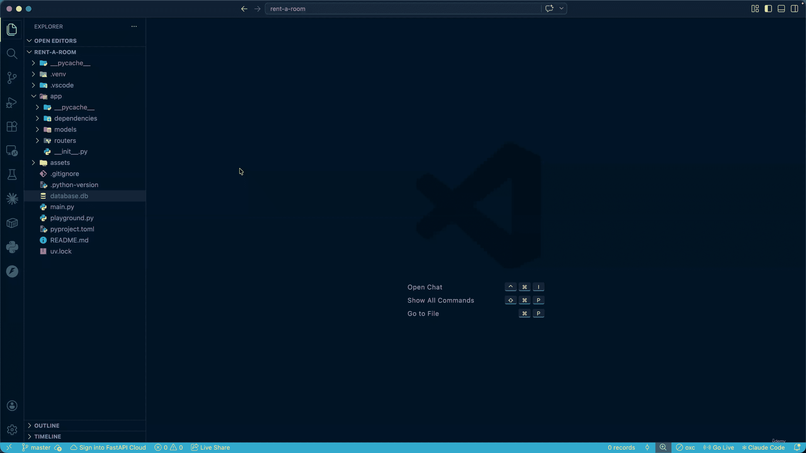

## 📖 本节概述

在本节课中我们将要学习如何在 FastAPI 项目中创建用户路由文件，把创建用户、按 ID 获取用户、以及按用户 ID 获取该用户全部预订的接口逐步搭起来。我们会先创建 `users.py`，再导入路由类和状态码，然后定义路由对象、依赖和模型，最后把这些路由注册到 `main.py`。整个过程会围绕依赖注入和响应模型这两个核心点展开，让接口保持清晰，也让初学者能一步一步跟上。

以下是本节课会依次完成的几个步骤。

- 新建用户路由文件，并导入 `APIRouter` 和 `status`。
- 实例化路由对象，设置 `/users` 前缀和 `users` 标签。
- 编写创建用户的 POST 接口。
- 编写按用户 ID 获取用户的 GET 接口。
- 编写按用户 ID 获取全部预订的 GET 接口。
- 在 `main.py` 中注册用户路由。

完成整体规划后，下面从最基础的文件创建开始。

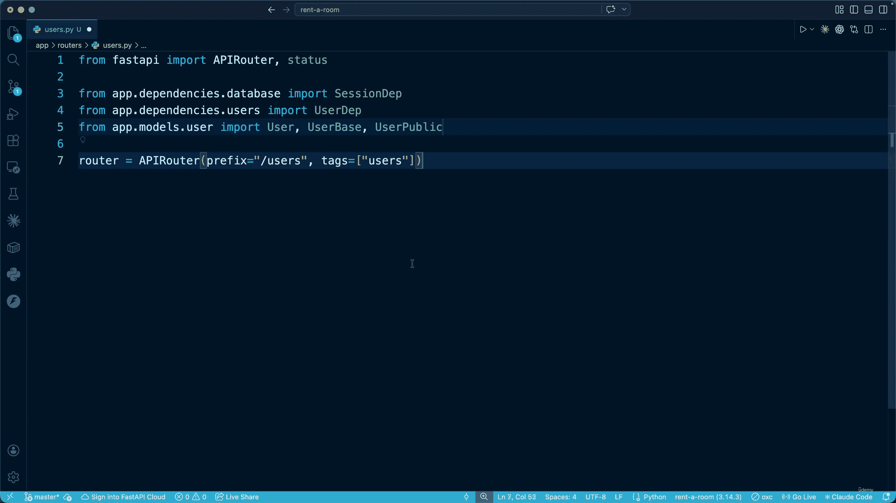

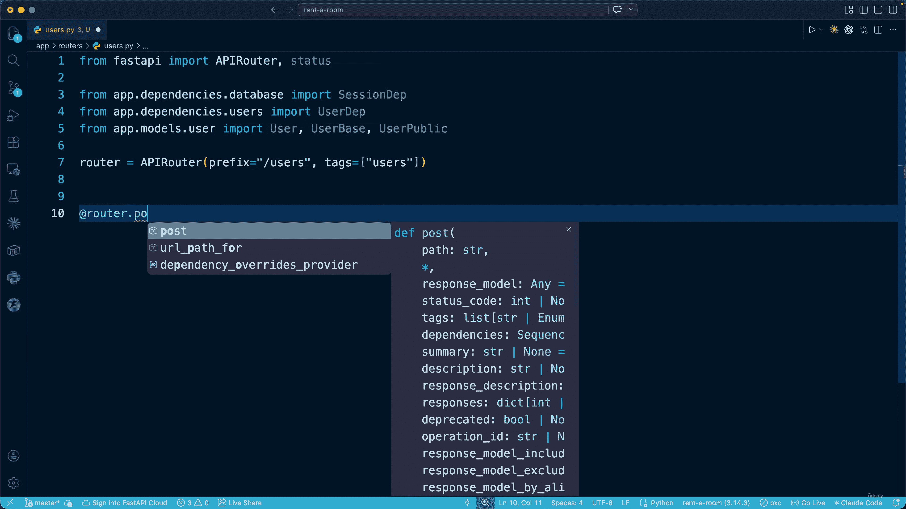

## 🗂️ 创建用户路由文件

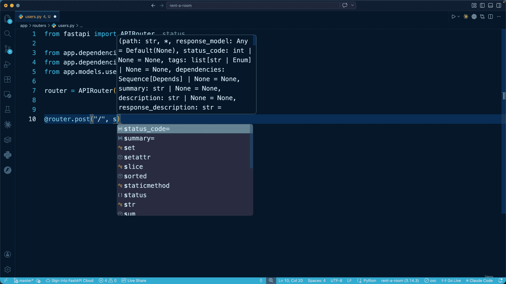

上一节我们准备好了用户依赖，本节中我们来看看用户路由文件应该放在哪里。到 `router` 文件夹中新建一个文件，名字可以叫 `users.py`。这个文件会成为用户相关接口的集中入口，后续与用户有关的 POST 和 GET 路由都会放在这里。为了让文件一开始就有清晰的导入结构，我们先把 FastAPI 中常用的 `APIRouter` 类和 `status` 状态码导入进来。

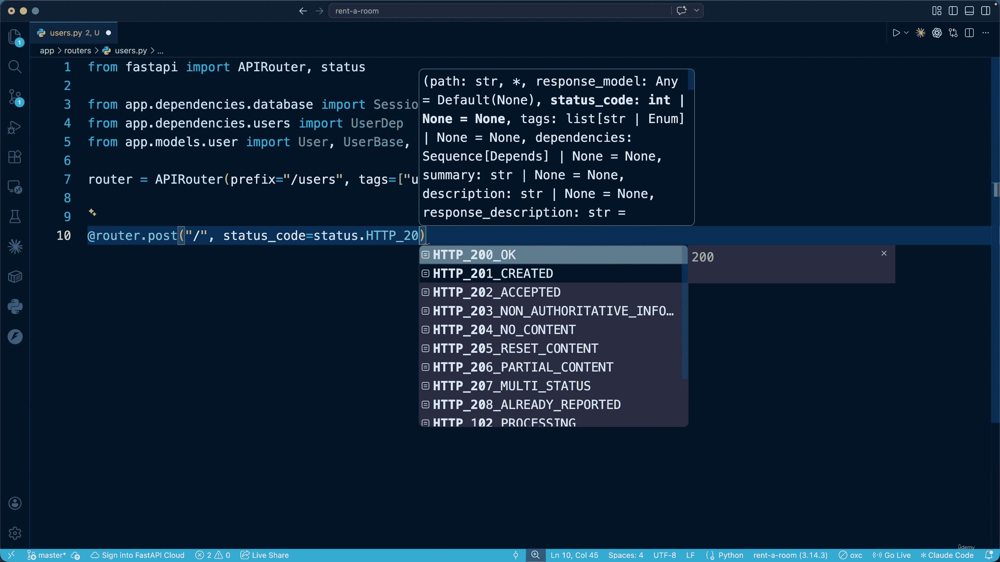

以下是这个路由文件一开始需要导入的路由类和状态码。

```python
from fastapi import APIRouter, status
```

完成导入后，下一步就是实例化路由对象。

## 🛠️ 创建路由对象

上一节我们新建了文件并导入了路由类，本节中我们来实例化一个 `APIRouter`。在文件下方创建路由对象，并给所有用户相关路由设置统一前缀 `/users`。同时设置 `tags` 参数，值为字符串列表 `["users"]`，这样接口文档里会按用户分组展示。这个路由对象可以写成下面这样。

```python
router = APIRouter(prefix="/users", tags=["users"])
```

有了这个路由对象后，我们就可以开始添加第一个接口了。

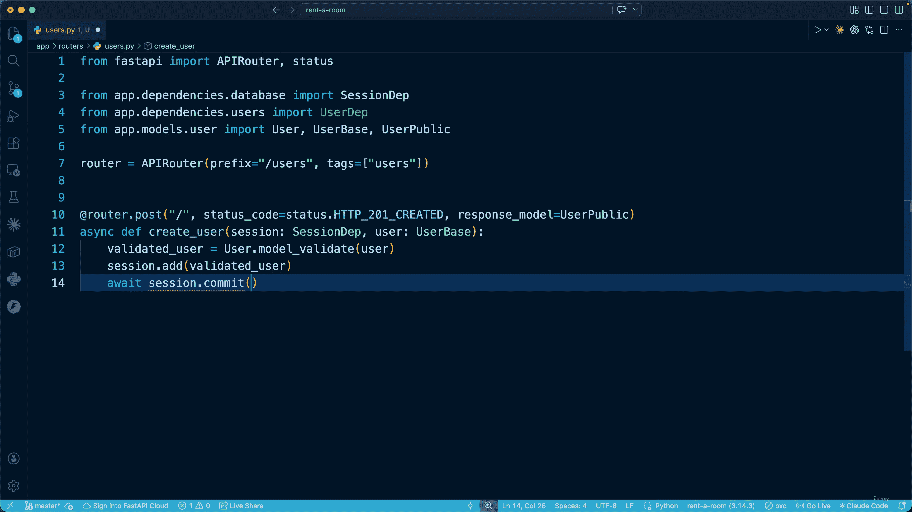

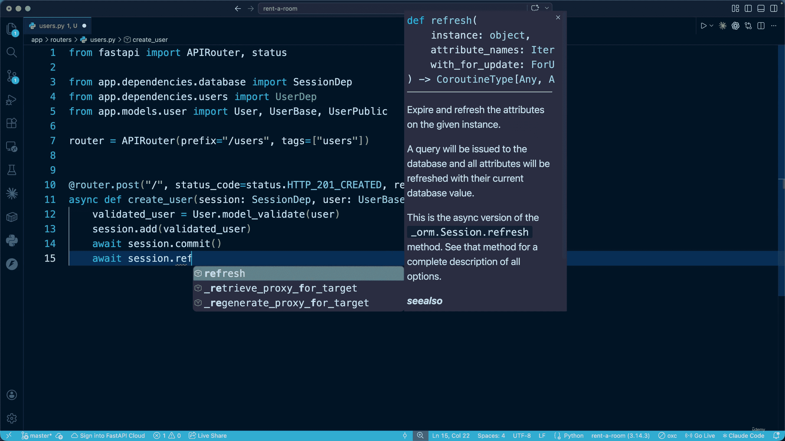

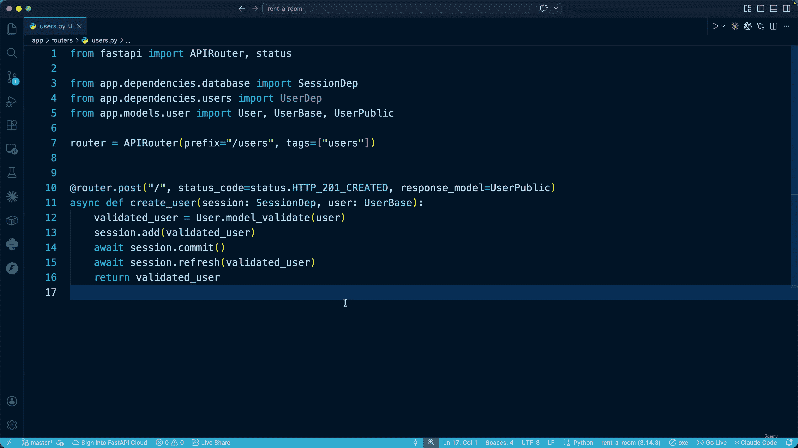

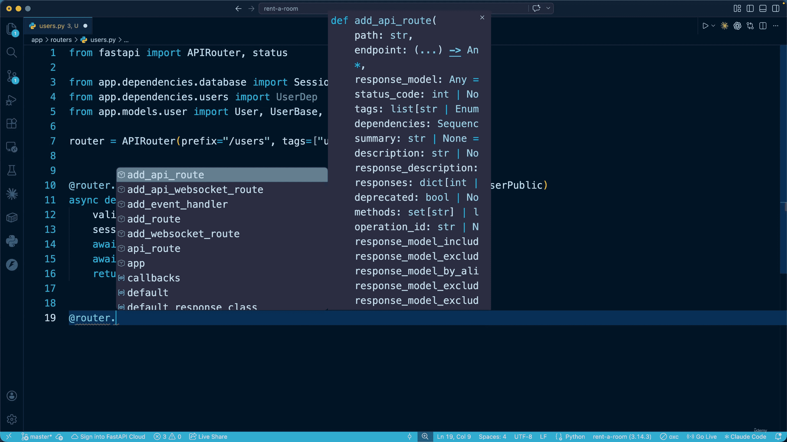

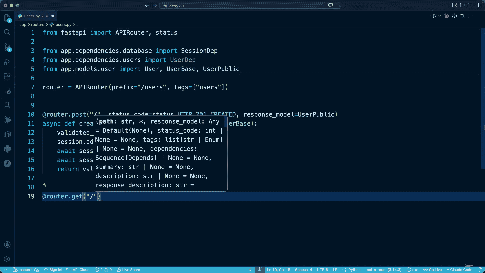

## ➕ 创建用户接口

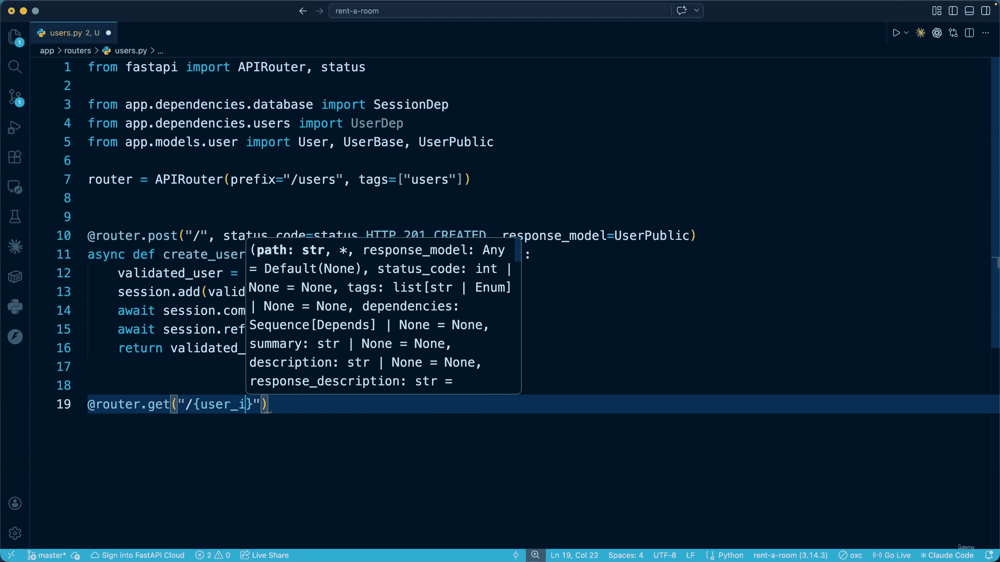

上一节我们定义了路由对象，本节中我们来实现创建用户的 POST 接口。这个接口需要数据库会话依赖，也需要请求体模型，还需要响应模型。原文在这里一次性导入依赖和模型，我们照着整理。需要使用的数据库会话依赖来自 `app.data.dependencies.database`，用户依赖来自 `app.dependencies.users`，模型来自 `app.models.users`。其中 `User` 是操作数据库的核心模型，`UserBase` 表示客户端传入的请求体形状，`UserPublic` 包含 ID，表示返回给客户端的响应形状。

以下是创建用户接口需要使用的依赖和模型，先列出它们的来源和用途。

- `SessionDep`：来自 `app.data.dependencies.database`，用于和数据库会话交互。
- `UserDep`：来自 `app.dependencies.users`，后续部分路由会用到这个用户依赖。
- `User`：来自 `app.models.users`，是操作数据库的核心模型。
- `UserBase`：表示客户端传入服务器的请求体形状。
- `UserPublic`：包含 ID，表示返回给客户端的响应形状。

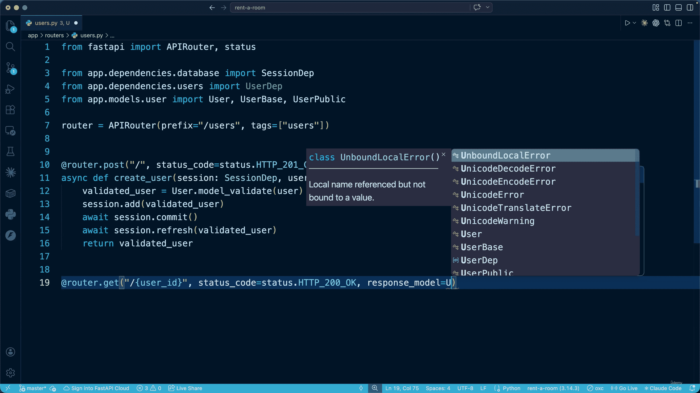

把这些依赖和模型导入后，代码如下。

```python
from app.data.dependencies.database import SessionDep
from app.dependencies.users import UserDep
from app.models.users import User, UserBase, UserPublic
```

导入完成后，定义 POST 路由。由于路由对象已有 `/users` 前缀，路由路径可以写成 `/`。状态码设置为 `status.HTTP_201_CREATED`，响应模型设置为 `UserPublic`。函数名为 `create_user`，接收 `session: SessionDep` 和 `user: UserBase`。函数内部先用 `User.model_validate(user)` 把请求体实例转换成 `User` 模型实例，得到 `validated_user`。然后用 `session.add(validated_user)` 把这个对象加入会话队列，此时它的 ID 字段还是 `None`。接着 `await session.commit()` 保存到数据库，`await session.refresh(validated_user)` 刷新对象，最后返回 `validated_user`，返回值会被整理成 `UserPublic` 响应。

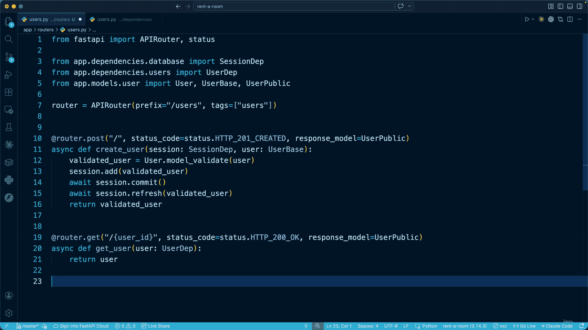

以下是创建用户接口的核心代码。

```python
@router.post("/", status_code=status.HTTP_201_CREATED, response_model=UserPublic)
async def create_user(session: SessionDep, user: UserBase):
    validated_user = User.model_validate(user)
    session.add(validated_user)
    await session.commit()
    await session.refresh(validated_user)
    return validated_user
```

这个接口和课程中房间、预订接口使用的模式一致。创建用户部分完成后，接下来添加一个互补的查询接口。

## 🔍 按用户 ID 获取用户

上一节我们完成了创建用户接口，本节中我们来看看如何按用户 ID 获取单个用户。这个接口也挂在 `router` 上，路径为 `/{user_id}`，最终会变成 `/users/{user_id}`。状态码使用 `status.HTTP_200_OK`，响应模型仍然是 `UserPublic`，因为这里返回的是单个用户。函数可以写成同步函数 `get_user`，在当前逻辑中没有必须异步的阻塞操作。参数直接使用上一课定义的 `UserDep` 依赖，这个依赖会自动调用“获取用户或返回 404”的逻辑。等 `user` 参数进入路由处理函数时，数据库查询已经完成；如果用户不存在，依赖已经返回 404。所以函数体只需要把 `user` 返回给客户端。

以下是按用户 ID 获取用户的接口代码。

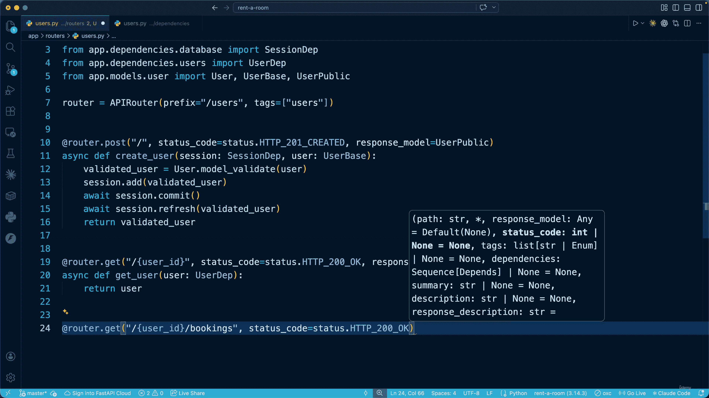

```python
@router.get("/{user_id}", status_code=status.HTTP_200_OK, response_model=UserPublic)
def get_user(user: UserDep):
    return user
```

这个依赖把查询和 404 处理都封装掉了，路由函数本身就很短。单个用户查询接口完成后，我们继续添加一个更复杂的接口。

## 📚 获取某个用户的全部预订

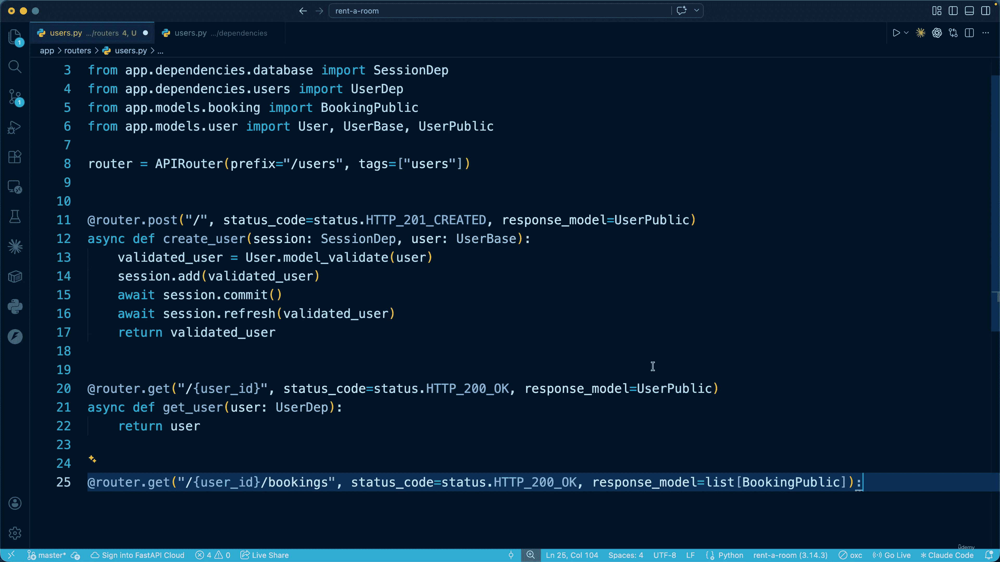

上一节我们用依赖简化了单个用户查询，本节中我们添加一个按用户 ID 获取全部预订的接口。这个接口在当前阶段不会按预期工作，先把它写出来，后面再讨论原因。产品需求很常见：用户希望看到自己在平台上的全部预订。这个路由可以设计为 `/{user_id}/bookings`，最终地址类似 `/users/5/bookings`。真实项目中要考虑授权，某个用户只应该访问自己的预订，不能看到别人的预订；当前先不考虑安全要求，允许任何人访问 `/users/{id}/bookings` 并查看关联数据。设计上可以讨论这个路由到底放在预订路由还是用户路由，原文认为放在用户路由也合理，因为首先提供的是用户 ID，逻辑上说得通。

以下是这个接口需要补充的导入和路由定义。

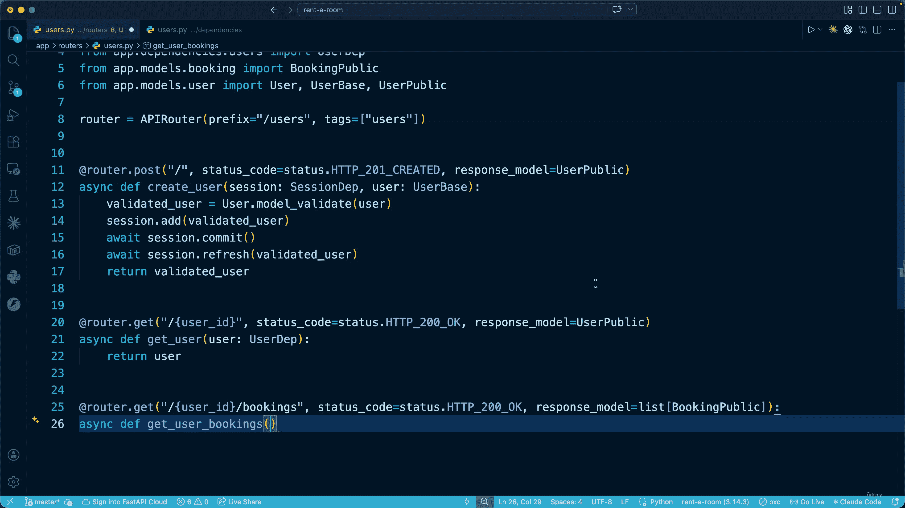

```python
from app.models.booking import BookingPublic

@router.get("/{user_id}/bookings", status_code=status.HTTP_200_OK, response_model=list[BookingPublic])
async def get_user_bookings(user: UserDep):
    return user.bookings
```

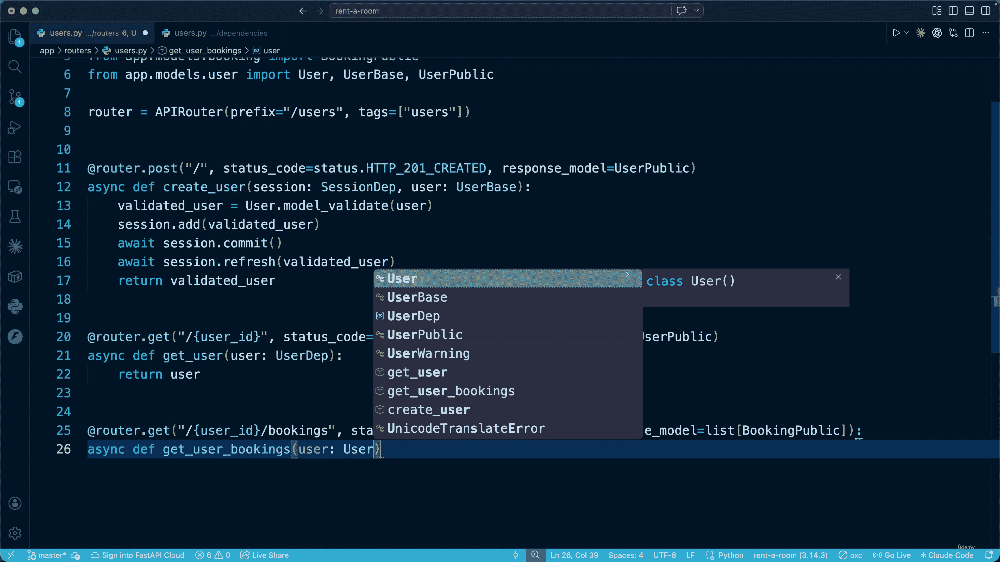

这里响应模型不是单个 `BookingPublic`，而是列表 `list[BookingPublic]`。函数仍然使用 `UserDep`，因此进入函数体时已经拿到有效用户；如果 ID 无效，前面已经返回 404。用户模型上有 `bookings` 关联关系，这个关系会根据数据库中的用户 ID 找到属于该用户的预订。返回 `user.bookings` 后，Pydantic 会把这个预订列表转换成 `BookingPublic` 实例列表。这个路由目前还不能按预期工作，但方向是对的，后续会说明设计中的关键缺陷。

到这里三个路由都写完了，下一步需要把它们注册到主应用。

## 🧩 在 main.py 注册用户路由

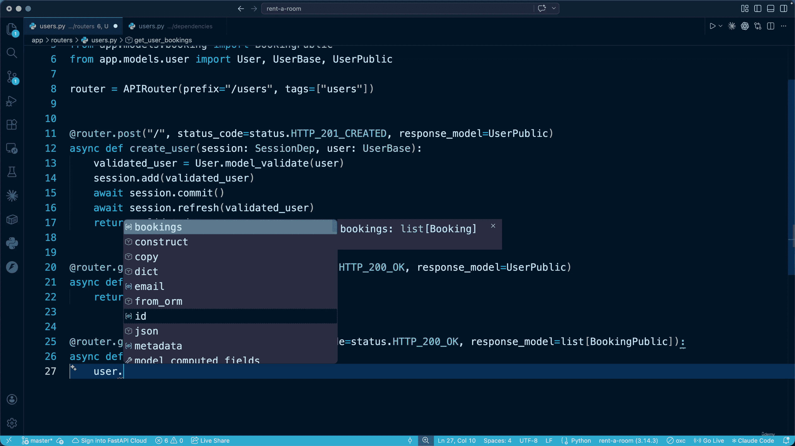

上一节我们写完了用户路由，本节中我们把它们接入应用。打开 `main.py`，导入新的用户路由，按字母顺序放到合适位置。然后在文件末尾再添加一次 `include_router` 调用，把用户路由包含进来。这样前面定义的三个新路由就会注册到应用中，下一课就可以在浏览器里测试这些功能。

以下是在 `main.py` 中注册用户路由的代码示例。

```python
from app.routers import users

app.include_router(users.router)
```

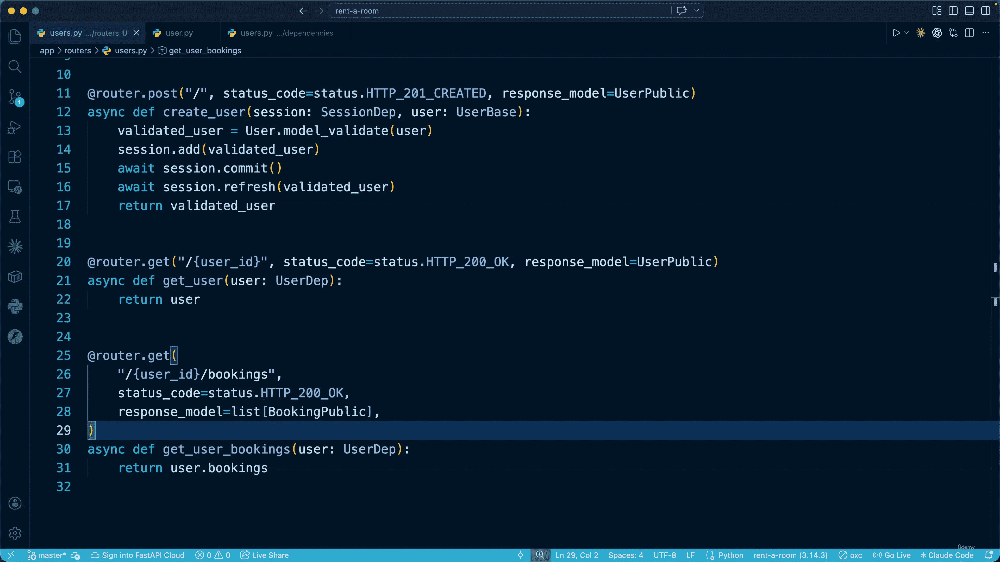

完成注册后，用户路由文件、依赖和主应用就连接起来了。下一课会实际测试这些接口。

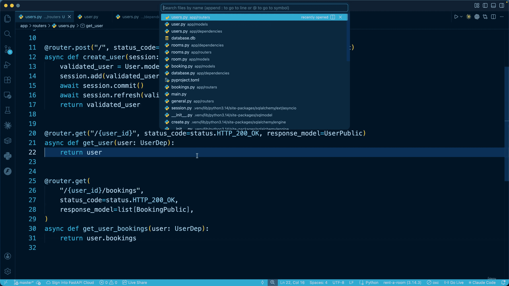

## ✅ 本节总结

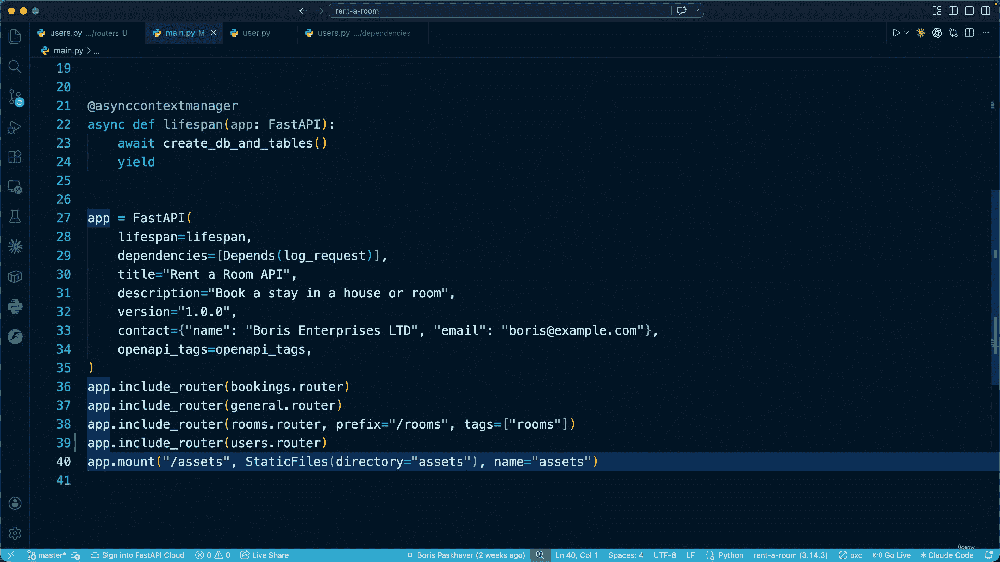

本节课中我们一起学习了创建用户路由的完整流程：新建 `users.py`，导入 `APIRouter` 和 `status`，实例化带 `/users` 前缀和 `users` 标签的路由对象；实现创建用户的 POST 接口，使用 `SessionDep`、`UserBase`、`User` 和 `UserPublic`，并通过 `model_validate`、`add`、`commit`、`refresh` 完成保存；实现按用户 ID 获取用户的 GET 接口，利用 `UserDep` 自动完成查询和 404 处理；添加按用户 ID 获取全部预订的 GET 接口，返回 `user.bookings` 并声明 `list[BookingPublic]` 响应模型，同时记录这个接口暂时不会按预期工作；最后在 `main.py` 中导入并注册用户路由。下一课我们会在浏览器中测试这些功能。

