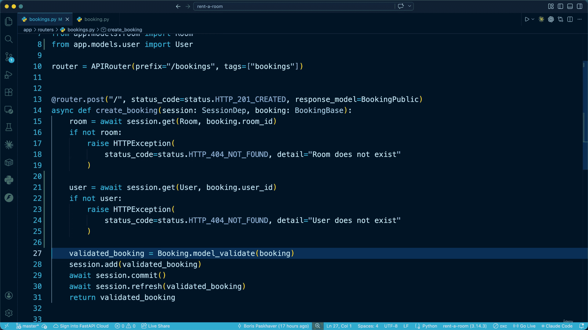
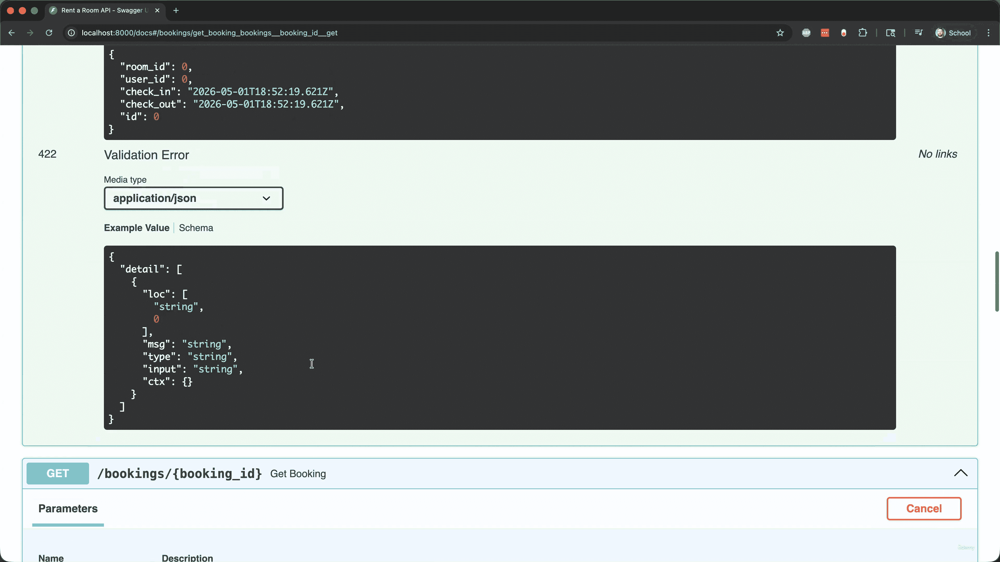
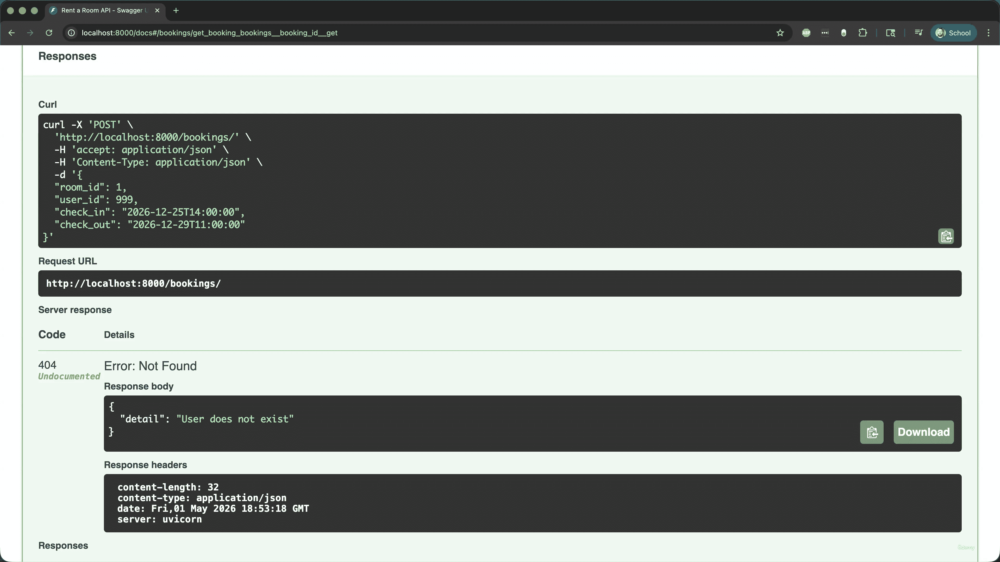
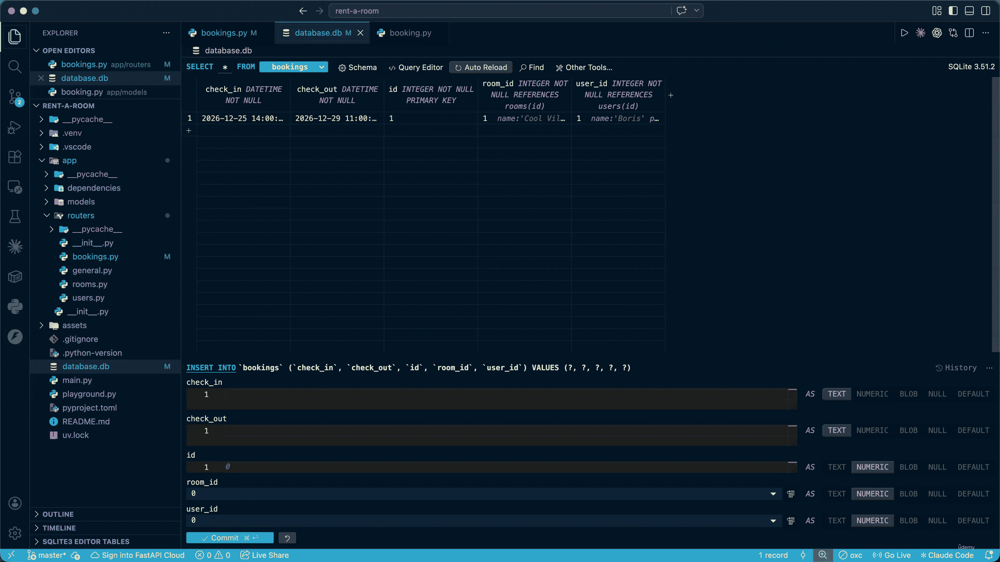

# 🧪 FastAPI Masterclass part2 p04：105：测试创建包含用户和房间的预订


## 📌 FastAPI Masterclass part2 p04：105.1：课程概述与测试目标


在本节课中，我们将要学习在进入浏览器验证完整流程之前，再补上一项安全检查。核心目标是让一条预订记录同时接收房间 ID 和用户 ID，并把这两个 ID 都保存到数据库的预订记录中。为做到这一点，前面已经把 `BookingBase` SQL 模型更新为包含 `room_id` 和 `user_id`。本节还会在 `app/routers/bookings.py` 的创建预订 POST 端点中增加用户 ID 存在性校验，并用 Swagger 页面实际创建用户、房间和预订，最后验证两类 404 错误状态与数据库结果。

下面的代码表示本节涉及的预订数据核心字段：

```python
class BookingBase(BaseModel):
    room_id: int
    user_id: int
    check_in: datetime
    check_out: datetime
```

模型和路由代码准备好之后，下一节先看数据模型层的变化，再进入路由层的安全检查。


## 🧱 FastAPI Masterclass part2 p04：105.2：在预订模型中同时保存房间ID和用户ID


在概述中已经确认本节要补充预订记录的用户关联能力，本节中我们来看看数据模型层的变化。原文强调，在进入浏览器验证流程之前还要补充一件事：预订记录既要接收房间 ID，也要接收用户 ID，并且这两个 ID 都会存进数据库的预订记录。前面已经更新了 `BookingBase` SQL 模型，使它包含 `room_id` 和 `user_id`。用大白话说，模型层就是给创建预订的 payload 规定字段，数据库层则把这两个字段作为连接用户表和房间表的外键信息保存下来。

下面的公式表示一条预订记录至少需要房间、用户和时间信息：

```text
Booking(room_id, user_id, check_in, check_out)
```

模型层准备好之后，下一节看创建预订路由中如何利用这两个字段做存在性校验。


## 🔐 FastAPI Masterclass part2 p04：105.3：在创建预订端点中校验用户ID


上一节我们介绍了 `BookingBase` 新增的 `room_id` 和 `user_id` 字段，本节中我们来看看创建预订端点还缺什么安全检查。回到 `app/routers/bookings.py`，在创建预订端点，也就是 POST 请求里，现有代码已经校验 `room_id` 有效，但还没有校验 `user_id` 有效。如果 payload 给出的用户 ID 对应的用户不存在，代码不应继续尝试创建预订，而应直接抛出错误。这个不存在的用户 ID 是另一个错误来源，因此要再增加一项安全检查。



为了做这件事，需要导入与用户表交互的 `User` 模型；从 `app/models/user.py` 导入用户模型。然后复制房间校验的代码，改成针对用户 ID 的校验。`session.get` 的第一个参数给模型，第二个参数给主键；查不到时返回 `None`。下面是加入用户校验后的核心代码：

```python
room = session.get(Room, booking.room_id)
if not room:
    raise HTTPException(status_code=404, detail="Room does not exist")

user = session.get(User, booking.user_id)
if not user:
    raise HTTPException(status_code=404, detail="User does not exist")
```

`room_id` 和 `user_id` 这两个属性定义在核心 `BookingBase` 模型上，所以可以正常读取。用户不存在时返回 404，`detail` 写 `User does not exist`；其他逻辑保持不变。此时代码位置已经确认房间 ID 和用户 ID 都有效，因此作为连接两个外键的预订 join table，可以继续创建预订，并把这两个 ID 以及 check-in time 等其他数据写入。公式可以写成：

```text
Booking(room_id=有效房间ID, user_id=有效用户ID, check_in=入住时间, check_out=退房时间)
```

用户校验代码完成之后，下一节进入浏览器，用 Swagger 页面准备测试数据。


## 🌐 FastAPI Masterclass part2 p04：105.4：用Swagger创建测试用户和测试房间


上一节我们给创建预订端点增加了用户存在性校验，本节中我们来看看在 Swagger 页面里准备用户和房间。完成代码后转到浏览器打开 `http://localhost:8000/docs`。前一两节课清空了数据库，所以从零开始。创建预订前需要先有房间和用户，创建这两个记录的顺序不重要。先测试新的 users 端点。以下是测试用户端点时的操作步骤：

- 在 Swagger 页面下方找到 users 标签，选择 POST 请求创建用户，点击 Try it out，填写任意 body。姓名写 `Boris`，邮箱写类似 `boris@example.co` 的示例值。
- 电话字段受 Pydantic types 库校验，必须提供结构正确的电话号码，哪怕是假号码。三个数字之类不合法电话会触发 Pydantic 校验错误。这里使用假但结构合法的 `+1 2015550123`。
- 执行请求，滚动查看返回 201。响应 payload 中能看到第一个用户，ID 为 1，说明 POST users 端点工作正常。
- 快速测试 GET user by ID 端点，提供刚创建的用户 ID=1，获取后应返回已创建用户 payload，ID 也是 1。两个新端点工作正常。

> 注意：示例电话不是真实号码，但结构要能通过 Pydantic 校验。

这里暂不测试 bookings 端点，后面课程会回来。现在数据库有一个用户。以下是创建房间的步骤：

- 向上滚动到 rooms 区域，选择 POST rooms 端点创建示例房间，数据全部为假 mock 数据。`name` 写 `cool villa`，每晚价格 200 美元，4 个卧室，2.5 个浴室。其他值可以任意填写。
- 执行请求，这是 room 表第一条记录，返回成功 201，room ID=1。现在已有房间和用户，可以创建预订。

用户和房间都准备好之后，下一节看如何把这两者关联成一条预订，并读取预订结果。


## 🛏️ FastAPI Masterclass part2 p04：105.5：创建预订并读取预订详情


上一节准备好了一个用户和一个房间，本节中我们来看看如何创建并读取预订。回到 Swagger 总览，找到 bookings。点击 Try it out 后，更新后的 `BookingBase` schema 包含 `room_id` 和 `user_id`，两者都关键，因为预订用于关联房间和用户。当前只有一个房间和一个用户，ID 都是 1。以下是创建预订和读取预订的步骤：

- 填 `room_id=1`，`user_id=1`；check-in 和 check-out 用任意值。日期和时间用 `T` 分隔。例如 check-in 用 `2025-12-25T14:00:00`，check-out 用 `2025-12-29T11:00:00`。复制字符串时注意 JSON 最后一个字段不要带尾逗号。
- 向 bookings 端点发 POST。端点会校验房间和用户都存在；返回 201 表示成功。响应是 bookings 表第一条记录，booking ID 也是 1，建立 `room_id=1` 与 `user_id=1` 的映射。公式为 `booking(room_id=1, user_id=1)`。
- 再请求 GET `/bookings/{id}`，提供 booking ID=1，应返回 200。返回的 booking public Pydantic model 包含全部信息，包括 ID，说明该 booking 已存在数据库。

创建和读取流程验证完成后，下一节验证错误状态和数据库中的最终结果。


## ⚠️ FastAPI Masterclass part2 p04：105.6：验证404错误状态和数据库结果


上一节成功创建并读取预订，本节中我们来看看 POST bookings 里的 `if` 检查是否按预期触发，以及数据库中的最终结果。存在几种可能：`room_id` 无效、`user_id` 无效、两者都无效。由于 `if` 语句按顺序执行，两者都无效时总会先触发第一个异常。以下是错误状态测试步骤：

- 提供不存在的 `room_id`，例如 999。代码进入靠前的 `if` 分支，不会走到创建预订，返回 404，`detail` 为 `Room does not exist`；原因是 `session.get` 返回 `None`。公式为 `session.get(Room, 999) -> None => 404`。
- 反过来，提供有效 `room_id=1`，但无效 `user_id=999`。返回响应码仍是 404，但 `detail` 来自本节课开头新增的另一个 `if`，即 `User does not exist`。公式为 `session.get(User, 999) -> None => 404`。

最后回到数据库检查。以下是数据库检查结果：

- users 表有新建用户，rooms 表有新建房间，bookings 表有新建 booking。
- bookings 表中这条 stay 记录连接 `room_id=1` 和 `user_id=1`。所有端点按预期工作。



错误分支和数据库结果都确认之后，下一节对本节课做总结。


## ✅ FastAPI Masterclass part2 p04：105.7：课程总结


本节课中我们一起学习了为预订记录补齐用户关联和用户存在性校验的完整过程。具体内容包括：更新 `BookingBase` SQL 模型，使其包含 `room_id` 和 `user_id`；在 `app/routers/bookings.py` 的创建预订 POST 端点中，先校验房间 ID 存在，再校验用户 ID 存在，任一不存在就返回 404；用 Swagger 页面从空数据库开始创建用户和房间；用 `room_id=1`、`user_id=1` 创建第一条预订并读取预订详情；最后分别用无效房间 ID 和无效用户 ID 验证两个 404 错误状态，并检查数据库中用户表、房间表和预订表中的记录。用代码概括本节的创建预订条件为：



```python
if not room:
    raise HTTPException(status_code=404, detail="Room does not exist")
if not user:
    raise HTTPException(status_code=404, detail="User does not exist")

booking = Booking(
    room_id=booking_payload.room_id,
    user_id=booking_payload.user_id,
    check_in=booking_payload.check_in,
    check_out=booking_payload.check_out,
)
```



至此，预订端点、用户端点和房间端点都能按预期工作。

