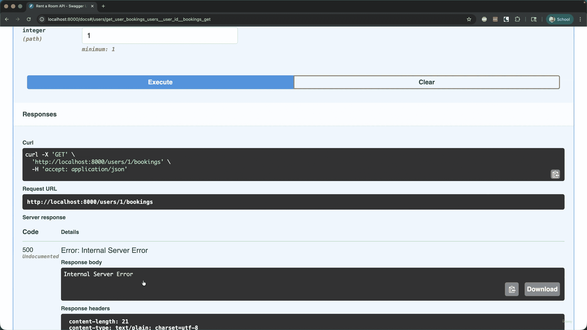
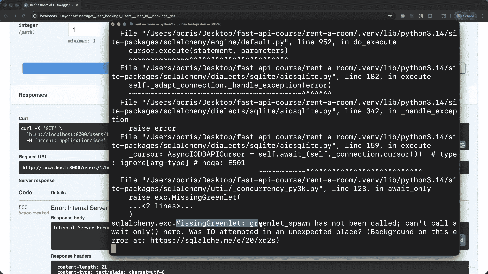
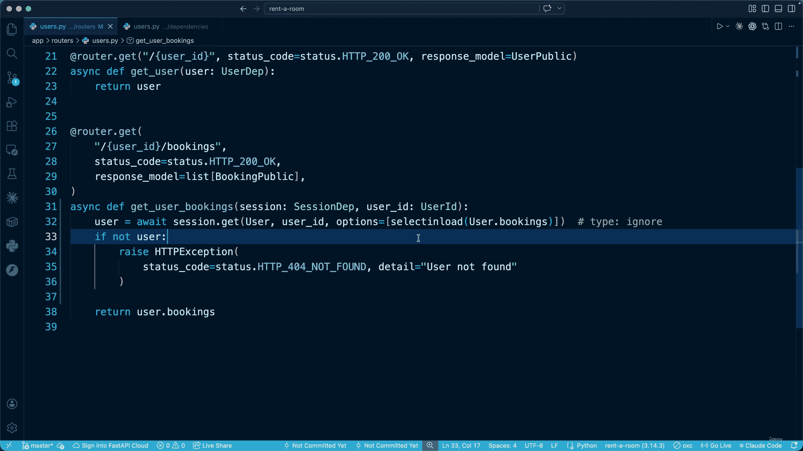
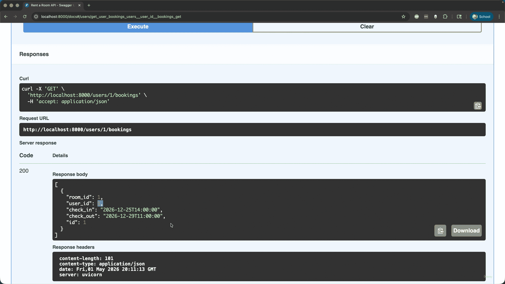

# FastAPI 大师课：106：使用 selectinload 进行急加载 🚀

在本节课中我们将要学习：如何测试“获取指定用户预订”的端点，为什么会遇到 `MissingGreenlet` 和 500 错误，懒加载与急加载分别是什么，以及如何用 `selectinload` 在异步数据库会话中完成急加载。教程会按问题复现、概念理解、代码放置、实际实现、结果验证的顺序展开，适合初学者跟着一步步理解。

## FastAPI 大师课：106.1：复现用户预订端点的问题 🧪

我们还有一个端点没有测试，它的作用是获取指定用户的预订。回到用户标签下，可以看到之前声明的端点 `/users/{user_id}/bookings`，目标是获取某个用户的所有预订。上一节课中，我们为 `id=1` 的用户创建了一条预订，所以理想情况下，提供 `id=1` 时，应该返回一个包含一条预订的列表。这个端点的前缀是 `users`，返回的是根据用户过滤后的预订集合，也就是只属于这个用户的预订。这里也是 SQL 模型之间关系的一次实际使用。

执行这个端点后，结果并不理想，服务端返回了 500 内部服务器错误。查看服务器日志时，SQLAlchemy 给了一点提示，但主要错误信息 `MissingGreenlet` 并不能直接说明发生了什么。我本人当时也感到困惑，还搜索资料才弄明白问题所在。问题出在用户路由文件底部这个端点里：代码使用用户依赖，根据标识符获取用户，然后通过模型上的 `bookings` 属性访问关联预订。

> 现象是：访问关系属性 `user.bookings` 时返回 500，日志中出现 `MissingGreenlet`。





这里需要强调一个关键背景：如果仍使用同步数据库会话，这种写法是足够的，也是 SQLModel 文档中常见的示例。但我们已经把应用迁移到异步会话，目的是获得不浪费等待时间的好处，所以不能直接照搬同步写法，需要更巧妙的解法。

以下是这个端点当前暴露出来的几个关键现象，先列出来便于定位。

- 端点 `/users/{user_id}/bookings` 还没有测试过，目标是返回指定用户的预订列表。
- 上一节课为 `id=1` 的用户创建了一条预订，预期返回一条预订。
- 实际执行后得到 500 内部服务器错误。
- 日志中出现 `MissingGreenlet`，这个错误信息对初学者不够友好。
- 问题代码位于用户路由底部，先获取用户，再访问 `bookings` 关系属性。

理解这些现象后，下一步需要弄清懒加载机制，因为错误正是在访问关系属性时出现的。

## FastAPI 大师课：106.2：懒加载与急加载的区别 🧠

在同步世界里，这套代码的工作方式是：用户依赖先获取用户，访问 `bookings` 属性时触发懒加载。懒加载中的“懒”和现实中的含义一致，表示不愿意投入工作，直到绝对需要时才做。ORM 不会提前获取预订，只有代码真正访问 `bookings` 属性时，才补充一条 SQL 查询去获取预订。所以 `get_user_or_404` 只获取用户，不会与其他表通信；在异步世界中访问属性时，ORM 和 SQL 才再次通信，这时才去获取预订。

问题在于，懒加载发起的查询默认是同步的。只要执行同步查询，包括这种在背后隐式发生的查询，在异步数据库连接下就会出问题。也就是说，懒加载在普通同步会话中完全没问题，但在异步设计中不能直接工作。解决办法是使用急加载，它是懒加载的对应概念。急加载表示愿意提前把工作做完，立即投入工作。

懒加载和急加载可以用下面的公式来理解。

\[
\text{Lazy Loading} = \text{访问关系属性时才发起关联查询}
\]

\[
\text{Eager Loading} = \text{查询主记录时立即预取关联记录}
\]

> 懒加载是不愿意提前投入工作，直到绝对需要才做；急加载是愿意提前投入工作，立即做完。

采用急加载后，获取用户时会同时要求 ORM 预先加载该用户关联的预订记录。也就是说，在配置用户查询时明确告诉 ORM：后面会访问 `bookings` 属性，请提前把相关记录取回来。接下来的问题就是：这段急加载代码应该放在哪里。

以下是两种加载思路的对比，用大白话理解即可。

- 懒加载：先查用户，等代码访问 `user.bookings` 时再查预订，默认同步查询，异步会话下容易报错。
- 急加载：查用户时就把关联预订一起预取，访问 `user.bookings` 时数据已经准备好。

理解这两种加载方式后，就需要考虑代码放置位置，因为放置位置会影响其他端点的查询行为。

## FastAPI 大师课：106.3：选择急加载代码的放置位置 🧭

一种想法是把急加载逻辑放进用户依赖里，例如在 `get_user_or_404` 的查询方法上附加急加载配置。但这里有一个基本的设计问题：如果 10 个端点都依赖这个函数，其中 9 个只需要用户本身，不需要预订信息，第 10 个才需要预订，那么把急加载放进依赖后，每次依赖运行都会获取预订，即使某个路由处理器根本不需要这些数据。这会潜在增加数据库压力，因为即使端点不需要，也会去取关联的预订记录。

在小规模应用中，这种压力通常不会立刻被感觉到，但长期积累可能产生问题。我见过一些代码库，多个路由处理器需要中心模型的不同信息，例如一个路由获取用户的支付方式，一个路由获取用户发票，一个路由获取用户主题偏好。开发者把这些逻辑全部上移到中心依赖后，依赖变得过载，会获取大量记录，而每个路由只使用其中一部分。因此没有绝对完美的答案。可以每个路由单独放置，也可以放在依赖里，还可以定义第二个依赖函数，例如 `get_user_with_bookings_or_404`，先查询用户，再补充获取预订。处理方式很多。

为了保持简单，当前做法是把逻辑复制到实际获取预订的处理器中。也就是移除对 `get_user_or_404` 的依赖，在这个特定用户查询中急加载预订，因为当前只有这个路由需要预订。如果把逻辑上移到依赖，像示例端点这样的路由也会自动获取预订，因为它同样使用用户依赖，但它并不需要预订数据。最终选择取决于 API 设计偏好，核心是保持端点简单，并根据请求的核心资源返回最小必要数据。

以下是几种常见放置方案，各有取舍，初学者先知道有这些选择即可。

- 放在用户依赖中：代码集中，但所有依赖该函数的端点都会获取预订。
- 每个路由处理器单独处理：按需加载，重复代码会多一些。
- 定义第二个依赖函数：例如 `get_user_with_bookings_or_404`，先查用户再查预订。
- 复制逻辑到当前路由处理器：当前场景最简单，只有需要预订的路由才急加载。

为了简单，我们选择把相关逻辑复制到获取预订的路由处理器中，接下来进入实际代码实现。

## FastAPI 大师课：106.4：用 selectinload 实现异步急加载 🛠️

要在异步方式中完成急加载，需要从 SQLAlchemy ORM 导入工具。SQLAlchemy 是 SQLModel 底层的 ORM，SQLModel 未来可能支持这类异步操作加载，但录制时还不支持。SQLModel 不支持某个具体操作时，可以深入其底层依赖 SQLAlchemy，取出相同的构造来使用。导入代码如下。

```python
from sqlalchemy.orm import selectinload
```

然后在获取用户的方法中提供第三个参数 `options`，设置为列表，用来配置用户查询的加载行为。调用 `selectinload` 时，传入希望随用户一起获取的关联关系。在 `User` 模型类上引用 `bookings` 属性即可。类型检查器可能提示违规，但这是误报，代码本身没有错。可以添加 `# type: ignore` 注释来静默这个警告。示例代码如下。

```python
user = await session.get(
    User,
    user_id,
    options=[selectinload(User.bookings)],  # type: ignore
)
```

这段代码背后仍然会发出两个查询：一个查询用户，另一个查询该用户的所有预订。SQLModel 通过模型关联理解关系：先获取用户记录，用户记录提供 ID，然后选择 `bookings` 表中 `user_id` 属于该集合的记录。本例集合中只有一个 `id=1`。底层使用的是 SQL 的 `select in` 特性。

关键点是：当希望为关系的关联数据附加补充查询时，就把 `selectinload` 放进 `options` 列表。传入的值是当前正在获取单条记录的模型上的属性。代码表达的意思是：按 ID 获取用户，并为这个用户提前发起第二次查询获取预订。因为 ORM 理解关系，后面访问 `bookings` 时数据已经存在，不会再补发查询，代码就能按预期工作。这段代码只在异步会话下需要；换来的是服务器有机会更高效，因为线程在等待异步操作时可以处理其他任务，从而同时处理更多请求。

以下是落到代码里的关键步骤，按顺序检查即可。

- 从 `sqlalchemy.orm` 导入 `selectinload`。
- 在路由处理器中获取 `session`，并标注为 `SessionDep`。
- 使用 `user_id` 路径参数类型提取并转换整数 ID，同时保留路径校验。
- 导入 `HTTPException`，用于处理用户不存在的情况。
- 用 `session.get` 或查询构造获取用户，并在 `options` 中加入 `selectinload(User.bookings)`。
- 如果类型检查器误报，用 `# type: ignore` 静默。

实现完成后，回到接口测试工具验证结果，看看急加载是否解决了问题。

## FastAPI 大师课：106.5：验证返回结果 ✅

保存代码后，回到 RentRoom API，为安全起见刷新页面。打开同一个预订端点，提供要获取预订的用户 ID，点击执行。现在得到 200 响应，返回的是一个列表，在 JSON 中就是数组，每条记录代表一条预订。这是该用户过滤后的预订子集。如果提供 `id=1`，返回集合中的每条预订的 `user_id` 都是 1，因为过滤条件就是它；如果查询 `id=2` 的用户，返回列表中每条预订的 `user_id` 都是 2。返回形状是 `booking public`，端点是 `/users/{user_id}/bookings`，返回的是 `booking public` 模型实例列表，并表示为 JSON。

> 验证结果：HTTP 200，响应是 `booking public` 数组，数组元素只属于路径中的用户。

到这里，端点已经按预期工作，所有端点看起来都正常了。

## FastAPI 大师课：106.6：总结 📚



本节课中我们一起学习了：如何复现用户预订端点的 500 错误，`MissingGreenlet` 与异步会话下懒加载的关系，懒加载和急加载的区别，急加载代码放置位置的设计取舍，以及如何用 `selectinload` 在异步查询中预取关联预订并验证返回结果。

以下是本节课需要记住的关键点，方便复习。

- 用户预订端点 `/users/{user_id}/bookings` 返回的是过滤后的预订列表。
- 异步会话中直接访问 `user.bookings` 会触发同步懒加载，容易导致 `MissingGreenlet`。
- 懒加载是访问关系属性时才查询，急加载是查询主记录时提前预取关联记录。
- 急加载放在依赖中可能让不需要关联数据的端点也额外查询，需要按需选择放置位置。
- `selectinload(User.bookings)` 放入查询的 `options` 列表，可以在异步会话中预取预订。
- 底层通常仍是两个查询，第二个查询使用 `select in` 找到属于该用户的预订。
- 验证时返回 200 和 `booking public` 数组，数组元素只属于路径中的用户。



本节课中我们一起学习了使用 `selectinload` 进行急加载的完整过程，并解决了异步 FastAPI 应用中关系属性访问导致的 500 错误。
