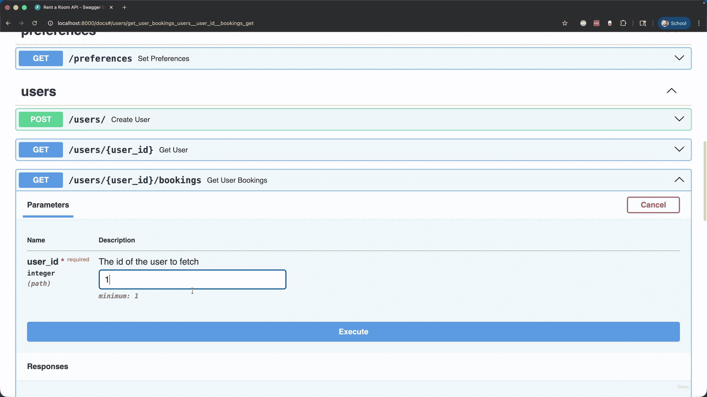
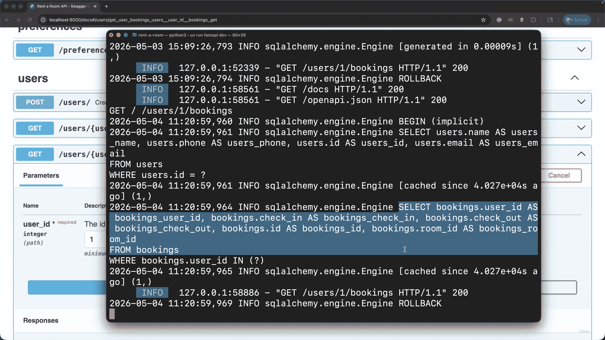
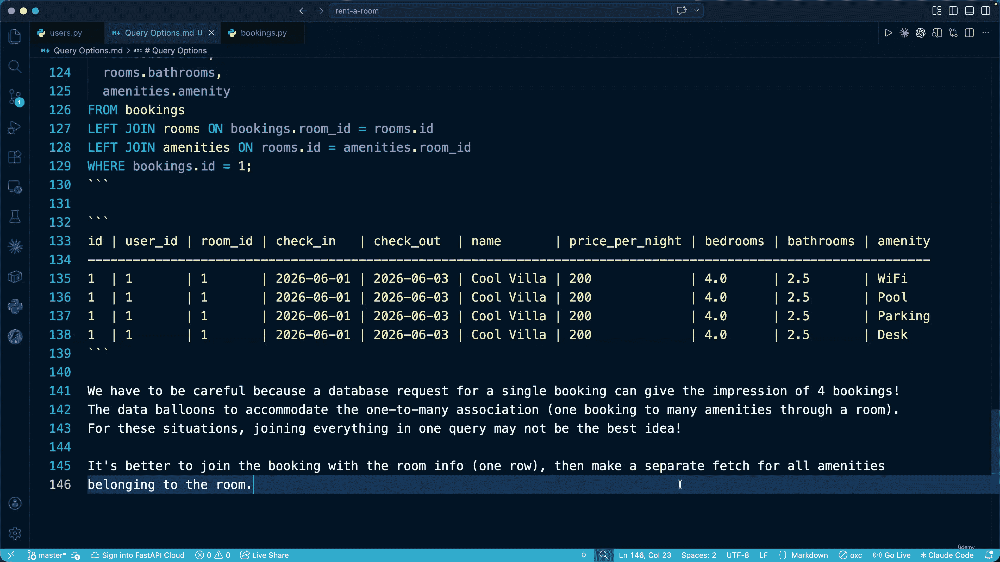

# 🚀 FastAPI 大师课：第2部分第06课：查询选项


在本节课中，我们将要学习 FastAPI 与 SQLModel 中获取关联数据的第二种方式，也就是传统的 SQL 连接（join）。这节课会先深入分析 `selectinload` 的工作方式，再把它和 `joinedload` 进行对比，最后解释一对多场景下为什么不能盲目使用连接。整个教程会围绕“查询次数、结果行数、数据是否重复”三个核心问题展开，让初学者也能看懂两种查询选项的差别。


## 🧭 FastAPI 大师课：第2部分第06课-01：两种查询思路总览


上一节已经接触过一种获取关联数据的方法，本节先建立整体对比。原文先介绍第二种获取记录关联数据的方法，也就是传统 SQL 连接。进入连接之前，需要先深入理解 `selectinload` 的工作方式，这样才能和本课要学习的 `joinedload` 做比较。`selectinload` 在后台会让 SQLModel ORM 生成 SQL，而且通常会发出两个查询，这两个查询分别负责主记录和关联记录。


下面列出本课需要先记住的两种查询思路，方便后文逐段展开。




- `selectinload`：先查主表，再用主记录中的 ID 去查关联表，总查询数通常是两次。
- `joinedload`：用 SQL 的 `LEFT JOIN` 在数据库内部把主表和关联表合并成一个结果集，通常只发一次查询。


可以用一个简单公式概括两者的第一层差别，这个公式在初学阶段非常实用。


```text
selectinload 总查询数 = 主记录查询 1 次 + 关联记录查询 1 次 = 2 次

joinedload 总查询数 = 主记录与关联记录合并查询 1 次 = 1 次
```


理解这两个公式后，下一节进入 `selectinload` 的日志细节，看看两个查询到底长什么样。




## 🔍 FastAPI 大师课：第2部分第06课-02：selectinload 背后的两个查询


前面给出了查询次数公式，本节看看日志中的真实表现。原文用一个请求来演示：向 bookings 端点发起请求，传入用户 ID，获取 ID 为 1 的用户的所有 booking。执行请求后切到服务器日志，可以看到 SQL 输出。日志里总共出现两个查询，第一个查询针对用户本身，从 users 表选择所有列，并用 `WHERE users.id = 1` 把行缩小到输入 ID 对应的一条记录。SQL 先取得用户，同时用户 ID 已经知道，也就是 1。


第一个查询完成后，系统再发第二个查询，用来获取属于该用户的 bookings。这个查询被称为 `selectin` 查询，原因就在于它要选择 bookings，而且条件是 bookings 的 user_id 出现在第一个结果集中，而第一个结果集正是刚刚取到的用户。注意第二个 SQL 中有一段动态部分，这段动态部分会注入从上一个查询取得的 user_id 或 user_id 集合。当前只取一个用户，所以只注入一个 ID；如果一次取一组用户，那么这一组用户的 ID 都会插入到这个 SQL 查询中。


下面是这两个查询的简化结构，便于直观理解。


```text
-- 第一个查询：先取用户
SELECT users.*
FROM users
WHERE users.id = 1;

-- 第二个查询：再取该用户的 bookings
SELECT bookings.*
FROM bookings
WHERE bookings.user_id IN (第一个结果集中的 user_id);
```


这里的关键结论是：`selectinload` 仍然从两个表取数据，而且是两个独立、分开的查询。ORM 负责最后的关联工作，因此在 user 对象上访问 bookings 时，可以拿到第二次查询取回的补充数据。总结起来，`selectinload` 函数总是这样加载数据：先取核心记录，再用这条记录的 ID 或一组 ID 作为过滤条件，发出第二个查询。


理解 `selectinload` 的两个查询之后，下一节把它放到一对多场景中看适用性。


## 🧩 FastAPI 大师课：第2部分第06课-03：一对多场景为什么适合 selectinload


上一节看到 `selectinload` 会发两个查询，本节解释它适合什么关系。对于一对多关联，`selectinload` 通常很理想，例如一个用户有很多 booking，并且希望在一次获取中拿到这些 booking。这类场景正是 `selectinload` 的典型用途。不要因为出现两个独立查询就害怕，两个查询不一定错误，甚至可能很理想，因为本质上要处理的就是两个表。


下面列出判断 `selectinload` 是否合适时可以关注的点。


- 主记录和关联记录来自两个表。
- 关联记录在主记录视角下是一对多关系。
- 可以接受先查主记录，再查关联记录。
- 不希望数据库把主记录和大量关联记录拼成重复行。


原文在这里还明确了本课的目标：扩展 booking 端点。需要记住目标，后面所有查询选项的比较都围绕这个目标展开。回到代码中的 bookings 路由器，可以看到 `get booking` 路由负责获取单条 booking 的信息。当前这个路由会从 bookings 表取出记录，而这条记录带有 `room_id` 和 `user_id` 这样的外键。接下来希望扩展这个端点，让它返回更大的 payload，包含 room 和 user 的完整信息，而不仅是外键。也就是说，要用外键作为依据，去查询 rooms 表和 users 表，并把完整信息附加到 booking 行上。


例如，对于某条 booking，还希望拿到用户的名字和邮箱；对于这条 booking 对应的 room，还希望拿到 bathrooms、bedrooms 和每晚价格。理想状态是把这些都放在一次 SQL 查询中捕获。这个目标会直接影响后面选择 `selectinload` 还是 `joinedload`，所以需要先明确：当前只是取 booking 本身，后面要取 booking 加 room 加 user 的完整信息。


明确目标后，下一节先看当前代码只取 booking 时 ORM 会生成什么 SQL。


## 🧱 FastAPI 大师课：第2部分第06课-04：当前只查 booking 的基线行为


上一节确定了扩展目标，本节回到我写的文档，从顶部开始复习之前谈过的几个想法。当前代码只是获取 booking 本身。文档中使用 `get` 方法，提供 Booking 模型和一个示例 ID，这是一个硬编码示例，取 ID 为 1 的 booking。ORM 生成的 SQL 只会访问 bookings 表，并过滤 `id = 1` 的行，因此只会返回一行，返回数据就是 bookings 表的完整行。此时没有其他表参与。


需要说明的是，外键仍然会返回，但这只是因为外键本来就是 bookings 表中的列值，并不代表已经查询了 users 或 rooms 表。下面是当前基线代码的简化示例，用来说明只查主表的行为。


```python
booking = session.get(Booking, 1)
# 生成的 SQL 只访问 bookings 表
# 外键 user_id、room_id 只是 bookings 表自身的列值
```


如果使用 `selectinload`，代码会发生变化。需要给查询附加 `options` 参数，提供 `selectinload`，并指定 booking 的关联关系，例如 room 关联，这个关联会连接到另一张表。后台中 SQLModel 仍然会先发出一个针对 booking 本身的查询，并按 ID 过滤，这和前面终端里看到的“先取用户、再取关联 bookings”的模式完全一致。这个查询是整体查询的第一部分，然后 ORM 会发出第二个查询，用来取 booking 表对应的 room 关联。


因为使用了 `selectinload`，ORM 会发出第二个查询，查询 rooms 表，条件是 `room_id` 出现在第一个结果集的集合中。当前 `room_id` 是 1，所以 ORM 会请求 rooms 表，并用“room_id 属于第一结果集”作为过滤条件。关键结论仍然是：`selectinload` 会发出两个查询，它适合“第二批数据相对于原始结果集是多关系”的情况。获取用户的 bookings 是很好的用例，因为从用户视角看这是一对多：先取一行用户，拿到用户 ID，再在后续查询中取出全部 bookings。


当前场景却是一对一关联。每条 booking 只关联一个 user，也只关联一个 room。如果为了拿补充的 user 和 room，继续发第二个、第三个查询，就需要把代码扩展成同时对 booking 的 room 使用 `selectinload`、对 booking 的 user 使用 `selectinload`，这样就需要三次查询。为了用一次总查询拿到全部数据，可以改用 SQL 连接。下面进入 `joinedload` 和左连接的解释。


## 🔗 FastAPI 大师课：第2部分第06课-05：joinedload 与 SQL 左连接


上一节说明了 `selectinload` 在一对一场景下会增加查询次数，本节介绍 `joinedload`。SQL 连接的工作方式是：在取给定 booking 时，在同一行、同一条记录上使用这些 ID 去取 users 表和 rooms 表中补充的行，再把它们粘到右侧，把关联记录的所有列直接加到右边。原文通过一个结果集示例说明这一点。选项 B 的提醒是：这里有一份来自 bookings 表的 payload，还有一份来自 rooms 表的 payload，SQLModel ORM 会把它们转换成对应的模型对象。


先看连接方式中的“左连接”。之所以叫左连接，是因为保留一张表作为主要焦点，这里的主表是 bookings 表。对于 bookings 表中的任意一行，都会把补充表的内容加上去或连接上去，这些补充表叫右表。右表被合并进左表，因此叫左合并或左连接。换成代码后，不再是 `selectinload`，而是提供 SQLModel 的 `joinedload` 函数，并指定完全相同的关联关系。语法在 options 参数和关联关系上基本一致，只是把函数换掉。


下面是 `selectinload` 与 `joinedload` 的代码对照，便于看清唯一的重点变化。


```python
# 方案 A：selectinload，通常两个查询
statement = (
    select(Booking)
    .where(Booking.id == 1)
    .options(selectinload(Booking.room))
)

# 方案 B：joinedload，通常一个查询
statement = (
    select(Booking)
    .where(Booking.id == 1)
    .options(joinedload(Booking.room))
)
```


使用 `joinedload` 后，ORM 生成的补充 SQL 只有一个总查询。它仍然从 bookings 表选择数据，条件是 `bookings.id = 1`，但还会要求 SQL 对 rooms 表做左连接，连接依据是 bookings 表中的 `room_id` 外键列与 rooms 表中的 `id` 列匹配。SQL 和数据库提供的连接功能会在数据到达 FastAPI 的 Python 代码之前完成组装、聚合和连接。数据库擅长提取数据、排序数据和连接数据，这些都属于数据操作；数据库本身存储数据，也为这类操作做了优化。


连接后的结果基本是一张派生表。示例行中包含 bookings 表的所有原始列，一直到 checkout 列；同时，数据库使用 `room_id` 查询 rooms 表，并按匹配条件取出 rooms 表中 `id = 1` 的房间，再把 rooms 表的补充列连接进来。名字、每晚价格、bedrooms 和 bathrooms 来自 rooms 表，但现在它们被左连接到了左侧的表中。左侧的表就是原始 bookings 表，也是查询起点；现在基于匹配的 room ID，把 rooms 表的补充列拉到这一侧。下面是这个左连接的简化 SQL。


```text
SELECT *
FROM bookings
LEFT JOIN rooms
  ON bookings.room_id = rooms.id
WHERE bookings.id = 1;
```


这种方案的优势是只有一次数据库查询，而不是两次。对于一对一关联，这通常很理想，因为如果用 `selectinload`，得到的数据基本一样，但会通过两个独立查询发出：先查 booking，再查 room，然后由 SQLModel 组装全部数据。使用连接时，数据库替我们组装全部数据，数据在数据库返回的 payload 中已经齐全，从某种意义上说，数据一开始就是合并好的。这样运行时代码更少，SQLModel 需要处理的事情也更少，因为所有数据都装在一个表或一行合并表示中返回，这一行表示来自两个引用表的组合数据。


理解左连接的优势后，下一节要回答一个关键问题：既然连接能一次查询拿到数据，为什么还需要 `selectinload`。


## ⚠️ FastAPI 大师课：第2部分第06课-06：一对多时 joinedload 的数据膨胀问题


上一节看到 `joinedload` 在一对一场景下很优雅，本节解释它的限制。可能会问：如果 `joinedload` 和 SQL 左连接能用一次查询拿到所需全部数据，为什么永远不优先使用它，为什么还要用 `selectinload`。答案是：在获取一对多关联时，左连接可能出问题。当前示例是一对一关联，所以很理想，每条 booking 都能得到一行，并带上来自 room 或 user 或两者的补充数据，这种结果很好。但是如果把连接用于一对多关联，数据规模可能迅速膨胀。


为了说明这个问题，原文给出选项 D 的例子。想象租房 API 中有一个新的补充领域概念：每个 room 都有 amenities，amenity 是类似 Wi-Fi、泳池、停车位这样的功能。每个 amenity 通过自己的 ID 连接到 room，并放在单独的 amenities 表中。这张表可能看起来像这样：同一个 room ID 会重复出现，因为同一个房间提供多个设施；对于每个连接 room ID 的表，都会列出 amenity。假设在获取 booking 时想拉取通过 room ID 可用的 amenities。从 booking 的 room_id 出发，先定位 room，再从 room 走到它的全部 amenities。


代码会类似这样：从 booking 开始，先取 ID 为 1 的 booking，然后从 booking 导航到 room 并连接进来，再对给定 room 连接它的全部 amenities。下面用简化代码表达这个意图。


```python
statement = (
    select(Booking)
    .where(Booking.id == 1)
    .options(
        joinedload(Booking.room).joinedload(Room.amenities)
    )
)
```


这里有一个 booking 和一个 room，单看这两者非常适合连接查询，因为 SQL 可以优雅地把两行合并成最终结果集中的一行。但是现在有四个 amenities。只有一个原始 booking 乘以一个原始 room，SQL 如何存储四行。SQL 会为每个 amenity 创建一行，最终结果集就会变成多行。下面是这个查询的简化 SQL。


```text
SELECT *
FROM bookings
LEFT JOIN rooms
  ON bookings.room_id = rooms.id
LEFT JOIN amenities
  ON rooms.id = amenities.room_id
WHERE bookings.id = 1;
```


最终结果中，因为对 amenities 做了左连接，每个 amenity 都需要单独一行，因为每个 amenity 彼此完全不同。SQL 会保留全部 booking 数据，也会保留不断重复的 room 数据；创建四行重复记录的原因基本就是每一行都有一个不同元素或不同值，也就是不同的 amenity。可以看到大量数据被复制，并从数据库发送到服务器。更进一步，SQLModel 中实际得到的结果会是四条记录，也就是一个包含四个 booking 的列表，因为数据库返回了四行。需要记住，实际只创建了一条 booking，就是 ID 为 1、连接 room ID 为 1 的那条 booking，本来可以获取它的全部数据。问题在于连接过于激进、过于急切，尤其还加上了 amenities 的左连接，于是得到四行，给人四条 booking 的印象，实际不是。


这就是连接可能变得有问题的地方。如果希望获取这些 amenities，更好的方式是使用类似 `selectinload` 的方法，用单个 room ID 获取全部关联 amenities。这样仍然会有四行，但这四行代表四个不同 amenity，而且不会复制原有数据，因为 `selectinload` 会单独查询 amenities 表，只取这四行 amenity，可能带上补充 ID，但不会和 booking 与 room 连接后的全部原始数据合并。需要再次小心：数据库请求一条 booking，却可能给出四条 booking 的印象，数据库为了容纳一对多关联而膨胀，一条 booking 通过一个 room 连接许多 amenity。因此，在这类场景中，把所有内容都连接进一个查询不一定是好主意。更好的做法是先把 booking 和 room 信息连接一次，因为这属于一对一关联：取一条 booking，左连接一条补充 room，依据匹配的 room ID；然后为全部 amenities 做单独查询，或者在单独的 `selectinload` 中使用 room ID。本课引入不少高级 SQL 概念，现在对连接的优点有了更好理解，下一课就可以开始扩展 `get booking` 端点。


## 🧾 FastAPI 大师课：第2部分第06课-07：本课总结




本节课我们一起学习了 FastAPI 与 SQLModel 中两种关联数据获取方式。`selectinload` 先查主记录，再用主记录 ID 发第二个查询，适合一对多场景；`joinedload` 通过 SQL 左连接把主表和关联表合并成一次查询，适合一对一场景。还需要记住，连接用于一对多时会产生重复行，数据可能迅速膨胀，单个 booking 甚至可能看起来像四个 booking。理解查询次数、结果行数和数据重复这三件事后，后续扩展 booking 端点时就能更有把握地选择查询选项。
