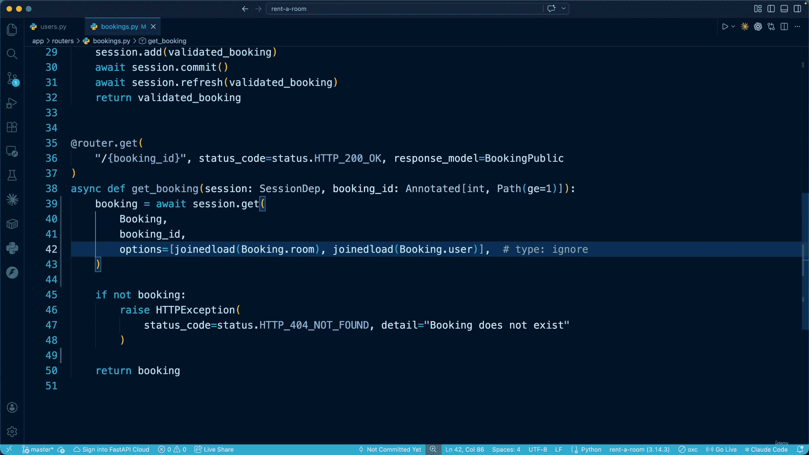
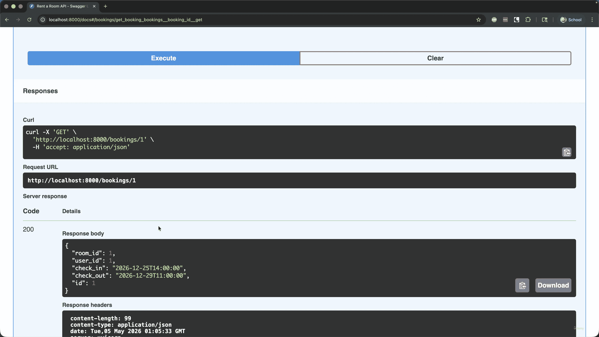
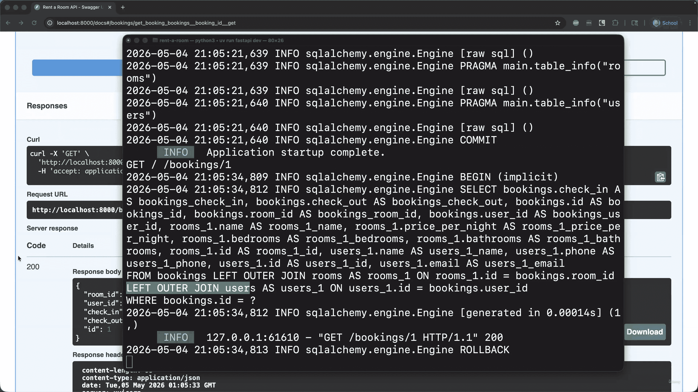
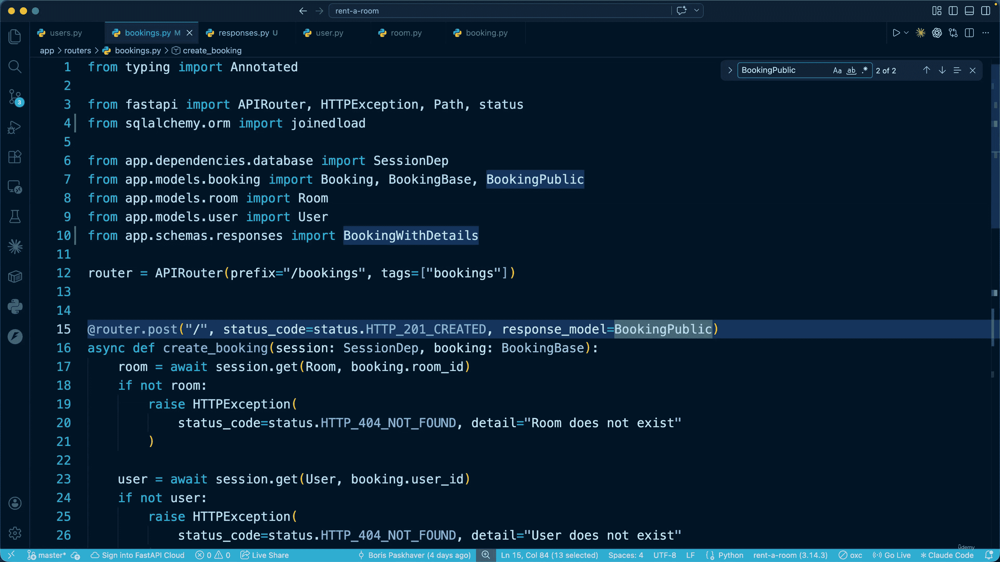
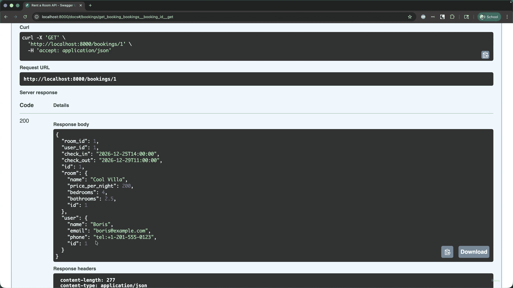

# 🚀 FastAPI 大师课（Part 2）：第108节：使用 joinedload 函数进行预加载

## 📖 FastAPI 大师课（Part 2）：第108节：本节概述

在本节课中我们将要学习如何把前面学到的 SQL 连接知识用到实际接口里，用 `joinedload` 把一条 booking 对应的完整 room 和 user 一起拉出来。简单说，前面我们理解了 join 是什么，本节要把它变成 FastAPI 接口里的真实代码，让查询结果不只是 booking 本身，还能带上关联的 room 和 user 数据。

整体思路分三步：先在路由里用 `joinedload` 做预加载，再通过服务器日志确认 SQL 查询确实做了左连接，最后设计一个组合响应模型，把 booking、room、user 三部分数据按一个响应形状返回给前端。下面先看本节的主线步骤，以下列表把操作顺序列清楚：

- 在 bookings 路由中导入 `joinedload`。
- 在获取单条 booking 的接口里配置两个 `joinedload`。
- 在 Swagger 中测试并查看服务器日志。
- 创建独立的响应模型文件。
- 定义包含 room 和 user 的 `BookingWithDetails`。
- 把新响应模型接到接口上并验证结果。
- 最后比较 `joinedload` 和 `selectinload` 的适用场景。

这些步骤看起来多，但核心就是“先查数据，再定形状，最后验证响应”。理解这个顺序后，后面写代码会更容易对上号。

## 🧩 FastAPI 大师课（Part 2）：第108节：理解 joinedload 与左连接

上一节我们介绍了 SQL 中 join 的基本概念，本节中我们来看看 `joinedload` 在查询里到底做了什么。`joinedload` 会执行一次左连接，把关联表的数据拼到主查询结果里。左连接可以简单理解为：以 booking 表为主表，把 rooms 表和 users 表里能对上的行拼到 booking 行的右边；对不上的时候，右边就是空。

原文里提到，`joinedload` 会左连接到本次查询拉取的第一个表，这个表对应传给 `get` 方法的第一个模型。换句话说，查询的主模型决定了左连接从谁出发。核心概念可以用下面的代码表示：

```python
joinedload(Booking.room)  # 左连接 rooms 表，把 room 数据拼到 booking 行右侧
joinedload(Booking.user)  # 左连接 users 表，把 user 数据拼到 booking 行右侧
```

这里还要注意一个区别：`joinedload` 和 `selectinload` 的语法很像，但生成的 SQL 不一样。后面我们会看到，`joinedload` 在这种情况下总共只有一条查询，而 `selectinload` 的行为不同。理解这一点后，下一节我们进入路由代码，看看如何把 `joinedload` 加到获取单条 booking 的接口里。

## 🛠️ FastAPI 大师课（Part 2）：第108节：导入 joinedload

前面理解了 `joinedload` 的作用，本节中我们来看看代码里怎么导入它。原文从 bookings 路由文件的顶部开始，也就是 `app/routers/bookings.py` 这个位置。这里需要从 SQLAlchemy 库中导入 `joinedload`，更准确地说，是从 SQLAlchemy 的 ORM 模块里导入 `options` 的配套函数 `joinedload`。

为了让操作更清楚，下面列出导入时需要确认的要点，以下是具体内容：

- 导入位置在 bookings 路由文件顶部。
- 导入来源是 SQLAlchemy 的 ORM 模块。
- 导入对象是 `joinedload`。
- 这个函数用于给查询的 `options` 参数提供预加载能力。



对应代码如下：

```python
from sqlalchemy.orm import joinedload
```

导入完成后，下一步就是找到获取单条 booking 的路由，并在 `get` 方法里配置 `options` 参数。这个导入本身不复杂，但它是后面两个 `joinedload` 能生效的前提。

## 🔍 FastAPI 大师课（Part 2）：第108节：配置单条 booking 查询

上一节我们完成了导入，本节中我们来看看如何在获取单条 booking 的路由里配置预加载。先向下滚动到获取单个 booking 的路由，为了便于编辑可以先腾出一些空间。然后在这个路由的 `get` 方法中，给 `options` 参数传入一个列表。

这里需要传两个条目，因为本次要拉取两个关联：room 和 user。第一个条目调用 `joinedload`，访问 `Booking` 类上的 `room` 关系属性；第二个条目再次调用 `joinedload`，访问 `Booking` 类上的 `user` 关系属性。语法和两课前的 `selectinload` 相同，只是函数换成了 `joinedload`。下面的列表说明配置时的关键点，以下是需要确认的内容：

- `options` 参数接收一个列表。
- 列表里可以放两个 `joinedload` 条目。
- 第一个条目预加载 `Booking.room`。
- 第二个条目预加载 `Booking.user`。
- 不强制两个都做，只预加载 room 或只预加载 user 也可以，列表只放一个元素即可。
- 本次示例选择同时左连接 room 和 user 两个关联。

对应代码可以写成这样：



```python
options=[
    joinedload(Booking.room),
    joinedload(Booking.user),
]
```

查询时，booking 的 `room_id` 会用来从 rooms 表拉取对应的行，booking 的 `user_id` 会用来从 users 表拉取对应的行，最后这些数据会合并到最终表的一行里。原文还提到，这里可以忽略类型检查提示，在代码后面加上 `# type: ignore`，这样提示就会消失，然后就可以在浏览器里测试。下面的代码展示忽略类型检查的写法：

```python
options=[  # type: ignore
    joinedload(Booking.room),
    joinedload(Booking.user),
]
```

配置完成后，下一节我们进入 Swagger 页面做一次测试，并通过服务器日志确认 SQL 查询是否真的做了左连接。



## 🌐 FastAPI 大师课（Part 2）：第108节：测试并查看服务器日志

前面已经把 `joinedload` 加到了路由里，本节中我们来看看实际请求会发生什么。先回到 Swagger 文档，向下滚动到 `GET /bookings/{id}` 这个接口，点击 Try it out，然后输入 booking id 为 1。执行后，好消息是会得到 200 响应；坏消息是 `response_model` 仍然设置为原来的 `BookingPublic` 形状，所以看到的还是原来的响应形状。

不过，有一种办法可以证明我们确实查询了关联的 room 和 user，那就是查看服务器日志。日志里会显示完整的 SQL 查询。这里要注意：和 `selectinload` 不同，`joinedload` 这次总共只有一条查询。查询会先从 bookings 表开始，然后左连接 rooms 表，同时左连接 users 表，把对应的 room 和 user 信息一起拉出来。下面用伪 SQL 表示这个查询结构，以下是查询的主要部分：

```sql
SELECT ...
FROM bookings
LEFT JOIN rooms ON bookings.room_id = rooms.id
LEFT JOIN users ON bookings.user_id = users.id
WHERE bookings.id = 1;
```

看到这条查询后，就能确认关联数据已经在数据库层被取出来了。现在剩下的问题，是把这些关联数据按照真正的响应形状返回给用户。下一节我们来看看如何设计一个组合响应模型，把 booking、room、user 三部分形状拼到一起。

## 🧱 FastAPI 大师课（Part 2）：第108节：设计组合响应模型

上一节我们验证了数据已经被拉取，本节中我们来看看如何把它组织成响应。这里有一个有意思的问题：现在的响应形状要建模一条 booking 的完整数据，同时还要建模 room 和 user 的完整数据。一个直观做法是在 booking 原有属性之上，再加两个顶层属性 `room` 和 `user`。

当我们要组合多个已经存在的模型或 schema 形状时，会难以确定这个新 schema 到底放在哪个文件里，因为 booking 涉及 room，也涉及 user。原文建议，在这种情况下，最好把新 schema 提取到一个独立文件中，与任何已有模型文件分开，用这个文件表明：这里定义的是一个组合多个模型元素的 schema。核心概念可以用下面的公式表示：

```text
BookingWithDetails = BookingPublic + { room: RoomPublic, user: UserPublic }
```

公式表达的意思是：新响应形状保留 `BookingPublic` 的全部内容，再额外加上 `room` 和 `user` 两个顶层属性。下一节我们创建 `schemas` 目录和响应文件，把这个公式落到代码里。

## 📦 FastAPI 大师课（Part 2）：第108节：创建 schemas 与 responses.py

前面确定了要建独立响应文件，本节中我们来看看目录怎么建。在顶层 `app` 目录下创建一个新文件夹，名字叫 `schemas`。schema 描述的是某个对象的形状，这里描述的是响应形状。然后在 `schemas` 目录里创建一个文件，名字叫 `responses.py`。

原文说明，如果以后响应很多，可以创建多个 Python 文件，对响应做不同分类；当前代码库比较小，所以先把各种 Pydantic 模型或 SQLModel 模型都放在 `responses.py` 里，这些模型都是其他模型的组合或合并。下面列出创建目录和文件时的要点，以下是需要完成的内容：

- 在 `app` 目录下创建 `schemas` 文件夹。
- 在 `schemas` 文件夹中创建 `responses.py`。
- 在 `schemas` 文件夹中补一个 `__init__.py`，让 Python 把它识别为包。
- 当前阶段把组合响应模型集中放在 `responses.py`。
- 后续响应类型变多时，再考虑拆分多个文件。

对应目录结构可以写成这样：

```text
app/
  schemas/
    __init__.py
    responses.py
```

其中 `__init__.py` 的添加方式是创建两个下划线的 init 文件，也就是双下划线加 `init` 再加双下划线，这样 Python 就会把这个目录当成包。目录准备好后，下一节我们来定义 `BookingWithDetails` 这个具体响应模型。

## 🧬 FastAPI 大师课（Part 2）：第108节：定义 BookingWithDetails

上一节建好了响应文件，本节中我们来看看响应模型怎么继承和组合。先打开 booking 模型文件，也就是原文中提到的 `booking5` 对应位置。当前响应形状是 `BookingPublic`，它继承自 `BookingBase`，包含四个属性以及 `id`。这些内容需要保留，因为接口本质上仍然是在返回一条 booking 的信息，只是要在原有属性之上附加 room 和 user。

一个办法是子类化现有的 `BookingPublic`。在 `responses.py` 中先导入 `BookingPublic`，它是当前形状。然后定义一个 new class，名字叫 `BookingWithDetails`，名字可以自由选择，这里继承 `BookingPublic`。由于 `BookingPublic` 已经继承自 `BookingBase`，而 `BookingBase` 本身是 SQLModel，所以不需要再从 SQLModel 导入其他东西，功能可以直接使用。

接下来要增加两个顶层属性：`room` 和 `user`。代码里已经有 `RoomPublic` 和 `UserPublic` 这两个模型，分别存储单个 room 和单个 user 的 public 形状。从 `app.models.room` 导入 `RoomPublic`，它包含 `id`，并继承 `RoomBase`，所以会包含 room 表列对应的属性；再从 `app.models.user` 导入 `UserPublic`，它包含 `id` 和几个属性。这里也体现了统一命名方案的价值：`RoomPublic`、`UserPublic` 这种命名能让人一眼看出用途。下面的代码展示响应模型的定义方式，以下是核心写法：

```python
from app.models.booking import BookingPublic
from app.models.room import RoomPublic
from app.models.user import UserPublic

class BookingWithDetails(BookingPublic):
    room: RoomPublic
    user: UserPublic
```

需要特别注意的是，当把这个响应形状指定给 booking 接口时，必须确保关联数据已经被拉取。把 `BookingWithDetails` 交给 `response_model` 后，Pydantic 和 FastAPI 会负责把 ORM 对象转换成这个响应形状；但如果对应的 room 或 user 没有被取出来，或者只取出了其中一个而模型需要两个，就会报错。这个注意点可以用下面的引用强调：

> `response_model` 使用 `BookingWithDetails` 时，ORM 查询必须提前加载 `room` 和 `user` 关联数据，否则响应校验会失败。

模型定义完成后，下一节我们把它导入路由，并替换原来的 `BookingPublic` 响应模型。

## 🔗 FastAPI 大师课（Part 2）：第108节：接入新响应模型并验证

前面定义好了 `BookingWithDetails`，本节中我们来看看如何把它接到接口上。先在路由文件顶部从 `app.schemas.responses` 导入 `BookingWithDetails`。然后在获取单条 booking 的接口里，把 `response_model` 从 `BookingPublic` 换成 `BookingWithDetails`。这样 booking 就会带上关联的 room 和 user，room 使用 `RoomPublic` 作为形状，user 使用 `UserPublic` 作为形状，它们会成为 `BookingPublic` 所有内容之上的两个顶层属性。

这里还要回头确认是否仍然需要 `BookingPublic`。原文提到，另一个创建单条 booking 的接口仍在使用 `BookingPublic`，所以这个导入需要保留。下面的列表列出接入时的检查点，以下是需要确认的内容：

- 从 `app.schemas.responses` 导入 `BookingWithDetails`。
- 把获取单条 booking 的 `response_model` 改为 `BookingWithDetails`。
- 确认 `BookingPublic` 在其他接口仍然需要，不要误删导入。
- 确认查询里仍然保留 `joinedload(Booking.room)` 和 `joinedload(Booking.user)`。

对应路由片段可以写成这样：

```python
from app.schemas.responses import BookingWithDetails

@router.get("/bookings/{booking_id}", response_model=BookingWithDetails)
def get_booking(...):
    ...
```

完成接入后，回到浏览器，对同一个接口再次执行请求。此时响应体会更丰富：包含 `BookingPublic` 的所有属性，同时嵌套的 `room` 属性使用 `RoomPublic` 的形状，嵌套的 `user` 属性使用 `UserPublic` 的形状。再次强调，Pydantic 能使用 schema 校验形状的前提，是 ORM 一开始已经把数据取出来，所以必须使用类似 `joinedload` 的函数拉取关联数据。下一节我们比较 `joinedload` 和 `selectinload` 的适用场景，帮助你在不同关联关系下做选择。

## 🧠 FastAPI 大师课（Part 2）：第108节：比较 joinedload 与 selectinload

上一节完成了响应验证，本节中我们来看看两种预加载方式怎么选。原文再次强调，使用 `joinedload` 完成所有数据获取时，总共只有一条 SQL 查询：查询 booking，左连接 room，左连接 user。这个特点适合“一对一”关联，比如通过外键可以到达一条互补行，并且想把这条互补行的数据拼到原始记录的右侧。

`selectinload` 更适合“一对多”关联；而 `joinedload` 的 join 更适合“一对一”关联。返回的行会被 ORM 转换成对象或对象集合，用来表示关联关系，这样就能用 Pydantic 决定最终响应形状。下面用两个表达式概括选择原则，以下是核心判断方式：

```text
一对多关联 -> selectinload
一对一关联 -> joinedload
```

可以把它理解成：如果一条主记录会对应多条子记录，就用 `selectinload` 分开查更合适；如果一条主记录只对应一条互补记录，并且希望用一条查询把数据拼到右边，就用 `joinedload` 更直接。理解这个区别后，本节内容就进入收尾。



## ✅ FastAPI 大师课（Part 2）：第108节：本节总结

前面我们完成了路由配置、响应模型设计和实际验证，本节中我们做一次总结。本节课中我们一起学习了如何使用 `joinedload` 进行预加载：在 bookings 路由中导入 `joinedload`，在获取单条 booking 的接口里通过 `options` 列表预加载 `Booking.room` 和 `Booking.user`，并通过服务器日志确认 `joinedload` 会生成一条包含左连接的 SQL 查询。

我们还学习了如何把多个模型的形状组合成一个新的响应模型：创建 `schemas` 目录和 `responses.py`，定义 `BookingWithDetails` 继承 `BookingPublic`，再添加 `room: RoomPublic` 和 `user: UserPublic` 两个顶层属性，最后把新响应模型接到接口上验证返回结果。需要记住的是，响应模型只负责描述和校验形状，关联数据必须先由 ORM 查询加载出来，否则会报错。



最后我们比较了 `selectinload` 和 `joinedload`：`selectinload` 适合一对多关联，`joinedload` 适合一对一关联，并且能在一条查询里把互补行拼到原始记录右侧。到这里，本节从查询到响应形状的完整流程就串起来了。

