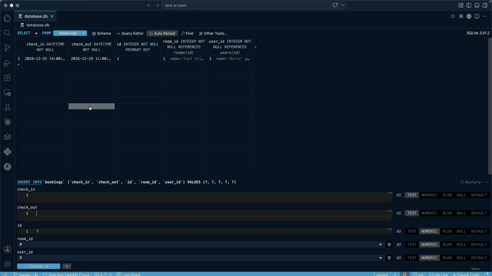
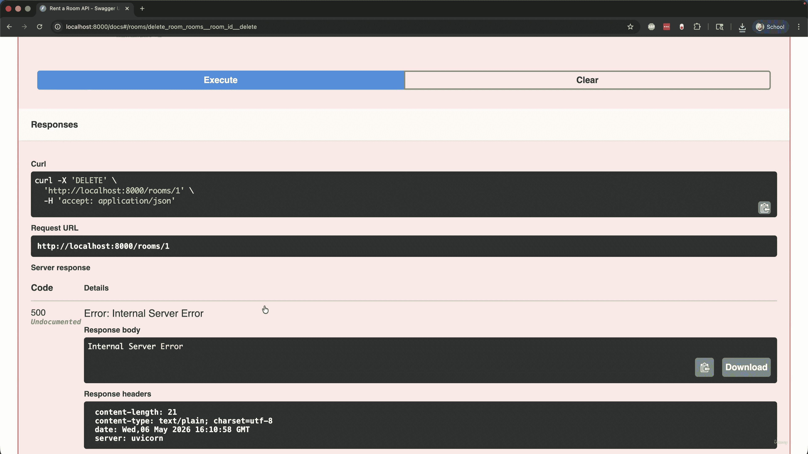
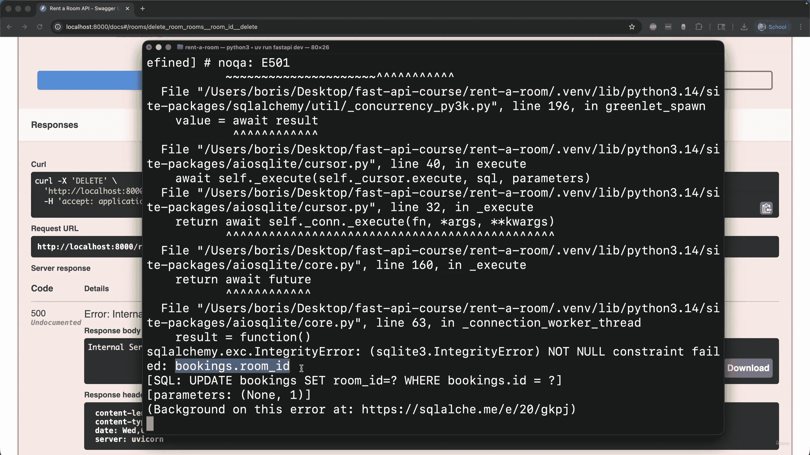
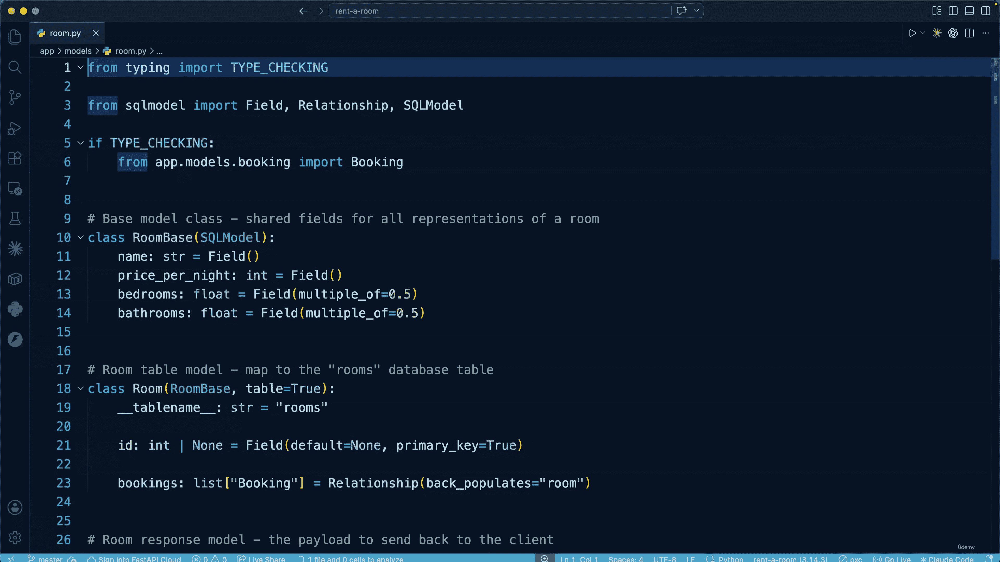
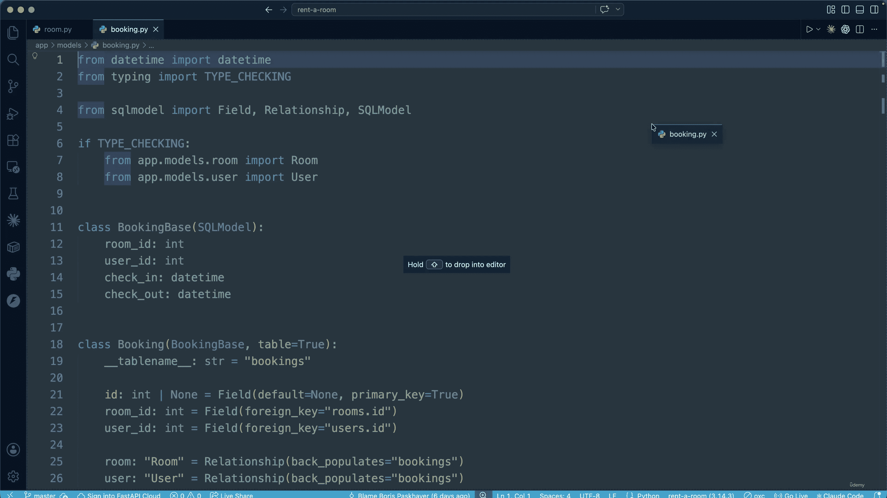
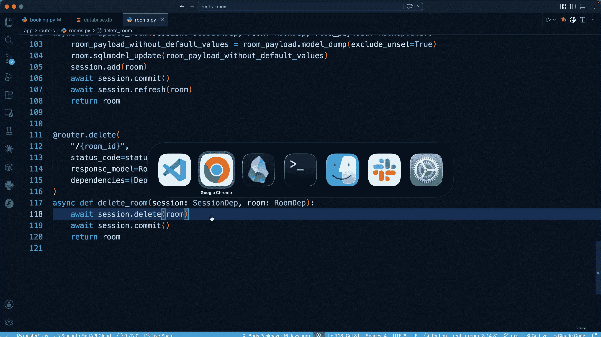
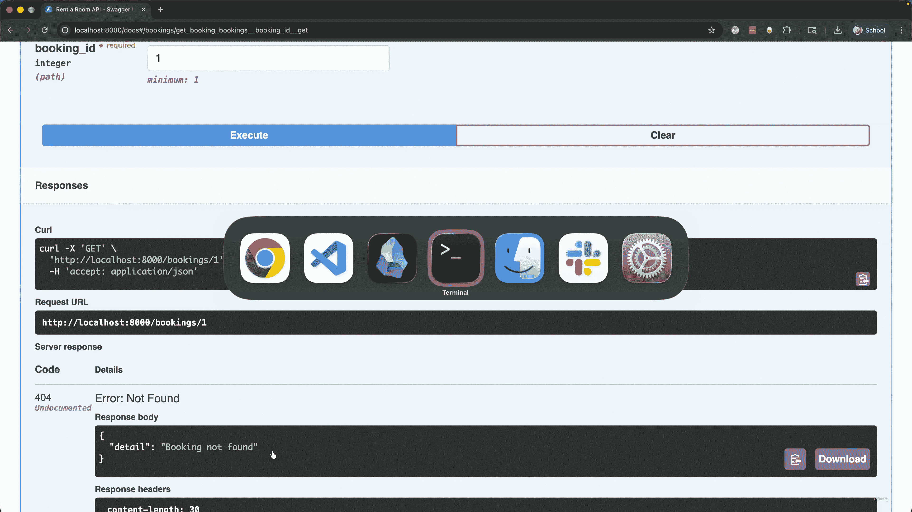
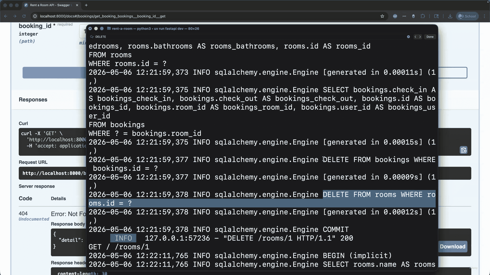
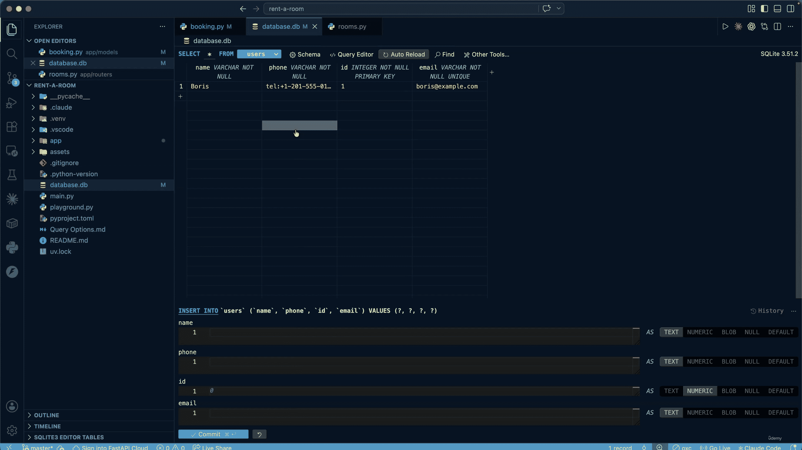

# 🚀 FastAPI 大师课：第2部分-P09-110：级联删除

## 📚 FastAPI 大师课：第2部分-P09-110：课程概述

在本节课中我们将要学习级联删除。当前应用里的 rooms 路由中有一个按 ID 删除单个房间的端点。这个端点现在直接调用会失败，原因是数据库校验错误。本课会先解释为什么失败，再一步步修复。过程中会讲外键、孤儿记录、软删除、级联删除、SQLModel 两侧配置以及实际测试。内容会尽量直白，让初学者也能理解每个概念之间的关系。

## 🧩 FastAPI 大师课：第2部分-P09-110：问题背景与失败原因

上一节概述了课程目标，本节来看看删除房间端点失败的根本原因。当前应用里有 rooms 路由，里面有按房间 ID 删除单个房间的端点。实际请求会失败，并返回数据库验证错误。这里要回答一个外键场景的问题：删除一条被其他记录引用的记录时会发生什么。例如，数据库里有房间 ID=1，也有一条预订记录 booking 的 room_id=1。现在删除房间 ID=1，那么这条对应的 booking 记录应该怎么处理。删除后，booking 会变成孤儿记录。

孤儿记录就是外键指向了一条已经被删除的记录。数据库一般不允许这种状态。因此，删除被其他表外键引用的房间时，数据库会拒绝操作并抛错，FastAPI 也会因此返回错误状态码。

以下是理解这个问题的几个关键点，先给出简短说明，方便后面继续展开。

- 删除被外键引用的记录，可能产生孤儿记录。
- 孤儿记录会让外键指向不存在的记录。
- 数据库默认会阻止这种删除，并抛出外键约束错误。
- FastAPI 收到数据库错误后，会向客户端返回错误状态码。

技术上，这个错误的名称是外键约束错误。原因是另一张表里存在外键，在本例中是 bookings 表，它阻止房间 ID=1 被删除。同样的规则也适用于删除用户的假设端点。如果尝试删除用户 ID=1，这个操作也会被禁止，因为 bookings 记录会变成孤儿记录，它的 user_id 不再对应一个仍然存在的有效用户记录。

## 🧭 FastAPI 大师课：第2部分-P09-110：解决思路与业务决策

上一节说明了失败原因，本节继续看可选解决思路。解决这个问题有几种不同方案，但最终选择取决于业务和产品经理。代码只是反映业务想要什么、产品经理想要什么，并不存在唯一且始终正确的最佳实践。有时确实希望记录被永久删除，从数据库清除后就不再存在；有时希望保留更久，甚至永久保留。

以下是两种常见思路的简短介绍，它们分别代表“保留记录但隐藏”和“删除记录并连带清理关联记录”。

- 软删除：给房间增加状态字段，把删除变成归档。
- 级联删除：删除房间时，同时删除引用该房间的预订记录。

### 🧊 FastAPI 大师课：第2部分-P09-110：软删除方案

上一节提到软删除思路，本节具体看它怎么做。可以在房间表增加 status 列。用户想删除房间时，不真正删除，而是把状态改成 archived。渲染可预订房间列表时，排除所有 archived 房间。这样做的优点是，已有预订或过去的预订仍然引用 archived 房间，因此仍能取出并展示该房间的全部信息，因为外键关联仍然存在。同时，可以阻止未来再预订这个 archived 房间。这样就在效果上模拟了删除。

这种方案有时叫软删除。核心做法是记录仍然留在数据库里，但给它一个状态或标记，让它在业务上被隐藏，给人已经被删除的印象，其他人找不到实际数据，但数据仍在数据库里，方便未来留档。可以用下面的公式和代码表示。

```text
软删除：记录仍存在 + 状态标记隐藏 => 业务上表现为已删除
```

```sql
UPDATE rooms
SET status = 'archived'
WHERE id = 1;

SELECT *
FROM rooms
WHERE status != 'archived';
```



### 🌊 FastAPI 大师课：第2部分-P09-110：级联删除方案



上一节介绍了软删除，本节转向本课要演示的更激进方案。为了示例，这里选择更激进的做法。假设产品经理要求：删除房间时，也删除引用该房间的对应预订记录。这样可以防止产生孤儿记录，因为 booking 不会继续引用一个不存在的房间。用户删除房间时，同时删除所有对应 booking。

这个技术术语叫级联。级联删除的意思是让删除操作像瀑布一样向下传递。cascade 这个词来自瀑布的概念：水从一层落下，会触发下一层落下，必要时再触发下一层。数据库里也是同一思路：一个动作，例如删除房间，可以触发后续数据库动作，例如删除它关联的所有 booking。一次操作触发下一次操作，删除一条记录会要求数据库删除另一张表里的关联记录。

用公式表示如下。

```text
删除 room(id=1)
=> 删除 bookings WHERE room_id = 1
=> 再删除 room(id=1)
```

这里再次说明，删除房间时也删除 booking，不代表这是最好的业务决策或技术决策，本课只是演示如何在代码中实现。



## 🧪 FastAPI 大师课：第2部分-P09-110：复现删除错误

上一节介绍了级联删除的概念，本节回到浏览器复现当前错误。先看当前数据库状态：有一个房间、一个用户、一个预订，它们的 id 都是 1，分别位于各自表中。现在尝试删除 id=1 的房间。因为有一条 booking 引用了这个房间，所以发出删除请求后会看到服务器返回 500 Internal Server Error。

以下是复现错误时观察到的关键信息。

- 请求：删除 id=1 的房间。
- 结果：服务器返回 500 Internal Server Error。
- 原因：数据库中存在 booking 引用该房间。
- 日志：SQLAlchemy 报完整性错误。





查看终端里的服务端日志，可以看到问题在这里：SQLAlchemy integrity error，NOT NULL constraint failed: bookings.room_id。日志说明 bookings 表的 room_id 列引用了正在删除的房间 ID=1，因此数据库不允许孤儿记录存在。数据库默认会阻止这种可能有危害的行为，所以禁用了该删除动作。

需要说明的是，删除 booking 本身不会有问题，因为 booking 是存储外键的一方。如果从业务角度删除 booking，虽然不理想，因为会丢失一些业务数据，但不会产生孤儿记录，因为 room 记录和 user 记录都可以独立存在。进一步证明这一点的是，创建数据时必须先创建 room 和 user，再创建 booking，所以是 booking 持有指向这两张表的外键。只有当 room 或 user 表经历删除时，SQL 才会再次检查是否有 booking 引用该 room。

## 🛠️ FastAPI 大师课：第2部分-P09-110：在 SQLModel 中配置级联删除

上一节复现了错误，本节进入代码配置。回到 VS Code，打开两个互补的模型文件：room 和 booking，并排打开。SQLModel 的工作方式有一个关键点：需要在关系两侧都指定级联关系。一侧负责实际与数据库通信，因为级联删除最终是数据库特定操作；另一侧负责在运行时更新记录之间的关联，也就是让 Pydantic 模型知道删除发生后不再拥有对应的关联关系。

以下是两侧需要做的配置，先给结论，再看代码。

- room 模型：在 relationship 参数上增加 `cascade_delete=True`。
- booking 模型：在外键列上增加 `ondelete="CASCADE"`。
- 两边都要配置，缺一不可。

在 room 模型里，找到与 booking 的 relationship，在参数中增加 `cascade_delete=True`。这个参数表示：删除 room 时，也请求删除通过 room_id 引用该 room 的 bookings。这里容易混淆，但可以记住：room 是主键所在的表，room_id 被 booking 引用，所以级联参数写在 room 的 relationship 上。

```python
class Room(SQLModel, table=True):
    # 其他字段省略
    bookings: list["Booking"] = Relationship(
        back_populates="room",
        cascade_delete=True,
    )
```

在 booking 侧，不把参数加在 relationship 上，而是加在真正的外键列上。booking 有 room_id 列，映射到 room 表的 id 列，这就是外键。在这个外键列上增加 `ondelete="CASCADE"`。原文强调参数名使用小写且没有空格或下划线，值是全大写字符串 `CASCADE`。SQLModel 要求两边都声明，所以这里和 room 侧都要写，这样才能把整套关系接好。

```python
class Booking(SQLModel, table=True):
    # 其他字段省略
    room_id: int = Field(
        foreign_key="room.id",
        ondelete="CASCADE",
    )
```

作者也常混淆哪一行负责什么，所以会参考文档，并把文档作为本课资源。可以这样理解：外键列上的 `ondelete="CASCADE"` 主要负责数据库侧的动作，room 关系上的 `cascade_delete=True` 负责让 Python 运行时里的模型彼此通信、更新关联。两者配合，才是完整配置。



## 🌐 FastAPI 大师课：第2部分-P09-110：测试级联删除

上一节完成了模型配置，本节测试实际删除。现在一切接好，可以到浏览器验证。先看数据库当前状态。如果你的数据库和这里不同，可以按需要创建记录，最低要求是有一个 user、一个 room、一个 booking。这里确认三类记录各有一条。

打开 Swagger 文档并刷新，展开删除房间端点，点击 Try it out，输入房间 ID=1，执行。预期是级联删除会同时删除对应的 booking 记录。这里还要指出，rooms 路由里的删除路由代码不需要额外修改。路由处理函数没有额外声明要去了解引用该房间的 booking，代码保持原样。把 room 传给 session 的 delete 方法时，背后的 SQL 模型关联知道如何执行对应数据库查询。

以下是测试时预期观察到的结果。



- 删除 room id=1 返回成功响应。
- 再查询 room id=1 返回 404，因为房间已不存在。
- 再查询 booking id=1 返回 404，因为级联删除已删除该 booking。
- 服务端日志出现两条 DELETE 查询。

在 Swagger 中执行删除后，得到成功响应，这是好迹象。再按 ID 查询房间，返回 404，说明房间已不在数据库。最终要验证的是 booking 是否被连带删除。查询 booking id=1，它原先指向 room id=1，级联删除应该已经删除它。执行后返回 404 Not Found。转到服务端日志并向上滚动，找到对应的删除记录。

日志里有两条发往数据库的删除查询。第一条删除 bookings 记录，因为这条 booking 引用了准备删除的 room。为了避免之前看到的外键违规，数据库先删除引用 room id=1 的 booking，使两张表之间不再有依赖或耦合。booking 删除后，才删除 room id=1。因此，由于模型之间的关系和关联，删除 room 会自动让 ORM 删除对应 booking，所以之后查不到该 booking。

## 🗂️ FastAPI 大师课：第2部分-P09-110：检查数据库与用户记录



上一节通过接口验证了级联删除，本节检查数据库文件。回到 VS Code，查看 db 文件可以再次确认：现在没有 room，没有 booking，但仍然有一个 user。原因是没有在 user 上声明删除或级联关系，所以删除 user 不会自动删除对应 booking。处理 booking 这种连接表时要更小心，因为它引用多张不同表，情况可能变得复杂。SQLAlchemy 和 SQLModel 还提供更多高级选项，可用于各种数据库关系，本课只是基本示例。

以下是检查数据库后的注意点。

- rooms 表为空，说明房间已删除。
- bookings 表为空，说明级联删除生效。
- users 表仍有一条记录，因为 user 未配置级联。
- join 表引用多表时，级联策略需要更谨慎设计。

## ✅ FastAPI 大师课：第2部分-P09-110：课程总结



本节课中我们一起学习了级联删除的完整流程。当前 rooms 路由的删除房间端点会因为外键约束而失败，因为 booking 引用了 room，直接删除会产生孤儿记录。数据库默认阻止孤儿记录，所以 FastAPI 返回错误状态码。解决方案取决于业务和产品经理，软删除用状态标记隐藏记录，级联删除则在删除 room 时连带删除 booking。级联删除的核心是让一个删除动作像瀑布一样触发后续删除，配置 SQLModel 时需要在 room 关系上写 `cascade_delete=True`，在 booking 外键列上写 `ondelete="CASCADE"`。配置正确后，删除房间端点代码不需要改变，ORM 会在背后先删除关联 booking，再删除房间，从而避免外键违规。最后通过 Swagger 和数据库文件验证了房间与预订都被删除，而用户记录仍然保留，因为用户侧没有配置级联。

