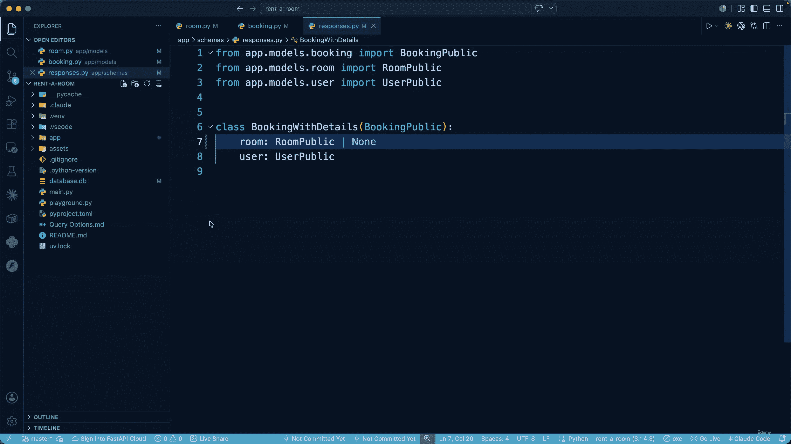
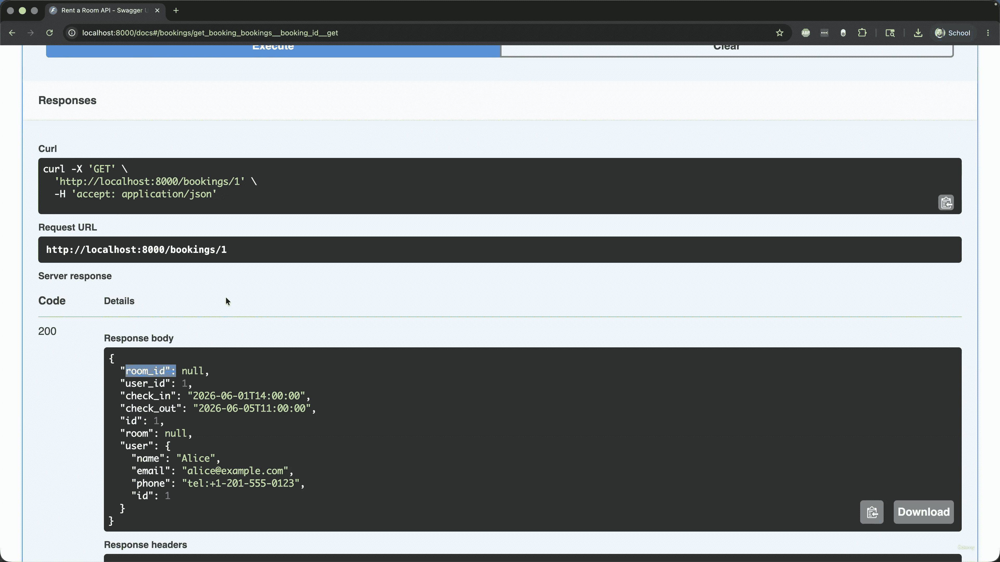
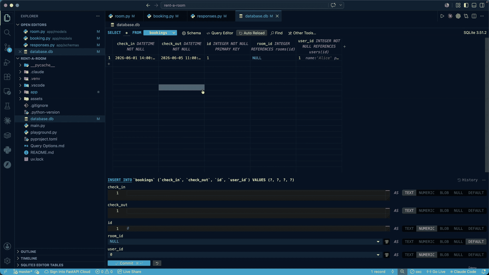

# FastAPI Masterclass：Part 2 P10 111：删除时设置 NULL（SET NULL on Delete）

在本节课中，我们将学习一种与级联删除互补的删除策略：当删除主记录时，不再把关联记录一并删除，而是把关联记录上的外键列设置为 NULL。我们会先回顾级联删除，再解释为什么要启用 SQLite 的外键规则，然后修改 Room 和 Booking 两个模型，最后在 Swagger 中实际验证效果。整个过程会尽量用大白话解释，让初学者也能跟着做。本节课会涉及以下几个关键步骤：启用 SQLite 外键约束、设置 `passive_deletes`、设置 `ondelete="SET NULL"`、更新 Pydantic 模型的可空类型，以及从零开始测试。

## 回顾级联删除，理解 SET NULL 的思路

在上一节课中，我们探索了级联删除。简单来说，当我们删除一个主记录（比如一间房）时，SQL 可以顺势把对应的预订记录也删除。这些预订记录通过外键指向原始房间记录，所以数据库在删除房间时，可以把那些“挂”在房间下面的预订一条条清掉。

除了级联删除之外，其实还有另一个选项可用。而且对于类似 Airbnb 这样的应用来说，这个选项可能更合适。当用户删除一间房时，我们并不一定要把对应的预订记录也删除。相反，我们可以把该预订记录里的 `room_id` 字段在数据库中设置为 NULL。

这里先解释一下 NULL。NULL 是 SQL 里用来表示“空”或者“不存在”的值，就像 Python 里的 `None` 对象表示“什么都没有”一样。采用这种设计，我们仍然可以保留预订记录本身，包括入住时间、退房时间以及用户 ID。我们只是断开了预订与那间已经不存在了的房间之间的链接。

保留历史数据在许多业务场景下都很有价值。举个例子，当一间房被删除后，我们仍然可以把所有历史预订都保留下来，这些历史预订还可以关联到其他补充记录上，比如账单、报表等等。很多时候我们并不想删除所有东西，因为有些重要数据需要被保存下来。所以，删除主记录时把外键列设置为 NULL，就是要解决“保留数据、断开无效关联”的问题。

用公式来表示，级联删除和 SET NULL 的区别如下：

```sql
-- 级联删除：
DELETE FROM rooms WHERE id = 1;
--> 自动执行：DELETE FROM bookings WHERE room_id = 1;

-- SET NULL：
DELETE FROM rooms WHERE id = 1;
--> 自动执行：UPDATE bookings SET room_id = NULL WHERE room_id = 1;
```

这个公式揭示了两种策略的本质差异：级联删除会让关联记录消失，而 SET NULL 只是让外键失去指向，关联记录本身仍然存在。

## 为什么需要启用 SQLite 的外键规则

要实现 SET NULL 这个做法，我们首先需要告诉 SQLite 去强制启用外键规则。你可能会问，之前不是一直有外键吗？实际上，SQLite 本身可以存储像 `room_id` 和 `user_id` 这样的外键列，SQLAlchemy 也会用它们来做 join 和关系映射，但 SQLite 默认并不会真正去强制执行这些外键的约束规则。

举个例子，默认情况下，SQLite 并不会阻止你插入一条 `room_id` 不存在的预订记录。到目前为止，一切都能正常工作，是因为 SQLModel 和 SQLAlchemy 在 Python 这一侧帮我们管理了这些关系。但是，我们要做的“把预订记录的 `room_id` 列设置为 NULL”这个动作，实际上是一个数据库层面的操作。我们希望向数据库发起一个调用，让数据库自己去执行设置 NULL 这个动作。因此，我们必须在 SQLite 里启用相关的功能。

接下来要打开 `database.py` 文件。这一部分代码其实不需要你死记硬背。当需要添加某个功能时，你只需要查阅文档，或者搜索一下就行。具体来说，我们要从 SQLAlchemy 中导入一个东西。SQLAlchemy 是 SQLModel 底层所依赖的 ORM，我们要从 SQLAlchemy 的顶层导入 `event`。

在创建好 `engine` 对象之后，我们要用到 `event`。`event` 是一个对象，它上面有一个方法叫 `listens_for`，这个方法会返回一个装饰器。我们要在 `listens_for` 前面加上 `@` 符号。用这个装饰器，可以监听指定事件，从而挂钩到 SQL 引擎的生命周期中。这个概念和 FastAPI 里的 lifespan 很相似：在数据库连接或引擎存在的过程中，会有一些特定的时刻，我们可以挂钩到这些事件上，并在那一刻执行额外的代码。

第一个参数是我们挂钩的对象，也就是上面创建的 `engine`。我们需要访问它的 `.sync_engine` 属性。第二个参数传入字符串 `"connect"`，表示我们监听“连接到引擎”这个事件。我们实际上是拦截这个连接时刻，然后运行一小段额外代码。这段代码可以通过下方定义的 Python 函数来表达。

在这里，我们要定义一个函数，函数名自己定，我打算叫它 `enable_foreign_keys`，因为这就是我要做的事情。为了通过类型检查器的检查，这个函数需要提供两个参数。第一个参数是 `db_api_connection`，它基本上就是一个代表底层数据库连接的对象。第二个参数是 `connection_record`，这个参数在函数体里用不到，但为了类型检查，它是必须的。这背后有很多复杂细节，不过这正是那种你在 Stack Overflow、Google 上查一下，或者直接问 AI 就能拿到答案的典型代码。AI 基本上会告诉你加上这么一段。

我们做的事情，说白了就是拦截引擎的启动或连接过程，然后执行一小段代码，以在 SQLite 中启用外键功能，这样才能测试“设置列为 NULL”的效果。在代码里，我们调用 `db_api_connection.execute` 方法，在连接引擎的那一刻执行 SQL 代码。这段 SQL 就是大写的 `PRAGMA foreign_keys = ON`。`PRAGMA` 是一条用来配置或定制数据库行为的命令。它能够启用 SQLite 的外键约束。

有了这个约束，每当我们删除一条房间记录时，如果预订表里有指向该房间记录的外键，SQLite 就有能力执行我们要求它做的操作，也就是把 `room_id` 的值设置为 NULL。下面是在 `database.py` 中需要添加的代码：

```python
from sqlalchemy import event

@event.listens_for(engine.sync_engine, "connect")
def enable_foreign_keys(db_api_connection, connection_record):
    db_api_connection.execute("PRAGMA foreign_keys = ON")
```

这段代码中的 `connection_record` 虽然没有被使用，但保留它才能让函数签名符合事件监听的预期，从而让类型检查器满意。

## 修改 Room 模型：打开被动删除的开关

数据库那边的复杂性已经处理好了，接下来我们就去配置两个模型。先从 Room 模型开始。我们打开 `room.py` 文件，在这里需要找到与预订记录（bookings）的实际关系配置。在 Room 模型里，关系就在这里。我们要把原来的级联删除参数去掉，然后添加 `passive_deletes=True`。

让我们花点时间解释一下这个参数到底在做什么。`passive_deletes` 告诉 SQLModel：请你信任数据库，别在 Python 这一侧操心去更新任何记录。单词 passive 的意思是“不主动的、懒的”，换句话说就是“不采取行动”。所以，我们是在要求 SQLModel 对删除操作保持被动，也就是说，当我们删除一间房的时候，它不要去做任何额外的动作。这一点非常关键，因为实际上删除房间这个动作会触发预订表里的那个互补更新，但这个更新不是发生在 ORM 这一侧，而是自动发生在数据库那一侧。

所以，`passive_deletes` 基本上就是说：在 Python 这一侧，只要代码中删除了房间，你别管那些预订记录，就当作一次被动的房间删除好了。数据库会去处理预订记录的补充逻辑。真正的逻辑在别的地方，你不用担心，你就保持被动，不要主动。下面是一个关系配置的典型写法：

```python
bookings: list["Booking"] = Relationship(back_populates="room", passive_deletes=True)
```

在这个配置中，`passive_deletes=True` 告诉 SQLModel，删除房间时不需要由 Python 侧去级联处理预订记录，数据库会负责后续动作。

## 修改 Booking 模型：设置外键策略和可空类型

接下来打开预订模型，也就是 `booking.py`。这里才是更重要代码的所在位置。我们之前写的是 `ondelete="CASCADE"`，它会在删除房间的同时，把通过 `room_id` 关联到该房间的预订记录也删掉。但现在，关键的是，我们要换一个字符串参数，写成 `ondelete="SET NULL"`。这才是与 `passive_deletes` 搭配使用的真正代码。

整个过程的职责划分是这样的：ORM 这一侧只需要发出从数据库删除房间的调用；而数据库那一侧会知道，当删除房间时，对于那些引用该 `room_id` 的预订记录，不要删除预订，而是把它们在 `room_id` 列中的值设置为 NULL。重申一下，NULL 是 SQL 里表示“空/不存在”的概念。

为了适应这个变化，我们还需要更新一些类型。第一处是每当从数据库中取出一条预订记录时，现在存在一种可能：它关联的房间已经被删除了，所以 `room_id` 列中的值确实可以为 NULL。因此，在 Python 对应的表示中，当 ORM 从数据库查询到那一行，并且把它转换成 Pydantic 模型时，`room_id` 可能是整数，也可能是 Python 的 `None`。这里可以使用竖线 `|` 表示“或”操作，把 `room_id` 的类型声明为“可以是整数，也可以是 None”。例如：

```python
room_id: int | None = Field(default=None, foreign_key="rooms.id", ondelete="SET NULL")
```

第二处是房间这个关联属性，它现在也不再保证是一个 `Room` 对象了。如果你有一条没有 `room_id` 的预订，也就是说它的值为 `None`，那么你就没有办法再从数据库中查询出对应的房间了。所以，当你访问 `room` 属性时，它也可能变成 `None` 对象。原来那种直接写 `room: Room` 的语法就无法满足要求了，我们需要换一种写法来表达同样的含义：这个 `room` 关联要么给我们一个 `Room` 对象，要么，如果房间已经不存在了，它就是一个 Python 的 `None` 对象。

于是在文件最上面，我们要从 Python 标准库的 `typing` 模块中导入 `Optional`。这只是声明“一个值或者 None”的另一种语法，也就是“某个东西或者什么都没有”。我们写 `Optional[Room]`，放在方括号里面。这样声明就表示 `room` 现在可以是 `Room` 对象，也可以是 Python 的 `None` 对象。这之所以成为可能，是因为数据库里数据的形态已经变了。相关代码可以这样写：

```python
from typing import Optional

room: Optional["Room"] = Relationship(back_populates="bookings")
```

现在，`room_id` 和 `room` 都具备了容纳“空值”的能力，这样当我们从数据库取出一个已经失去房间关联的预订时，程序就不会因为类型不匹配而崩溃。

## 更新响应模型中的可空类型

除了 Booking 模型本身，我们还有一处需要更新，就是这里的 `BookingPublic` 类。这个 Pydantic 模型也要把 `room_id` 的可空语义包含进来。让我解释一下这里发生了什么。`BookingPublic` 这个模型继承自 `BookingBase`，它代表了创建预订时流入接口的数据形态。当你创建一条预订时，必然要有 `room_id` 和 `user_id`。但现在，我们返回一条预订时，有可能会发现关联的房间已经被删除了。所以，这里的 `room_id` 不再保证是整数。在删除的情况下，它可以是整数，也可以是 `None`。因此，为了覆盖继承来的 `room_id`，并且更精确地指定它的类型，我要在公共响应中写成 `room_id: int | None`。

还有一个模型我们也必须记得更新，它在 `responses.py` 文件里。提醒一下，我们有一个 `BookingWithDetails` Pydantic 模型，它提供关于预订的详细信息，因为它继承了 `BookingPublic` 的所有字段，并且还额外提供了一个完整的 `room` 对象和一个 `user` 对象，这些对象是从数据库取出来的关联记录。那么现在同样地，`room` 不再保证存在了，所以它在这里也可以是 `RoomPublic` 或 `None`。

相关代码可以这样调整：

```python
class BookingPublic(BookingBase):
    room_id: int | None

class BookingWithDetails(BookingPublic):
    room: RoomPublic | None
    user: UserPublic
```

如果你忘了这些具体的 schema 更新，其实也不是什么大问题。会发生什么呢？你会在 Swagger 里向某个端点发请求，然后得到一个 500 内部服务器错误。因为程序试图返回一个值为 `None` 的数据，却想把它建模成 `RoomPublic`，于是就会抛出那个错误。这个错误反而会帮助你追踪到对应的端点，然后看一下响应模型，意识到：“哦，这个类型已经不对了，我需要更新它。”所以，即使一开始没改完整，也可以通过报错信息快速定位问题。



## 从零开始，验证 SET NULL 的效果

现在，我们已经把代码里所有该更新的地方都更新完了。接下来我们从零开始测试。先删除或移除我们的 `database.db` 文件，然后重启服务器，再在 Swagger 文档里试试效果。我先按 `Ctrl+C` 关掉服务器，然后用 `uv run fastapi dev` 重新启动，这个命令同时也会创建一个空的 `database.db` 文件。好了，现在我们可以切换到浏览器去测试了。

打开 Chrome，来到 Swagger 文档页面，此时我们面对的是一个空数据库。那就从零开始吧。下面是本次测试的完整步骤：

- 创建一间房。
- 创建一个关联用户。
- 创建一条预订，把房间和用户关联起来。
- 删除那间房。
- 获取原来的预订，观察 `room_id` 是否变成 `null`。

先创建一间房。我快速过一下创建数据的流程。我们把房间名字设为 “Cool Villa”。这些值都是随便填的。价格设成 200，再填 4 和 2.5 之类的任意值。然后我们点击创建房间。接下来可以在下面看到返回结果，201 状态码，一切正常。

接着创建一位关联用户。往下找到 users 下的 POST 端点，创建用户。叫她 Alice，邮箱可以写 alice@example.co。我们需要一个有效的电话号码，这里我用 `+12015550123`，这个应该没问题。然后创建用户，下面可以看到同样返回了 201。

现在我们可以继续创建预订了。因为我们用的是全新数据库，所以用户和房间的 ID 应该都是 1。来到创建预订的 POST 端点，`room_id` 和 `user_id` 都填 1。然后可以填类似 `0601T14:00:00` 这样的入住时间。我把它复制到下面作为退房时间，退房时间可以设成 6 月 5 日上午 11 点左右。当然，所有这些值都是任意取的。现在我来创建一条预订，它会把 `room_id=1` 和 `user_id=1` 关联起来。

接下来就是核心功能了。我们删除那间房，然后希望如果一切正确的话，数据库里的那条关联预订记录会把 `room_id` 的值设置为 NULL，而不是删除这条预订。我们回到上面的 rooms 端点，发出一个 DELETE 请求，删除 ID 为 1 的房间，然后执行。可以看到，我们确实得到了一个成功响应。

那么接下来看看，如果我尝试获取 ID 为 1 的预订，会发生什么？这条预订以前就是与那个被删除的房间关联的。于是我向 `/bookings/1` 发请求，看看我们得到的结果。注意看，我们拿到了所有数据，并且可以直接看到数据库中的 `room_id` 列的值在 Python 中变成了 `None`，在 JSON 表示中变成了 `null`。这就是我们仍然保留预订信息的证据。这里包含预订行的所有字段，也仍然有用户的关联，因为用户还存在。但注意，`room` 属性被设置成了 `null`，而不是完整的房间对象；同时 `room_id` 也被设置成了 `null`。



如果你想再确认一下，当然可以到 VS Code 里打开 `database.db`，查看 bookings 表，注意看 `room_id` 已经变成了 NULL。也就是说，通过我们本课写的代码，我们并没有删除这一行、把它永久抹掉，而是保留了关于这条预订的所有信息。只不过我们不再有一个指向有效房间记录的指针或者说外键了，因为那间房在数据库中已经不存在了。用户仍然好好存在，我们完全可以通过预订关联到用户。所以一切看起来都很正常，符合预期。

## 总结

本节课中，我们一起学习了另一种与级联删除互补的删除策略：SET NULL。我们通过代码展示了如何让 SQLite 启用外键约束，如何在 Room 模型中设置 `passive_deletes=True`，如何在 Booking 模型中使用 `ondelete="SET NULL"`，以及如何更新 Pydantic 模型中的可空类型。我们还从零开始，通过 Swagger 完整验证了删除房间后，预订记录没有被删除，而是把 `room_id` 变成了 NULL。



这种方法与级联删除是不同的思路。到底用哪种，取决于你和你的业务希望如何处理数据删除，以及这些删除会对外键关联记录带来哪些副作用。希望本课的内容能帮助你在实际项目中做出更合适的选择。
