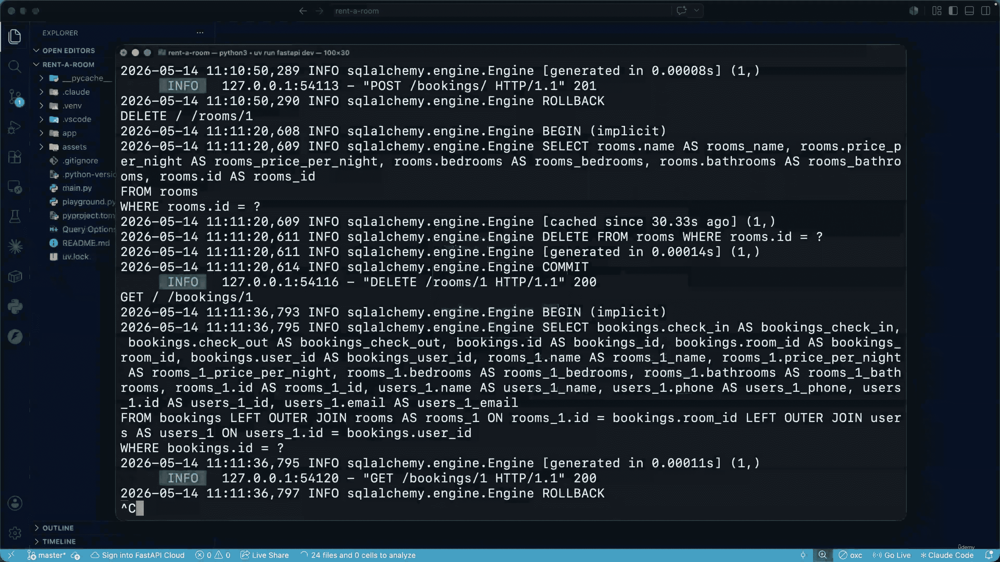
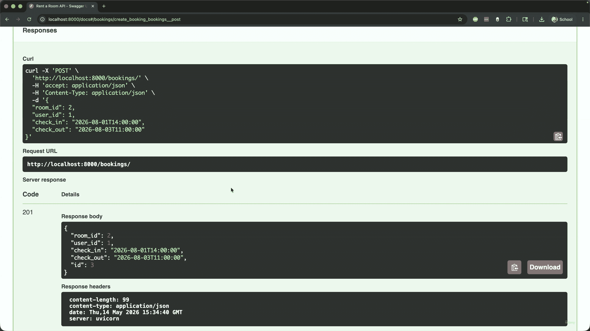
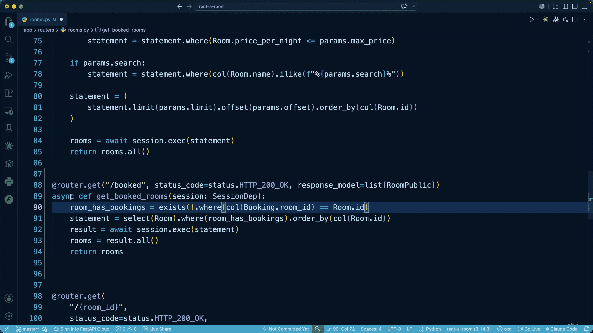
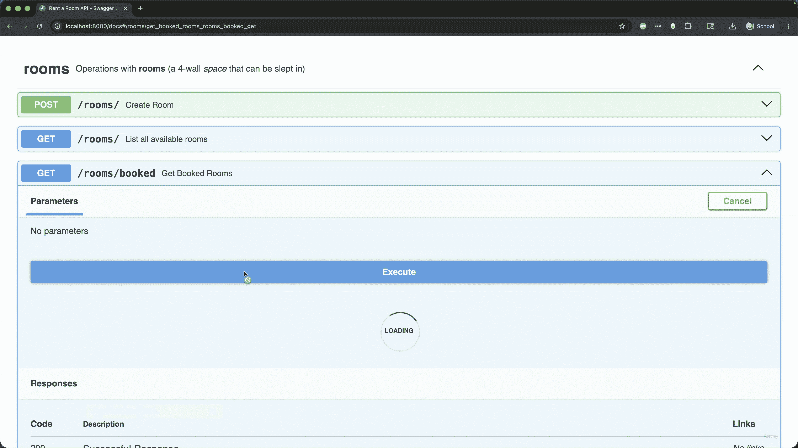
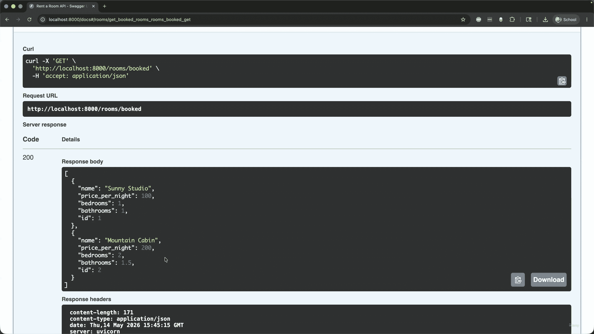

# FastAPI Masterclass：第 11 部分·第 112 节：使用 exists 函数查询已预订房间 🛎️

## 本节概览 📋

在本节课中，我们一起来学习如何用 SQLModel 的 `exists` 函数，从数据库里查出“已经被预订过的房间”。我们不会把每条预订记录都加载到 Python 中，而是让数据库自己判断“这个房间是否存在一条对应的预订记录”。这样的查询在日常后端开发里很常见，所以即使这节课没有引入很多全新的 FastAPI 概念，它仍然值得认真理解。

到目前为止，我们已经掌握了数据库关系建模和关联数据访问的绝大部分核心概念，比如在模型上定义关系属性、使用预加载把关联记录一起取出来。我们也已经见过 `select`、`load`、`join_load` 这类函数，它们可以把房间和对应的预订记录、用户记录一起加载回来。这套思路在“取一个对象，然后遍历它所有关联记录”的场景里特别好用，例如查询一个房间和它的所有预订。

不过，关系属性并不能回答所有问题。很多业务需求其实是要跨表做筛选或者聚合。比如“找出所有有预订记录的房间”，我们并不关心某个具体房间的预订内容，只关心“它到底有没有预订记录”。这就等于根据另一张表里的关联数据，来判断主表中的记录是否满足条件。再比如“每个房间被预订了多少次”，同样不需要把每一条预订都取回来，只需要按房间分组统计一下数量就行。这类操作应该让数据库来完成，而不是把所有数据拉到 Python 里再处理。

接下来的几节课，我们会看到连接、子查询、聚合函数这些数据库功能，它们能让我们把更复杂的问题交给数据库，最终拿到正确的记录。我们最终返回的仍然是一个个房间，但这些房间现在必须满足某些基于关联关系产生的条件。接口本身往往就是在做数据汇总和组合，这是后端开发者每天都会面对的工作。如果你暂时只想专注 FastAPI 本身，这部分内容也可以跳过，不影响后续主线。

## 为什么需要 exists 函数 🤔

上一节我们已经看到关系属性在“加载关联记录”时很好用，但如果要“根据关联记录是否存在来筛选主记录”，关系属性就不太方便了。`exists` 函数正是为了解决“关联是否存在”这一问题而存在的。它不会真的把关联表里的数据加载出来，而是只返回一个布尔判断结果：这个房间是否至少有一条预订记录。

我们可以把要解决的问题拆成下面几个判断：



- 房间 A 是否被预订？👉 查看预订表里有没有房间 A 的 ID。
- 房间 B 是否被预订？👉 查看预订表里有没有房间 B 的 ID。
- 房间 C 是否被预订？👉 查看预订表里有没有房间 C 的 ID。

用公式来表达，就是：

```text
房间被预订 ⇔ 预订表中存在一行记录，满足 Booking.room_id == Room.id
```

这个公式就是 `exists` 的核心思想。我们不需要把预订数据加载出来，只需要让数据库告诉我们“这个条件是否为真”。只要预订表里至少有一行满足条件，`exists` 就会返回真，然后这个房间就会被包含在查询结果中。

## 准备演示数据 🧪

为了让接下来的查询结果更容易理解，我们需要先删除原来的数据库，再重启服务器，确保大家数据起点一致。重新操作一次虽然有些繁琐，但目的是避免数据不一致带来的困惑。接下来我们打开浏览器，在 Swagger 文档里录入一些测试数据。

以下是我们需要创建的数据：



- 三个房间。

  - **Sunny Studio**：每晚 100 美元，1 间卧室，1 个卫生间。
  - **Mountain Cabin**：每晚 200 美元，2 间卧室，1.5 个卫生间。
  - **Beach House**：每晚 350 美元，4 间卧室，2.5 个卫生间。

- 一个用户。

  - 用户名是 **Alice**，邮箱是 `alice@example.co`，电话号码是 `+12015550123`。

- 三条预订记录。

  - 第一条：Alice 预订房间 ID 为 1 的 Sunny Studio，入住时间是 6 月 1 日 14:00，退房时间是 6 月 5 日 11:00。
  - 第二条：Alice 再次预订同一个房间 ID 为 1 的 Sunny Studio，时间改到未来，比如 7 月 10 日入住，7 月 15 日退房。
  - 第三条：Alice 预订房间 ID 为 2 的 Mountain Cabin，时间大概在 8 月，8 月 1 日入住，8 月 3 日退房。

这样录制出来的数据分布很清晰。现在，Alice 一共预订了 3 次，覆盖了 2 个房间。房间 ID 为 1 的 Sunny Studio 被预订了 2 次，房间 ID 为 2 的 Mountain Cabin 被预订了 1 次，房间 ID 为 3 的 Beach House 则完全没有被预订。也就是说，数据库里一共有 3 个房间，其中 1 个被预订两次，1 个被预订一次，还有 1 个没有被预订。

## 编写 /rooms/booked 端点 🛠️

数据准备好了，现在回到 VS Code。我们希望在 rooms 路由器里增加一个新端点，用来查询所有“已经被预订过的房间”。这个端点最终应该返回房间 ID 为 1 和 2 的两个房间，因为它们至少有一条预订记录。虽然我们需要查看房间和预订之间的关系，但我们并不关心具体的预订内容，也不需要把预订数据放在响应里。我们只是把预订表作为筛选房间的条件来源。

为了达到这个目的，我们需要在文件顶部导入两个东西。第一个是 SQLModel 提供的 `exists` 函数，第二个是 `Booking` 模型本身。导入代码如下：

```python
from sqlmodel import exists
from app.model.booking import Booking
```

`exists` 函数用来判断一个房间是否已经存在对应的预订记录，它不会去加载预订表里的全部数据。`Booking` 模型则用来描述预订表，这样我们才能写出“预订表里的 `room_id` 等于房间表里的 `id`”这种条件。

接下来，我们在 rooms 路由器里定义新端点。这里有一个非常重要的注意事项：这个新路由必须放在任何包含动态路径参数的路由之前。如果放在后面，比如放在 `/rooms/{room_id}` 之后，那么 `/rooms/booked` 会被优先匹配成 `room_id="booked"`，这就不对了。由于路由器顶部已经定义了公共前缀 `/rooms`，所以这个端点的完整路径就是 `/rooms/booked`。

下面是对应的代码实现：

```python
@router.get("/booked", status_code=status.HTTP_200_OK, response_model=list[RoomPublic])
async def get_booked_rooms(session: SessionDep):
    room_has_bookings = exists(Booking.room_id).where(Booking.room_id == Room.id)
    statement = select(Room).where(room_has_bookings).order_by(Room.id)
    result = await session.exec(statement)
    rooms = result.all()
    return rooms
```

这个端点返回的状态码是 `200 OK`，响应模型是 `list[RoomPublic]`。也就是说，我们返回的是一个房间列表，而不是预订列表。每个元素的类型都是房间的公开数据结构，里面不会附带预订信息。预订记录只参与筛选，不会出现在响应内容里。

`room_has_bookings` 这个变量是整个查询的关键，它就是我们用来过滤房间的条件。我们调用 `exists(Booking.room_id)`，表示要去预订表里检查是否存在某个 `room_id`。然后调用 `.where(Booking.room_id == Room.id)`，意思是“预订表里的 `room_id` 必须等于房间表里的 `Room.id`”。这其实是在构建一个布尔表达式，数据库会拿着这个表达式去判断每一个房间是否应该保留。

接下来，我们用 `select(Room)` 去查询房间表中的数据。因为我们本质上是想把所有房间列出来，所以这一步选择的是整个 `Room` 模型。然后通过 `.where(room_has_bookings)` 把刚刚构造的存在性条件传进去。数据库在读取房间记录时，会到预订表里检查是否存在对应的 `room_id`。如果存在，这个房间就会被选中；如果不存在，这个房间就会被过滤掉。

我们还调用了 `.order_by(Room.id)`，让查询结果按照房间 ID 升序排列。这样 ID 最小的房间会排在最前面，后面的房间 ID 依次增大。虽然查询过程中会用到预订表，但我们不会把预订记录也一起加载回来。最终的查询结果只有房间记录，而且只是那些有预订记录的房间。

执行查询时，我们使用 `await session.exec(statement)`，这是异步操作，所以必须写 `await`。得到 `result` 对象之后，再调用 `result.all()` 获取所有房间记录的列表，把结果赋值给 `rooms`。最后直接返回这个列表，交给 Pydantic 转换成 `RoomPublic` 的格式。

这里的大部分代码，比如 `select`、`where`、`order_by`、`session.exec`，我们之前都见过。这节课真正的新核心是 `exists` 函数的用法。我们实际上是在使用另一张表里是否存在某行记录，来判断主表中的记录是否应该被返回。

## 测试查询结果 ✅

代码写完之后，保存文件，然后打开 Swagger 文档。刷新页面后，在 rooms 路由器下面应该能看到新增的 `/rooms/booked` 端点。点击这个端点，再点击 `Try it out`，然后执行请求，我们来看返回结果。

还记得我们刚才的数据吗？Alice 只预订了 3 个房间中的 2 个，所以 `/rooms` 这个普通列表端点会返回 3 个房间，而 `/rooms/booked` 这个新端点应该只返回其中 2 个房间。实际返回的结果确实就是房间 ID 为 1 的 Sunny Studio，以及房间 ID 为 2 的 Mountain Cabin。

你还会注意到，结果里不会出现重复的 Sunny Studio。这是因为 Alice 明明预订了 Sunny Studio 两次，但我们筛选的是房间记录，而不是预订记录。房间表里只有一条 Sunny Studio 的记录，它之所以会被选中，是因为预订表里至少有一行的 `room_id` 等于 1。Mountain Cabin 也是同样的道理，只要存在一条预订记录，它就会被选中。



所以，这个端点最终返回的是数据库 3 个房间中的 2 个。我们根据另一张关联表中是否存在对应记录，得到了一个过滤后的房间子集。这正是 `exists` 函数所解决的问题。



## 总结 🎯

本节课中，我们一起学习了如何利用 SQLModel 的 `exists` 函数查询“已预订的房间”。我们从关系属性在处理跨表筛选时的局限性出发，解释了为什么需要 `exists`，然后准备了包含 3 个房间、1 个用户和 3 条预订的演示数据，最后在 rooms 路由器中实现并测试了 `/rooms/booked` 端点。



核心思想其实非常简单：当我们需要根据关联数据是否存在来过滤主表记录时，可以使用 `exists(Booking.room_id).where(Booking.room_id == Room.id)` 这样的条件。`exists` 不会加载实际关联数据，只负责判断“是否有这样一条记录存在”。我们还学习了路由顺序的重要性，以及如何在返回房间列表时避免把预订记录带进响应中。下一节课中，我们会继续探索更多基于关联关系的查询方式，比如统计每个房间的预订数量，这类问题同样要用到数据库的连接和聚合功能。
