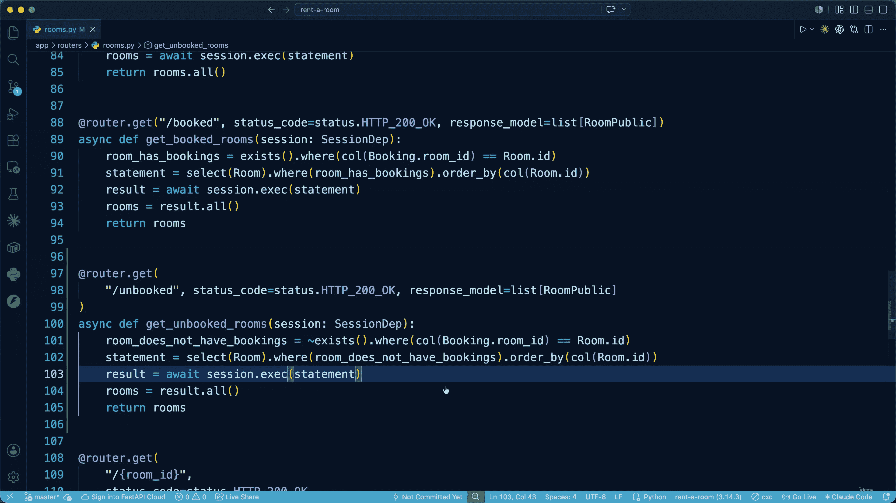
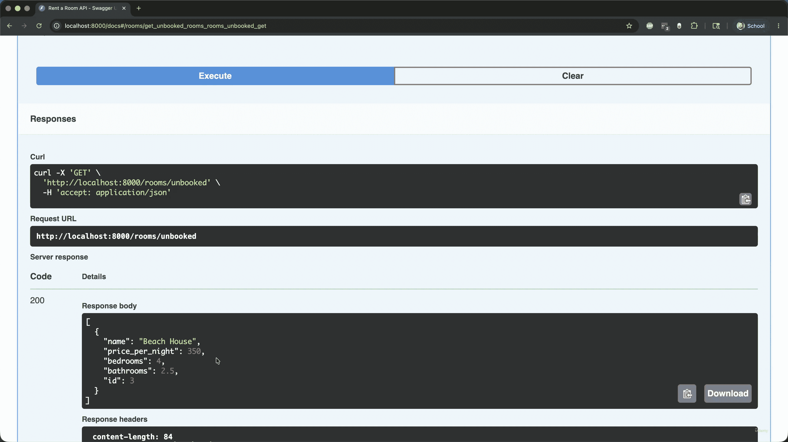

# Udemy - FastAPI 大师课 part2：p12 113：查询未预订房间（以及波浪号符号）

  

在本节课中，我们将学习如何使用波浪号（`~`）符号配合 SQLAlchemy 的 `exists()` 方法，来实现结果集的取反操作。这个操作能够帮助我们快速筛选出那些“不存在”对应记录的数据，比如没有预订记录的房间。我们会基于上一节课已经写好的代码，做一个非常简单的改动，就能轻松实现一个全新的查询接口。

  

## 回顾与引入

  

上一节课程中，我们使用了 `exists()` 方法来查询那些已经存在预订记录的房间。这个方法的返回结果是一个布尔值，用来判断某个条件是否成立。当我们希望查询结果反过来，也就是找到那些“不存在预订记录”的房间时，就需要借助一个特殊的符号——波浪号（`~`）。波浪号在编程中被广泛用作“取反”或“否定”的标记，放在某个布尔表达式前面后，就会把原本的 `True` 变成 `False`，把 `False` 变成 `True`。所以，当我们把 `~` 放在 `exists()` 前面时，查询逻辑就完全反过来了：原本是“存在预订”，现在变成了“不存在预订”。

  

## 波浪号（`~`）到底做了什么？

  

简单来说，`~` 是 Python 中的按位取反运算符，但在这里它被 SQLAlchemy 重载为逻辑取反。你可以把它理解为 SQL 中的 `NOT` 关键字。比如，下面这个表达式：

  

```python
exists(select(Booking.id).where(Booking.room_id == Room.id))
```

  

它检查某个房间是否在 `bookings` 表中存在至少一条记录。如果存在，整个表达式返回 `True`，否则返回 `False`。而当我们在这个表达式前面加上波浪号：

  

```python
~exists(select(Booking.id).where(Booking.room_id == Room.id))
```

  

原本的 `True` 就变成了 `False`，原本的 `False` 就变成了 `True`。也就是说，这个新表达式只对“不存在预订记录”的房间返回 `True`。用公式表示就是：

  

```
~exists(condition) 等价于 NOT EXISTS (condition)
```

  

这样，我们就能非常优雅地实现“查询所有未预订房间”的需求。

  

## 动手实现未预订房间查询

  

现在，我们开始实际操作。首先，把上一节课中已经写好的路由处理器代码完整地复制过来。你可以直接打开上一课的项目文件，找到那个查询已预订房间的接口，然后把所有代码复制到当前文件中。接下来，我们要对这个复制过来的代码进行三处简单的修改。以下是需要修改的内容：

  

- 第一，将路由路径从原来的 `/booked` 改为 `/unbooked`，这样新接口的地址就是 `/rooms/unbooked`。  
- 第二，将函数名改成与“未预订”相关的名称，比如 `get_unbooked_rooms`，这样一眼就能看出这个接口的作用。  
- 第三，在 `exists` 方法前面加上波浪号 `~`，这是最核心的一步修改，它直接反转了查询条件。  

  

为了进一步提高代码的可读性，我们还可以把整个查询条件放进一个变量里，并把这个变量命名为 `room_has_no_bookings`。这样做的好处是，当别人阅读代码时，看到这个变量名就能立刻明白这个条件表达的是“房间没有预订记录”这一事实。然后，我们把这个变量传递给查询构造器的 `where` 子句，就能得到我们想要的结果。下面是修改完成后的完整代码示例：

  

```python
@app.get("/rooms/unbooked")
def get_unbooked_rooms():
    room_has_no_bookings = ~exists(
        select(Booking.id).where(Booking.room_id == Room.id)
    )
    stmt = select(Room).where(room_has_no_bookings)
    return db.execute(stmt).scalars().all()
```

  



请注意，这段代码假设你已经定义了 `Room` 和 `Booking` 这两个 SQLAlchemy 模型，并且已经创建好了数据库会话 `db`。在实际项目中，我们可能还需要考虑分页、异常处理等额外问题，但这里我们只关注波浪号的用法，所以暂时不做那些扩展。

  

## 验证查询结果

  

代码修改完成后，让我们回到 Swagger UI 界面测试一下效果。首先刷新浏览器页面，你会看到在接口列表中多了一个新的 `unbooked` 端点。我们点击这个端点，再点击 `Try it out` 按钮，然后执行请求。你会看到返回结果仍然是一个房间列表，但这个列表中的每一个房间都是没有预订记录的。

  

为了更直观地理解，我们回忆一下上一节课中的测试数据：示例用户 Alice 预订了 ID 为 1 和 2 的前两个房间，那么 ID 为 3 的房间自然就没有任何预订记录。因此，这个新端点现在应该只返回 ID 为 3 的那个房间。这里需要特别说明的是，即使同一个房间可能有多次预订，但只要它至少存在一条预订记录，它就不会出现在这个结果中。换句话说，我们最终得到的是数据库中完全没有被预订过的房间，一条预订记录都没有。

  

## 总结

  



本节课我们一起学习了如何使用波浪号 `~` 来反转 `exists()` 方法的查询结果，从而轻松实现“查询不存在记录”的需求。我们通过一个实际的例子——创建查询未预订房间的新端点，完整地演示了从复制代码、修改路由和函数名、添加波浪号，到验证结果的整个过程。现在你应该已经掌握了这个技巧：当你想找出那些“不满足某个条件”的记录时，只需要在对应的条件表达式前面加上 `~` 就行了。这就是波浪号在 SQLAlchemy 中的核心作用——否定。以后遇到类似的需求，你都可以放心地使用这个方法。

