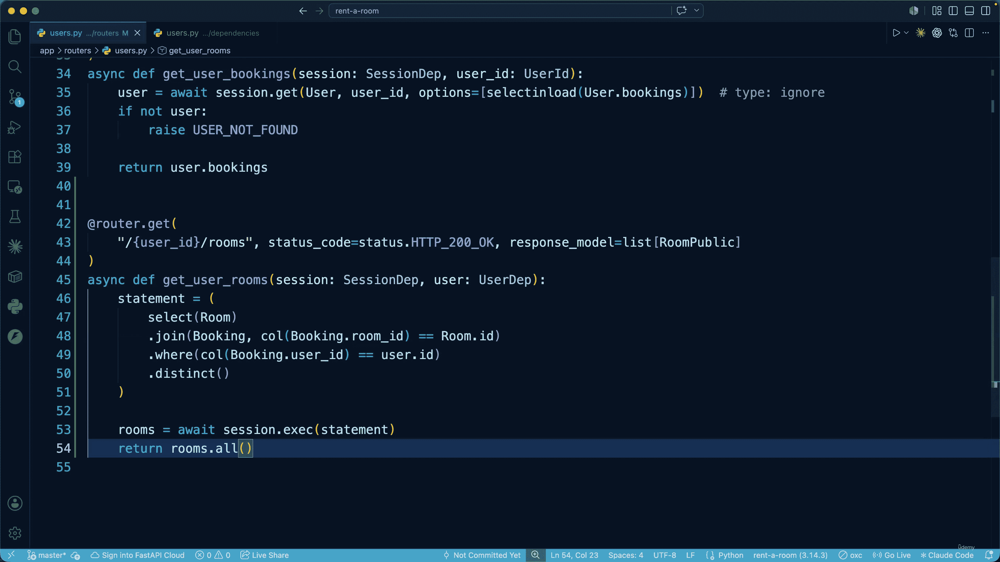
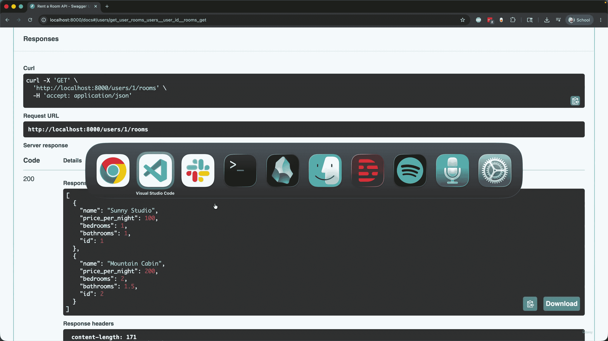
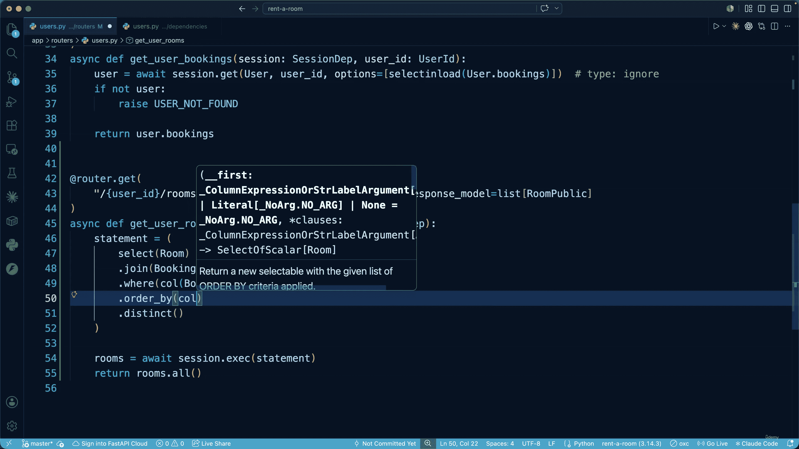
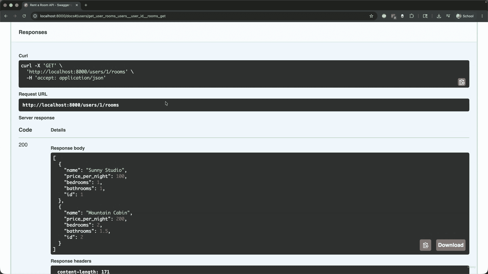
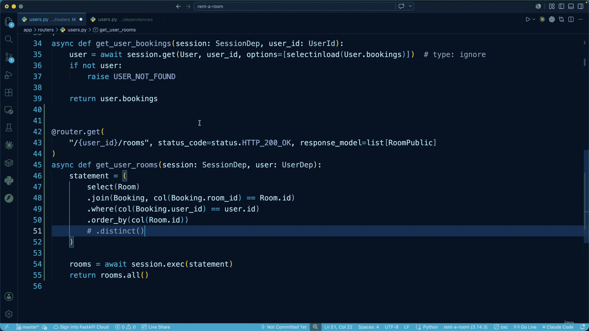
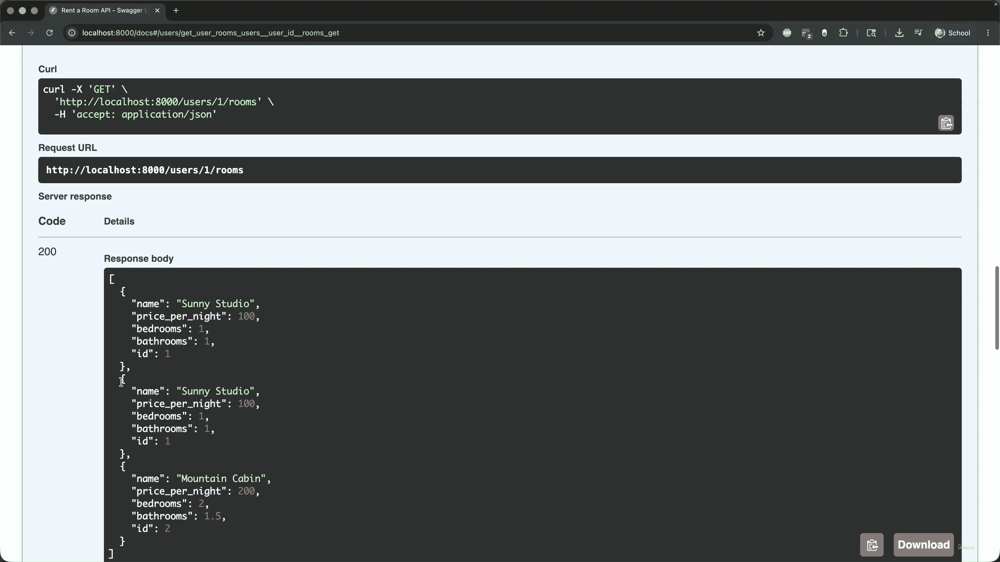
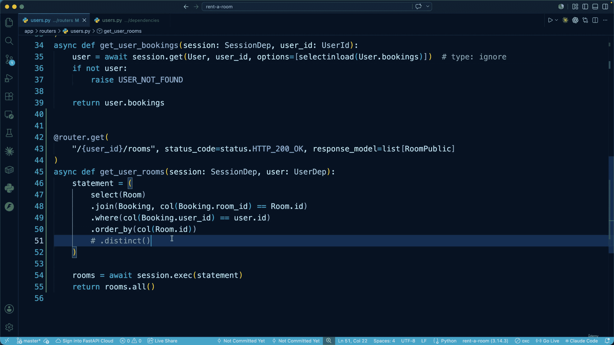
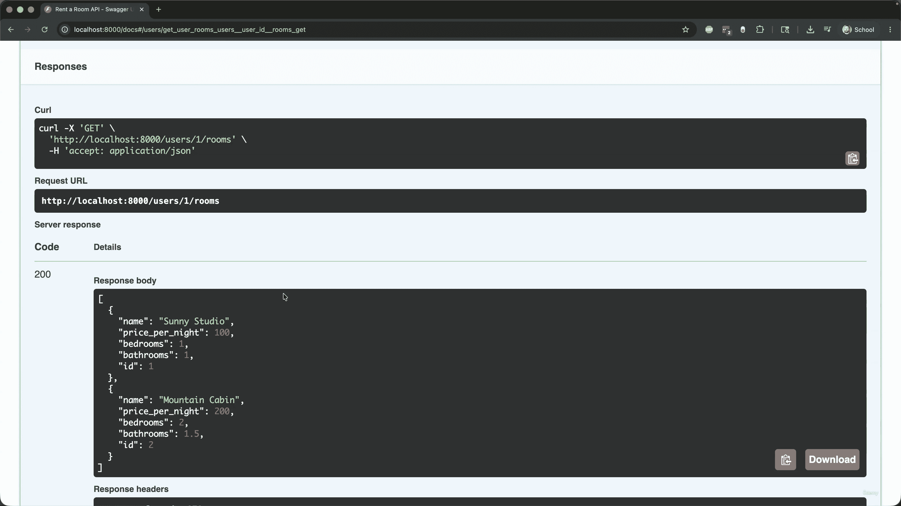

# 🚀 FastAPI Masterclass：第13节：查询用户的唯一房间

在本节课中，我们将学习如何为现有用户路由新增一个端点，用来查询某个用户曾经住过的所有不同房间。具体来说，就是根据用户ID，先找到该用户的所有订房记录，再通过订房记录关联到对应的房间，最终返回一个去除重复之后的房间列表。为了避免常见的N+1数据库查询问题，我们会使用SQL JOIN在数据库端一次完成查询，并使用DISTINCT关键字保证结果的唯一性。理解这个例子能够帮助你更清楚地掌握JOIN在实际项目中的用法。

## 🔍 问题背景：从订房记录到房间列表

在我们当前的用户路由中，已经有一个端点可以根据用户ID获取该用户的所有订房记录。这个端点返回的是用户所下的所有订单，而不是房间本身。现在，我们希望新增一个端点，直接返回用户曾经住过的所有不同房间。想象一下，如果用户多次入住同一个房间，比如Alice在同一个房间订了两次房，那么在最终的房间列表中，这个房间不应该出现两次，而应该只出现一次。换句话说，我们需要一个端点，用来返回一个“独特的、没有重复的房间列表”。那么，怎么实现呢？

你可能会想到一种比较直观的做法：既然用户有订房记录，而这个订房记录是一个列表，那么可以先遍历这个列表，拿到每个订房记录，再访问该订房对应的房间属性，最后手动去重。听起来似乎可行，但这种写法会引发一个非常著名的数据库性能问题——N+1查询问题。所谓N+1查询，是指我们需要对数据库发起的查询总数等于“1 + N”，其中“1”是最初的那一次查询，比如获取所有订房记录；而“N”是随后为了获取每条关联记录而额外发起的动态查询次数。可以用一个公式来表示：

```text
总查询数 = 1 + N
```

举个例子，假设某个用户共有10条订房记录，我们先发一次请求去查这10条订房记录，然后每一条订房记录都要再发一次请求去查对应的房间，这就多出了10次请求，总共就是11次。这种模式下，数据库会被大量零散查询压得喘不过气来，效率自然很低。要注意的是，我们现在已经转向异步会话，所以这种懒加载不会真的发生，但理解同步场景下的问题仍然很重要。

那么更理想的做法，是希望能用一条查询就搞定所有事情。这条查询能够把用户、订房记录和房间表全部串联起来，并且还能在数据库端直接完成去重，最终返回一个不重样的房间列表。好消息是，SQL中的JOIN就是为此而生的。我们在前面的课程中已经接触过joinedload之类的加载函数，它们的作用也是把两张表合并起来。但这一次有一个关键区别：我们并不是真的要把JOIN出来的所有数据都加载到内存里，而只是利用JOIN来建立一种逻辑上的过滤条件。虽然这里面有点绕，但只要记住本节课的目标就可以了：创建一个新端点，返回一个用户住过的所有不同房间，也就是他/她至少入住过一次的房间。

## 🔧 第一步：准备导入和模型

在动手之前，我们需要先做好铺垫。打开用户路由文件，要在顶部增加一些必要的导入。可以从sqlmodel中引入`col`函数和`select`函数。`select`函数负责构建查询语句，让我们能够选取指定表的全部列；而`col`函数则用来在查询条件中明确地指向某张表的某个列。之所以需要它们，是因为后面我们既要写JOIN条件，又要写WHERE过滤条件。

除了这两个函数，我们还需要引入额外的模型。当前文件里已经导入了`Booking`和`User`，但还缺少与房间相关的模型。请从`app.models.room`中导入`Room`和`RoomPublic`。这两个模型各有分工：`Room`是真正用于数据库查询的模型，因为只有它才具备与数据库交互的能力；而`RoomPublic`则用于定义API响应的数据结构，确保我们返回给前端的字段是安全、可控的。这里要注意，我们还需要确保`Booking`已经被导入，因为后面要在连接条件中使用它。这样一来，导入部分就准备完成了。

## 📍 第二步：定义新的路由端点

导入就绪后，我们滚动到文件底部，开始定义新端点。这个端点的路径可以设计为`/users/{user_id}/rooms`，其中`{user_id}`是路径参数，代表我们要查询的用户ID。如果传入的用户ID是1，就返回这个用户住过的所有房间。和大多数数据查询端点一样，它的成功响应状态码是200（HTTP 200，表示一切OK）。在响应模型方面，我们需要返回一个列表，但请注意，不是订房记录列表，而是房间记录列表，具体来说就是`RoomPublic`类型的列表。

你可能会问，这和上面已有的端点有什么区别呢？上面那个端点返回的是订房记录，订房记录本身只是用户和房间之间的关联表，里面虽然存有`room_id`，但并没有任何房间的补充信息，除非我们再额外做一次连接。而我们这个新端点，专门返回房间记录，自然希望房间的详细信息（比如房间名、卧室数量、浴室数量等）都在里面。所以，在定义响应模型时，直接使用`list[RoomPublic]`。

接下来，定义异步路由处理器，函数名叫`get_user_rooms`。它需要两个参数：第一个是`session`会话依赖，用于操作数据库；第二个是`user_id`，很快我们就会用到它来过滤数据。另外，我们还可以加入之前已经写好的用户依赖`user_dep`。这个依赖有一个很大的好处：在我们真正查询房间之前，它会先验证一下传进来的`user_id`是不是一个真实存在的用户。如果用户不存在，请求会在这一层就被拦截下来，根本不会跑到查询房间那一步。因此，我们在函数签名里加上`user = user_dep`，让这个依赖帮我们把关。

## 🧩 第三步：构建SQL查询语句

万事俱备，现在我们来写查询逻辑的重点部分。先用`select`函数构建查询语句。这里有一个核心概念：你传给`select`的第一个模型，代表了你要从哪张基础表开始查询，也决定了最后会返回哪些列并转换成Pydantic对象。在我们这个端点里，核心记录是`Room`，不是`User`也不是`Booking`。因为端点的职责是返回房间数据，所以我们要的基础表是`rooms`表。

但是，从`rooms`表出发，我们没有办法直接找到某个用户，因为没有一条路径是直接从房间指向用户的。不过，我们可以绕个弯——先通过订房记录来建立联系。订房记录里有`room_id`字段，把订房表和房间表连接起来后，房间就和用户联系上了。所以，我们要在`select(Room)`后调用`.join()`方法。

`join`方法的作用，是把两张表按照我们指定的条件组合在一起。具体写法是这样的：

```python
stmt = select(Room).join(Booking, col(Booking.room_id) == Room.id)
```

第一个参数传入我们想要连接进来的关联模型，这里就是`Booking`。第二个参数是连接条件，我们要用`col`函数明确写出：把`Booking.room_id`与`Room.id`用等号连接起来，让数据库端把订房表中的`room_id`与房间表中的`id`匹配起来。

需要特别说明的是，这种JOIN属于“内连接”（INNER JOIN）。它意味着只有那些在订房表中存在对应`room_id`的房间才会被包含进来。如果某个房间从没有任何人订过，那么它在订房表中找不到任何匹配行，就会被自动排除掉。对当前需求来说，这完全不是问题——我们想要的本来就是用户住过的房间，必然有订房记录作为纽带。但你要清楚这个行为，以免以后遇到需要包含无订房记录房间的情况时感到困惑。

另外，还有一个潜在的麻烦：如果用户多次入住同一个房间，那么订房表中会有多条记录指向同一个`room_id`。这时JOIN会把该房间与每条订房记录分别匹配，结果中就会出现两个一模一样的房间行。这正是我们后续要去重的原因。

## 🎯 第四步：添加过滤条件

现在，我们已经把`rooms`表和`bookings`表连接起来了，但还没有对“哪个用户的房间”做过滤。幸运的是，`bookings`表里有`user_id`列，正好可以用来筛选。我们需要找出那些订房记录的`user_id`正好等于当前请求路径中的用户ID。所以，在查询语句后接上`.where()`方法。

在`where`条件里，同样是使用`col`来引用列。这次要引用的是`Booking.user_id`，然后使用相等运算符，让它等于`user.id`。还记得我们前面通过用户依赖拿到的`user`对象吗？它现在是完整的用户对象，我们只需要取它的`id`属性进行比较即可。这样一来，JOIN之后我们得到的是同时包含房间信息和订房信息的宽表，但SQL会只保留那些订房记录中`user_id`与当前用户ID一致的行。到了这一步，主要数据已经筛选出来了，但离最终目标还差最后一步——去重。

## 🔁 第五步：使用DISTINCT去重

由于我们的测试数据里，用户Alice两次预定了同一个房间，所以当前的查询结果会有两条房间记录，而且它们完全一样。为了解决这个问题，我们要在查询语句中追加一个特殊方法，它叫`distinct`。它的作用直接对应SQL中的`DISTINCT`关键字，说白了就是去重。

为什么会有重复？你可以这样理解：Alice的两条订房记录本身是不同的，它们有不同的订房ID、不同的入住时间和退房时间。但是，它们都指向同一个房间ID，所以经过JOIN后，`Room`表中的那一行会被匹配两次。不过，别忘了我们`select`的是`Room`，并不是`Booking`。当数据最终变成Pydantic对象返回给前端时，连接所引入的订房信息根本不会出现在结果中。也就是说，我们拿到的本质上是两个完全相同的房间对象。这时，只要加上`distinct`，SQL就能自动发现这两条其实来自同一个房间，并把它们合并成一条。于是，无论同一个房间被预订过多少次，最终返回的列表里只会出现一次。当然，如果用户确实住过两个不同的房间，那两个房间都会保留下来；`distinct`只消除那些因为JOIN而造成的重复项。这也就是为什么`distinct`在这类查询中如此关键。

完整的查询语句就像这样：

```python
stmt = (
    select(Room)
    .join(Booking, col(Booking.room_id) == Room.id)
    .where(col(Booking.user_id) == user.id)
    .distinct()
)
```

最后，我们要把写完的查询语句真正交给数据库执行。可以这样写：

```python
rooms = await session.exec(stmt)
return rooms.all()
```

首先调用`await session.exec(stmt)`，注意`stmt`就是上面构建好的查询语句。执行结束后，返回的结果对象上再调用`.all()`方法，就可以拿到一个房间列表了。然后，直接将这个列表作为返回值返回。这样一来，FastAPI会根据我们声明的响应模型自动进行数据校验和序列化，确保最终只暴露`RoomPublic`中允许的字段。

## 🧪 第六步：用Swagger验证并理解DISTINCT的意义



现在，让我们打开浏览器，通过Swagger文档来验证这个新端点。在用户路由下面，我们能看到新增的`/users/{user_id}/rooms`路由。尝试传入`user_id=1`并执行请求。这里的用户是Alice，根据我们之前的数据，她一共有三条订房记录，但只有两个不同的房间。向下滚动响应列表，我们会看到两个房间记录，这完全符合预期。

如果你希望结果拥有稳定的顺序，还可以在查询语句中加一个`order_by`。例如，按照房间ID排序：



```python
stmt = (
    select(Room)
    .join(Booking, col(Booking.room_id) == Room.id)
    .where(col(Booking.user_id) == user.id)
    .order_by(Room.id)
    .distinct()
)
```

这样无论执行多少次，返回的顺序都是一致的。再次执行，结果依然相同，说明排序成功。

接下来，为了让你直观感受`distinct`的作用，我们临时把`distinct`注释掉，然后回到Swagger重新执行同样的请求。你会发现代码依然能够正常运行，但返回结果出现了变化：由于有两条订房记录指向`room_id=1`，那个名为“Sunny Studio”的房间在响应中出现了两次。换句话说，重复项没有被移除。这个对比清楚地说明，每当我们在`rooms`表上进行JOIN查询，并且连接关系可能带来重复房间时，都应该调用`distinct`来去重，以确保每个房间只出现一次。











## 📚 总结



本节课我们一起学习了如何使用SQL JOIN来合并不同的数据表。虽然我们本质上依然只查询了`rooms`这一张表，也只从这一张表返回数据，但我们通过与其他表（例如`bookings`表）进行JOIN，为数据筛选提供了更灵活的条件。我们还引入了`distinct`来解决因多次预订而产生的房间重复问题。现在，你已经掌握了在FastAPI中构建“用户唯一房间”查询的方法，这不仅避免了N+1低效查询，也让数据结果更加干净。在接下来的课程中，我们会继续探索更多类似的数据库查询技巧，敬请期待。
