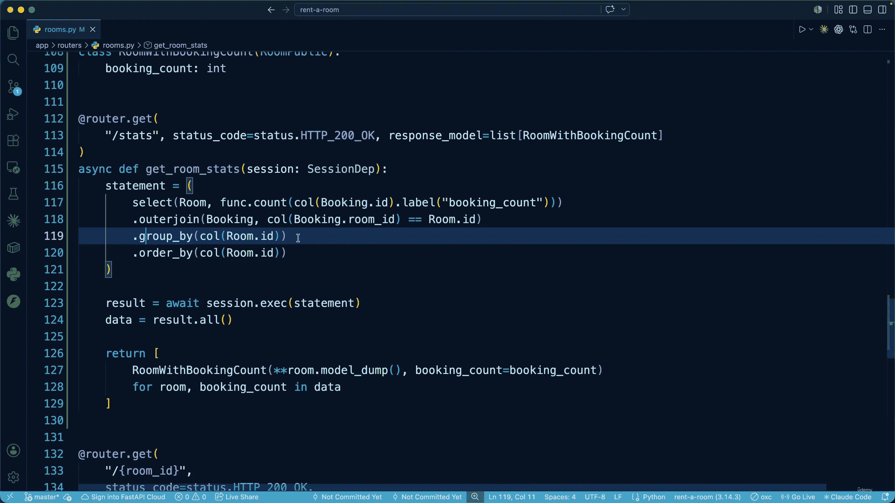
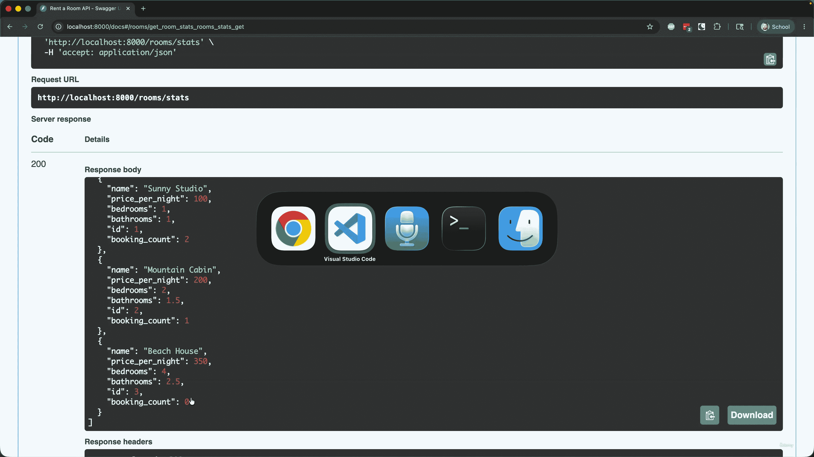
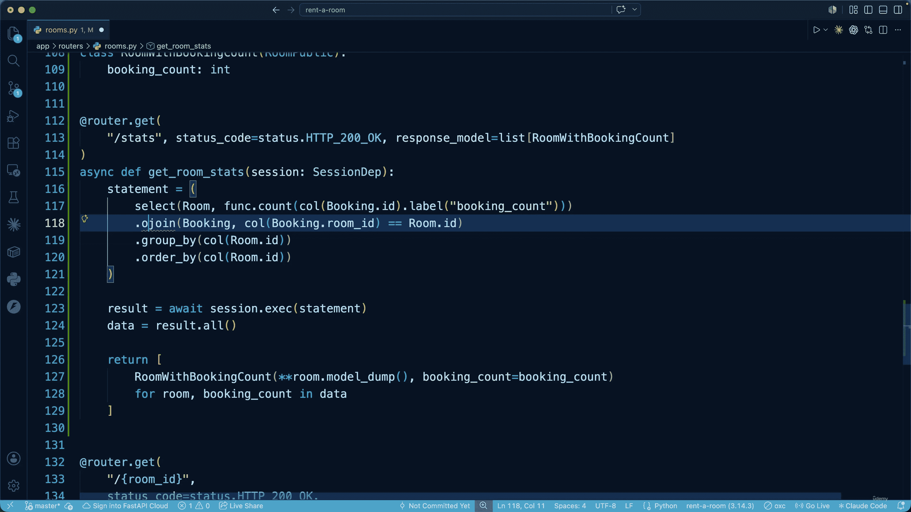
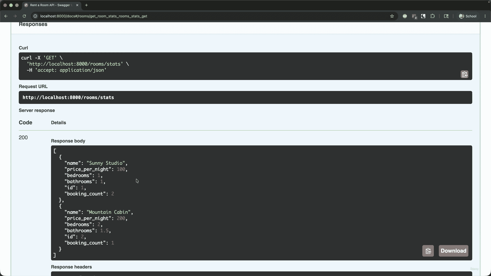
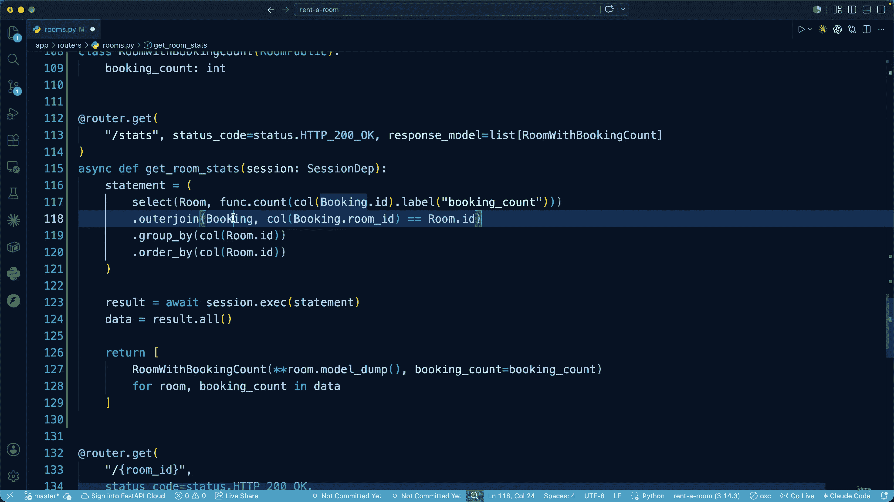
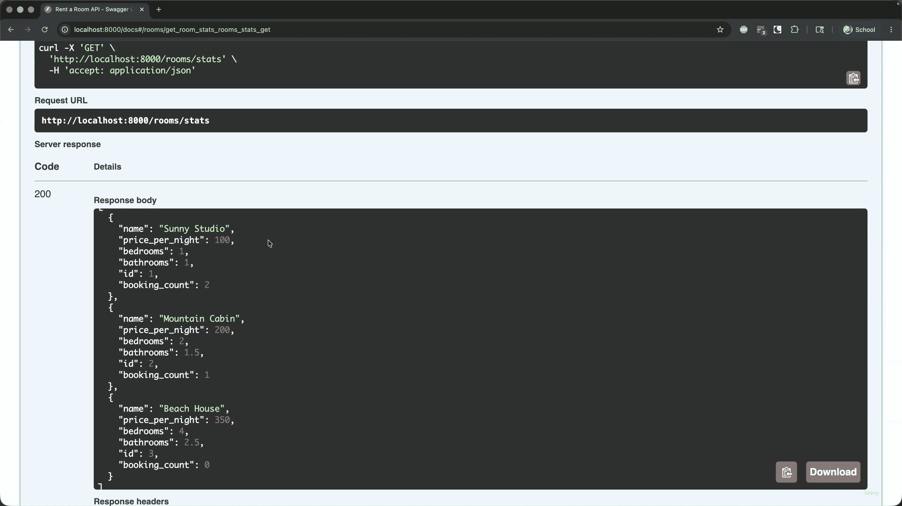

# 🚀 FastAPI Masterclass：115：按房间统计预订数量


在本节课中，我们将要学习 SQL 中的另一种连接方式，也就是外连接，并看看如何在 Python 代码里调用 SQL 函数。上一节我们处理了普通连接查询，本节中我们来看看当需求变成“每个房间都要出现，即使它没有任何预订”时，查询和响应模型应该怎样调整。这个需求看起来很小，实际会带出内连接与外连接的核心差别，也会带出分组、计数、排序和响应模型设计这些关键内容。接下来我们一步一步把接口写出来，再把结果放到 Swagger 里验证。


## 🧩 FastAPI Masterclass：115.1：需求与响应模型


上一节我们介绍了普通连接查询的基本用法，本节中我们先明确新接口的需求和返回结构。我们希望再定义一个接口，它仍然返回房间列表，但每个房间记录上还要多一个字段，用来表示这个房间的预订数量。这里不要返回预订记录本身，只返回每个房间的预订总数。即使某个房间一笔预订都没有，这个房间也必须出现在结果里，并且它的预订数量要显示为 0。


这个需求正是我们不能随便使用内连接的关键原因。普通连接方法只会在存在匹配记录的地方把房间和预订找出来。如果某个房间没有任何预订，就不会有对应的预订记录可以被拉取。可是我们仍然希望这个房间出现在结果中，并且预订数量为 0，所以这里就要引入外连接这个概念。


为了定义接口，我们在路由上新增一个端点。端点名称本身并不重要，可以叫 `stats`。这个端点使用状态码 200。为了保持简单，我们直接在代码里定义一个 Pydantic 模型，名字可以叫 `RoomWithBookingCount`。这个模型当然可以移动到专门的模型文件里，但这里先保持简单，直接写在当前文件中。它继承 `RoomPublic`，因此会拥有 `RoomPublic` 的所有属性和字段，并额外定义一个 `booking_count` 属性，类型为整数。


以下是这个接口需要满足的要点，我们先把需求列清楚，后面的代码就会围绕这些点展开。


- 接口返回一个房间列表。

- 每个房间记录上都要附加 `booking_count` 字段。

- 没有预订的房间也要返回，并且 `booking_count` 为 0。

- 响应模型不能只是 `list[RoomPublic]`，而要是 `list[RoomWithBookingCount]`，否则新增字段可能被过滤掉。


完成响应模型的设计后，接下来我们看看查询语句应该怎样写，尤其是连接方式为什么要从内连接改成外连接。


```python
class RoomWithBookingCount(RoomPublic):
    booking_count: int


@router.get(
    "/stats",
    response_model=list[RoomWithBookingCount],
    status_code=200,
)
async def get_room_stats(session: AsyncSession = Depends(get_session)):
    ...
```


## 🧱 FastAPI Masterclass：115.2：外连接与内连接的区别


上一节我们明确了“零预订房间也要出现”的需求，本节中我们来看看 SQL 连接方式的选择。在路由处理函数内部，我们先定义 SQL 语句，再把它传给 `exec` 方法执行。查询从 `select` 函数开始，传入要查询的表对应的模型。我们最终要返回房间，所以这里查询房间表，使用 `Room` 模型。


为了计算一个房间有多少预订，需要把房间和预订表连接起来。普通 `join` 写法的问题在于，它是内连接，只会拉取真正存在匹配预订的房间。我们可以指定连接条件，例如让 `Booking.room_id` 等于 `Room.id`，但内连接仍然只保留匹配成功的行。假设编号为 3 的房间没有任何预订，那么这种连接就会把它排除掉。


如果希望包含所有房间，并且在有预订时把预订信息连接进来，就要使用外连接或者左外连接。这里把方法改成 `outerjoin`。外连接的工作方式是：先取出所有房间，例如房间 1、房间 2、房间 3 等；如果某个房间有预订信息，就把预订信息拉进来；如果某个房间没有预订，那么来自预订表的列就会是一堆 `NULL` 值。


需要记住，我们这里 `select` 的是房间，最终响应不会返回预订数据本身，但预订数据在连接结果中是可用的，可以用来做过滤或者其它逻辑操作。内连接与外连接的根本差别就在这里：内连接只拉取有匹配预订的房间；外连接会拉取匹配的预订，同时也会保留那些在预订表中没有匹配行的房间。


以下是内连接与外连接在结果集上的区别，理解这一点对后面的计数非常重要。


- 内连接只保留房间与预订能够匹配的行。

- 外连接保留全部目标房间，并在能够匹配时附带预订信息。

- 没有预订的房间在外连接结果中仍然存在，只是预订相关列为 `NULL`。

- 我们最终要的是“全部房间 + 每个房间的预订数量”，所以外连接是正确起点。


```text
Room ⟕ Booking   表示保留全部 Room，并尽可能连接 Booking
```


完成连接方式的选择后，接下来我们进入计数部分。外连接只是把房间和能匹配的预订放到一起，真正的统计还要靠分组和 SQL 的计数函数。


## 🧮 FastAPI Masterclass：115.3：分组、排序与 COUNT


上一节我们通过外连接得到了全部房间以及能够匹配的预订信息，本节中我们来看看怎样统计每个房间的预订数量。在 SQL 中计数通常要做两件事，第一件事是分组。分组可以理解为按照某个属性或字段，把结果集中的条目组织成一个个类别或者桶。这里在查询末尾调用 `group_by`，按共享的房间 ID 分组。


这样分组的原因是解决上一节见过的重复问题。如果同一个房间有多条预订，我们不希望这个房间在结果集中出现多次，但又希望把所有匹配的预订都拉进来，方便后面计数。例如房间 ID 为 1 的房间有两条预订，结果中只应返回这个房间一次，但它的预订数量应显示为 2。为了让 SQL 能够算出这个 2，仍然需要把房间和预订表连接起来，即使最初会产生重复批次；随后 `group_by` 会按照相同的房间 ID 把这些记录归到同一组。


除了分组，我们还要按 ID 列排序，所以调用 `order_by(Room.id)`。接下来是核心部分：使用 SQL 内置函数 `count` 来统计每个房间所属的预订数量。`count` 可以统计每个分组内的条目数量，而每个分组就是按 ID 组织起来的一个房间。为了在 Python 代码中使用这些 SQL 函数，需要从 `sqlmodel` 导入 `func`。这个名字看起来有点有趣，实际是 function 的缩写，代表数据库侧可用的 SQL 函数。


SQL 本身有很多内置函数，可以在数据库内部执行操作，例如转小写、转大写、去除空白、取字符串前几个字符或者后几个字符。这些操作和 Python 里的字符串方法很像，但它们是在数据库侧执行的，通常会在结果到达我们的代码之前完成，因此一般更快。这里给 `select` 传入第二个参数，这是合法语法，会在房间表字段之外再加一列。我们使用 `func.count(Booking.id).label("booking_count")`，其中 `label` 用于指定结果表中这一列的名称，也会影响 ORM 把数据交回 Python 时对象属性或字段的名称。


以下是计数步骤的要点，按这些步骤组合查询即可得到每个房间的预订总数。


- 用 `outerjoin` 保留所有房间，并尽可能连接预订。

- 用 `group_by(Room.id)` 按房间 ID 分组，避免同一房间重复出现。

- 用 `func.count(Booking.id).label("booking_count")` 统计每组条目数并命名。

- 用 `order_by(Room.id)` 让结果按房间 ID 排序。


```python
from sqlmodel import select, func

statement = (
    select(
        Room,
        func.count(Booking.id).label("booking_count"),
    )
    .outerjoin(Booking, Booking.room_id == Room.id)
    .group_by(Room.id)
    .order_by(Room.id)
)
```


完成 SQL 语句后，接下来我们执行查询，并把返回的元组列表转换成最终响应需要的对象列表。


## 🐍 FastAPI Masterclass：115.4：把元组结果转成响应对象


上一节我们写好了带外连接、分组和计数的 SQL 语句，本节中我们来看看怎样处理查询结果。先声明 `result` 变量，用 `await` 执行 `session.exec(statement)`。然后在下面调用 `result.all()`，把返回值赋给 `data`。这里要注意，`data` 现在是一个元组列表，每个元组里有两个条目，因为 `select` 函数传入了两个参数。每个元组的第一个条目是真正的房间记录，第二个条目是表示预订数量的数字。


也就是说，ORM 返回的数据大致会像“完整房间记录 + 计数、完整房间记录 + 计数”这样，作为一个 Python 列表中的元组集合。接下来要做的是构造最终响应形状，也就是 `RoomWithBookingCount` 对象组成的列表。可以使用列表推导式，遍历 `data` 中的每个元组，把两个元素分别取为 `room` 和 `booking_count`。


在列表推导式中创建 `RoomWithBookingCount` 实例。房间对象是数据库里的常规 `Room` 模型，这个 Pydantic 模型有 `model_dump` 方法，会返回字段和值组成的字典。用双星号 `**` 把字典展开，作为类构造时的参数，这就是解包语法。这样会把名称、卧室数、浴室数等信息全部传进去。随后再传入额外的 `booking_count` 参数，把它设置为每个元组中的第二个条目。


以下是返回处理时要注意的要点，重点是理解元组结构和解包写法。


- `data = result.all()` 得到的是元组列表。

- 每个元组的第一个元素是房间对象，第二个元素是预订计数。

- `room.model_dump()` 把房间对象转成字典。

- `RoomWithBookingCount(**room.model_dump(), booking_count=booking_count)` 把字典展开并补上计数字段。


```python
result = await session.exec(statement)
data = result.all()

return [
    RoomWithBookingCount(
        **room.model_dump(),
        booking_count=booking_count,
    )
    for room, booking_count in data
]
```


这段计数逻辑会应用到每个房间，包括完全没有预订的房间。对于没有预订的房间，分组中仍然会有它的记录，计数结果为 0。到这里核心实现就完成了，接下来我们到浏览器里实际验证结果。


## ✅ FastAPI Masterclass：115.5：Swagger 验证与外连接对比


上一节我们完成了代码实现，本节中我们到 Swagger 里检查接口行为。刷新页面后，可以在下面看到新的 `stats` 端点，执行它就能看到返回的房间列表。每个房间都会包含 `RoomPublic` 的所有字段，并额外附带 `booking_count` 字段。三个房间的预订数量会分别显示为 2、1、0，其中编号为 3 的第三个房间完全没有预订，所以它的预订数量是 0。




为了对比，我们回到代码，把外连接改回普通连接，也就是内连接。重新执行后，结果集会变得不完整，因为此时只会查找有预订的房间，也就是前面那两个房间。再次执行接口，确实还能看到每个房间的预订计数，但结果中只会包含有预订的房间，因为只有这些房间能够被连接匹配到。


内连接的工作方式就是：两张表在记录匹配时合并，只保留匹配成功的行。没有预订的房间会被排除；假设出现有预订但没有对应房间的记录，理论上在删除房间等情况下可能出现，但这里的关键点仍然是内连接会排除所有不匹配的记录。因此，如果想包含没有预订的房间，就必须使用外连接。外连接会保留所有目标房间，在有预订时把预订拉进来，然后分组并统计每组条目总数，这样就能得到真正想要的结果集。




以下是验证过程中应观察到的现象，用它们可以快速判断连接方式是否正确。


- 使用外连接时，三个房间都会出现，预订计数分别为 2、1、0。



- 把外连接改成内连接后，只出现有预订的房间。

- 内连接只保留匹配行，因此零预订房间会消失。

- 要保留全部房间，必须使用 `outerjoin`。




```python
# 外连接：保留全部房间
.outerjoin(Booking, Booking.room_id == Room.id)

# 内连接：只保留有匹配预订的房间
.join(Booking, Booking.room_id == Room.id)
```






本节课中我们一起学习了如何在 FastAPI 中通过 SQLModel 使用外连接、分组、排序和 `COUNT` 函数，按房间统计预订数量，并把元组结果转换成 Pydantic 响应对象。我们还验证了外连接与内连接在结果集上的差别，并看到 ORM 可以把 Python 代码翻译成数据库侧执行的 SQL 函数。到这里，这个按房间统计预订数量的接口就完成了。


