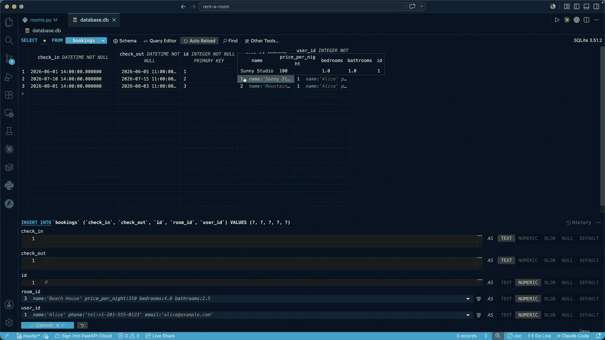
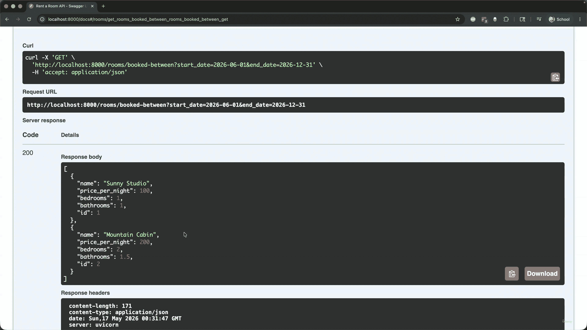

# Udemy FastAPI 大师课：第15节：🚀 按日期范围筛选已预订房间

在本节课中我们将要学习一个新的房间接口，这个接口用来练习 join 和 filter，同时把预订记录里的入住时间和退房时间用起来。入住时间和退房时间都是日期时间字段，数据库里存的是日期时间值，所以只要 ORM 能生成正确查询，就可以按时间范围过滤。在前面课程里我们已经接触过 join、过滤和响应模型，本节中我们来看看如何把这些知识组合成一个“按日期范围查询已预订房间”的接口。这个接口会接收开始日期和结束日期两个查询参数，返回在这段时间内被预订过的房间，并且会对同一房间的多次预订做去重。

**🎯 接口目标**

上一段概述说明了本课要解决的问题，这一节先明确接口要做什么。这个新接口放在 rooms router 中，是本节最终接口，路由名可以叫 `bookedBetween`，实际路径可以写成 `/booked-between` 这种常见形式。接口返回状态码 200，并且可能返回多个房间，因为一个日期范围内可能有多间房被预订。响应模型使用 `list[RoomPublic]`，也就是房间公开响应结构的列表。原文还特别提到去重：如果同一间房在给定范围内被预订多次，只返回这一间房；如果两间不同房间被预订，就返回两间房。目标是得到时间范围内“已预订房间”的去重列表。

**🧱 定义路由函数**

接口目标和返回形状确定后，本节中我们来定义处理函数。处理函数需要和数据库交互，所以先提供 session 参数，类型是 `SessionDep`。然后提供两个查询参数：开始日期和结束日期，两个参数都标注为 `str`。数据进入接口时是字符串，交给 ORM 后，ORM 会把它翻译成合适的 SQL 查询，SQL 能够把表示日期的字符串与入住、退房列中的日期时间值进行比较。因为这两个参数不是路径参数，URL 中没有对应的动态片段，FastAPI 默认会把它们当作查询参数。原文也提到，如果需要额外校验，可以给参数加上 `Query` 校验器，但本课先保持简单。下面先把这个接口函数的骨架写出来：

```python
@router.get(
    "/booked-between",
    response_model=list[RoomPublic],
    status_code=200,
)
async def get_rooms_booked_between(
    session: SessionDep,
    start_date: str,
    end_date: str,
):
    ...
```

**🔎 构造查询**

路由函数准备好后，本节中我们来看看 SQLModel 查询怎么写。查询最终要从房间表返回房间记录，所以先 `select(Room)`。这里必须 join 预订表，因为要判断哪些房间被预订过；响应里不需要返回预订补充信息，但需要借助预订记录做过滤。未预订的房间不需要返回，所以使用普通 inner join 即可，不需要 outer join。原文还说明，如果外键列命名为 `room_id` 这种“单数表名加 id”的形式，SQLModel 可以自动推断连接关系，`join(Booking)` 就够用；如果外键命名不同，就需要显式写连接条件。过滤逻辑使用两个 `where`，两个条件同时成立，也就是 AND 逻辑。核心条件可以用公式表示为：

\[
\text{Booking.checkin} \ge \text{start\_date}
\quad \land \quad
\text{Booking.checkout} \le \text{end\_date}
\]

原文提到入住时间存的是日期时间，包含小时和时间部分，而这里先按普通日期测试；如果以后要精确到时间，可以写得更细。两个 `where` 分别让入住时间大于等于开始日期，让退房时间小于等于结束日期。为了让类型检查器满意，原文会把列包进 call 函数，但查询含义仍然是列比较。查询代码可以写成下面这样：

```python
statement = (
    select(Room)
    .join(Booking)  # 外键列为 room_id 时，SQLModel 可自动推断连接条件
    .where(Booking.checkin >= start_date)
    .where(Booking.checkout <= end_date)
    .distinct()
    .order_by(Room.id)
)
```

**♻️ 去重与排序**

过滤条件写好后，本节中我们来看看重复结果怎么处理。因为用了 inner join，同一间房如果有多条预订记录，结果集里就会出现多行同一个房间；每条预订都有自己的入住和退房值，但房间的 id、name 等字段完全相同。由于响应里不返回预订数据，预订记录只是 join 和过滤的依据，所以 `distinct()` 只需要对返回的房间记录去重。去重后，同一间房在结果中只出现一次。公式可以理解为：

\[
\text{rooms} = \operatorname{distinct}(\text{满足过滤条件的 Room 行})
\]

最后再加一个 `order_by(Room.id)`，按房间 id 升序排序，保证返回结果顺序可预测。这个查询组合了本课程中多次出现的过滤、连接和排序思路。

**⚙️ 执行查询并返回**

去重和排序确定后，本节中我们来看看怎么执行查询。把语句传给 `session.exec()`，等待执行完成，然后对结果对象调用 `.all()`，得到房间列表。可以把结果赋给 `rooms` 变量再返回，也可以直接返回；原文选择返回 `rooms`，这样会符合 `RoomPublic` 的响应结构。代码如下：

```python
result = await session.exec(statement)
rooms = result.all()
return rooms
```

**🧪 在 Swagger 中验证**

返回逻辑完成后，本节中我们来看看实际验证。数据库的 bookings 表里一共有三条预订记录，每条都有入住时间和退房时间。预期是：传入一个包含某条预订的有效时间范围，就返回对应房间；如果范围内有两条预订但属于同一间房，则去重后只返回一间房。打开 Swagger 文档并刷新后，应该能看到新的 `booked-between` 路由。下面把 Swagger 验证步骤按顺序列出来，方便跟着操作：

1. 打开 Swagger 文档并刷新页面，在页面中找到 `booked-between` 路由，原文里也叫 bookedBetween 路由。

2. 展开该路由，点击 Try it out。

3. 在 `start_date` 输入 `2026-06-01`，在 `end_date` 输入 `2026-06-30`。

4. 执行请求，返回结果中应包含与这条预订对应的单个房间。



5. 把 `end_date` 改成 `2026-07-30` 再执行，这个范围内有两条预订，但它们对应同一间房，所以仍然只返回一个房间。

6. 把 `end_date` 改成 `2026-12-31` 再执行，应能得到第三条预订，并返回第二间不同的房间。

按上述步骤执行后，日期格式使用年、月、日并用短横线分隔，例如 `2026-06-01`。第一次请求返回单条预订对应的房间；扩大范围到 7 月底后，Sunny Studio 有两条预订，但去重后仍然只返回一间 Sunny Studio；再把结束日期扩大到 12 月 31 日，结果中应包含两间已预订房间，也就是 Sunny Studio 和 Mountain Ca（原文如此）。

**📌 本课总结**



本节课中我们一起学习了如何新增一个按日期范围筛选已预订房间的接口，包括定义 `bookedBetween` 路由、接收 `start_date` 和 `end_date` 两个字符串查询参数、使用 `select(Room)` 和 `join(Booking)` 做 inner join、用两个 `where` 同时限制入住时间和退房时间、用 `distinct()` 对同一房间的多次预订去重，以及用 `order_by(Room.id)` 保证排序。我们还通过 Swagger 验证了单条预订、同一房间多条预订去重、以及多间不同房间被预订的场景。本课和本节内容到这里结束，下一节课会做一次快速小节回顾。

