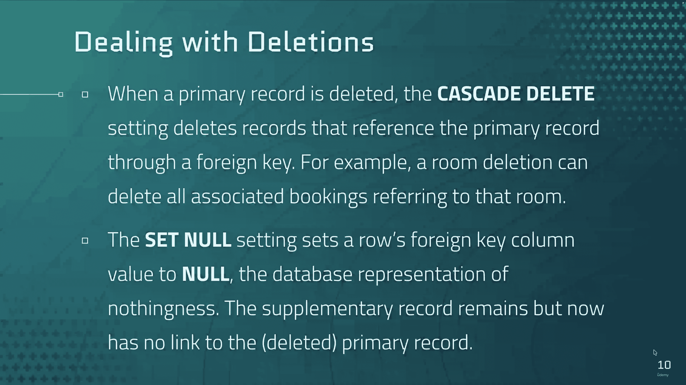
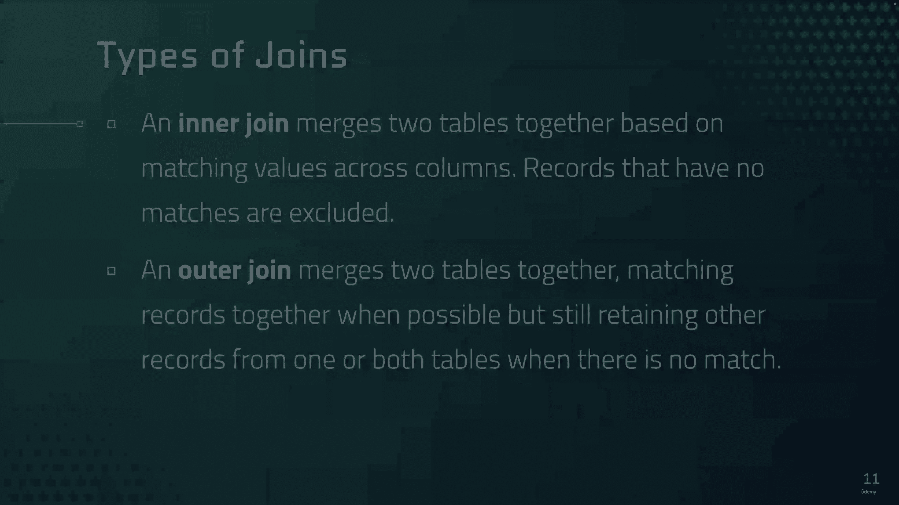

# 🚀 FastAPI 大师课：第117节：数据库关系与查询复习


在本节课中我们将要学习如何复习上一节课程里的数据库关系与查询内容。首先要恭喜你到达另一个课程章节的末尾。像往常一样，我们会花一点时间回顾本节学过的全部内容。本次复习会围绕数据库关系、外键、连接表、Booking 模型、`relationship`、`back_populates`、循环导入、`POST /bookings` 端点、`datetime` 类型、懒加载与预加载、删除策略、内连接与外连接，以及 `select`、`exists`、`func`、`group_by` 等查询操作展开。下面我们按主题逐项回顾，把每个概念用更直白的方式重新讲清楚。


## 📚 FastAPI 大师课：第117.1节：数据库关系与连接表


上一节我们进入了数据库关系这一主题，本节中我们来看看数据库关系到底是什么意思，以及它在租房 API 中是如何落地的。数据库关系是两个不同表之间的连接或链接。关系允许我们在业务领域和业务模型中连接相关的概念。具体到本节的租房 API，我们定义了一张新的 `bookings` 表和一个 `Booking` 模型，`Booking` 充当房间与发起预订的用户之间的连接层。

在关系数据库中，也就是使用表的数据库中，我们建立这些连接的方式是使用外键。外键是一张表里的列，但这一列中的值引用另一张表的主键。因此外键几乎像箭头或指针，指向其他表中的数据，指向其他表中的记录。这个列之所以叫外键列，是因为它是通往外部表的键，是通往另一张表、另一条记录的链接。

以下是本节关于外键和连接表需要记住的要点：

- `bookings` 表中包含 `room_id` 外键列，指向 `rooms` 表中的一条记录。
- `bookings` 表中还包含 `user_id` 外键列，指向 `users` 表中的一行。
- 像这样包含多个外键的表有时被称为连接表，因为它的主要目的是把其他表的记录连接起来。
- 连接表并不总是包含多个外键，也可以只有单个外键。
- `Booking` 再次充当用户与房间之间的中间层或连接组织。
- 拥有连接表并不意味着不能在这张表上添加额外信息，连接表完全可以有额外列。

以 `bookings` 表为例，我们还有 `check_in` 和 `check_out` 这样的额外列，因为这里是存储这些信息的最佳位置。把入住和退房时间存到用户行或房间行并不合理，因为同一个房间可以被多个用户通过多次预订重复预订。`Booking` 表示的是对房间的实际预订，它是同时知道房间和用户的记录，所以把入住、退房等信息放在这张连接表上更合理。

用一个公式来理解外键关系：

```text
Booking.room_id -> Room.id
Booking.user_id -> User.id
```

上一节我们说明了连接表和额外字段的放置位置，本节中我们来看看这些表如何映射到 Python 模型，以及模型之间如何建立关系。


## 🔗 FastAPI 大师课：第117.2节：Booking 模型与 relationship


在上一节理解连接表之后，本节中我们来看看 `Booking` 模型如何映射表，以及 SQLModel 的 `relationship` 函数如何帮助我们在 Python 代码中建立对象之间的连接。我们引入了 `Booking` 模型来映射 `bookings` 表，并且声明了 `room_id` 字段和 `user_id` 字段，因为它们直接对应 `bookings` 表中的实际列。

代码中还使用了 SQLModel 提供的 `relationship` 函数，这让我们在 Python 代码中直接获得一些优势。它帮助 SQLModel 在这些对象之间建立连接，这些对象是 ORM 从数据库取回数据时将要创建的 Pydantic 模型。例如，在 `Room` 模型上我们定义了 `bookings` 属性，这样只要有一个房间对象或房间模型，就可以直接写这个属性，拿到该房间关联的所有预订。

以下是模型关系属性的核心设计：

- `Room` 模型上的 `bookings` 属性使用复数形式，因为同一个房间可以被预订多次。
- `bookings` 属性的类型声明为 `Booking` 的列表，因为从任意房间都可以导航到它拥有的全部预订。
- `Booking` 模型表示一次单独入住，因此它的 `room` 属性使用单数形式。
- `Booking` 上的 `room` 属性让预订可以连接回这次预订所使用的单个房间。

因此，只要我们获取一个房间或一个预订，就可以访问它身上的互补属性，得到另一类记录的互补 Pydantic 模型，也就是数据库中补充表里另一类数据对应的模型。

核心代码可以这样表示：

```python
class Room(SQLModel, table=True):
    bookings: list["Booking"] = Relationship(back_populates="room")

class Booking(SQLModel, table=True):
    room: "Room" = Relationship(back_populates="bookings")
```

上一节我们建立了双向属性，本节中我们来看看让双向关系保持同步的关键参数 `back_populates`，以及它引出的循环导入问题。


## 🧩 FastAPI 大师课：第117.3节：back_populates 与循环导入


上一节我们看到了 `room` 和 `bookings` 两个互补属性，本节中我们来看看 `back_populates` 的作用，以及两个模型互相引用时如何避免循环导入。`back_populates` 是一个关键参数，它帮助我们在一个模型的状态或关联更新时更新互补模型。

例如，如果你有一个包含某些记录的列表，并且从这个列表中移除了一个条目，你也可以更新对应的模型，让它知道这个条目已经不再包含在该列表中。我们看到了一个例子：数据最终保存到数据库后是正确的，但运行时可能存在隐患，当我们更新一个模型却没有让另一个模型知道二者关系和关联发生变化时，就可能出现问题，而 `back_populates` 会自动处理这一点。

`back_populates` 的语法有一点容易混淆。我们把它提供给 `relationship` 函数，然后以一个字符串参数提供另一个模型上互补属性的名称。SQLModel 就是这样把两个方向的关系关联起来：如果我们改变一个类的模型，它会自动更新另一个完全不同的类的模型，前提是我们在代码中也加载了那个模型。这样，在 Python 代码这一侧，甚至在到达数据库之前，它们始终保持同步。

以下是解决循环导入的核心思路：

- 两个模型都需要在各自文件中引用对方，房间需要导入 `Booking` 模型来声明 `bookings` 属性的类型。
- 预订也需要导入 `Room` 模型来知道 `room` 属性的类型。
- 如果直接在运行时导入，文件 A 会尝试加载文件 B，文件 B 又会请求加载文件 A，文件 A 再次请求加载文件 B，形成无限循环。
- 运行时其实不需要具体的模型，只需要它们用于类型注解。
- 使用 Python 的特殊类型检查常量 `TYPE_CHECKING` 条件导入模型，只有类型检查器运行文件时才导入。
- FastAPI 运行代码时不会执行这些导入代码，因此不会遇到循环导入或循环依赖问题。
- 这样可以在行内引用模型及其类型，同时把类型声明为字符串，类型检查器会理解字符串对应 `if` 语句中导入的模型。

这相当于一个小技巧，让类型检查器知道这些关系和对应类型，同时不会在运行时让应用崩溃。核心代码示例如下：

```python
from typing import TYPE_CHECKING

if TYPE_CHECKING:
    from .booking import Booking

class Room(SQLModel, table=True):
    bookings: list["Booking"] = Relationship(back_populates="room")
```

> 一句话理解：运行时用字符串注解避开真实导入，类型检查时再用 `TYPE_CHECKING` 导入真实模型。


上一节我们解决了模型互相引用的问题，本节中我们来看看如何通过 `POST /bookings` 端点创建预订记录，并处理时间字段。


## 📝 FastAPI 大师课：第117.4节：POST /bookings 与 datetime


在建立模型之间的关系之后，我们继续构建新的 `POST /bookings` 端点，用来创建一条新的预订行。这个端点接收请求负载中的 `room_id` 和 `user_id`，它们对应另外两条记录的外键，也就是预订要关联的房间记录和用户记录。

客户端还会在请求负载中提供入住时间和退房时间，我们在 Pydantic 模型中也标注了这些类型。这是我们第一次接触包含 `datetime` 类型的字段。需要注意，当 `datetime` 值以 JSON 形式到达服务器时，它们会以字符串形式传入，随后 Pydantic 会把它们转换成 Python 的 `datetime` 对象。这些对象是 Python 编程语言内置的、用于表示日期和时间的对象。

当 ORM 向数据库发出实际请求时，数据库会把这些条目存储到自己的 `datetime` 列中，这些列针对时间数据的存储做了优化。核心概念可以写成下面的代码：

```python
from datetime import datetime

class BookingCreate(SQLModel):
    room_id: int
    user_id: int
    check_in: datetime
    check_out: datetime
```

以下是这个端点涉及的关键点：

- 端点接收 `room_id` 和 `user_id`，对应两个外键。
- 客户端提供 `check_in` 和 `check_out` 时间。
- JSON 中的时间先是字符串。
- Pydantic 把字符串转换成 Python `datetime` 对象。
- 数据库最终使用自己的 `datetime` 列存储时间数据。

上一节我们处理了创建预订和时间字段，本节中我们来看看查询关联数据时两种重要的加载方式：懒加载与预加载。


## ⚡ FastAPI 大师课：第117.5节：懒加载与预加载


上一节我们创建了预订记录，本节中我们来看看读取关联数据时的懒加载与预加载。`lazy` 和 `eager` 这两个词与现实世界中的含义完全一致：懒加载意味着不到绝对必要就不做工作，预加载则相反，希望尽可能立即完成工作。它们指的是两种不同的数据加载方式，通常指在获取第一条记录之后，如何加载补充数据或关联数据。

在同步数据库世界中，默认方式是懒加载。这意味着当 ORM 获取一条关联数据库记录时，只有当代码执行到访问关联属性的那一行，ORM 才会在代码的那个位置真正发出第二次请求，去取第二份数据。它之所以叫懒加载，是因为直到代码绝对必须运行、必须访问某个需要额外数据库数据的互补关联或关系时，请求才会发生。

相比之下，预加载会更早执行互补数据的获取。我们会在第一次获取数据时明确告诉 ORM：我们知道后面会需要这份关联数据，请在一开始就一次性把它取回来。引入异步数据库会话之后，预加载实际上变成了必须遵守的要求。因为默认情况下访问属性时，会话会尝试发出同步请求，这在异步世界中会失败。因此有了异步会话后，我们必须显式预加载，不仅预加载主记录，还要预加载第二张表甚至第三张表中的所有关联互补记录。

以下是两种预加载函数的核心区别：

```python
select(Room).options(selectinload(Room.bookings))
select(Booking).options(joinedload(Booking.user))
```

- `selectinload` 会向数据库发出两个独立请求，一个请求初始行或主记录，另一个请求关联记录，非常适合一对多关系。
- 例如在 `rooms` 路由中获取单个房间，同时想拿到该房间的所有预订，这就是一对多关系。
- 在路由处理器最顶部获取房间时，可以同时声明也要获取所有预订，数据库和 ORM 会以两个同时发生的请求完成这两次数据获取。
- `joinedload` 会向数据库发出一个总请求，执行等值连接，也就是根据列之间的匹配把多张表合并或连接起来。
- `joinedload` 适合一对一关系，例如一条预订映射到单个用户，或映射到单个房间。
- 这种情况下不需要两个独立查询，只发一个查询，数据库会一次性返回全部连接数据。
- 这样从预订到用户的关联在代码中直接可用，访问属性时数据已经存在，路由处理器可以正常继续。

我们探索了预加载语法，并且把它放在函数或路由处理器的最顶部。这样当我们访问主记录的属性时，关联数据已经获取完成，代码中的关联访问不会在运行时导致错误。

上一节我们解决了读取关联数据的问题，本节中我们来看看删除主记录时如何处理关联记录，也就是级联删除与置空两种策略。


## 🗑️ FastAPI 大师课：第117.6节：删除策略：级联删除与置空


上一节我们讨论了如何加载关联数据，本节中我们来看看删除主记录时关联记录该怎么办。我们探索了两种不同方法。所谓主记录，就是拥有主键、并被外键列引用的那条记录。

第一种方法是级联删除。使用级联删除时，我们会删除所有补充记录，也就是另一张表中那些外键指向已删除主记录的记录。它之所以叫级联，来自瀑布或水流从边缘倾泻而下并继续流向下一层的想法。数据库侧也是同样的原则：一个动作会产生另一个副作用或第二个动作。例如删除一个房间时，可以自动删除所有指向该房间的关联预订。

这里没有唯一的正确答案，这只是一个技术层面的数据库设计问题。最终取决于你的业务和领域，由你决定记录被删除时想做什么。有时你可能希望始终保留记录，并阻止主记录发生实际删除。有时可能是法律要求，例如用户想删除账户时，你可能必须删除他们所有的补充数据，例如信用卡或地址。这确实取决于你的领域或业务，不存在唯一正确的答案。这只是你可以利用数据库侧来处理主记录删除副作用的一种技术方法。



第二种方法是置空，也就是把外键设置为 `null`，而不是删除那一行，这样可以保留补充记录。例如删除一个房间时，可以保留它的预订，但房间 ID 已经不在 `rooms` 表中存在。因此可以在 `bookings` 表中把那一行的 `room_id` 条目设置为 `null`。`null` 只是数据库表示虚无或缺失的方式，和 Python 中的 `None` 对象表示同一概念，也和 JSON 中的 `null` 表示同一概念，基本就是缺失、虚无、删除、空位的意思。补充记录会保留下来，但它不再有指向主记录的链接，因为外键列被设置为 `null`，并且主记录也已经不存在。

核心概念可以用下面的代码表示：

```python
room_id: int | None = Field(
    default=None,
    foreign_key="rooms.id",
    ondelete="SET NULL"
)
```

以下是两种删除策略的对比：

- 级联删除：删除主记录时，同时删除所有指向它的补充记录。
- 置空：删除主记录时，把补充记录的外键设置为 `null`，保留补充记录。
- 级联删除适合希望关联数据一起消失的场景。
- 置空适合希望保留历史记录、但断开关联的场景。
- 选择哪一种取决于业务规则、领域需求，甚至法律要求。

上一节我们处理了删除带来的副作用，本节中我们来看看查询多张表时常用的内连接与外连接。


## 🔍 FastAPI 大师课：第117.7节：内连接与外连接


在章节接近尾声时，我们练习定义了各种端点，用不同方式获取数据和关联数据，这也引出了连接主题。我们探索了两种连接类型，SQL 中还有更多类型。我们重点看的是内连接和外连接。

内连接会根据你声明的关系合并两张表，并基于匹配值匹配行。这里最关键的一点是：另一张表中没有匹配的记录会被排除。例如你想获取所有拥有预订的房间，并把它们映射到一起，内连接很合适，但它会排除没有任何预订的房间。

外连接则更宽泛，会给出更大的结果集。它基本上仍然会合并两张表，像内连接一样匹配所有能够匹配的记录，但它还会保留一张表或两张表中没有匹配的记录。例如你想把房间和预订连接起来，同时又想保留没有预订、因此在 `bookings` 表中没有连接目标的房间，就需要使用外连接，确保不丢失这些房间数据。



核心概念可以写成下面的代码：

```python
select(Room, Booking).join(Booking)          # 内连接
select(Room, Booking).outerjoin(Booking)     # 外连接
```

以下是两种连接的直白区别：

- 内连接只保留两张表中能够匹配上的记录。
- 外连接除了保留匹配记录，还会保留没有匹配的记录。
- 内连接适合只关心有关联数据的场景。
- 外连接适合需要保留所有主表记录、避免数据丢失的场景。

上一节我们看了表连接，本节中我们来看看 SQLModel 中更细的查询操作，包括 `select`、表达式、`exists`、`func` 和 `group_by`。


## 🧮 FastAPI 大师课：第117.8节：select、exists、func 与 group_by


上一节我们学习了连接类型，本节中我们来看看新端点如何给我们机会探索 SQLModel ORM 的各种查询方式。一切从 `select` 函数开始。`select` 接受一个或多个模型参数，这些参数代表 ORM 将要返回哪些表的数据。如果传入 `select(Room)`，意思就是获取 `rooms` 表中的所有列。

我们也看到可以传入多个参数，包括多个模型。这个用法我们还没有实际看到，但它是可能的。我们还可以使用 `select` 的第二个参数来明确一些东西，例如一个求值、一个表达式，或者你希望数据库替你完成的一些额外计算。例如我们计算了每个房间的总预订数，这就是我们要求数据库执行的第二个计算。最终返回的结果集是一个元组，包含实际的房间记录以及对应的预订数量。

因此传给 `select` 的模型决定了 ORM 返回哪些表的列。当你执行连接或外连接并提供第二个模型时，第二个模型的列默认不会被带回来。但是执行连接之后，你可以使用第二张表的列进行过滤或分组等操作。例如在返回所有房间及其预订数量的端点中，我们并没有把全部预订记录本身包含进来，只是连接它们以便计数，然后把计数作为房间响应上的额外属性保存。我们可以仅仅为了过滤、分组或任何基于补充数据的额外计算而执行连接。

最后我们探索了一些额外查询操作，涉及可以从 SQLModel 中引入的额外函数。总体而言，这个库的 API 会镜像你在 SQL 中直接使用的关键词。好消息是，随着你更多练习 SQLModel，你也会不知不觉练习一些 SQL。我们引入了 `exists` 函数，它允许我们验证另一张表中是否存在关联记录，而不实际获取它的数据。例如我们想查询至少拥有一条预订的房间，并不需要任何实际的预订数据，这时 `exists` 这样的函数就非常有用。

我们还引入了从 SQLModel 导入的 `func` 对象。它有一整套方法对应实际的 SQL 函数。你写给 ORM 代码，然后 ORM 会告诉 SQL 和数据库使用 SQL 中可用的内置函数。我们看到了一个 `count` 的例子，它允许我们统计每个房间的预订数量。数据库里还有各种其他函数，例如 `lower` 会把内容转成小写，也可以去除空白，还可以从字符串开头或结尾提取指定子串等。再次说明，这些操作通常在数据库侧更快。用 Python 做这些事从技术上讲没有错，但如果你能生成完美的 ORM 查询，让数据回来时已经是完美形状，那么 Python 和服务器需要做的事就更少。因此，越多地把逻辑转移到 ORM，更具体地说转移到数据库，效果越好。

最后我们还看到了 `group_by` 方法，它允许我们根据某个列值把记录组织成组、桶或类别。我们就是这样把所有房间和它们连接到的预订记录分组到一起，从而统计每个房间的预订数量。

核心查询示例可以写成下面的代码：

```python
select(Room, func.count(Booking.id)) \
    .join(Booking) \
    .group_by(Room.id)

select(Room).where(
    exists().where(Booking.room_id == Room.id)
)
```

以下是本节查询操作的要点：

- `select` 决定 ORM 返回哪些模型或哪些表的数据。
- `select` 的第二个参数可以包含表达式或额外计算。
- 连接第二张表后，可以使用第二张表的列进行过滤或分组，但第二张表的列默认不会返回。
- `exists` 用于验证关联记录是否存在，而不需要取出关联数据。
- `func` 对应 SQL 内置函数，例如 `func.count`。
- 常见数据库函数还包括小写转换、去空白、截取子串等。
- 能交给数据库做的计算尽量交给数据库，Python 和服务器就能少做工作。
- `group_by` 按列值把记录分组，适合统计、聚合和分类。

本节覆盖了很多有趣的概念。我认为此时可以暂停，或者说 `rent room` 项目可能到此结束。接下来我们会把注意力放在更具体的 FastAPI 概念上，放在更小的领域或更小的项目中，这样可以让我们精确聚焦某个概念。此时我们的 `rent a room` 项目已经具有一定复杂度。我希望在过去十几个小时里，你享受和我一起构建这个项目，并且学到了很多。下一节见。


## ✅ FastAPI 大师课：第117.9节：总结与下一步


本节课中我们一起学习了数据库关系与查询的复习内容。我们回顾了数据库关系是两个表之间的连接，外键是指向另一张表主键的列，包含多个外键的表可以叫连接表，连接表也可以携带额外字段。我们回顾了 `Booking` 模型如何映射 `bookings` 表，`relationship` 如何让 `Room.bookings` 和 `Booking.room` 互相导航，`back_populates` 如何保持双向关系同步，以及如何用 `TYPE_CHECKING` 和字符串类型注解解决循环导入。

我们还回顾了 `POST /bookings` 端点如何接收 `room_id`、`user_id`、`check_in` 和 `check_out`，JSON 时间字符串如何被 Pydantic 转成 Python `datetime`，数据库又如何用优化过的时间列存储这些值。我们比较了懒加载与预加载，说明异步会话下必须显式预加载，并区分了 `selectinload` 适合一对多、`joinedload` 适合一对一。我们比较了级联删除和置空两种删除策略，说明它们没有唯一正确答案，要看业务规则。我们还比较了内连接与外连接，说明内连接排除无匹配记录，外连接保留无匹配记录。最后我们复习了 `select`、表达式计算、`exists`、`func`、`group_by` 等查询操作，并强调尽量把计算交给数据库。

到这里，本次章节复习完成。接下来课程会进入更小的 FastAPI 专题项目，继续把具体概念讲清楚。下节见。

