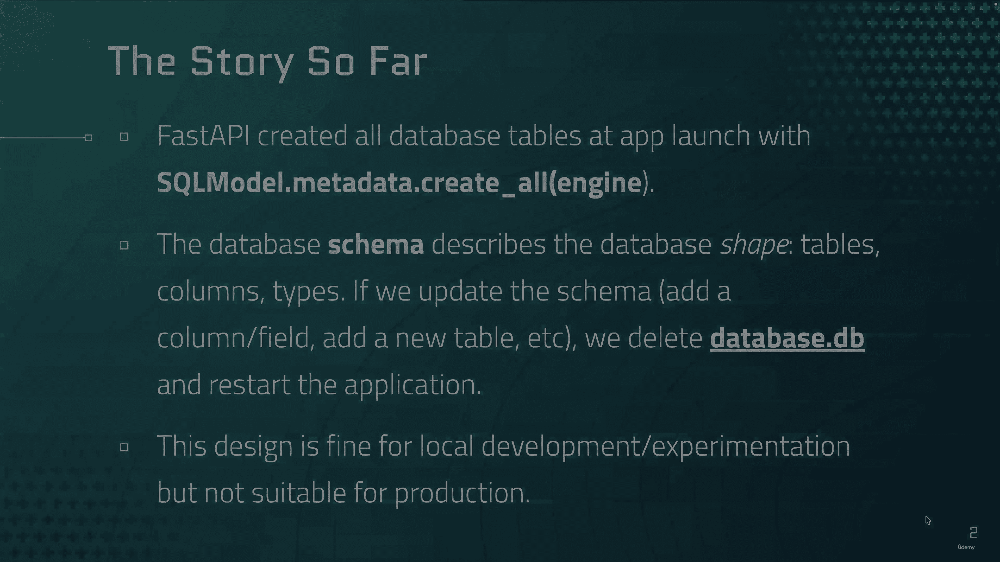
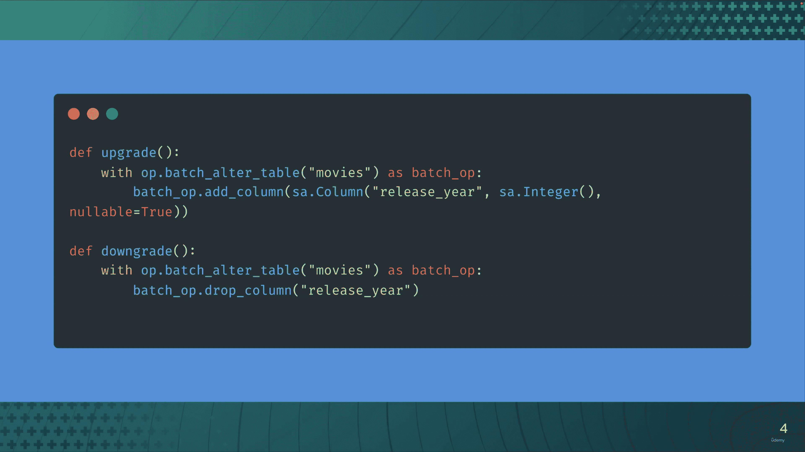
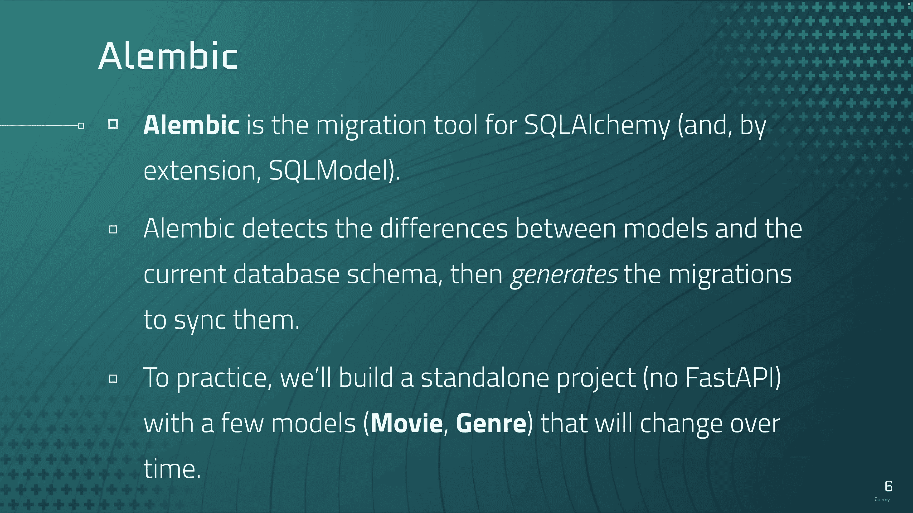

# FastAPI 大师课：118：🗄️ 数据库迁移

欢迎来到课程下一节。在本节课中，我们将要学习数据库迁移，也就是对数据库模式增量变化进行建模的文件。开头先回顾目前为止已经做过的建表方式，并说明本节中围绕数据库的心智模型会如何改变。简单说，数据库模式就是数据库的形状，包括有哪些表、每张表有哪些列、每列是什么类型。理解这一点后，迁移的必要性就会自然出现。下面先看当前项目里的做法。

## FastAPI 大师课：118：🧭 当前创建表的方式

上一节我们先明确本节目标，本节中我们来看看目前 rent room 项目是怎样创建数据库表的。到目前为止，在 rent room 项目中，应用启动时就会创建所有数据库表，项目使用的是 SQLModel ORM。在 FastAPI 应用的生命周期（lifespan）中，我们一直使用类似下面的代码创建所有表：

```python
SQLModel.metadata.create_all(engine)
```



如果新增一个模型，而这个模型对应一张新表，过去的做法只是删除数据库 `.db` 文件，然后重启应用，让数据库里出现所有新表。这个做法在学习阶段很直观，因为删除旧库再重建，所有表都会按当前模型重新生成。但在真实生产环境中，这不是合适的方案。原因是每次更新模式（schema）时删除数据库，就会丢失所有数据。模式基本就是数据库形状，包括所有表、列以及各自的类型。每次更新模式都删库，意味着每次给表增加一列，都可能删掉 Airbnb 上数百万房间和用户数据，这显然不可接受。SQLite 中删旧库、建新库的方式适合学习，不适合真实应用。

## FastAPI 大师课：118：📌 什么是数据库迁移

上一节回顾了删库重建的做法以及它的问题，本节中我们来看看数据库迁移如何解决模式演进问题。核心需求是：让数据库模式随时间演进，同时不删除已有数据。数据库迁移是用 Python 脚本描述模式变化的一种做法，这个概念不限于 Python 或 FastAPI，任何现代语言的后端开发库中都能找到类似机制，原则相同。迁移就是一段代码，用来描述数据库模式的变化。它可以描述任何更新数据库的动作，例如创建新表、删除表、建立外键连接，或修改列的数据类型，比如从整数改为浮点数。可以写成：

\[
\text{数据库模式}=\{\text{表},\text{列},\text{列类型},\text{约束},\text{外键}\}
\]

\[
\text{迁移} = \left(\text{upgrade} \rightarrow \text{应用变更},\ \text{downgrade} \rightarrow \text{回退变更}\right)
\]

迁移是一系列 Python 代码指令，说明如何以某种方式改变数据库。这里有一个重要点：每当我们规定数据库如何向前移动，也必须提供如何回滚的指令，也就是返回数据库的前一个版本或迭代。因此，一个 Python 迁移会有如何应用某项变更的指令，例如增加一列，也会有如何反转该变更的指令，例如删除迁移创建的那一列。迁移表示数据库变化的顺序步骤，因此我们可以导航到任意一个迁移，或模式中的任意部分，查看数据库在当时那个确切形状下的表、列和数据库类型。于是，迁移实际上提供了数据库模式随时间变化和演进的时间顺序历史。“migrate”这个词意思是移动，所以迁移字面上就是模式随时间移动或发展的记录。迁移在应用时会按顺序执行，数据库会记录哪些迁移已经应用，这样它才知道你处在按时间顺序的变化历史中的哪个位置。也可以把迁移看成模式开发过程中的新检查点或保存点，帮助你向前或向后遍历数据库模式。

## FastAPI 大师课：118：🧱 一个迁移文件长什么样

上一节解释了迁移的定义和前进、回退思想，本节中我们来看看一个迁移文件的具体结构。一个示例迁移文件里通常有两个函数：`upgrade` 和 `downgrade`。`upgrade` 包含应用迁移的代码，也就是对数据库做出那些变更；`downgrade` 包含互补的指令，用来降级或回退，也就是回到迁移应用之前的状态。下面的代码不必全部理解，但可以看到 `upgrade` 函数使用上下文管理器，并调用 `batch_alter_table` 影响 `movies` 表，在实际代码块中规定对该表的变更，其中 `add_column` 表示在 `movies` 表中新增一个名为 `release` 的列，这个列类型是整数，并且可为空（nullable），也就是可以包含 null 或缺失值。`downgrade` 函数则做相反的事，同样针对 `movies` 表，但指令是删除 `release` 这一列。

```python
def upgrade():
    with op.batch_alter_table("movies") as batch_op:
        batch_op.add_column(sa.Column("release", sa.Integer(), nullable=True))


def downgrade():
    with op.batch_alter_table("movies") as batch_op:
        batch_op.drop_column("release")
```

因此，迁移既提供向前走一步的代码，也提供向后走一步的代码。你可以随着数据库模式的发展导航或遍历模式。把迁移看成模式开发中的新检查点或保存点，就能理解它们的作用。迁移按顺序应用，数据库会跟踪哪些迁移已经应用，这样就能知道你在按时间顺序的变化历史中的位置。



## FastAPI 大师课：118：⚙️ Alembic 如何生成迁移

上一节看到一个迁移文件里的前进和回退函数，本节中我们来看看 Python 社区中负责处理迁移复杂性的工具 Alembic。Alembic 是 SQLAlchemy 使用的基础迁移工具，而 SQLModel 构建在 SQLAlchemy 之上，所以也会使用它。Alembic 强大的地方在于，它能检测模型和代码与实际当前数据库模式之间的差异；检测到差异后，它可以为你生成迁移文件。可以用一个差异公式理解：

\[
\Delta = \text{模型定义} - \text{当前数据库模式}
\]

例如，一张表有四个列，对应模型中的四个字段，随后给模型增加第五个字段，然后运行 Alembic，Alembic 会识别出模型现在有第五个字段，这个字段必须映射到数据库中尚不存在的第五个表列，于是它能生成添加第五列的迁移。如果模型写得正确，很多时候 Alembic 会自动生成迁移代码，不需要我们从零编写。需要说明的是，Alembic 生成的代码不总是正确。虽然这个助手很有帮助，但始终要检查迁移中的代码是否做了该做的事，因为 Alembic 可能误解你的意图。一个著名例子是重命名列：假设列当前叫 `a`，你把它改名为 `b`，Alembic 可能没有意识到这是重命名，而认为你删除了列 `a` 并新增了列 `b`。所以，每当 Alembic 根据模型变化和当前数据库模式生成迁移，仍然要打开迁移文件，验证代码符合预期。



## FastAPI 大师课：118：🎬 本节练习项目

上一节介绍了 Alembic 的自动生成能力和检查迁移的必要性，本节中我们来看看练习项目如何安排。在本节练习中，我们会暂时离开 rent room 项目。实际上，该项目可能已经完全结束，具体要看课程后续发展。这里的想法是在一个新的、隔离的、独立项目中测试 Alembic 相关思路。我们将构建一个电影追踪器，它会包含 movies 和 genres 等领域概念，这些概念会映射到对应的数据库表。我们会从基础项目开始，然后慢慢演进数据库模式。以下是本节练习中要观察的迁移环节：

- 迁移如何开发
- 迁移如何编写
- 迁移如何应用
- 迁移如何回退
- 以及其他相关内容

这样安排的目的，是让你亲眼看到迁移从开发到编写、应用、回退的完整过程，而不是只停留在概念层面。

## FastAPI 大师课：118：✅ 总结

本节课中我们一起学习了数据库迁移的基础概念。我们回顾了目前应用启动时用 SQLModel 创建所有表的做法，也说明了在生产环境中不能每次改模式就删库，否则会丢失全部数据。随后我们理解了迁移是用 Python 代码描述模式增量变化，并且必须同时提供前进和回退指令。我们还看到一个迁移文件中 `upgrade` 和 `downgrade` 的示例，理解了数据库会按顺序记录已应用的迁移。接着我们认识了 Alembic，它能检测模型与当前数据库模式之间的差异并生成迁移文件，但生成结果需要人工检查。最后我们说明了本节练习会使用一个独立的电影追踪器项目，逐步演进模式，观察迁移如何开发、编写、应用和回退。本课内容到此结束，希望迁移的基础概念能够理解，本节中我们会继续练习这些概念，期待下节课见。

