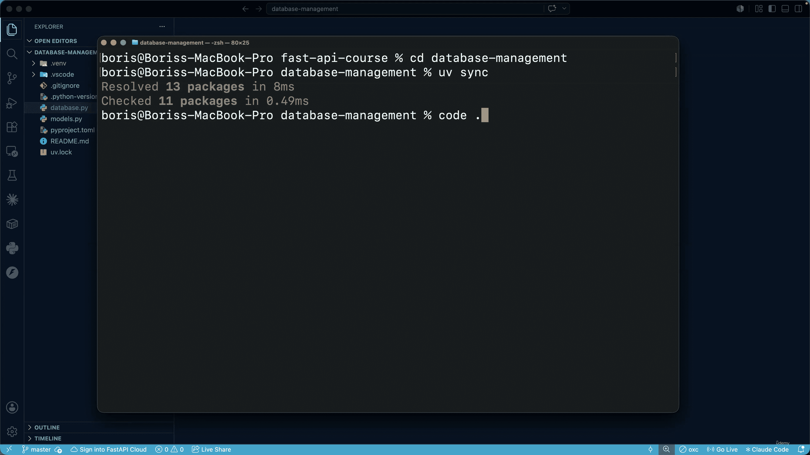
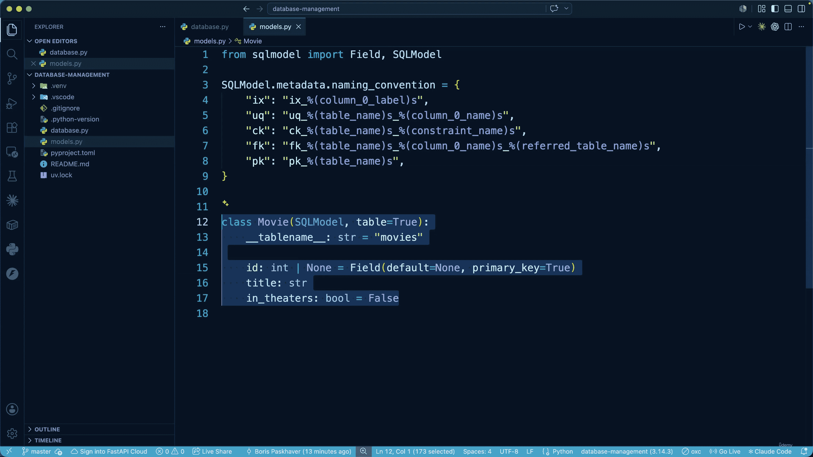

# 🎬 Udemy FastAPI大师课：119：项目初始化

在本节课中，我们将要学习一个名为 database management 的新项目如何完成初始化。本节内容对应 Udemy - FastAPI Masterclass part2 p18 119. Project Setup。我们会从进入项目目录、同步依赖开始，接着配置 VS Code 的 Python 解释器，然后查看 pyproject.toml 中的依赖，理解 alembic 在当前项目里的作用，再分别查看 database_setup.py 和 models.py 这两个文件，最后明确当前项目还没有数据库、还没有迁移文件这一状态。整篇教程会尽量用直白的话解释，让初学者也能看懂每一步在做什么，以及这些步骤为什么重要。

## 📁 Udemy FastAPI大师课：119.1：进入项目目录并同步依赖

首先，我们处于本课程章节的新项目之中，这个项目的文件夹名为 database management。我们需要从课程文件的顶层目录导航进入 database management 文件夹。作为提醒，为了下载 uv 项目声明的全部依赖，可以执行 `uv sync` 命令。这个命令会在当前文件夹直接创建一个新的 Python 环境，也就是虚拟环境，同时下载项目所需的所有依赖。这个同步过程完成之后，项目就具备了运行和后续操作所需的基础环境。



```bash
uv sync
```

依赖同步完成后，可以使用 `code .` 打开 VS Code，这个命令会在项目根目录中打开 VS Code。这个过程看起来简单，但它是后续配置解释器和查看项目文件的基础。上一节我们说明了进入项目并同步依赖的大致流程，本节中我们来看看 VS Code 中的解释器选择。

## ⚙️ Udemy FastAPI大师课：119.2：选择 Python 解释器

进入 VS Code 之后，需要打开命令面板。不同系统打开命令面板的快捷键如下：

- macOS：`Command + Shift + P`
- Windows：`Control + Shift + P`

这个快捷键列表可以帮助初学者快速找到命令面板。打开命令面板后，搜索 `Python: Select Interpreter`，选择这个选项，然后定位当前文件夹或当前项目对应的虚拟环境。在这里可以看到 database management 被高亮显示，这对应的就是当前文件夹内 `.venv` 中的虚拟环境。在编辑器左侧也能看到这个虚拟环境，本地版本的 Python 和全部依赖都安装在那里。需要按回车确认，这样 VS Code 才能理解当前项目要使用这个版本的 Python 和这些依赖。

上一节完成了依赖同步，本节确保编辑器使用正确的 Python 解释器。解释器配置完成后，我们打开项目配置文件，看看这个项目具体依赖了哪些库。

## 📦 Udemy FastAPI大师课：119.3：查看 pyproject.toml 与依赖

接下来打开 pyproject.toml，它是 uv 项目的中央配置文件。这个项目的依赖比较简单，以下是主要依赖及其用途：

- SQLModel：项目的 ORM，用来声明 SQLModel 类，方式和 rent-a-room 项目类似。
- alembic：用来生成数据库迁移文件。
- ruff：项目的代码格式化工具。

这个依赖列表说明项目当前的重点不在 Web 服务，而在数据库模型和迁移。这个项目完全不会使用 FastAPI，事实上大部分情况下也不会有任何服务器，甚至不会有完整的 Python 应用。原因在于 alembic 的核心用途是解析现有代码并为项目生成新的迁移文件，这种逻辑即使没有正在运行的应用也可以存在。可以用下面的公式来理解迁移生成的核心概念：

$$
迁移文件 = 解析(现有代码) \rightarrow 对比(数据库当前结构) \rightarrow 生成变更
$$

这个公式说明，迁移不是由运行中的服务器产生的，而是由代码状态和数据库状态之间的差异产生的。依赖和 alembic 的用途了解之后，我们来看当前项目中实际存在的两个文件。

## 🗂️ Udemy FastAPI大师课：119.4：database_setup.py 的作用

当前的基础设置非常精简，项目中只有两个文件。第一个文件是 database_setup.py，它包含创建数据库的代码。这个项目仍然使用 SQLite，代码和 rent-a-room 项目中的做法很接近。以下是这个文件的核心代码示例：

```python
from sqlmodel import create_engine

sqlite_file_name = "movie.db"
sqlite_url = f"sqlite:///{sqlite_file_name}"
engine = create_engine(sqlite_url)
```

这段代码从 SQLModel 导入 `create_engine`，指定 SQLite 数据库的名称，这个数据库会定义在 movie.db 这一个文件中，然后创建 engine，engine 表示到最终数据库的连接。这里仍然需要创建数据库，因为迁移会把变更应用到数据库中。这个文件基本就是在完成数据库创建和连接准备工作。database_setup.py 说明完之后，我们转到与它互补的 models.py。

## 🧱 Udemy FastAPI大师课：119.5：models.py 与约束命名约定

与 database_setup.py 互补的文件是 models.py。这个文件里大部分代码应该是熟悉的，主要区别在于有一段代码访问 SQLModel 的 metadata 属性，并把 naming_convention 属性覆盖为一个新的字典。以下是示例代码：

```python
from sqlmodel import SQLModel

SQLModel.metadata.naming_convention = {
    "fk": "fk_%(table_name)s_%(column_0_name)s_%(referred_table_name)s",
}
```

这段代码指定数据库约束的命名要求。数据库约束可以理解为 SQLite 在内部逻辑中跟踪的规则，例如主键、外键和索引。每次定义这些约束时，SQLite 都会使用某种内部命名方案。这里不需要深入担心内部细节，这段代码的作用是覆盖并设定一个新的命名标准。以 `fk` 为例，它代表外键；当 SQLModel 和 SQLAlchemy 创建或定义外键时，这个约定会规定外键名称的格式。名称会以外键缩写 `fk` 开头，接着包含外键所在的现有表名，再包含实际列名，例如 user_id，然后再用一个下划线连接外键指向的主表名。以下是命名约定中的关键部分：

- `fk`：表示外键。
- `%(table_name)s`：外键所在的现有表名。
- `%(column_0_name)s`：外键所在的实际列名，例如 user_id。
- `%(referred_table_name)s`：外键指向的主表名。

这些通用标准命名约定可以确保本节代码按预期工作。SQLite 与更接近生产环境的 Postgres 有所不同，因此需要一些附加配置；这些配置可以在 SQLite 和 SQLModel 文档中找到，用来确保迁移相关代码正常工作。除此之外不需要担心太多，这类代码通常就是查文档后复制粘贴使用的示例。命名约定了解之后，我们来看这个文件中更重要的 Movie 模型。

## 🎞️ Udemy FastAPI大师课：119.6：Movie 模型与当前项目状态

models.py 中更重要的细节是 Movie 模型。这段代码到现在应该比较熟悉了。以下是 Movie 模型示例：

```python
from sqlmodel import SQLModel, Field

class Movie(SQLModel, table=True):
    id: int | None = Field(default=None, primary_key=True)
    title: str
    in_theaters: bool
```

这段代码定义了一个新的 SQLModel 类 Movie，它会映射到 SQLite 数据库中的 movies 表。这个表当前有三列：id、title 和 in_theaters。项目要构建一个存储电影数据的应用，目前没有更多复杂内容需要理解。现在没有应用逻辑或业务逻辑，可以把它直接理解为一个存储电影的数据库。需要特别注意的是，目前没有应用，因此也还没有数据库，同时也没有任何迁移文件。我们还没有告诉 alembic 去查看当前代码状态，也就是当前只有一个模型，并把它映射成一个指定创建 movies 表的迁移。这个迁移还不存在，alembic 也还没有解析这个文件。当前状态可以用下面的代码表示：

```text
代码状态 = 一个 Movie 模型
数据库状态 = 尚未创建
迁移状态 = 尚未生成
```

这就是项目当前的起始画布。Movie 模型和当前状态说明之后，我们进入下一课要做的 alembic 初始化工作。

## 🚀 Udemy FastAPI大师课：119.7：下一课展望与本节总结

在下一课中，我们会继续 alembic 的初始化，然后查看如何指示 alembic 解析代码并生成第一个迁移。alembic 会分析代码当前状态和数据库当前状态之间的差异。运行 alembic 时，它会识别出代码指定了一个包含三列的 movies 表，但数据库中还不存在这个表，于是 alembic 会生成迁移，用来向数据库添加 movies 表，并让这三列映射到模型字段。需要注意，这些操作目前都还没有发生，我们会在下一课中完成设置。

> 提示：本项目的重点是用代码定义模型，再让 alembic 把模型变化转换为数据库迁移；当前还没有数据库和迁移文件。



本节课中我们一起学习了 database management 项目的初始化流程，包括进入项目目录、使用 `uv sync` 同步依赖、用 `code .` 打开 VS Code、选择 Python 解释器、查看 pyproject.toml 中的 SQLModel、alembic 和 ruff 依赖、理解 database_setup.py 创建 SQLite 数据库和 engine、查看 models.py 中的约束命名约定、认识 Movie 模型以及当前还没有数据库和迁移文件的状态。下一课我们会初始化 alembic，并生成第一个迁移文件。
