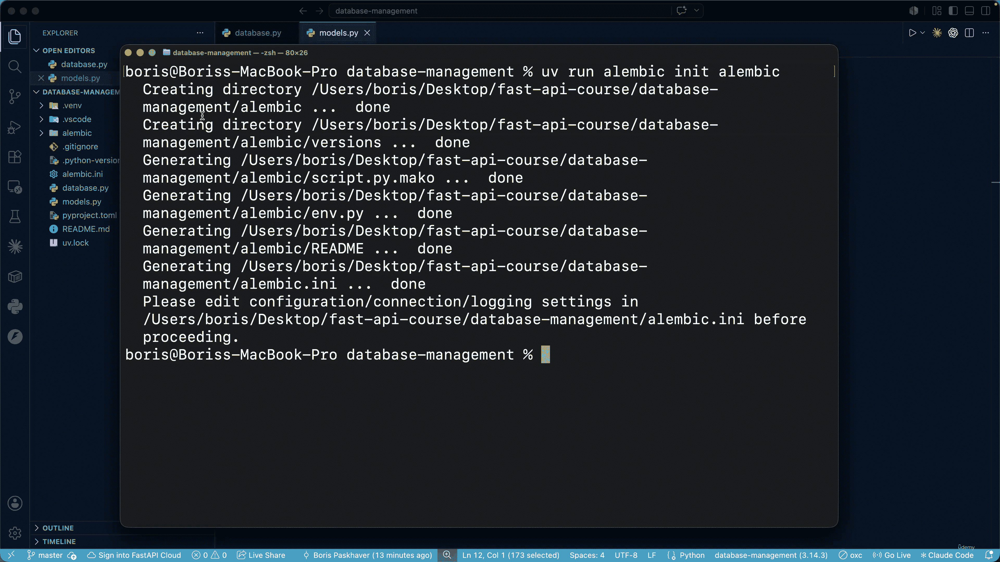
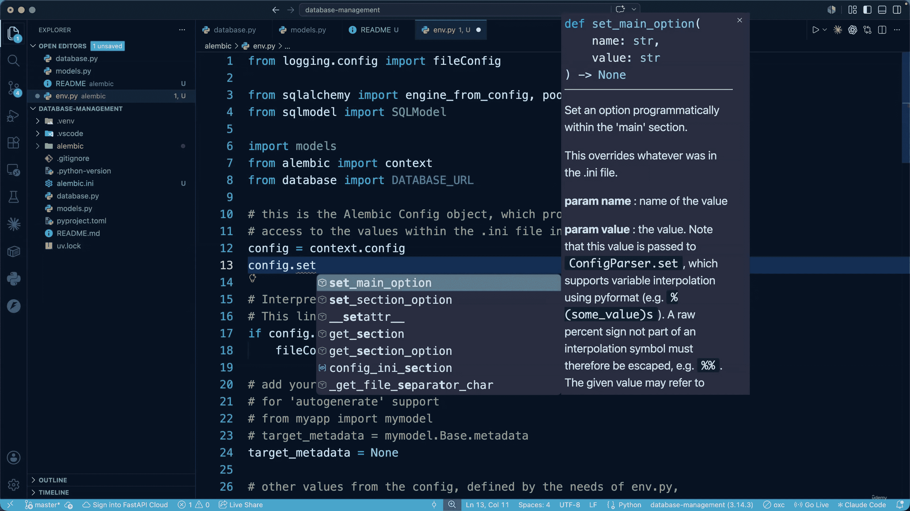
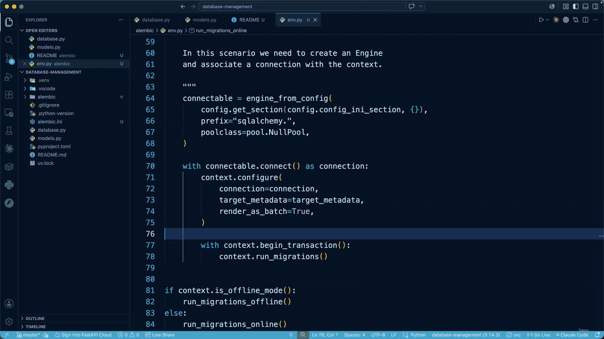

# FastAPI 大师课：120：🚀 初始化 Alembic

在本节课中我们将要学习如何在 FastAPI 项目中初始化 Alembic，并把它与 SQLModel、数据库连接起来。项目其实已经把 Alembic 添加为依赖，但依赖存在并不等于初始化完成，还需要在终端运行一条额外命令，让 Alembic 创建后续要用的文件。核心关系可以理解为：`模型代码 → Alembic 读取元数据 → 生成迁移文件 → 数据库执行`。本节会从终端命令开始，逐步说明生成的文件、`env.py` 的配置、离线与在线迁移模式，最后让整个迁移流程可以在 SQLite 上正常工作。

上一节我们了解了项目依赖和迁移的基本背景，本节中我们来看看怎样真正把 Alembic 初始化起来。

## FastAPI 大师课：120.1：🧰 在终端初始化 Alembic

我们的项目已经将 Alembic 添加为依赖。不过，还需要在终端中运行一条额外命令来初始化 Alembic。初始化会创建 Alembic 后续要使用的若干文件。需要特别注意，我们与 Alembic 的大部分交互都来自终端或命令行，而不是写在 Python 代码内部。实际流程是：在 Python 代码里修改模型，然后从终端让 Alembic 作为项目依赖去解析这些代码，并生成迁移。

因为项目是 uv 项目，要使用本地安装的 Python 版本，命令要以 `uv run` 开头。这个前缀和运行 `uv run fastapi dev` 时完全相同。随后列出依赖，再给出该依赖的补充命令。这里依赖是 Alembic，它已经在 `pyproject.toml` 中指定；Alembic 内部要执行的命令是 `init`，也就是 initialize 的缩写。

只写这条命令也可以，但我会在空格后额外加一个参数，用来指定 Alembic 存放所有创建文件的文件夹，包括最终生成的迁移文件。这里我写成 `alembic`，这个目录名由你决定。`alembic` 是常见选择，`migrations` 是常见选择，`versions` 是常见选择，都由你决定。完整命令如下：

```bash
uv run alembic init alembic
```



执行这条命令后需要注意：因为最后指定了 `alembic`，会看到它创建出一大批文件，这些文件都位于新的 `alembic` 目录中，这个目录来自命令最后传入的值。顶层还会出现 `alembic.ini` 配置文件；这个文件主要保存顶层配置信息，基本不需要手动修改。

上一节我们说明了初始化命令和目录参数，本节中我们来看看初始化后生成了哪些文件。进入 `alembic` 目录后，能看到一个嵌套文件夹 `versions`，此时它是空的。生成迁移时，Alembic 会把迁移文件放到这里；迁移文件中包含 `upgrade` 和 `downgrade` 两个 Python 函数，也就是预生成的代码。目录里还有 README，提供一些基本信息，但帮助不大，后面会再看；还有 `script.py.mako`，名字读作 mako 或 moco 都可以。为了开始配置，还需要在 `env.py` 中提供配置；`env.py` 是 Environment 的缩写。

## FastAPI 大师课：120.2：🔌 配置 `env.py` 连接数据库与 SQLModel

上一节我们认识了初始化后的目录结构和关键文件，本节中我们来看看 `env.py` 中需要补充哪些配置。打开 `env.py` 时，会看到一些 Ruff 违规提示；可以保存文件，让格式化按可预测的字母顺序处理。这个文件里要做的事情是建立 Alembic 与数据库的连接，以及 Alembic 与 SQLModel 的连接。Alembic 处在中间，扮演粘合层，从模型代码交互到数据库所需的迁移。当前文件完全不知道项目使用哪种数据库、使用哪种 ORM，所以要用几行代码把这些信息配置好。

以下是配置 `env.py` 时需要完成的关键导入与设置，按顺序说明每一项的作用。

首先从 SQLModel 导入 SQLModel 类本身，和在 `models.py` 中创建 `Movie` 类时使用的类是同一个。接着，要像 FastAPI 应用中那样，确保这个文件运行时 Alembic 知道应用中定义的所有模型，因为 Alembic 会跟踪这些模型，把它们作为生成迁移的基础。因此可以直接导入 `models.py` 文件；不需要在别处引用它，只要保证 Alembic 运行时它已经被导入。

```python
from sqlmodel import SQLModel
import models
```

然后从 `database` 文件导入 `DATABASE_URL` 常量。这个常量提供指向 SQLite 数据库 `movies.db` 的链接，而该文件目前还不存在。能够从 `database.py`、`models.py` 这样的顶层文件导入名称，是因为 `alembic.ini` 中的配置。虽然 `env.py` 嵌套在 `alembic` 目录中，但 `alembic.ini` 里的配置选项会让它知道要从代码库顶层导入。这些文件因此能被识别；这有点令人困惑，但属于 Alembic 通过 `alembic.ini` 启用的机制，使该文件可以从项目顶层读取，项目顶层被设置为根路径。于是这些代码会像 `env.py` 位于项目顶层一样工作，尽管它实际上并不在顶层。

```python
from database import DATABASE_URL
```

接下来建立 Alembic 与数据库之间的连接。代码中有一个 `config` 变量，它表示 Alembic 的配置对象。该对象有一个 `set_main_option` 方法，需要传入两个参数：第一个是选项名，第二个是该选项的值或设置。这里要传入的选项名字符串是 `sqlalchemy.url`，它表示实际数据库的位置、路径或 URL。SQLAlchemy 是 ORM，而 SQLModel ORM 构建在 SQLAlchemy 之上。这里设置的是数据库位置和连接信息，SQLAlchemy 会使用它；值就是前面导入的 `DATABASE_URL` 字符串。这样就在 Alembic 配置和数据库位置之间建立了连接。



```python
config.set_main_option("sqlalchemy.url", DATABASE_URL)
```

下一步建立 Alembic 与 SQLModel 之间的连接。代码中会看到 `target_metadata = None`，需要把 `None` 替换为下面的内容：访问 `SQLModel` 这个类上的顶层类属性 `metadata`，并把它赋给 `target_metadata`。这样 Alembic 就知道 SQLModel 是项目的主要 ORM，而该元数据会包含所有已注册模型。由于文件顶部已经导入了 `models.py`，这些模型此时已经定义好。以后运行 Alembic 并初始化或执行 `env.py` 时，它就会知道 SQLModel 的元数据，其中包含所有已定义模型及其字段。

```python
target_metadata = SQLModel.metadata
```

## FastAPI 大师课：120.3：🧪 理解离线与在线迁移模式

上一节我们完成了数据库和 SQLModel 的元数据连接，本节中我们来看看 `env.py` 下方两个迁移运行函数。下方有两个函数：`run_migrations_offline` 和 `run_migrations_online`，二者略有不同。`run_migrations_online` 会实际连接数据库并直接运行迁移，接近正常模式；相比之下，离线模式生成要运行的 SQL 脚本，但不实际连接数据库，类似一次试运行。离线模式适合在实际运行代码前检查原始 SQL，或者只想生成原始 SQL 交给其他人，例如数据库管理员。

例如，你在创建迁移，但在公司里没有权限更新数据库，就可以用离线模式生成所需的 SQL，再交给有权限的同事运行，从而生成配套的表。ORM 既可以处理代码生成，也可以处理代码生成并运行，在线模式就是后者。

以下是两个迁移函数中都需要注意的配置差异，便于理解离线与在线模式分别做什么。

- `run_migrations_online`：连接数据库并直接执行迁移，像正常模式。
- `run_migrations_offline`：只生成 SQL 脚本，不连接数据库，像试运行，可用于审查或交给 DBA。

无论选择哪种模式，都需要修改两个函数中的设置，位置在 `configure` 方法调用处。需要添加参数 `render_as_batch=True`。这一点和前面提到的命名约定类似，只是确保代码能与 SQLite 正常工作的一项要求。它不是本节的重点，不需要理解所有复杂细节；读文档跟随即可，SQLModel 文档中也提到这一点。在 `configure` 方法中传入该参数，同时在 `run_migrations_online` 中对应的 `configure` 方法里也传入 `render_as_batch` 参数。

```python
context.configure(
    connection=connection,
    target_metadata=target_metadata,
    render_as_batch=True,
)
```

完成这些设置后，基本可以确保所有迁移都能像在生产数据库（例如 PostgreSQL 或 MySQL）中一样与 SQLite 正常工作。现在所有连接都已设置好，Alembic、SQLModel 和数据库这些组成部分都知道彼此的存在，接下来就可以实际生成第一个迁移。

## FastAPI 大师课：120.4：✅ 本节总结与下一步



上一节我们完成了 `env.py` 中离线与在线迁移的配置，本节中我们对整个初始化流程做总结。本节课中我们一起学习了如何在 uv 项目中用 `uv run alembic init alembic` 初始化 Alembic，认识了 `alembic.ini`、`versions`、`env.py` 等文件，并在 `env.py` 中导入模型、设置 `sqlalchemy.url`、把 `target_metadata` 指向 `SQLModel.metadata`，还为 SQLite 配置了 `render_as_batch=True`。到这里，Alembic、SQLModel 和数据库已经互相连通，下一步就可以生成第一个迁移文件。

