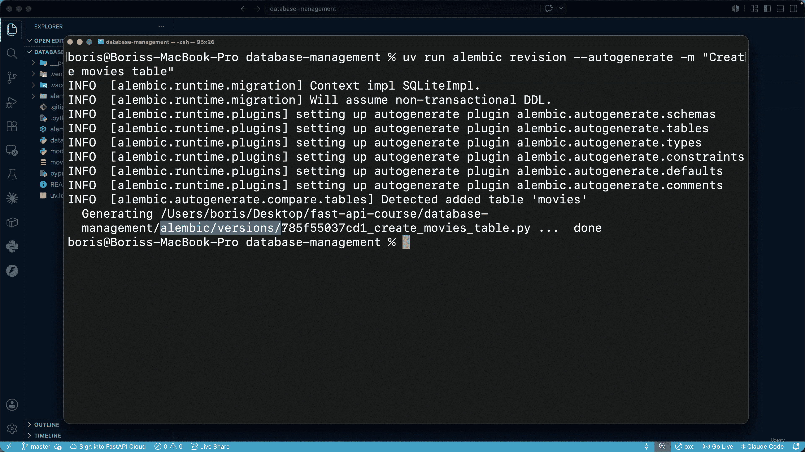
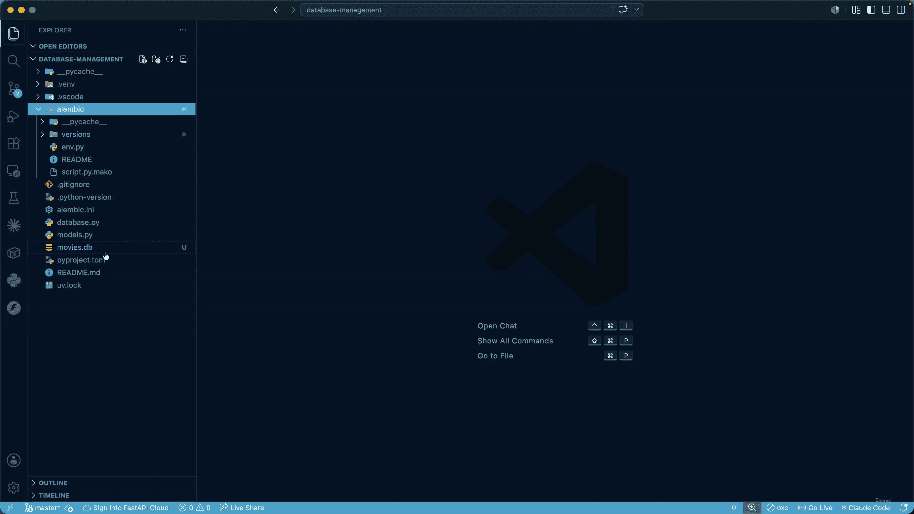
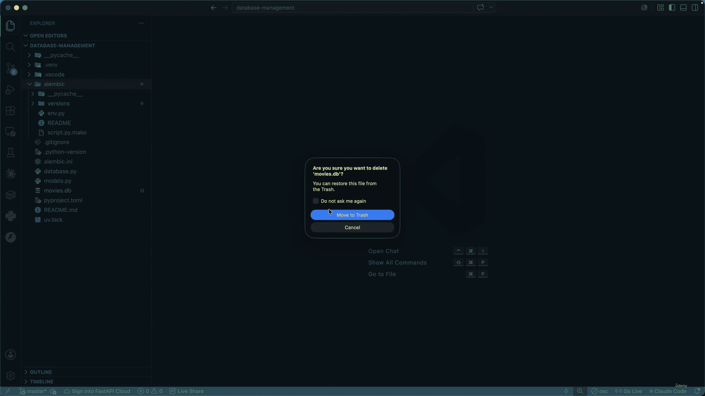
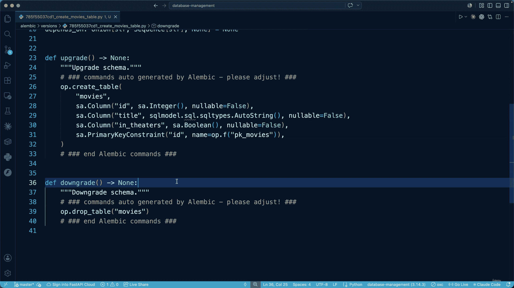

# 🚀 FastAPI 大师课：第 2 部分：第 121 课：生成第一个迁移


## 📖 课程概述

在本节课中，我们来学习如何用 Alembic 生成第一个数据库迁移。说白了，迁移（migration）就是一份"数据库结构的修改说明书"，告诉数据库该怎么改。我们会学到具体的命令怎么写，生成的迁移文件长什么样，文件里的 `upgrade` 和 `downgrade` 函数分别负责什么，还会遇到一个新手很容易踩的坑：Alembic 自动生成的代码可能缺了导入，导致迁移根本跑不起来。把这些都弄明白之后，下一节课我们就可以真正去执行迁移，把数据库建出来了。


## 🛠️ 生成第一个迁移的命令

上节课我们已经把 Alembic 配置好了，接下来就使用它来生成第一个迁移。我们在终端里面要借助 `uv run` 来调用项目本地的依赖，这样做的好处是能确保我们用到的 Alembic 是项目里安装的那个版本，而不是系统环境里乱七八糟的全局版本，避免环境不一致带来的各种怪问题。

具体的命令如下：

```bash
uv run alembic revision --autogenerate -m "create movies table"
```

这条命令我们拆开来看。`alembic` 是我们要运行的程序。在 `alembic` 后面的那个子命令是 `revision`。单词 revision 字面意思就是"修订"。这里要记住一个核心概念：一次 revision 就是一次变更，而迁移（migration）所代表的恰恰就是一次变更——也就是对数据库 schema（结构）的一次修改。你可以把 revision 和 migration 当成一回事来理解，在 Alembic 的世界里，它们俩说的是同一个东西。

在 `revision` 后面，紧跟着一个非常关键的参数 `--autogenerate`。从这个名字你大概也能猜出来，它的作用是让 Alembic 自动去检查当前模型的形态。也就是说，它会把我们在 `models.py` 里定义的所有模型以及它们的所有字段都通通看一遍，然后把这些模型映射成数据库那边需要做的对应的更新操作。这个参数是整个命令的灵魂，没有它，Alembic 就不知道该怎么自动生成迁移内容。

这里有一个值得注意的细节：目前我们的数据库其实还不存在，但是 Alembic 会自己察觉到这一点。它知道必须先把数据库创建出来，然后还要在数据库里新增一张叫做 `movies` 的表。所以 `--autogenerate` 不只是简单地比对模型和数据库的差异，在数据库压根不存在的情况下，它会把"创建数据库"这件事也一并纳入到整个更新计划里面，这一点非常贴心。

在 `--autogenerate` 后面，我们还要再追加一个参数 `-m`。这个 `-m` 是 `--message` 的缩写，也就是"消息"的意思。在这里我们可以为这次迁移写上一句简短的描述，说明这次迁移具体要干什么。之所以要写描述，是因为我们通常都很清楚自己在模型里改了什么东西，把这个信息记录下来，对以后回顾历史变更非常有帮助。更重要的是，这段描述会直接成为 Alembic 生成的迁移文件的文件名的一部分——也就是说，文件名里会带上我们写的这句话，以后在文件列表里一眼就能看出每个迁移是干嘛的。

在终端里，我以字符串的形式写下描述内容，写成 "create movies table"。一般来说，描述要写得简短明确，让人一看就知道这次迁移做了什么，不要写那种模棱两可的话。


## 💡 关于迁移粒度的建议





在执行命令之前，我想先跟你聊聊迁移的粒度问题，因为这是一个很容易被忽视但非常重要的实践建议。在真实项目里，尽量让每次迁移都保持短小、原子化、范围有限。举个例子，如果你一次性声明了四个新模型，我强烈建议你一个一个来：先创建第一个模型，然后运行一次迁移；再创建第二个模型，再跑一次迁移。这样每个表都对应一个独立的迁移文件，每个迁移的关注点就非常集中，出问题的时候也容易定位和回滚。千万不要图省事，把四个模型的改动塞进同一个迁移里，那样一旦出错，回退起来会非常痛苦。



好，回到正题。现在我在终端里把这个字符串写完整，然后按下回车执行这条命令。执行完之后，Alembic 就顺利生成了我们的第一个 Python 迁移文件。


## 📂 迁移文件的位置

正如之前承诺的那样，这个文件被写到了 `alembic/versions` 目录下面。我们打开 VS Code，展开 `alembic/versions` 这个文件夹，就能看到里面多了一个新文件，整个过程非常直观。

不过在这之前，你可能会注意到文件夹里还躺着一个 `movies.db` 文件。这个文件是自动生成出来的，严格来说它不一定会每次都出现。我先把鼠标移到这个文件上，右键点击，选择删除，把它丢进废纸篓。这是我故意删掉的，因为我想让大家保持一种不同的心智模型——至于这个心智模型是什么，我马上就会解释。这个 `movies.db` 可能只是 VS Code 帮我们做的一点自动化操作，并不重要。

简单来说，这个心智模型就是：数据库文件（`.db`）不应该在迁移真正执行之前就存在。我们期望的流程是：先写好迁移文件，然后通过执行迁移来生成数据库文件，而不是让数据库文件莫名其妙地提前出现在项目里。把 `movies.db` 删掉，能避免后面产生"到底这个数据库是从哪来的"这种困惑，也能让我们更清楚地理解迁移在整个流程中的地位。


## 🔍 深入理解迁移文件

现在回过头来看 `alembic/versions` 目录，你会看到那个新生成的迁移文件。双击打开它，你会发现这其实就是一个普普通通的 Python 文件，没有任何特殊格式。我先保存一下这个文件，让 ruff 格式化工具帮我们把文件里所有的 import 语句整理得干净漂亮一点，这样读起来会舒服很多。

保存之后你会发现，文件名里确实包含了我们刚才提供的消息内容，也就是 "create movies table" 这段描述。而在这段描述前面，还有一串很长的随机字符，这就是这次修订（revision）的唯一标识符（ID）。这个 ID 是完全随机生成的，所以你在自己电脑上看到的数值会跟我这里的完全不一样。这是完全正常的，不用担心，也不要试图去比对。这个 ID 存在的意义，就是让每次迁移都有一个独一无二的身份标识。

在这个迁移文件里，正如之前所说的，我们会看到两个关键函数：`upgrade` 和 `downgrade`。不过在看函数之前，我们先来看几个额外的元数据信息，因为它们决定了迁移之间的相互关系。


### 🏷️ 元数据：revision 与 down_revision

文件里有一个 `revision` 变量，它的值跟文件名里那串 ID 是完全一致的。每一次修订（或者说每一次迁移）都会分配到一个独一无二的标识符，用来区分不同的迁移。你可以把它想象成每个人的身份证号，全世界唯一。

文件里还有另一个变量叫 `down_revision`，它的作用是指向前一个迁移的 ID。所有的迁移会通过这种互相指向的引用关系，连成一条链条。这是因为每一个迁移都代表着对数据库结构的一步更新，而这些更新是有先后顺序的：前一个迁移执行完了，后面一个迁移才能接着执行。这种链式结构保证了数据库的变更过程是有序的、可追溯的。

现在我们看的是第一个迁移，所以它没有更早的迁移可以指——换句话说，不存在"上一个修订"。因此 `down_revision` 的值就是 `None`。不过你记住，等我们在后面的课程里生成第二个迁移的时候，第二个迁移的 `down_revision` 就会指向第一个迁移。到时候，第二个迁移里 `down_revision` 的值就是我们此刻看到的这个 ID，也就是第一个迁移的 revision ID。这个特性在后面会反复用到，理解了它，你就理解了整个迁移历史是怎么串起来的。


### ⬆️ upgrade 函数

看完了元数据，接着往下看，就是那两个大家期待的函数：`upgrade` 和 `downgrade`。这两个函数是每个迁移文件的核心，缺一不可。

`upgrade` 函数声明的是"要对数据库做什么"，也就是如何把我们想要的变更应用到数据库上。在这个函数里，你会看到我们使用了一个叫 `op` 的对象。`op` 是从 Alembic 导入来的，它是 operations（操作）的缩写。在这个 operations 对象上说白了就是一堆数据库操作的集合，它上面挂着很多方法，每个方法对应一种数据库操作，比如建表、删表、加列、删列等等。

举个例子，在 `upgrade` 函数里，我们调用了 `op.create_table` 这个方法。你可以猜得到，第一个参数指定的是表的名称，后面跟着的那一堆参数，都是在声明这个表的各个列（column）的详细信息。你不用着急把这里每一行代码都完全搞懂，实际上很多东西都是很直觉的，看多了自然就明白了。初学者看到长篇大论的迁移代码容易发怵，其实放轻松，大部分内容都是重复的模式。

比如，这里出现了 `sa`，它指的就是 SQLAlchemy。我们能看到，它指定了在 `movies` 表里有一个叫 `id` 的列，这个列的类型是 `integer`（整数），而且这个列的值不允许为空（non-nullable），也就是说每一条记录都必须带上这个 id，不能留空。紧接着，我们又定义了 `title` 列和 `in_theaters` 列，分别用来存放电影标题和是否正在上映的布尔值。最后，我们还设置了主键约束（primary key constraint），这个约束指回我们刚才定义的 `id` 列。主键的作用是唯一标识表中的每一行，是数据库表设计的基石。

你可能已经注意到了，这个约束的名字叫 `PK_movies`。这个名字不是凭空来的，它来自我们在 `models.py` 文件里讨论过的 naming conventions（命名约定）字典。也就是说，我们之前在 SQLModel 代码里设置的那套命名规则，就是在这里被真正用上的。换句话说，迁移文件不是纯手工一行行敲出来的，它是根据我们定义模型的方式自动推导出来的。你现在看到的这段逻辑，就是我们之前配置 SQLModel 代码时埋下的伏笔。


### ⚠️ Alembic 也会出错：缺少 SQLModel 导入

前面我提醒过你，一定要养成一个好习惯：每次生成迁移文件之后，都要仔细读一遍文件内容，确认里面写的到底对不对。原因很简单：SQLAlchemy 和 Alembic 并不能保证每次生成的代码都是完美无缺的，它们也会犯错。这不是说它们不可靠，而是说数据库结构这个东西太复杂，自动推导难免有疏漏。

你看这里就有一个活生生的例子。对于 `title` 这一列，迁移文件指定了该列的数据类型，而且用的是 SQLModel 里的 `AutoStr` 类型。这个类型本身完全没问题，可真正常见的问题在于：这个迁移文件里根本没有导入 SQLModel。如果你现在就直接运行这个迁移，也就是真的把变更应用到数据库上，程序就会因为找不到 `AutoStr` 这个类型而直接报错。这种错误非常隐蔽，因为光看代码结构你是看不出来的，必须运行才能发现。

这里要特别强调一个概念：这个迁移文件现在只是一个"更新模板"。它描述了要如何对数据库执行一次变更——也就是添加一张 movies 表——但迁移本身还没有真正被执行过。这也是我刚才把 `movies.db` 删掉的另一个原因：我不希望那个数据库文件的存在给大家造成困惑。数据库文件虽然在技术上可能存在，但迁移还没有被应用，它就没有意义，反而会误导人。此时此刻，我们手里只有一份"操作说明书"，它告诉我们往数据库里加一张 movies 表应该怎么写。至于真正去执行这件事，我们必须另外在终端里运行一条独立的 Alembic 命令才能完成。这个区别一定要拎清楚：生成迁移 ≠ 应用迁移，这是两件完全不同的事。

那为什么你必须反复检查这个迁移文件呢？正是因为它有可能出错，而且出的错误可能就像现在这样：它引用了一个 SQLModel 的类型，却没有把 SQLModel 导入进来。所以我在这里往上滚动，找到 import 的区域，把 SQLModel 的导入补充完整。修复方式非常简单，只需要加一行导入语句：

```python
from sqlmodel import SQLModel
```

补上之后，编辑器里可能还会提示一些类型错误。比如，有些类型检查工具会认为 `sa` 这个属性不存在。这实际上属于 type checker violation，也就是类型检查器发出的违规警告。如果你遇到这种情况，完全不用慌，直接无视它就行，它不影响实际运行。最关键的一点是，你必须把 SQLModel 导入进来。只要导入补上了，这段代码在真正运行迁移的时候就能正常工作了。记住：类型检查器的警告不等于代码错误，要学会分辨。


### ⬇️ downgrade 函数

有 `upgrade` 自然就有和它相对的 `downgrade` 函数。正如你可能已经猜到的，创建一张名为 `movies` 的表的反面操作，就是删除这张表。`downgrade` 函数里的代码比 `upgrade` 简单太多了。原因很直接：在 SQL 里删除一张表，根本不需要指定这张表有哪些列、每列是什么类型。删除操作针对的是整张表本身，一条 DROP 语句就够了，所以这条删除指令非常简洁。这就是为什么 `downgrade` 函数的代码明显比 `upgrade` 短很多，你对比一下两个函数的代码量就能直观感受到。

你可以这样理解这两个函数的分工：`upgrade` 展示的是当我们往前走、应用迁移的时候，数据库的结构会怎么变化、怎么演进；而 `downgrade` 就是一条后退的路径——如果我们后悔了，想要撤销这次迁移，就可以通过命令行让 Alembic 执行回退操作。一条迁移带着一正一反两个方向，进可攻退可守，非常方便。这种设计在数据库版本管理里非常重要，它让每一次变更都变得可逆、可审计。

现在确保你保存了带导入语句的代码，一切都看起来不错，整个迁移文件的逻辑也都很合理。到这里，我们这节课的内容就基本完成了。


## ✅ 本节总结



本节课中，我们一起学习了如何生成第一个数据库迁移。我们看到了完整的命令 `uv run alembic revision --autogenerate -m "create movies table"`，弄清楚了 `revision` 表示一次对数据库结构的变更，`--autogenerate` 会检查模型定义并自动生成对应的数据库更新，`-m` 消息参数会变成迁移文件名的一部分。我们还深入阅读了迁移文件的内部结构：`revision` 和 `down_revision` 一起构成了迁移之间的依赖链，`upgrade` 函数负责应用变更，`downgrade` 函数负责回退变更。更重要的是，我们见识了一个真实的坑：Alembic 生成的代码可能缺少 SQLModel 的导入，所以每次生成迁移后都要仔细检查一遍，把缺失的导入补上，保存好代码。一切看起来都正常了，在下一节课中，我们就可以实际运行这个迁移，真正把数据库创建出来，把这些变更应用到数据库上。

