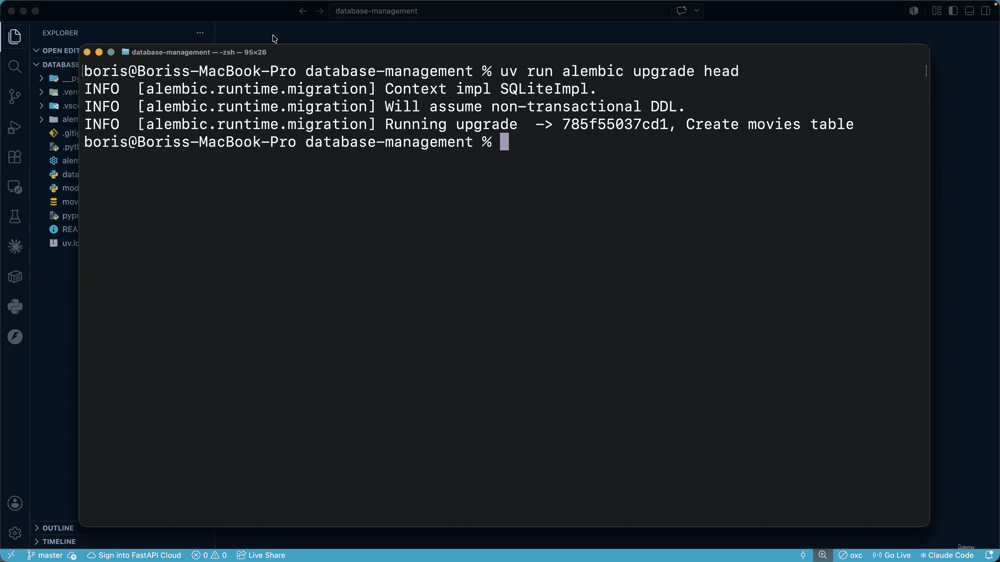
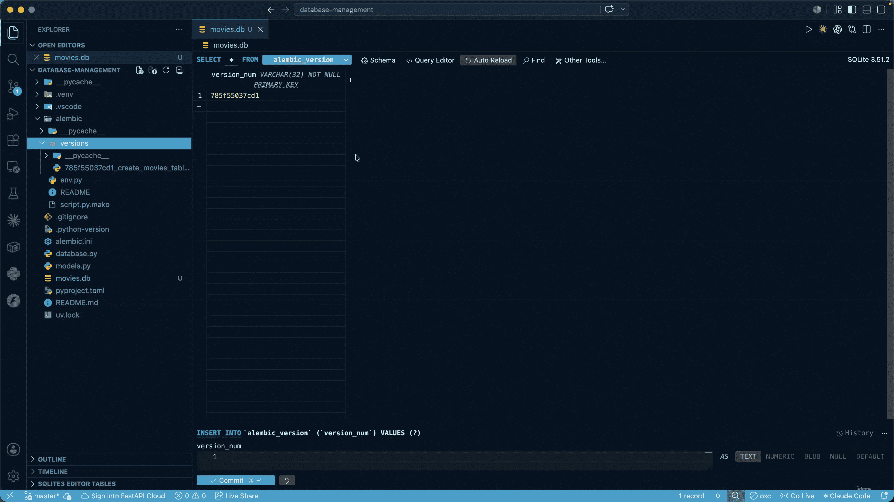

# 🚀 FastAPI 大师课（第二部分）：第 21 节：应用数据库迁移


在本节课中，我们将要学习如何把已经生成好的迁移文件真正应用到数据库上。上一节课我们提到过，创建迁移文件和真正修改数据库并不是同一件事；本节会从终端命令、检查点、`head` 以及数据库记录表等角度，把“应用迁移”这件事讲清楚。内容会尽量用大白话解释，让刚开始接触 FastAPI 和 Alembic 的同学也能跟上。

## 🧠 迁移文件与数据库的关系


上一节我们介绍了迁移文件的生成，本节中我们来看看它为什么还没有改变数据库。正如上一课所说，创建迁移文件并不会自动把那项变更应用到数据库里。上一课中之所以可能看到实际的数据库文件，可能是因为 VS Code 或某个扩展在自动帮我们；如果我们完全从终端操作，就不会真的已经拥有任何数据库文件。这个心智模型需要记住：迁移文件本身只是“说明”，不是“执行结果”。关键结论是，我们手里有的只是一个迁移文件，也就是一堆 Python 代码，它规定了数据库应该发生什么变更或修订。又因为这是我们的第一个迁移，所以它还会指定数据库本身的创建。换句话说，代码先写好“要建什么、要改什么”，但还没有真正去建、去改。

> 迁移文件是“说明书”，`upgrade` 才是“施工队”。

## ⚙️ 在终端执行迁移


接下来，在终端里，我们再次运行 `uv run alembic`。真正执行、运行或应用迁移的命令是 `upgrade`，这个名字和迁移函数里使用的名字完全一样。核心命令可以写成下面这样：


```bash
uv run alembic upgrade head
```


为了把这条命令的使用方式记得更牢，下面用列表把几个关键点串一下。以下是在终端应用迁移时需要记住的要点：


- `upgrade` 是真正执行迁移的动作名。
- `head` 表示迁移链里的最新修订版本。
- `upgrade head` 表示把所有待执行迁移应用到最后。


这里先解释一下 `upgrade` 的作用。请记住，我们可以按顺序拥有多个迁移；例如，我们可以先创建五个 SQL 模型，然后生成五个迁移，此时数据库就会落后五个迁移。之后，我们可以指定具体要移动到哪个迁移，也可以把它想成要移动到哪个检查点或存档点。现在只有一个迁移，所以例子有点刻意；但如果以后增加到五个或十个迁移，我们完全可以说只应用这十个里面的四个，先看看数据库在应用剩下六个之前长什么样。

## 🎯 使用 head 应用所有待执行迁移


如果你只是想把数据库移动到当前最新、最完整的迁移，那现在其实只有一个迁移，所以这个例子并不复杂。但如果你只是想把所有尚未应用、可用的迁移都应用上，可以直接提供参数 `head`。Alembic 里的 `head` 指的是迁移链中最新的修订版本，这和 Git 里 `head` 的工作方式非常相似。因此，`upgrade head` 的意思是应用每一个待执行迁移，一直应用到并包括最新的那个迁移。下面是这个概念的简化表示：




```text
upgrade head = 应用所有 pending migrations，直到最新 revision
```


在这里我们执行这条命令，它应该正好完成我们想要的效果。执行完成后，在 VS Code 里就能看到我们的 SQL 模型数据库，名字叫 `movies.db`。打开它以后，可以看到一个 `movies` 表，里面的列形状包括 `id`、`title` 和 `in_theaters`；这些列来自上一课看到的迁移文件中的 `upgrade` 函数，而这个迁移文件本身又是根据 `models.py` 里的模型定义自动生成的。

## 🗂️ alembic_version 表在做什么


你还会注意到，背后还有第二张表，叫 `alembic_version`，也就是原文里提到的 `aic version` 表。这张表实际上会记录哪些迁移已经运行过。这里有一个挺有意思的设计：我们使用数据库本身来记录数据库状态。可以看到一个简单的版本号列，里面的版本标识和迁移文件名里的标识一模一样；对我来说是 `785`，你的 ID 或标识会不同，因为它是一串随机的字母数字字符。关键结论是，数据库现在已经在内部知道这个迁移已经应用过了。因此，每当我们再次让 Alembic 执行 `upgrade head` 时，它就会以这条记录为基础来判断：这个以 `785` 开头的迁移已经运行过，数据库已经处于那个状态或模式。Alembic 基本上就是通过这种方式判断哪些迁移已经运行、哪些迁移还没有运行，尚未运行的迁移叫作待执行迁移，也就是 `pending migrations`。可以用下面的关系来理解：


```text
alembic_version.version_num = 已应用迁移的 revision 标识
pending migrations = 迁移链中尚未记录到 alembic_version 的 revision
```


现在，我们的数据库已经通过迁移完全更新到最新状态，所以一切就绪。到这里，迁移文件和真实数据库之间的连接就建立起来了：文件负责描述变更，`upgrade` 负责执行变更，`alembic_version` 负责记住执行到了哪里。

## 🔜 后续练习内容


在接下来的课程中，我们会练习修改其中一个模型，也会练习添加更多模型；然后整个过程会重复一遍。我们会让 Alembic 生成一个新的迁移，用来反映这些改动；我们还会再次看到如何连续应用多个迁移，从而再次修改数据库。后面我们也会看看如何回退这些变更。前面的内容很多，也很有意思，下一节课见。

## ✅ 总结




本节课中我们一起学习了如何把迁移文件真正应用到数据库：创建迁移文件不会自动改数据库；在终端使用 `uv run alembic upgrade head` 可以应用所有待执行迁移；`head` 表示迁移链中的最新修订；`alembic_version` 表会记录已经运行的迁移，从而帮助 Alembic 判断哪些是 `pending migrations`。数据库更新完成后，后续就可以继续修改模型、生成新迁移并连续应用或回退迁移。

