## 🎬 FastAPI 大师课（第二部分）：123：演进数据库模式

在本节课中我们将要学习如何从零走一遍数据库模式演进流程：先往现有 `movies` 表插入一条真实数据，再给电影模型增加新字段，然后用 Alembic 生成迁移并应用到数据库。我们会重点理解旧数据兼容问题，也就是为什么新增字段通常要先允许 `NULL`，回填旧数据后再收紧为 `NOT NULL`。整个教程会通过 `release_year` 和 `rating` 两个例子反复练习，让你熟悉“修改模型、生成迁移、检查迁移、升级数据库”的完整套路。

## 🧱 FastAPI 大师课（第二部分）：123.1：先往 movies 表插入一条真实数据

接下来我们要练习从零走一遍完整流程。为了模拟更真实的世界场景，第一步是往 `movies` 表里添加一条有效数据，这样后面修改表结构时就有旧数据需要兼容。我们可以直接在 VS Code 的 SQLite 编辑器里操作，不需要写额外脚本。以下是插入一条电影数据的操作步骤列表。

- 在 VS Code 的 SQLite 编辑器底部选中 `movies` 表。
- 给 `id` 选择自动生成，在右侧选择 `default`。
- 给 `title` 和 `in_theaters` 填值，例如 `title` 用 `Goodfellas`，`in_theaters` 用 `false`。
- 点击 `commit` 按钮，把这一行写入数据库。

提交之后，你会在 `movies` 数据库里看到第一行数据。现在切换到 `models.py`，想象我们的数据库模式正在演进。产品经理说，电影数据库现在需要额外存储一个细节，也就是电影的发行年份 `release_year`。接下来我们看看为什么不能直接把这个字段声明成普通的整数。

## 🧩 FastAPI 大师课（第二部分）：123.2：为什么不能直接新增非空字段

你可能会想，直接写 `release_year: int` 应该就可以，但这类代码生成的迁移在运行时可能崩溃。原因是数据库里已经有旧数据，而 `release_year: int` 表示这一列只能存整数，不能包含 `NULL` 或缺失值。如果迁移直接添加一个不允许 `NULL` 的新列，现有行没有发行年份，数据库就会报错，因为这一行在新列上需要 `NULL`，而这违反了列的约束。写代码时必须考虑现有 schema，典型解决办法是两步迁移，核心概念可以用下面的公式表示。

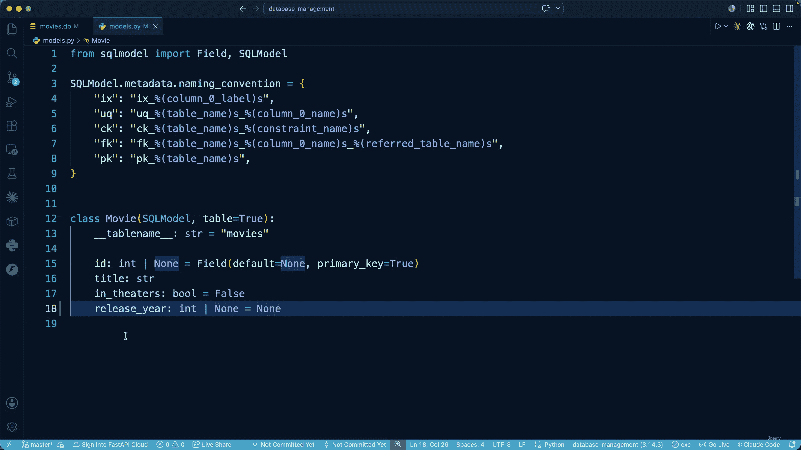

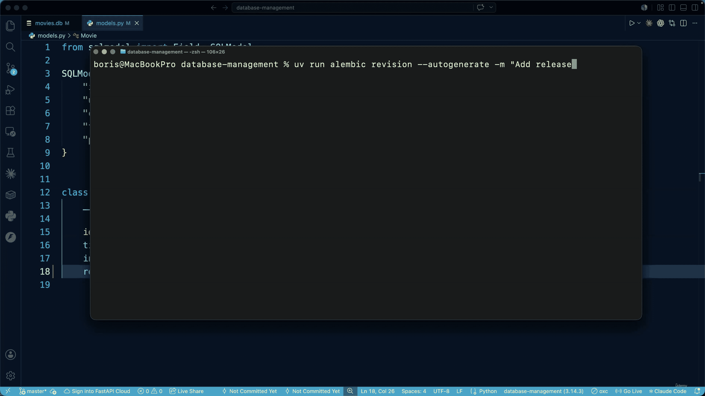

```text
第一步：release_year: int | None  # 允许 NULL
回填旧数据：把已有行的 release_year 改成有效年份
第二步：release_year: int         # NOT NULL
```

这个两步流程是：先添加一个支持 `NULL` 或缺失值的新列；列添加完成后，回到表里所有旧记录，把这一列填上有效整数或有效发行年份；等所有旧记录的数据都更新后，再修改模型去掉 `NULL` 可能性，并生成另一个迁移来移除该列的 `NULL` 支持。这里体现了支持旧 schema 并向新 schema 过渡的复杂性。为避免报错，模型里把类型声明为 `int | None`，同时在创建新电影时提供 `None` 作为回退值。这样 Alembic 在生成“添加 release_year 列”的迁移请求时，会知道该列必须支持 `NULL`，因为列类型是 `int | None`。以下是模型声明示意。

```python
class Movie(SQLModel, table=True):
    ...
    release_year: int | None = None
```

代码写好后就可以生成迁移。接下来我们进入终端，执行 Alembic 的迁移生成命令。

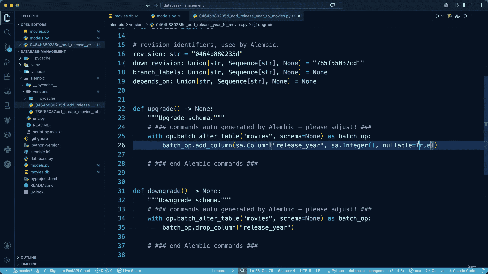

## 🛠️ FastAPI 大师课（第二部分）：123.3：添加可空字段并生成第一个迁移

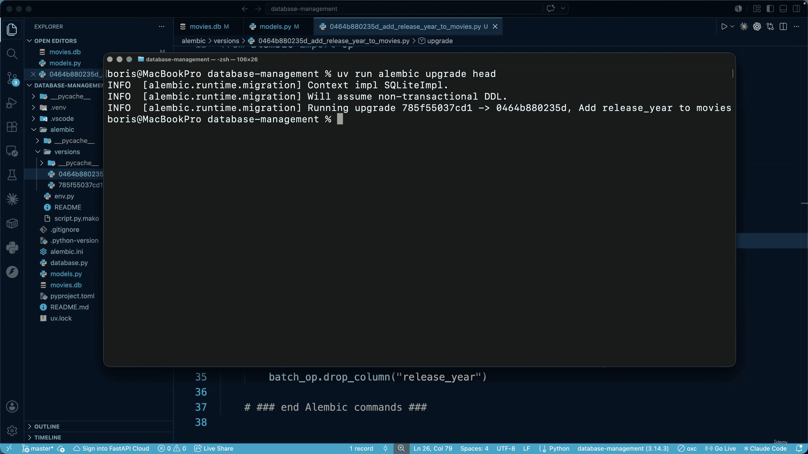

在终端里运行 `uv run alembic revision --autogenerate -m "add release year to movies"`。执行后，`alembic/versions` 目录里应该会出现一个新的迁移文件。打开这个文件并保存，让编辑器自动格式化。此时迁移文件的格式应该比较熟悉，但这次有一个重要区别：除了 `revision` 这个唯一标识，现在 `down_revision` 有了具体值，它指向上一个迁移的 ID，也就是迁移链里的第一个迁移。例如我这里的 ID 以 `785` 开头，它引用的是前一个迁移，Alembic 就是靠这种顺序链接来跟踪迁移链。你还能看到上一个迁移的标识出现在“这个 revision ID 将修订这个迁移”的位置，所有迁移是顺序串联的。此时我们还没有真正应用迁移，所以数据库里还没有变化。应用迁移前要检查迁移内容。这里会使用 `batch_alter_table`，它是专门为 SQLite 设计的方法，用来模拟 Postgres 等更生产化方案中的同类功能。关键点是：修改 `movies` 表，添加 `release_year` 列，存储整数，并且支持 `NULL`，这样现有行不会因为发行年份为 `NULL` 而报错。以下是迁移核心代码示意。

```python
def upgrade():
    with op.batch_alter_table("movies") as batch_op:
        batch_op.add_column(
            sa.Column("release_year", sa.Integer(), nullable=True)
        )
```

确认内容正确后，运行 `uv run alembic upgrade head`。这里不指定具体 revision ID，而是写 `head`，表示应用所有剩余待执行的迁移；当前只有一个待执行迁移，也就是刚生成的那个。运行后检查 `movies.db`，可以看到新的 `release_year` 列，类型是整数，但支持 `NULL`。SQLite 和迁移会给现有行填 `NULL`，所以 id 为 1 的那一行在新 `release_year` 列上现在是 `NULL`。下一步我们要让这一列变成非空，但必须先回填旧数据。

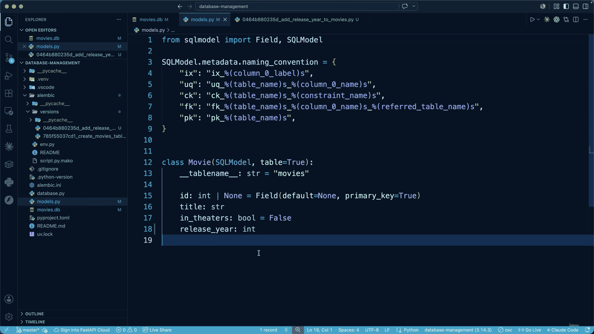

## 🔁 FastAPI 大师课（第二部分）：123.4：回填旧数据并收紧为非空

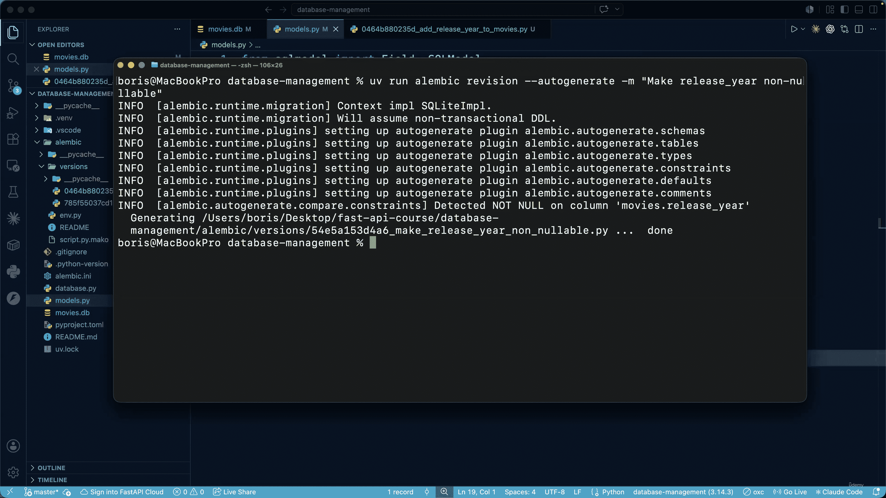

如果要再生成一个迁移，让 `release_year` 变成非空，首先必须确保所有现有记录在这一列上都有有效值。在 SQLite 编辑器里点击对应单元格，给 `release_year` 填入 `1991`，然后点击 `commit`。可以把这看成数据库中所有旧数据的代表：在添加 `release_year` 列之前已经存在的记录，现在都已经填好了有效发行年份。然后回到 `models.py` 修改模型，把它改成始终为整数，也就是 `release_year: int`，并保存。这个改动表示类型从 `int | None` 这种联合类型变成了单一的 `int` 类型，Alembic 能理解这是模型和当前数据库状态之间的差异。接着在终端再次生成迁移，运行 `uv run alembic revision --autogenerate -m "make release year non-nullable"`。迁移名称完全由你决定，但应该简短清晰。执行后会出现第三个迁移文件。查看这个文件：它有新的 `revision` ID，引用上一个迁移“添加 release_year”，下面会修改已经存在的 `release_year` 列。这个操作不是添加列，而是修改列；现有类型仍然是整数，但现在要确保它不再可空，也就是不支持 `NULL`。检查无误。它的 `downgrade` 会保留这一列但把列改回可空；Alembic 理解回退时我们不想删除列，而是保留列并移除 `upgrade` 提供的额外约束或类型修改。现在运行 `uv run alembic upgrade head`，不应该出现错误。数据库里的数据保持完全一致，但 `release_year` 变成了必填列，列定义会显示 `NOT NULL`。以下是第二个迁移的核心代码示意。

```python
def upgrade():
    with op.batch_alter_table("movies") as batch_op:
        batch_op.alter_column(
            "release_year",
            existing_type=sa.Integer(),
            nullable=False
        )
```

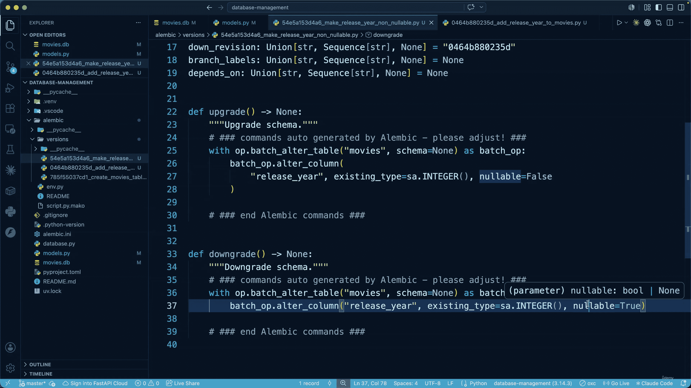

## ⭐ FastAPI 大师课（第二部分）：123.5：再练一次，添加 rating 字段

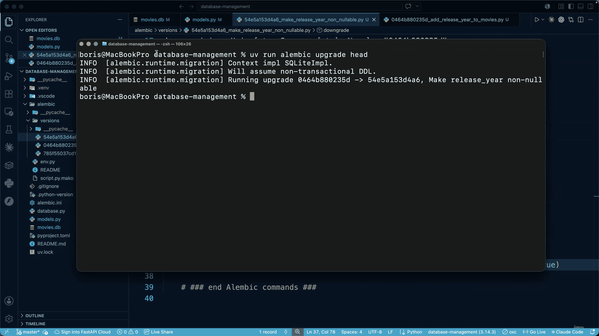

我们再运行一个例子，往数据库添加另一种类型的数据，流程完全相同。回到 `models.py`，假设产品经理现在想给表添加 `rating` 列。现有记录没有 `rating`，所以第一个迁移始终要先把它设为可空。这里类型设为 `float`，并声明 `rating: float | None`。也可以提供 `None`，或者使用已经导入的 SQLModel 的 `Field` 函数，它支持 `default` 参数。这样当创建新记录时，如果请求载荷或数据没有显式提供浮点类型的 `rating`，就回退到 `None`。在生成添加列的迁移时，Alembic 通过这个关键类型也会理解：表里的这一列必须支持 `NULL`。这个关键部分让 Alembic 明白它要对数据库提出的要求。以下是 `rating` 字段声明示意。

```python
from sqlmodel import Field

class Movie(SQLModel, table=True):
    ...
    release_year: int
    rating: float | None = Field(default=None)
```

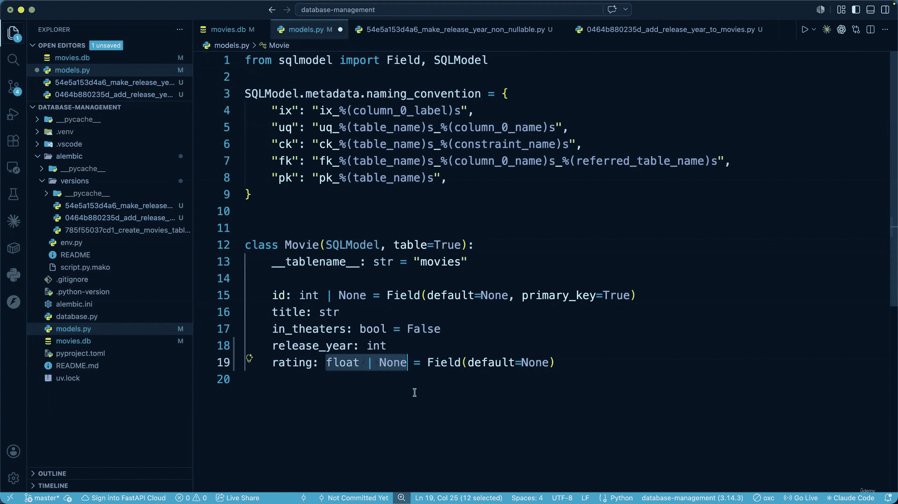

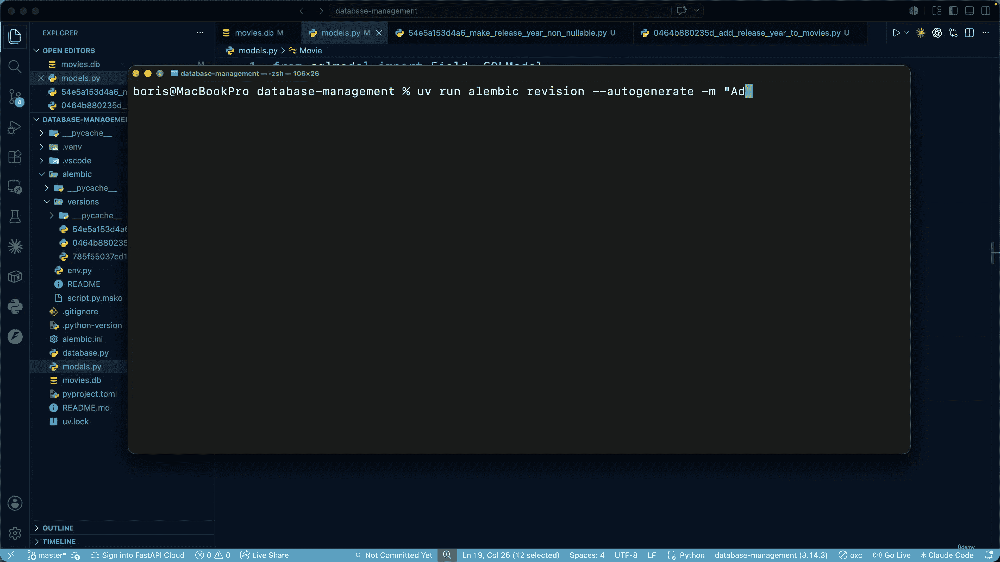

保存后回到终端，运行 `uv run alembic revision --autogenerate -m "add rating to movies"` 创建新迁移。生成新迁移后保存并格式化。按前面几个例子的规律，到这里应该已经比较熟悉。查看迁移文件：在 `upgrade` 函数里，它再次修改现有的 `movies` 表，添加一个 `rating` 新列，存储浮点值，并且值可以为 `NULL`，也就是某一行可以缺失评分。`downgrade` 函数会删除或丢弃新添加的 `rating` 列。检查无误，现有数据会因为可空性而得到支持。运行 `uv run alembic upgrade head`。然后检查 `movies.db`，可以看到新的 `rating` 列存储浮点值，同时也支持 `NULL` 条目，第一行数据就体现了这一点。以下是迁移核心代码示意。

```python
def upgrade():
    with op.batch_alter_table("movies") as batch_op:
        batch_op.add_column(
            sa.Column("rating", sa.Float(), nullable=True)
        )

def downgrade():
    with op.batch_alter_table("movies") as batch_op:
        batch_op.drop_column("rating")
```

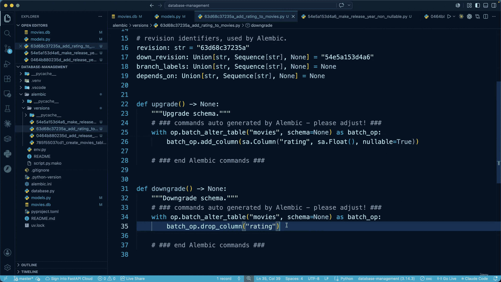

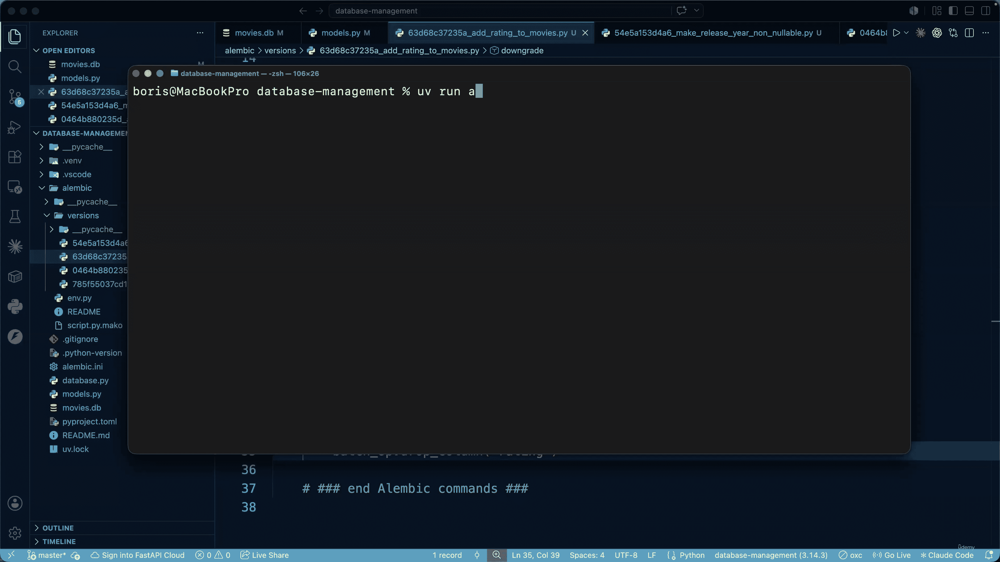

## ✅ FastAPI 大师课（第二部分）：123.6：课程总结

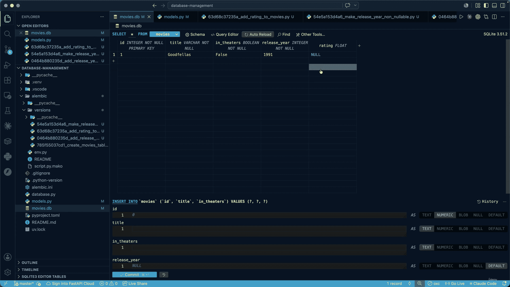

本节课中我们一起学习了如何从一条真实旧数据开始演进数据库模式。我们先用 SQLite 编辑器插入一行电影数据，再给模型添加 `release_year`，发现直接加非空字段会让旧数据违反约束，于是采用两步迁移：先添加可空列，回填旧数据，再收紧为非空。我们还查看了迁移文件的 `revision` 与 `down_revision` 链，使用 `batch_alter_table` 处理 SQLite，并用 `uv run alembic upgrade head` 应用迁移。随后用 `rating` 字段重复了同一流程，确认新增可空列、生成迁移、升级数据库的步骤一致。最后要记住：Alembic 会理解模型与数据库当前 schema 之间的差异，并生成对应迁移，把模型驱动的变化同步到数据库中；添加、修改甚至删除模型字段时，思路都是先改模型，再生成并检查迁移，最后升级数据库。

