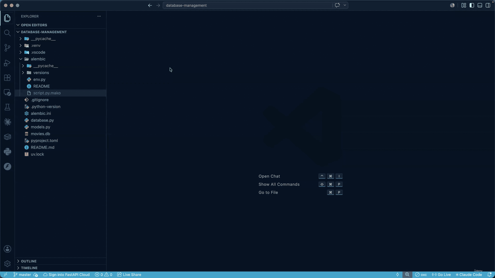
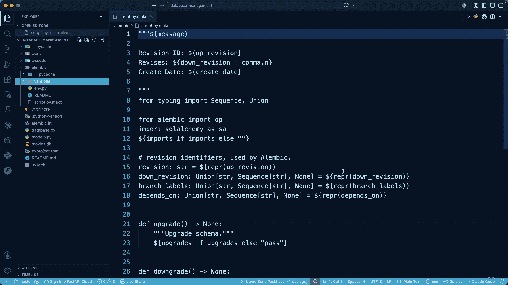
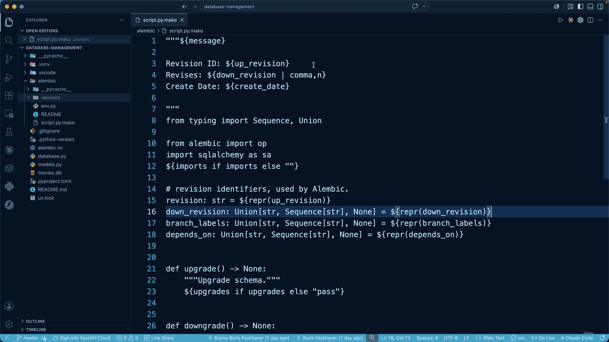
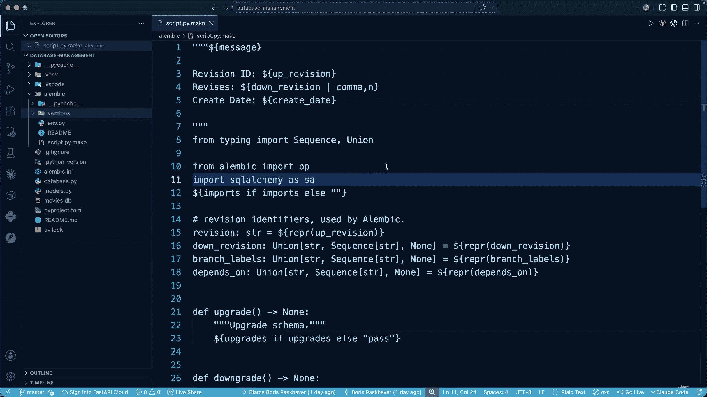
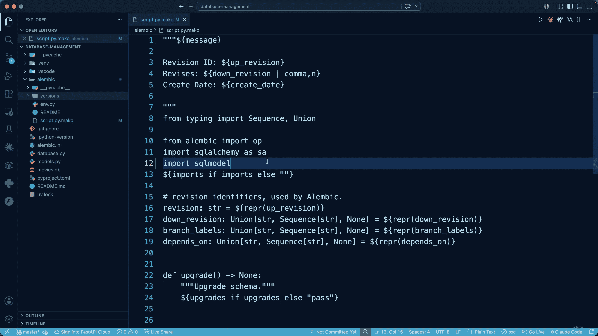

# FastAPI Masterclass：第23讲：修改迁移模板 🛠️

在本节课中，我们将深入认识 Alembic 文件夹里一个之前没有讨论过的文件——`script.py.mako`。这个文件非常重要，因为它是 Alembic 创建所有新迁移文件时使用的通用模板。了解它的作用之后，我们还可以直接修改它，让后续生成的新迁移文件自动带上我们需要的导入语句，从而避免一些常见的报错问题。接下来，我们就一步步把这个模板拆开来看。

## 认识 `script.py.mako` 文件 📄

在 Alembic 的目录结构里，有一个文件我们之前一直没有讲到，就是这里这个 `script.py.mako`。简单来说，这是一个模板文件，Alembic 每次创建新的迁移文件时，都会以它为基础来生成内容。也就是说，所有出现在 `versions` 文件夹里的迁移文件，本质上都是从这一个模板“复制”过去，再填充实际数据得到的。

如果你打开这个文件，哪怕编辑器没有提供语法高亮，你也会发现这段代码非常眼熟。因为它所呈现的，正是 Alembic 生成迁移文件时要使用的基本形状、模板或者说蓝图。换句话说，Alembic 在 `versions` 文件夹里创建每一个新迁移时，都是按照这个模板的框架来搭结构的。

不过，这个模板和最终生成的迁移文件之间有一个关键区别：模板里包含了很多动态部分。比如，迁移的 `message`（迁移说明文字）、具体的 `revision`（当前修订号）、以及 `down_revision`（父修订号）等等。这些值都是直到真正创建迁移文件的时候才会被动态填充进去的。而模板本身所做的，只是提前定义好这些变量，等创建迁移时，由 Alembic 自动把对应的动态数据注入到最终生成的代码里。

整个流程可以用下面这个公式来理解：

```text
script.py.mako（模板） + 动态参数（消息、修订号、日期等） = 新迁移文件
```

下面是模板中常见的几个动态变量，它们最终都会被替换成实际值：





```mako
"""${message}

Revision ID: ${up_revision}
Revises: ${down_revision | comma,n}
Create Date: ${create_date}
"""
```

这里我们不需要死记硬背，只要知道这些占位符是干什么用的就可以了。

## 为什么要修改这个模板？🤔

既然模板决定了所有新迁移文件的生成方式，那一个很明显的好处就是：我们完全可以按照自己的需要去调整这个 `script.py.mako`，让它成为后续所有迁移共同的基础。这个说法听起来可能有点抽象，没关系，我们用一个真实的例子来感受一下。

你可能还记得，在创建第一个迁移文件的时候，我们遇到了一个问题：默认情况下，迁移文件里没有导入 `SQLModel`。当时，虽然迁移代码中确实使用了来自 `SQLModel` 库的类型，但模板并没有自动把这个库导入进来。如果我们没有注意到这一点，直接去运行迁移，就会看到报错信息。一旦报错，我们就只能返回去，手动修改迁移文件、补上导入，然后再继续。



这种问题虽然不难解决，但每次都手动修改总归很麻烦。为了避免以后再次遇到同样的情况，最简单的方法就是：在 `script.py.mako` 这个模板中直接加入 `SQLModel` 的导入语句。例如，我们可以在模板的导入区域加上这么一行：

```python
import sqlmodel
```

加上这一行之后会怎么样呢？有可能某个特定的迁移文件完全用不到 `SQLModel`，但至少它不会因为这个原因触发任何错误。事情就是这样：多一个用不到的导入，远远好过漏掉一个必须的导入。因为漏掉导入会直接导致运行时报错，而多写一个导入顶多让程序在启动时多花一点点时间，毕竟加载了一个根本用不到的函数库。两相比较，当然是多写一个导入更划算。

## 模板存在的真正意义 💡

通过上面这个例子，我们就能彻底明白为什么会有 `script.py.mako` 这个文件了。它的存在并不是为了给我们添麻烦，而是为了让我们能够根据自己的项目实际情况，去定制迁移文件的生成逻辑。我们可以把任何特定的库、ORM，或者项目中任何不同于 Alembic 默认蓝图的东西，都提前写进这个模板里。这样一来，每次生成新迁移时，这些自定义内容都会被自动带上，完全不需要我们再去手动修改。

例如，如果你的项目里还用到了其他第三方库，或者有一些固定的辅助函数需要在迁移中引入，都可以在这个模板里面提前写好。这样就能彻底摆脱 Alembic 默认模板的限制，让迁移文件的生成过程更加贴合自己项目的实际需求。

## 保存模板并应用到今后的迁移 💾



修改完成之后，我们在这里保存这个文件。这样，下一次如果你想要练习创建新的迁移，这个保存好的模板就会成为新迁移文件的生成基础。也就是说，刚才我们加入的那行 `import sqlmodel` 代码，也会一并出现在之后所有新建的迁移文件里。从今往后，只要是通过 Alembic 自动生成的迁移文件，都会自动包含这行导入，我们再也不用担心因为忘记导入 `SQLModel` 而报错了。

## 总结 📝



本节课中，我们一起学习了 Alembic 中的 `script.py.mako` 模板文件。我们首先了解了它是 Alembic 创建新迁移文件时使用的通用模板，然后分析了模板中那些动态填充的变量，接着通过第一次迁移时遇到的 `SQLModel` 未导入问题，明白了修改模板的必要性。最后，我们演示了如何在模板中加入 `import sqlmodel` 来避免未来的报错。今后，在生成本项目的新迁移文件时，这个修改后的模板就会自动生效，让我们的迁移开发过程变得更加顺畅。

