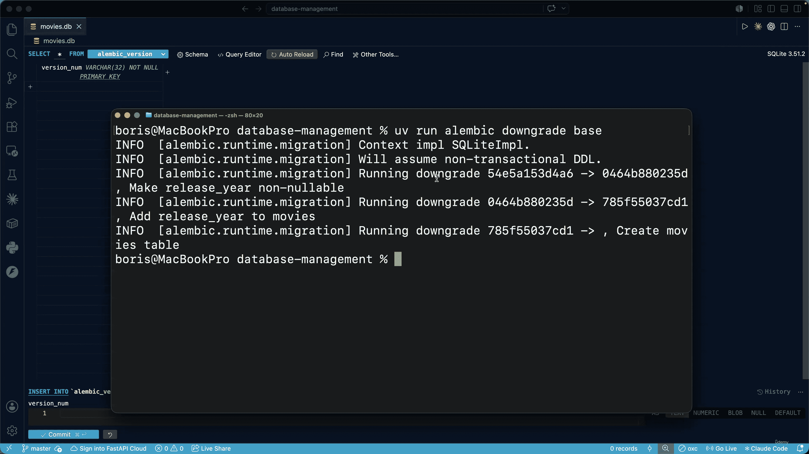
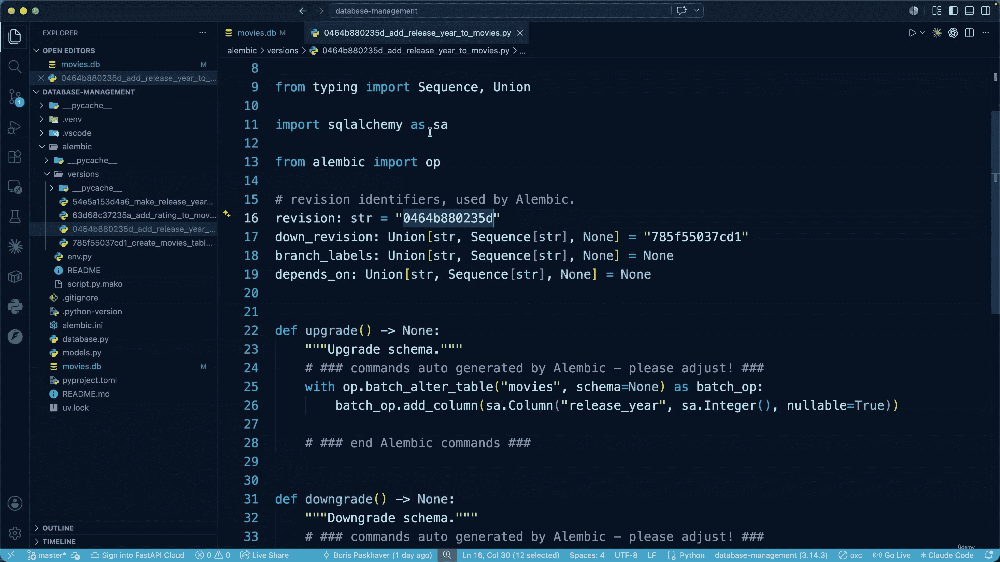
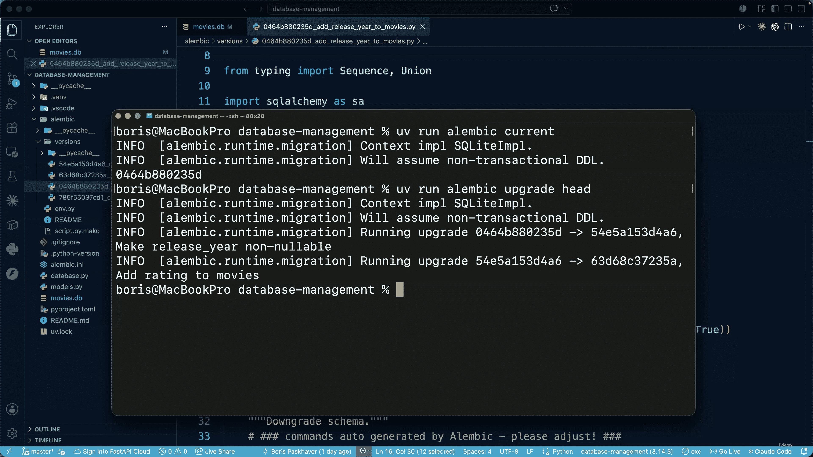

# 🚀 FastAPI Masterclass：Part 2 P24 125：回滚迁移与查看迁移历史

## 📌 课程概述

在本节课中我们将要学习迁移的前进与回退操作，重点包括使用 `downgrade` 回滚迁移、用负数和正数控制回退或前进的步数、用 `base` 和 `head` 处理全部回退与全部应用、通过 revision 标识精确定位迁移，以及查看迁移历史和当前迁移位置。学完这些内容后，初学者能够理解 Alembic 迁移在本地开发中的双向移动方式，并知道生产环境中为什么通常只向前迁移。

## 🧭 迁移可以向前也可以向后

迁移可以沿两个方向应用：向前和向后。到目前为止，我们只使用了向前迁移，但互补的 `downgrade` 函数带来的完整好处是：我们也可以在数据库 schema 历史中向后移动。核心概念可以写成下面的公式：

$$
前进迁移 = upgrade,\qquad 后退迁移 = downgrade
$$

理解了迁移具备双向能力之后，本节中我们来看看如何实际执行回退命令。

## 🔙 使用负数回退指定步数

上一节我们介绍了迁移可以双向移动，本节中我们来看看如何用 `downgrade` 命令回退。这里再次运行 `uv run alembic` 并引用 Alembic，但不是提供 `upgrade`，而是提供互补命令 `downgrade`。这个命令的语法有一个关键点：需要提供负数，用负数指定要回退多少个迁移。可以用下面的公式理解：

$$
回退 N 步 = downgrade\ -N
$$

以下是不同负数参数的含义和执行效果：

- `-1` 表示运行最后一个迁移中的 `downgrade` 函数，回到最后一个迁移之前的迁移，也就是向后移动一步。运行该命令后，后台的 `movies` 数据库文件会移除 `rating` 列，因为上一个迁移添加了该列；向后执行 `downgrade` 会删除这个 `rating` 列。
- `-2` 表示继续向后回退两个迁移，不仅回退倒数第二个迁移，还会回退倒数第三个迁移。摘要中会看到这些迁移被回退：让 `release_year` 非空的迁移会被回退，`release_year` 列对应的迁移也会被回退。数据库在后台更新后，将不再有 `release_year` 列。

从上面的例子可以看到，回滚迁移时确实会改变数据库结构，并且这种改变会直接影响已经存在的列。接下来我们看看回滚迁移时需要注意的数据丢失风险。

## ⚠️ 回滚迁移与数据丢失

上一节我们看到了回退命令会删除列，本节中我们来看看回滚迁移时的数据丢失问题。回滚迁移存在数据丢失的可能性，因为删除一个列会移除该列中存储的所有数据。可以用下面的引用提醒自己：

> ⚠️ 注意：回滚迁移可能删除列，从而删除列中的数据，因此生产环境通常不把回滚当作常规操作。

以下是生产环境和本地开发环境在回滚迁移上的主要差异：

- 生产环境通常不会运行回滚迁移，因为它有删除数据的潜力；生产应用中的迁移历史通常只向前推进。
- 在本地开发或本地测试时，丢失数据的危害没有那么大，因为这些数据通常只是本地开发用的临时数据。
- 本教程中的回滚操作只是为了演示示例。

当把 FastAPI 应用部署到生产环境时，通常不会回退迁移。唯一的例外通常是：某个迁移引入了重大错误或问题，并且不担心丢失数据，或者根本没有数据可丢失；只有在这些罕见场景下，才可能考虑回滚迁移，也就是执行 `downgrade`。理解了风险之后，本节中我们继续看看如何回退全部迁移以及如何重新应用全部迁移。

## 🧹 回退全部迁移与重新应用全部迁移

上一节我们介绍了回滚迁移的数据丢失风险，本节中我们来看看全部回退和全部恢复。在生产环境中，如果要还原所有迁移，可以应用下面的命令：仍然是 `uv run alembic downgrade`，但不是提供负数，而是直接提供 `base`。核心公式如下：

$$
全部回退 = downgrade\ base
$$

以下是 `base` 和 `head` 在全部回退与全部应用中的用法：

- `uv run alembic downgrade base` 会回退或降级任何剩余的迁移，无论当前处在迁移序列的哪个位置。
- 当前只剩一个迁移，也就是最初创建 `movies` 表的迁移；执行回退后，数据库会回到连 `movies` 表都不存在的位置。
- 要把所有迁移重新应用回来，可以运行 `uv run alembic upgrade head`，其中 `head` 是互补目标，会按顺序应用所有迁移。对应公式为：

$$
全部前进 = upgrade\ head
$$

通过 `base` 和 `head`，可以在迁移历史中随意向后和向前移动。下面我们来看看如何用正数控制向前移动的步数。

## ➕ 使用正数前进指定步数

上一节我们介绍了全部回退和全部应用，本节中我们来看看如何用正数控制前进步数。这里先回到迁移链的最开始，运行 `uv run alembic downgrade base`，这样当前就处在迁移历史的最开始位置。运行 `upgrade` 命令 `uv run alembic upgrade` 时，可以提供一个正数，表示想向前移动多少个迁移。核心公式如下：



$$
前进 N 步 = upgrade\ +N
$$



以下是正数步数参数的示例效果：

- 当前在开始位置时，提供 `+1` 表示只应用第一个迁移，也就是创建 `movies` 表的迁移。
- 如果运行同样的命令并提供 `+2`，表示运行接下来的两个顺序迁移，原文示例把这两个迁移称为编号 2 和 3 的迁移；执行后会向 `movies` 表添加 `release_year` 列，并把它设置为非空。

除了提供 `+1` 或 `+2` 这样的步数，还可以提供实际 revision 或 migration 本身的唯一标识。下面我们来看看如何通过标识定位迁移。

## 🆔 使用迁移标识前进或回退

上一节我们使用正数控制前进步数，本节中我们来看看使用 revision 标识精确移动。这里再次用 `uv run alembic downgrade base` 回到开始位置；不必计算要向前移动多少个迁移，而是先确定想前进到哪一个迁移，无论当前在开始位置还是已经移动了一个迁移，都可以直接定位到目标点。具体做法是打开目标迁移文件，复制其中可用的 revision 标识，这个标识也包含在文件名中；然后在终端执行类似下面的代码：

```bash
uv run alembic upgrade <revision_id>
```

以下是使用 revision 标识前进和回退的说明：

- 使用 `upgrade` 加标识时，会运行所有迁移，直到包含指定迁移为止；最终应用的迁移就是指定的 `0464`，该迁移会向 `movies` 表添加 `release_year` 列。
- `downgrade` 命令也接受 revision 标识，它会回退、反向或还原所有迁移，直到到达该标识对应的迁移。

能够精确指定迁移之后，还需要知道如何查看迁移历史和当前位置。下面我们来看看相关的查看命令。

## 📜 查看迁移历史与当前位置

上一节我们使用 revision 标识定位迁移，本节中我们来看看查看迁移历史和当前迁移位置。一个很有用的命令是 `uv run alembic history`，它会显示所有已经运行过的迁移，并且实际上按逆时间顺序排列，所以最近的迁移会出现在最前面。以下是 `history` 和 `current` 两个命令的用途：

- `history` 会显示完整的迁移序列或迁移历史，从 `base` 开始，先到创建某个对象的迁移，再从以 `785` 开头的迁移前进到以 `046` 开头的迁移；迁移注释来自迁移消息和文件名，并按顺序列出，最近的迁移位于最顶部。这样可以直接看出哪些迁移已经应用，也能识别迁移标识，而无需深入源码。
- `uv run alembic current` 会显示当前所在的迁移标识，准确告诉你当前处在迁移序列或迁移链的哪个位置。

如果想把迁移一直推进到未来并应用所有能应用的迁移，最简单的方式就是本节一直使用的 `uv run alembic upgrade head`，它会确保应用所有需要应用的迁移。执行后，迁移状态会回到上一课结尾时相同的时间位置和结构位置。

## 📝 课程总结



本节课中我们一起学习了 Alembic 迁移的前进与回退操作，包括用 `downgrade` 和负数回退指定步数、回滚迁移的数据丢失风险、用 `base` 回退全部迁移、用 `head` 应用全部迁移、用正数向前移动指定步数、用 revision 标识精确定位迁移，以及用 `history` 查看迁移历史、用 `current` 查看当前迁移位置。掌握这些命令后，就可以在本地开发中灵活地向前和向后移动迁移，同时理解生产环境中通常只向前迁移的原因。

