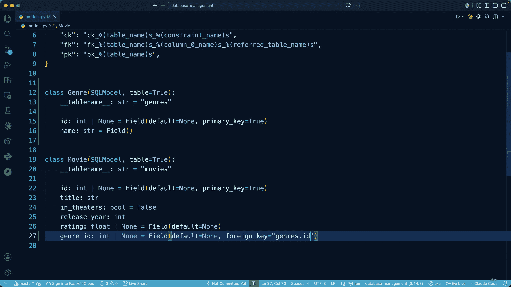
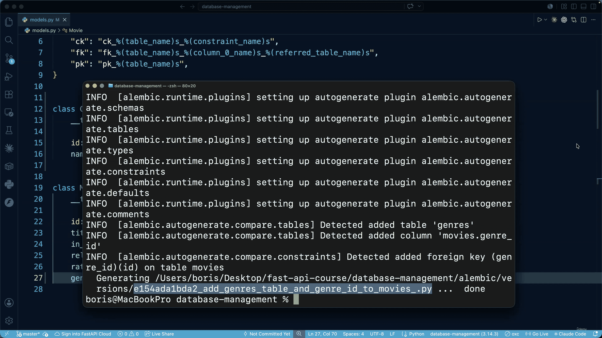
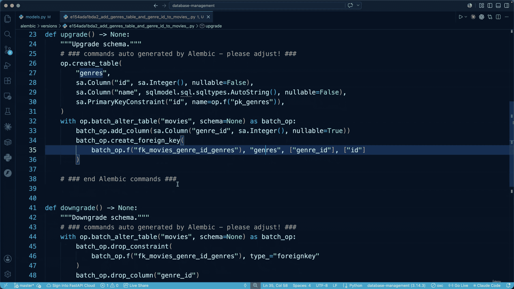
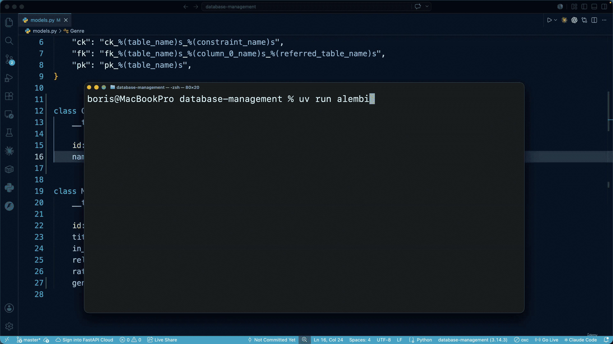
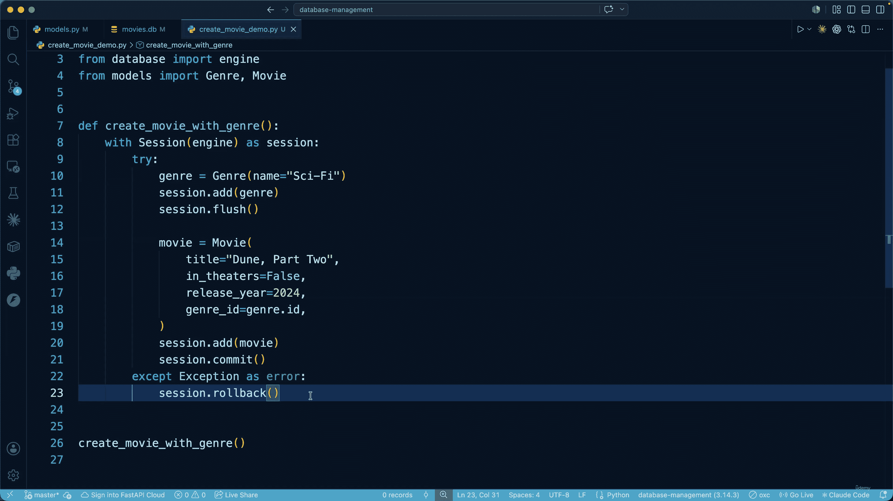
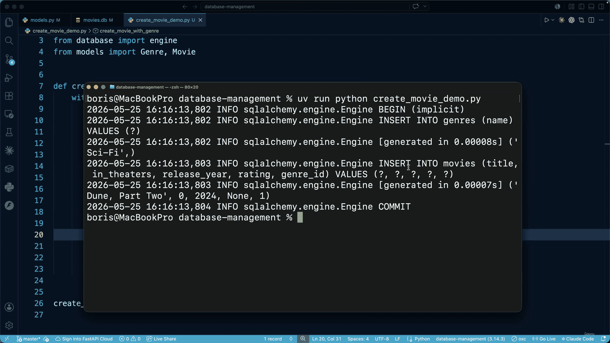
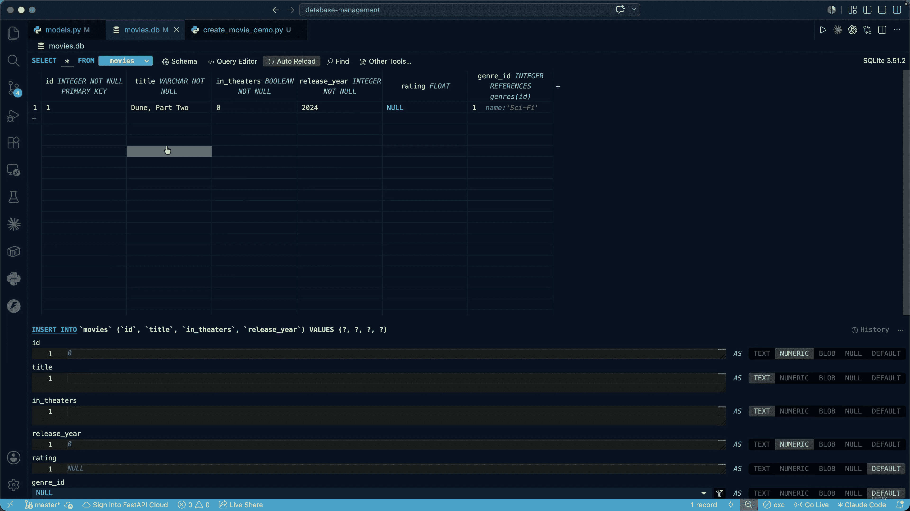

# FastAPI Masterclass part2：p25：🗄️ 数据库事务入门（Transactions I）

在本节课中，我们将要学习 FastAPI Masterclass part2 第 p25 节的内容：数据库事务（Transactions I）。这一节会先解释事务是什么，再通过新增 Genre 模型、生成数据库迁移、编写 Python 脚本，演示如何让多个数据库操作要么一起成功，要么一起回滚。学完后，初学者应能看懂 `commit()`、`rollback()` 和 `flush()` 在事务中的位置与作用，并理解为什么有些数据库操作不能提前提交。

## FastAPI Masterclass part2：p25.1：🧠 什么是数据库事务

上一节我们已经有了数据库模型和迁移的基础，本节中我们来看看数据库事务的核心概念。事务是一组数据库操作，这组操作要么一起成功，要么一起失败。换句话说，如果这组操作中的任意一个操作失败，就可以回滚整个操作序列，包括那些已经成功的操作。这样做的目的是允许许多不同的模型或操作共同完成预期结果，同时在某一步失败时能够回到之前的状态。

可以把事务的核心规则写成下面这个公式，便于直白理解。

\[
\text{事务} = \{op_1, op_2, \dots, op_n\}
\]

\[
\forall op_i \text{ 成功} \Rightarrow COMMIT；\exists op_i \text{ 失败} \Rightarrow ROLLBACK
\]

下面用保存五条记录的经典例子说明事务的回滚效果，这个例子能帮助初学者理解“要么全成，要么全败”的含义。

1. 依次保存第 1 条到第 5 条记录。
2. 前 4 条记录保存成功。
3. 第 5 条记录保存失败。
4. 如果这五个操作都在同一个事务里，数据库就能自动回滚前 4 条已经成功的记录。

这段例子的重点在于，事务可以看成一个覆盖多步操作的大号撤销按钮。它允许撤销因为后续失败而需要取消的全部变更，即使这些变更在前面已经执行成功。

> 事务可以理解为数据库操作的大号撤销按钮：它把多个步骤包成一个整体，后续失败时可以整体撤销。



理解了事务的概念后，接下来需要一个能演示事务的模型，因此下一节会新增 Genre 模型，并给 Movie 增加可选外键。

## FastAPI Masterclass part2：p25.2：🏗️ 新增 Genre 模型与可选外键

上一节我们介绍了事务的意义，本节中我们来看看如何为演示事务准备第二个模型。为了看到事务的实际效果，本节课要在领域模型中引入第二个模型，名字叫 Genre。每个 Movie 都可以附带一个名为 `genre_id` 的外键，这个外键指向新的 genres 表中的某个值。







在 `models.py` 中新增一个 SQLModel 类，代码如下，这段代码展示了 genres 表和 movies 表新增字段的基本写法。

```python
from sqlmodel import Field, SQLModel


class Genre(SQLModel, table=True):
    __tablename__ = "genres"

    id: int | None = Field(default=None, primary_key=True)
    name: str = Field()
```

```python
class Movie(SQLModel, table=True):
    # 省略 Movie 原有字段

    genre_id: int | None = Field(default=None, foreign_key="genres.id")
```

为了让新增字段的含义更清楚，下面列出这个模型设计中的关键点，便于初学者逐个对照。

- `Genre` 类继承自 `SQLModel`，并且会连接到一个数据库表。
- 使用双下划线属性 `__tablename__` 指定表名，这里把表名从 `genre` 改成复数的 `genres`。
- `id` 列在模型层面是 `int | None`，因为记录在保存到数据库之前需要先被建模；这里用 `Field(default=None, primary_key=True)` 设置默认值和主键。
- `name` 列是字符串类型，可以用 `Field()` 声明；原文也说明这个 `Field()` 不是严格必需的。
- Movie 新增 `genre_id` 属性，对应新的 `genre_id` 列；这个字段是 `int | None`，因为不强制每个 Movie 都必须有 Genre，并且默认值为 `None`。
- 为了建立外键，`foreign_key` 参数要写成字符串，并指向另一张表中存储主标识的列，因此这里写 `"genres.id"`，表示引用 genres 表的 `id` 列。

模型写好后，数据库结构还没有同步，因此下一节会生成并执行数据库迁移。

## FastAPI Masterclass part2：p25.3：🔁 生成并执行数据库迁移

上一节我们新增了 Genre 模型和 Movie 的可选外键，本节中我们来看看如何把模型变化同步到数据库。保存文件后转到终端，再次自动生成迁移。迁移流程可以按下面的步骤执行，初学者照着做即可。

1. 使用 `uv run alembic revision --autogenerate` 自动生成迁移。
2. 通过 `-m` 给迁移写消息，例如 `add genres table and genre_id to movies table`。
3. 保存迁移，并在 VS Code 中打开迁移文件快速检查。

对应的命令如下，这段代码展示了生成迁移和升级数据库的完整命令。

```bash
uv run alembic revision --autogenerate -m "add genres table and genre_id to movies table"
uv run alembic upgrade head
```

迁移文件检查时，可以关注下面几个点，这些点能确认迁移是否符合预期。

- 新建的 `genres` 表包含 `id` 和 `name` 两列。
- 在同一个 `upgrade` 函数下方，`movies` 表被修改，新增整数类型的 `genre_id` 外键列。
- 迁移会建立到 `genres` 表的具体外键连接。
- 这里再次看到这个 violation 提示，不用担心。
- 由于之前修改过 `script.py.mako` 文件，`SQLModel` 已经导入，因此迁移文件里的这个引用没有问题。

这个迁移看起来是正确的。转到终端执行 `uv run alembic upgrade head`，进入最新迁移。打开 movies 表后，应该能看到两个表；上一节课执行过 downgrade，所以之前的数据都丢失了，movies 表是空的，但表本身仍然存在。此时 movies 表中有 `genre_id` 外键列，引用 genres 表的 `id` 列；在下拉菜单中也能看到 genres 表本身。

数据库表准备好后，下一节会编写一个 Python 脚本，用代码演示两个操作如何放在同一个事务中。

## FastAPI Masterclass part2：p25.4：🧪 用脚本演示事务：创建 Genre 与 Movie

上一节我们完成了数据库迁移，本节中我们来看看如何用脚本把 Genre 和 Movie 的创建放进同一个事务。接下来要写一段 Python 代码完成两件事：第一，创建一个带 `id` 和 `name` 的新 Genre；第二，插入一个 Movie，并通过 Genre 的 `id` 指向一个已经存在的 Genre。按照示例中的业务要求，这两个操作要放在同一个事务里，也就是说，如果 Movie 保存失败，就要回滚 Genre 的创建；即使 Genre 行已经存在，只要 Movie 创建失败，也要回滚整个操作。

在项目顶层新建一个基础 Python 脚本文件，可以命名为 `create_movie_demo.py`。在这个文件里定义一个函数 `create_movie_with_genre()`，然后在文件下方直接调用这个函数，这样运行文件时就会执行全部逻辑。这段脚本依赖的内容可以归纳为下面几项，便于逐个理解。

- 从 `sqlmodel` 导入 `Session` 类。
- 从 `database.py` 导入 `engine` 对象。
- 从 `models.py` 导入 `Genre` 和 `Movie` 这两个 SQLModel。
- 使用 `with Session(engine) as session:` 创建并管理会话。

完整脚本如下，这段代码展示了 `add()`、`flush()`、`commit()` 与 `rollback()` 在一个事务中的配合方式。

```python
from sqlmodel import Session

from database import engine
from models import Genre, Movie


def create_movie_with_genre():
    with Session(engine) as session:
        try:
            genre = Genre(name="sci-fi")
            session.add(genre)

            session.flush()

            movie = Movie(
                title="Dune: Part 2",
                in_theaters=False,
                release=2024,
                genre_id=genre.id,
            )
            session.add(movie)

            session.commit()
        except Exception as error:
            session.rollback()


create_movie_with_genre()
```

在之前的 FastAPI 应用中，通常会在函数里调用类似 `yield session` 的写法，让每个路由处理函数都能拿到会话；现在这个文件没有 FastAPI 组件，也没有 `Depends` 或依赖注入，只是在文件内直接创建会话。这里的 `session` 对象本质上代表一个事务，它负责跟踪所有变更，包括数据库插入、更新和删除。调用 `session.add(genre)` 表示要把这个 Genre 保存到 genres 表，但会话会在后台管理事务，因此即使 Genre 保存成功，也仍然能够回滚。

理解事务控制时，最重要的三个方法是下面这些，它们决定了数据何时真正写入以及何时能够撤销。

- `commit()` 是真正把变更写入数据库的方法，同时会把事务标记为完成。这里不能提前调用 `commit()`，因为一旦调用，Genre 就会被永久保存；如果后面 Movie 保存失败，就没有办法回滚。
- `rollback()` 会撤销所有已经发生但尚未提交的变更。如果暂存了两次删除、两次更新和两次创建，调用 `rollback()` 会把整个事务清空，回到原状。
- `flush()` 会把所有待处理的创建、删除和修改写出到数据库，但事务还没有结束。可以把 `flush()` 理解为草稿或彩排：它把数据写到足以取得自增 ID 的程度，同时仍然允许回滚。

这里引出一个关键问题：Movie 需要 `genre_id`，但 Genre 还没有 `commit()`，怎样才能拿到 ID。答案是使用 `flush()`。调用 `flush()` 后，Genre 行会被写出，但事务没有结束，因此可以访问 `genre.id`，把这个数字作为 Movie 的外键引用，同时仍然保留回滚能力。现在可以再次调用 `session.add(movie)` 把 Movie 变更加入会话，最后因为会话把所有这些操作作为一个组来管理，所有操作都准备好之后就可以调用 `session.commit()`。

提交与回滚还需要异常处理兜底，下一节会说明 `try/except` 如何保证失败时整体撤销。

## FastAPI Masterclass part2：p25.5：🛟 用 try/except 与 rollback 保证要么全成要么全败

上一节我们完成了正常路径的事务代码，本节中我们来看看出现错误时如何回滚。把所有代码放进 `try` 块中；`try` 块允许运行一段代码，如果代码抛出异常或错误，就可以在下方用 `except` 捕获。这里捕获 Python 中层级很高的 `Exception` 类，并命名为 `error`。在这个只会在出错时执行的块里，仍然可以访问前面声明的 `session` 对象，并在它上面调用 `rollback()`。

失败与回滚通常会出现下面几种情况，理解这些分支有助于掌握事务边界。

- Genre 创建成功，Movie 创建失败：SQLModel 尝试把 Movie 写入数据库时，数据库会报错，代码进入 `except` 块并执行 `session.rollback()`。因为还没有 `commit()`，已经成功的 Genre 也会被撤销，结果是既没有 Movie，也没有 Genre；在这个示例中这可能是好事。
- 业务也可能希望在 Movie 创建失败时保留 Genre，这同样可以接受；但有些场景要求记录一起变化，某个后续操作失败就撤销全部，这段代码正是为这种场景服务。
- Genre 创建失败：会直接回滚整个会话，什么都不会创建。
- 整体规则是：完整序列或数据库操作集合必须作为一组、一个整体依次全部成功；只要其中一个操作失败，就回滚整个操作。

可以将事务的判定规则概括为下面这句话。

> 一组数据库操作必须作为一个整体一起成功；只要其中一个操作失败，整个事务就回滚。

在这个成功路径场景中，代码本身应该没有错误，因此运行文件后应该能在各自表中看到 Genre 和 Movie。换句话说，包括 `commit()` 在内的全部代码都会正常工作，不应该进入错误处理块；下一节课会展示一个确实触发错误并执行回滚的互补示例。

## FastAPI Masterclass part2：p25.6：✅ 运行脚本并验证成功路径

上一节我们补上了异常回滚逻辑，本节中我们来看看成功路径如何运行和验证。转到终端，把这个脚本当作普通 Python 文件，通过 uv 虚拟环境运行；命令是 `uv run python create_movie_demo.py`，它会运行本地可用的 Python 版本并执行这个文件。

```bash
uv run python create_movie_demo.py
```



运行后看起来没有问题，输出只是 SQLAlchemy 执行插入数据库时产生的各种命令。运行成功后，可以按下面几个检查点确认事务的成功路径。

- 查看 genres 表，可以看到 `sci-fi` 这个 Genre，`id` 为 1。
- 由于使用了 `flush()`，代码能够访问 `id=1`，并把 1 定义为 Movie 的 `genre_id` 外键。
- Movie 记录的插入也成功了。
- 完整事务成功，因此完整事务被提交，现在两条记录都保证存在。

这就是事务带来的好处，也是成功路径的表现：两个连续操作一起成功，完整事务成功，不需要回滚。下一节课会看互补的失败示例，其中事务会被回滚。

## FastAPI Masterclass part2：p25.7：📌 本节总结





本节课中我们一起学习了数据库事务的基本概念和实操方式。我们知道了事务是一组要么一起成功、要么一起失败的操作，失败时可以回滚整个序列，包括已经成功的步骤；也通过新增 `Genre` 模型、给 `Movie` 增加 `genre_id` 可选外键、生成迁移和升级数据库，准备好了演示环境。随后我们编写了 `create_movie_with_genre()` 脚本，理解了 `session.add()` 负责把变更加入会话，`flush()` 负责在不结束事务的情况下取得自增 ID，`commit()` 负责真正提交，`rollback()` 负责在异常时撤销全部尚未提交的变更。最后运行脚本验证了成功路径：Genre 的 `id=1` 被 `flush()` 写出并被 Movie 引用，Movie 插入成功，整个事务提交后两条记录同时存在。下一节将继续观察失败路径中事务如何整体回滚。

