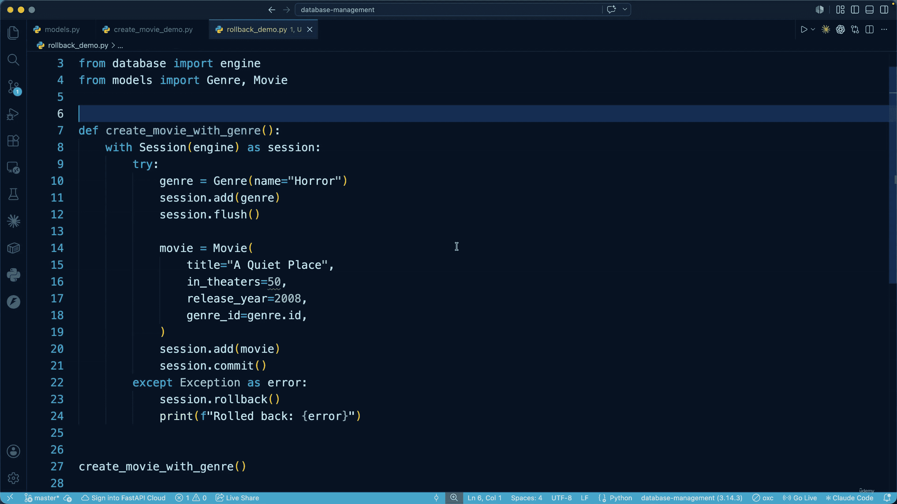
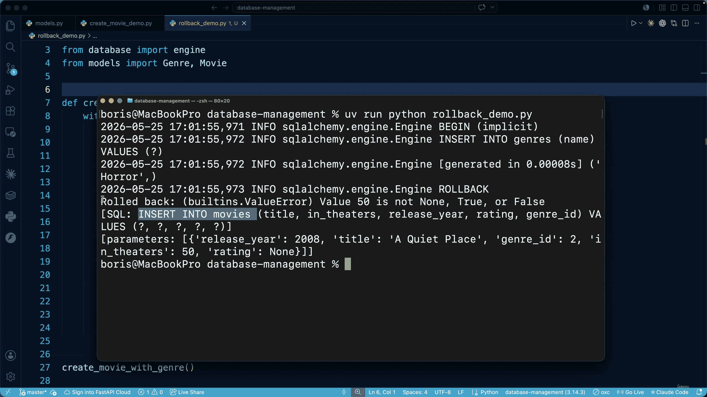
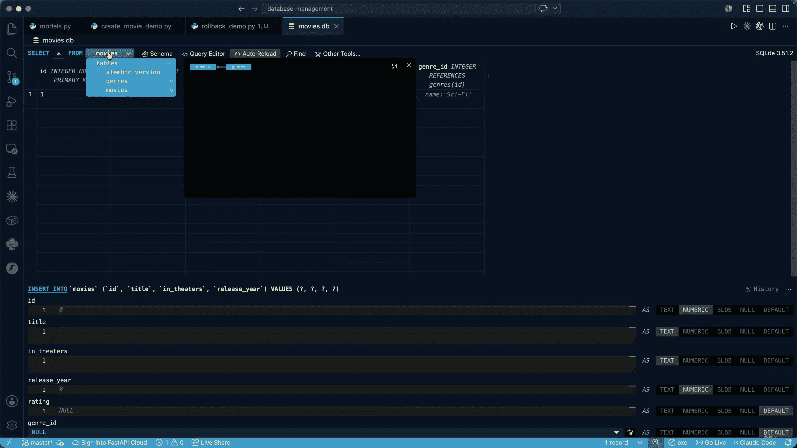
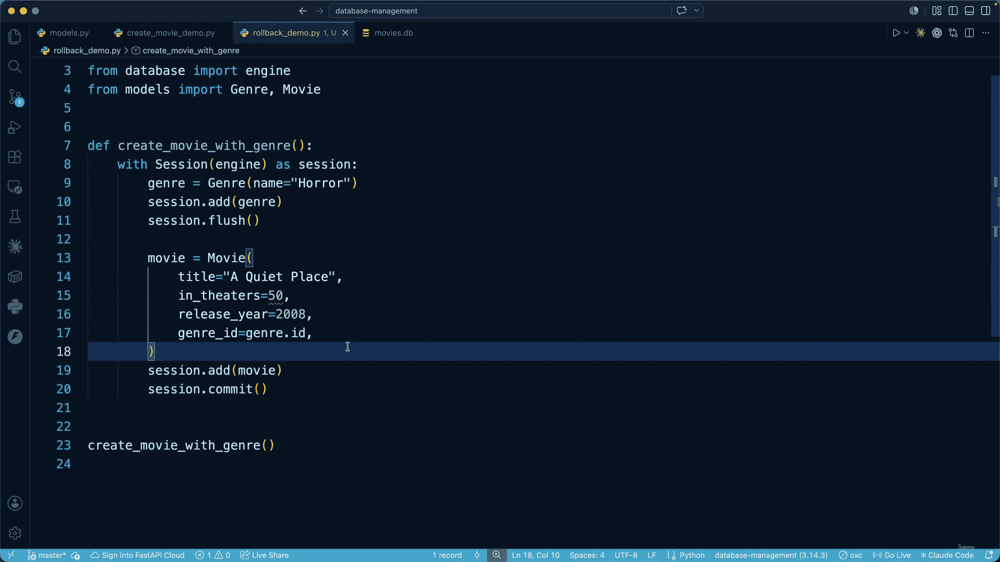
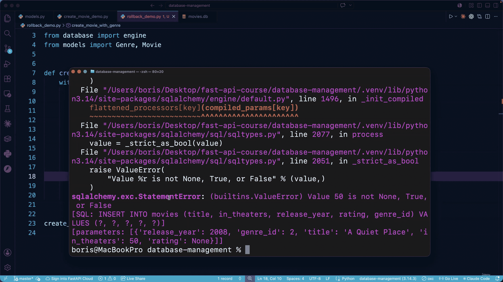
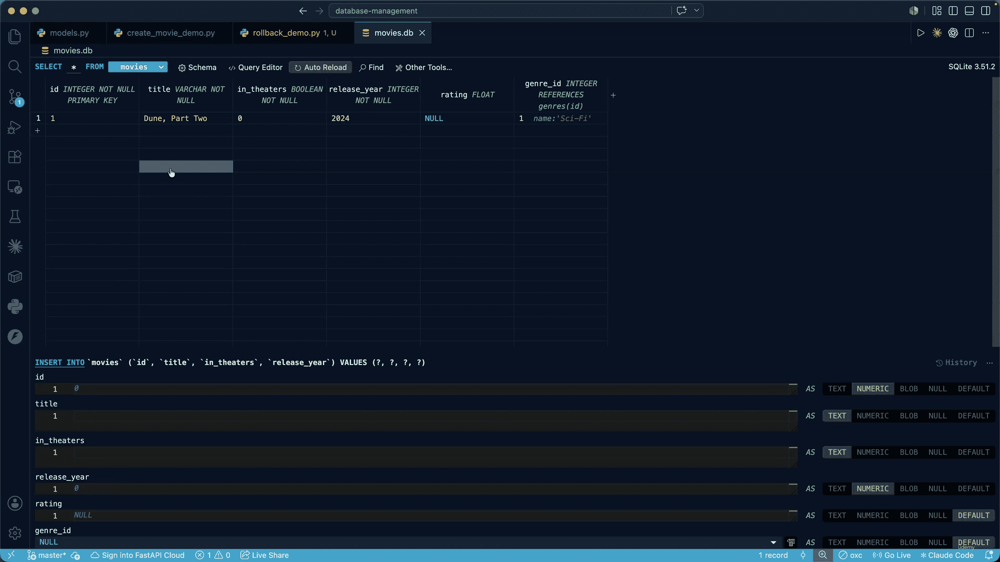

# 🧪 FastAPI 大师课：Part2 p26 127：事务回滚实战

在本节课中我们将要学习 FastAPI 和 SQLAlchemy 中的事务回滚。上一节我们接触了事务相关的基础用法，本节中我们来看看当代码执行到一半出现错误时，如何把已经排队等待写入数据库的变更全部撤销。为了让初学者也能看懂，我们会用一个故意制造错误的简单例子，一步步观察 `rollback` 到底做了什么，以及 `flush` 和 `commit` 在回滚场景中的区别。整个教程会从准备演示文件开始，然后制造运行时错误，再检查数据库结果，最后说明上下文管理器如何自动回滚。

## 🧰 FastAPI 大师课：Part2 p26 127：准备一个回滚演示

接下来我们开始准备演示。首先复制粘贴原来的代码到一个新文件里，可以把这个文件叫作 `rollback_demo` 之类。因为我们的数据库里已经有原来的 genre 和 movie，所以为了演示回滚，需要快速切换一下例子。这里我们创建一个新的 horror genre，再创建一个新的 movie，比如选择 `A Quiet Place`，原文说它于 2008 年上映。然后我们故意在代码里制造一个错误，这个错误可以来自代码本身，也可以来自数据库侧，比如数据库宕机或超时；这里为了让例子简单，我们用一个有点刻意 contrived 的错误。

具体做法是：当我们要表示 movie 模型对象时，这个对象最终会被转换成对应的 SQL 查询来插入 movie。假设 `theaters` 本来应该传布尔值，我们却不小心传了一个整数。类型检查器会警告，但类型检查器对运行时没有影响。于是 ORM 尝试生成 SQL，把 50 插入 `theaters` 列，这会触发错误。保存文件后，一旦事务成功回滚，movie 当然不会存在；更重要的是，这个 horror genre 也不应该存在，因为回滚事务应该撤销所有已经发生或等待发生的变更，包括新 genre 的插入。以下是这个演示需要记住的关键点：

- `theaters` 本应传入布尔值，却被误传为整数。
- 类型检查器会提示问题，但不会阻止运行时继续执行。
- ORM 生成 SQL 后，把 `50` 插入 `theaters` 列会触发错误。
- 回滚不仅要撤销 movie 插入，还要撤销 genre 插入。

```python
# rollback_demo.py 示例结构
genre = Genre(name="Horror")
movie = Movie(
    title="A Quiet Place",
    year=2008,
    theaters=50,  # 故意把布尔值写成整数
)
```

## 💥 FastAPI 大师课：Part2 p26 127：制造错误并打印回滚信息

上一节我们准备好了演示数据和故意写错的字段，本节中我们来看看如何运行并观察错误。事实上我们甚至可以把错误打印出来，这样就能在终端里看到它。这里提供一个格式化字符串，文本类似 `rolled back`，然后把 `error` 变量的值插值进去。以下是打印错误信息的代码示例：

```python
except Exception as error:
    print(f"Rolled back due to: {error}")
```

然后在终端执行 `uv run python rollback_demo.py` 来运行这个脚本文件。你会看到错误消息，它可能不是特别显眼，但大概会显示类似 `rolled back due to a value error: value 50 is not None, True or False` 的内容。这里插入 movies 表的实际查询应该失败，这就是为什么代码进入 `except` 块，并在终端看到 roll back。需要说明的是，原文里的 “accept block” 指的是 `except` 块，不要和接受操作混淆。

> 注意：这里的 `theaters=50` 是故意制造的运行时错误，用于演示事务回滚，不应出现在真实业务代码中。

## 🔍 FastAPI 大师课：Part2 p26 127：检查数据库回滚结果

上一节我们在终端看到了错误和回滚提示，本节中我们回到数据库检查结果。现在回到数据库 `movies`，在 movies 表里应该看不到新电影 `A Quiet Place`。但同样重要的是，因为事务回滚了，genres 表里也不应该看到新的 horror genre，而实际检查也确实没有。也就是说，一切符合预期。这段代码回滚了 session 中所有排队等待变更的内容，而这个 session 也代表了我们这段代码对应的事务。可以用一个简单公式来理解：

\[
\text{rollback} = \text{撤销 session 中尚未 commit 的变更}
\]







## 🧼 FastAPI 大师课：Part2 p26 127：为什么用 flush 而不是 commit

上一节我们验证了回滚能撤销 movie 和 genre 的插入，本节中我们来看看为什么这里要用 `flush`，而不是 `commit`。再次强调，如果这里调用 `commit` 而不是 `flush`，就会在那个时间点做一次保存或检查点，那么就没有办法回滚 genre 行的插入。也就是说，`commit` 之后数据已经持久化，回滚无法再撤销它。这就是 `flush` 在这里重要的原因：它几乎模拟了一次保存，做了等效的事情，但同时保留了在更大事务中回滚这个变更的潜力。并且，一旦 movie 保存失败，我们也会回滚 genre 的待插入操作。此外，`flush` 方法还允许我们访问 genre ID，供后面的代码使用。以下是 `flush` 和 `commit` 在回滚场景中的关键区别：

- `flush()` 会把 SQL 发送到数据库，但还没有最终提交，因此后续可以回滚。
- `commit()` 会在当时形成一个保存点或检查点，之后无法回滚已经提交的内容。
- `flush()` 可以让 ORM 拿到自增 ID 等数据库返回值，例如 genre ID。
- 在同一个事务中，movie 插入失败后，pending 的 genre 插入也能一起回滚。

```python
session.add(genre)
session.flush()      # 发送 INSERT，拿到 genre.id，但尚未提交
session.add(movie)
session.flush()      # 这里失败，触发异常
# 异常发生后 rollback 会撤销 genre 和 movie 的待提交变更
```

## 🤖 FastAPI 大师课：Part2 p26 127：上下文管理器自动回滚

上一节我们说明了 `flush` 和 `commit` 的差别，本节中我们来看一个课程结尾的小惊喜和好消息。我们刚才在 `except` 块里显式写代码处理异常，其实这个逻辑会被上下文管理器自动处理。换句话说，传给 `with` 关键字的代码块里如果发生任何错误，SQLAlchemy 会自动替你调用 `rollback`。它会假设这个逻辑就是你想要的：你基本上是在排队一批相关变更，只要最后不 `commit`，整个过程中间出错，它就会在幕后自动调用 rollback。我们前面的显式例子只是为了让你建立更好的 mental model，理解背后发生了什么。

我们也可以得到完全相同的结果：移除整个 `except` 块，同时移除整个 `try` 块，让 ruff formatter 自动取消缩进。这样做之后，背后基本上是完全相同的代码，因为只要使用这个上下文管理器，SQLAlchemy 就会处理所有这些复杂性，并自动对 session 调用 rollback。以下是自动回滚的核心代码形态：

```python
with Session(engine) as session:
    session.add(genre)
    session.flush()
    session.add(movie)
    session.flush()
    # 如果这里抛出异常，SQLAlchemy 会自动 rollback
    session.commit()
```

## ✅ FastAPI 大师课：Part2 p26 127：验证自动回滚

上一节我们介绍了上下文管理器会自动回滚，本节中我们从终端从头再运行一次这个文件来验证。我们应该会看到错误，这个错误消息、输出或格式可能和之前看到的不一样，但结果完全相同。这里可以看到 SQLAlchemy statement error，内容是 `value 50 is not None`。最重要的是，在 movie 数据库里可以看到没有 horror genre，也没有新电影 `A Quiet Place`。于是这就是一个事务回滚在实际运行的例子。

> 错误消息的具体格式可能变化，但核心结果一致：错误触发回滚，相关待提交数据都不会落库。

## 📌 FastAPI 大师课：Part2 p26 127：总结

到这里，本节课的内容就完整走了一遍。本节课中我们一起学习了 FastAPI 和 SQLAlchemy 中事务回滚的实战用法：我们复制代码创建了 `rollback_demo`，切换例子创建 horror genre 和 `A Quiet Place` movie，并故意把 `theaters` 的布尔值写成整数 `50`，让 ORM 生成的 SQL 插入失败；随后通过终端观察错误和回滚提示，再回到数据库确认 movie 和 genre 都没有被插入；我们还解释了为什么这里要用 `flush` 而不是 `commit`，以及 `with` 上下文管理器如何在代码块内出现异常时自动调用 `rollback`。以下是本节课的要点回顾：







- 事务回滚会撤销 session 中所有尚未 `commit` 的待提交变更。
- `flush()` 把变更发送到数据库但保留回滚能力，还能拿到自增 ID。
- `commit()` 会形成保存点，提交后无法再回滚已经持久化的插入。
- 使用 `with` 上下文管理器时，代码块内异常会自动触发 rollback。
- 显式 `try/except` 示例有助于理解原理，但实际可以交给 SQLAlchemy 自动处理。

