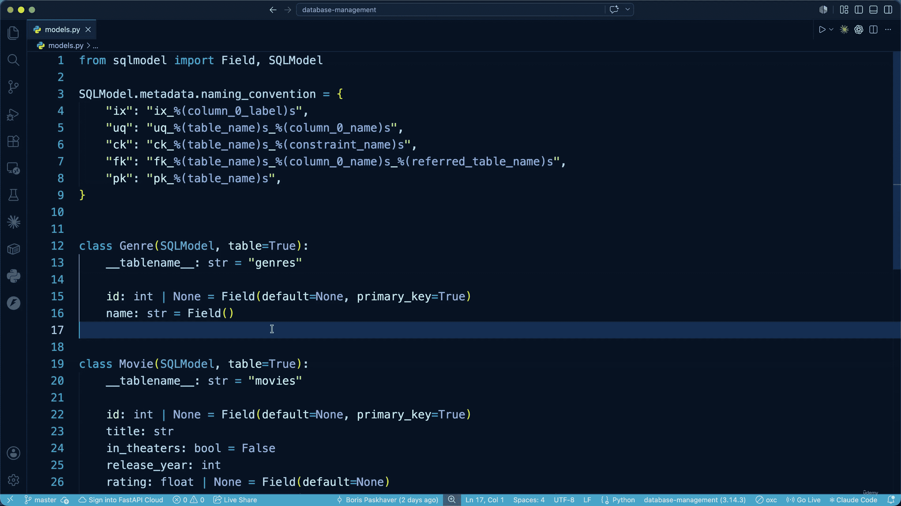
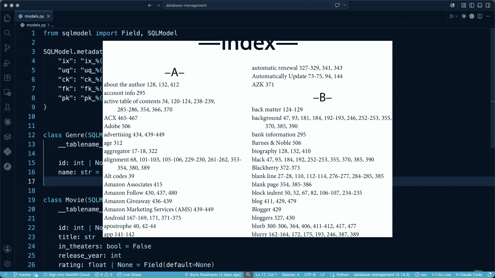
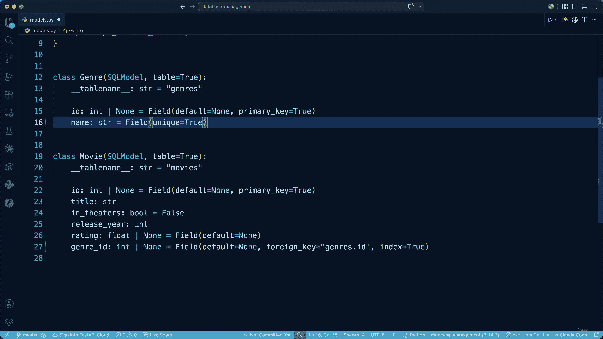
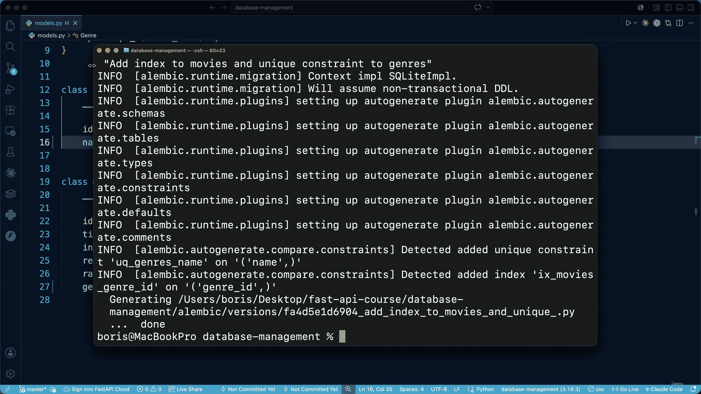
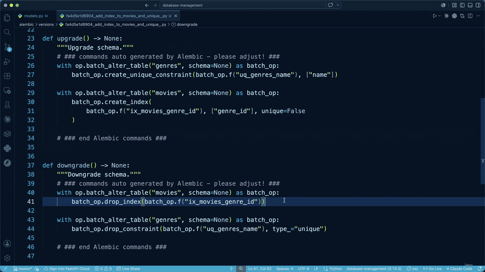
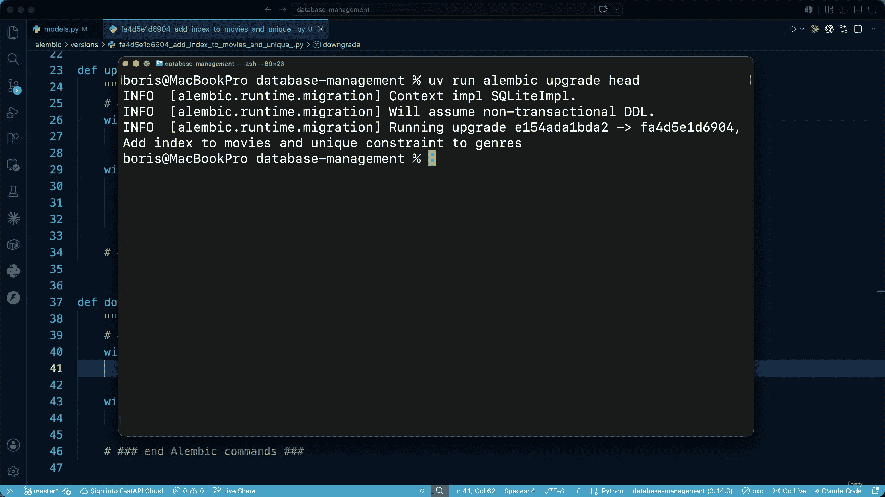
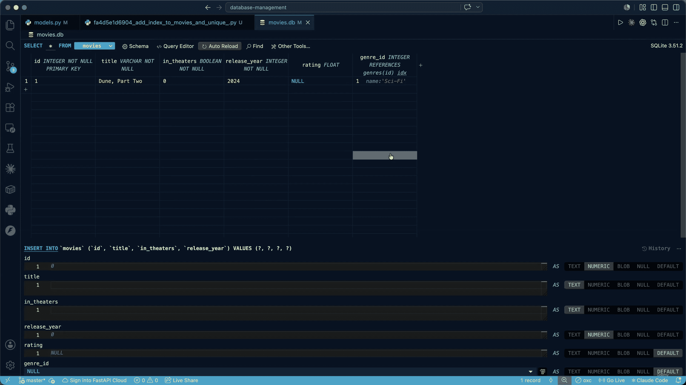

# 📚 FastAPI大师课：第27课：数据库索引


在本节课中我们将要学习数据库索引。我们会了解索引是什么、为什么它能让查询更快、什么时候应该使用索引，以及在SQLModel和数据库迁移中如何给列添加索引和唯一性约束。本节内容会尽量用直白的方式解释，让初学者也能理解这些概念，并且知道在实际项目中如何落地。


## 🗂️ 什么是数据库索引


上一节我们完成了本节前面的内容，本节我们来看看数据库索引这个主题。索引是数据库在后台管理的一种数据结构，作用是帮助数据库更快地定位行。它实现这一点的方式，是让数据库在处理某个查询时不必扫描整张表。


你可以把索引类比成实体书后面的索引。你不需要翻遍书里的每一页去找某个主题，而是可以在书后索引里查到该主题，然后直接跳到对应的一页或多页。数据库在后台创建的索引，起到的就是类似作用。






用更直白的方式描述，索引改变的是查询方式：


```text
没有索引：查询时需要全表扫描，逐行检查
有索引：查询时通过后台数据结构快速定位目标行
```


例如，主键列数据库会自动创建索引，使查询该列比逐行线性扫描整张表快很多。再比如删除行会造成行顺序不可预测，索引可以更快帮助数据库取出特定行；如果主键不是数字，而是UUID这类字符串，索引也能帮助数据库更快找到对应标识符的一行或多行。理解这一点，对后面设计表和写查询都很有帮助。


## ⚖️ 索引的代价与最佳实践


上一节我们知道了索引能加速查找，本节我们来看看为什么不能给每一列都加索引。数据库在后台必须跟踪并维护索引，每次表或记录更新时都要更新索引。例如新增房间或删除房间并移除其ID时，数据库也要同步更新对应索引，以维持未来查询操作的效率。


如果给每一列都加索引，后台就要处理更多复杂数据结构；索引创建太多，最终可能拖慢整个数据库。所以这始终是一个权衡问题。通用最佳原则是：给经常作为查询基础的列创建索引。例如外键列是常见推荐，因为外键列经常用于连接或WHERE子句。


以下是选择索引列时可以参考的要点：


- 经常用于查询条件的列适合加索引。
- 经常用于连接操作的外键列适合加索引。
- 不要给所有列都加索引，因为索引维护有成本。
- 索引太少可能查询慢，索引太多可能写入和维护变慢。


## 🧩 在SQLModel中添加索引


上一节我们介绍了索引的代价和最佳实践，本节我们来看看具体语法。本课会展示在SQLModel和迁移中添加索引的写法。你不需要担心后台所有复杂性；关键结论是，给某列添加索引后，该列的查找和连接操作会快很多。数据库只有1行、10行甚至1000行时，你看不到明显影响；进入生产环境后可能有数万或数百万行，这时索引可能带来很大差别。


打开models.py，滚动到movies表中唯一的外键列genre_id，添加参数`index=True`：


```python
genre_id: int = Field(foreign_key="genres.id", index=True)
```


需要提醒的是，像id这样的主键列默认会在后台自动生成索引，但外键列必须手动显式标注希望索引存在。


以下是在SQLModel中设置索引时需要记住的要点：


- 主键列默认自动创建索引。
- 外键列需要显式设置`index=True`。
- 索引会让该列的查找和连接更快。
- 小数据量下效果不明显，大数据量下效果明显。


## 🔐 唯一性约束与索引


上一节我们给外键列添加了索引，本节我们来看看唯一性约束。数据库可以强制列内值的唯一性，换句话说，如果插入新行会在指定列产生重复，数据库会禁止插入。


现实中的一个好例子是用户表：你在跟踪网站所有用户，假设email用作主要登录凭证，那么适合在email列加唯一性约束，确保系统内不能有重复email。类似地，对于genres表，假设不希望horror这样的类型在类型表里重复多次，可以给name字段对应的name列添加`unique=True`：


```python
name: str = Field(unique=True)
```


这个主题相关的原因是，当你给数据库提供唯一性约束时，数据库会自动隐式创建索引。它会用这个索引作为辅助数据结构，不仅帮助查找，也帮助维护唯一值集合，数据库需要在尝试插入新条目时跟踪这些值。


以下是唯一性约束与索引相关的要点：




- 唯一性约束禁止指定列出现重复值。
- 数据库会为唯一性约束隐式创建索引。
- 唯一性索引既帮助查找，也帮助维护唯一值。
- 外键列通常不需要唯一性，因为多条记录可以引用同一个外键。


## 🛠️ 生成并运行迁移


上一节我们修改了模型，本节我们生成新的迁移。运行命令：


```bash
uv run alembic revision --autogenerate -m "add indexes to movies and unique constraint to genres"
```


执行后，快速查看versions目录中的新迁移文件。迁移会对genres表应用操作：在name列添加唯一约束；对movies表在genre_id列创建索引。注意genre_id列没有唯一性要求，这是好事，因为如果加唯一约束，两部电影就不能有相同genre；而多部电影可以属于同一genre，比如horror，它们可以有相同外键。这就是不需要唯一性的索引例子。反过来，name列是唯一列，也会自动成为索引。downgrade函数只是移除这些索引或约束；这个迁移没有增删新列，只是调整两列的设置。


以下是这个迁移文件中的关键变化：


- genres表的name列添加唯一约束。
- movies表的genre_id列创建索引。
- genre_id列不添加唯一约束。
- downgrade函数移除索引或约束。






## 🚀 运行迁移与查看效果


上一节我们查看了迁移文件，本节我们在终端运行迁移：


```bash
uv run alembic upgrade head
```


如果查看movies数据库，数据本身不会变化；但在SQL编辑器中会看到额外语法`IDX`，它是index的缩写，表示数据库现在在后台维护索引。SQLite会在后台管理这个列的索引，确保涉及genre_id列的查询查找更快。


以下是运行迁移后可以观察到的现象：


- 数据行本身不会改变。
- SQL编辑器中会出现`IDX`标记。
- 数据库在后台维护独立索引数据结构。
- 涉及genre_id列的查询会更快。






本节课中我们一起学习了数据库索引：索引是数据库后台维护的数据结构，能加速查找和连接；主键默认有索引，外键需要显式添加；索引有维护成本，不应给所有列加索引；唯一性约束会隐式创建索引；在SQLModel中可以用`index=True`和`unique=True`设置，并通过迁移应用。你可以继续研究索引的最佳使用场景，一个好的起点是经常用于查询或连接的列，通常就是外键列；本节课也讨论了给数据库添加唯一性要求的方式。
