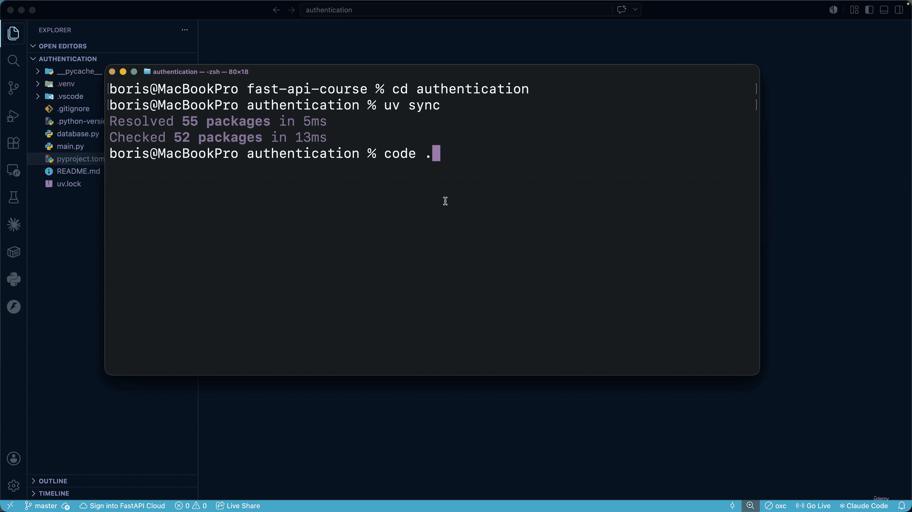
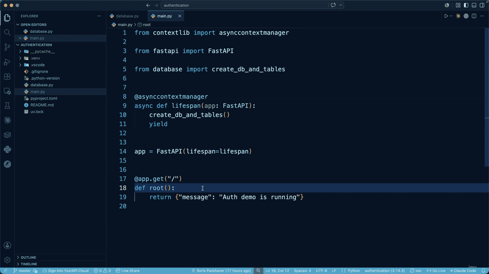
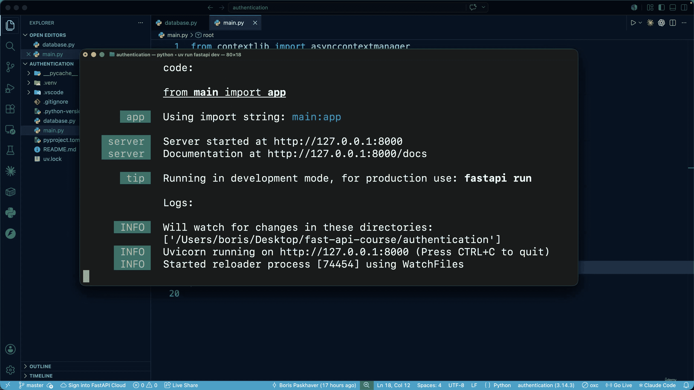
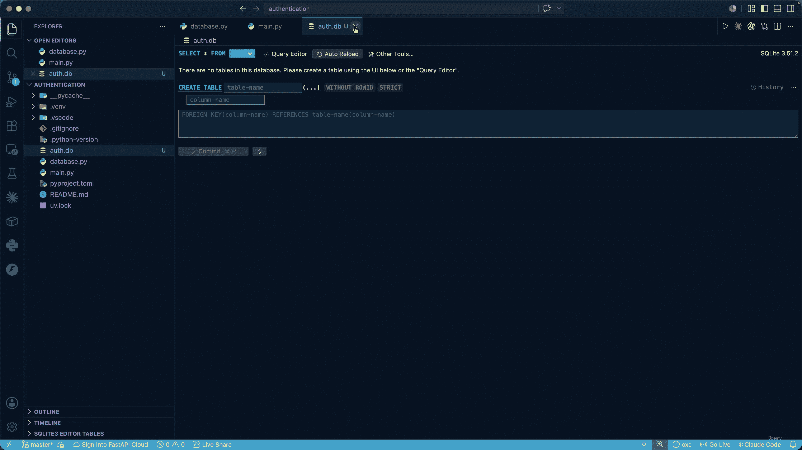
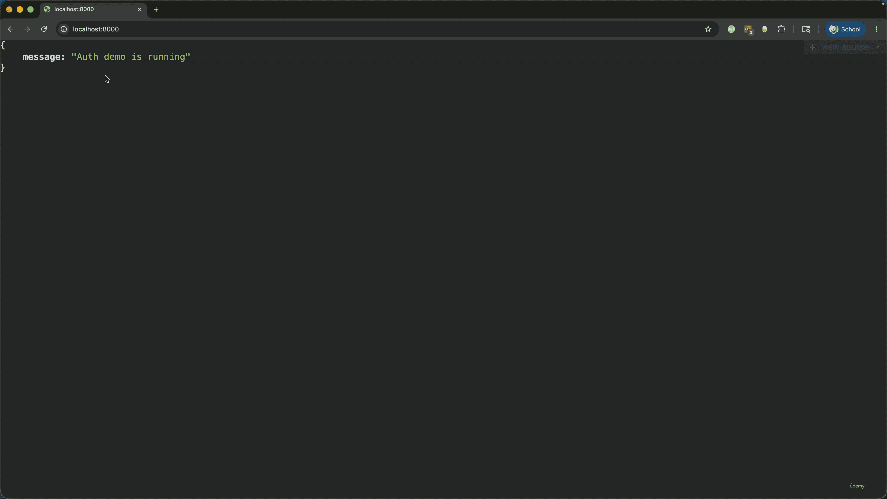

## 🚀 FastAPI 大师课：p30 / 131：项目初始化

在本节课中我们将要学习如何为认证系统准备一个新的 FastAPI 项目。主要内容包括进入 `authentication` 文件夹、安装项目依赖、让编辑器使用正确的虚拟环境、查看项目里的关键文件，以及启动服务并确认数据库文件和根路由都能正常工作。这些步骤本身不复杂，但它们决定了后续代码能否顺利导入依赖、能否正常连接数据库，因此值得按顺序完整做一遍。

完成课程定位后，本节中我们来看看如何进入项目并准备依赖。你可以在课程资料的 `authentication` 文件夹中找到这个新项目。以下是进入项目、安装依赖和打开编辑器时需要执行的操作。

- 导航到 `authentication` 文件夹。

- 运行 `uv sync`，这个命令会把 Python 和项目的全部依赖下载到该文件夹内的虚拟环境中。

- 依赖安装完成后，可以使用类似 `code .` 的命令打开 VS Code，从而打开当前项目。

```text
虚拟环境依赖 = uv sync(项目目录)
code .
```

完成依赖安装后，接下来需要检查依赖清单。项目顶层是一个合适的起点，通常可以先看 `pyproject.toml`。以下是这个项目中需要关注的几个依赖。

- `FastAPI`：项目使用的 Web 框架。



- `pydantic-settings`：这是第一次遇到的 Pydantic 补充库，用来读取环境变量，后续会再次说明。

- 若干用于生成 JWT 的库。

- 若干用于帮助生成密码的库。

对于这些依赖，后续在真正用到时会逐一说明。了解依赖之后，需要确保编辑器使用的是已经安装全部依赖的虚拟环境。此时一个合适的操作是打开命令面板。以下是在 VS Code 中选择 Python 解释器的步骤。

- 在 Mac 上按 `Command + Shift + P`，在 Windows 上按 `Control + Shift + P`，打开命令面板。

- 在命令面板中查找 `Python: Select Interpreter`。

- 选择该项目 `authentication` 文件夹内实际存在的虚拟环境。

选择完成后，VS Code 会登记这个本地文件夹以及其中安装的全部依赖。这样你就可以放心地从这些库中导入代码，编辑器里也不应该出现相关错误。接下来我们看看项目中的一些顶层文件。这个项目的结构和课程前面见过的结构比较标准。以下是 `database.py` 与 `main.py` 中的关键内容。

- 在 `database.py` 中，我们设置了数据库，并包含补充函数 `create_db_and_tables`，它会在 FastAPI 应用启动时、在 `lifespan` 中运行。

- `database.py` 中还包含一个获取依赖项的函数，用来授予对数据库会话的访问权。

- 项目里还有配套的 `SessionDep` 类型，可以把这种类型作为函数参数提供。

- 在 `main.py` 中，我们使用 `asynccontextmanager` 上下文管理器包装 `lifespan` 函数，并在其中调用创建数据库和数据表的逻辑。

```python
@asynccontextmanager
async def lifespan(app: FastAPI):
    create_db_and_tables()
```

- 本节仍然使用 `SQLModel`。

- 项目中创建了 FastAPI 应用。

- 目前只定义了一个根路由，也就是 `/` 或首页路由，它只返回一个基本字典。



```text
根路由响应 = {"message": "app demo is running"}
```

了解项目文件后，本节中我们来看看如何启动服务并检查结果。以下是在终端启动服务以及启动后需要观察的两件事。

- 在终端执行 `uv run fastapi dev` 启动服务。

```text
uv run fastapi dev
```

- 第一件事是项目内应该创建出一个新的数据库文件。示例中这个文件命名为 `auth.db`。当前项目还没有模型，也没有数据表，但这个文件会成为后续使用的数据库。

- 第二件事是既然 FastAPI 应用有效，就可以在浏览器中访问根路由，并看到预期响应。示例中响应显示 `message: app demo is running`。



```text
数据库文件 = auth.db
```





这些检查完成，就说明基础设置已经跑通。下一节课会开始构建认证系统。本节课中我们一起学习了如何进入 `authentication` 项目、运行 `uv sync` 安装依赖、在 VS Code 中选择虚拟环境、查看 `pyproject.toml`、`database.py` 和 `main.py` 的作用，以及如何用 `uv run fastapi dev` 启动服务并验证数据库文件和根路由响应。把这些基础步骤做完整，后面的认证功能就有了稳定的运行环境。

