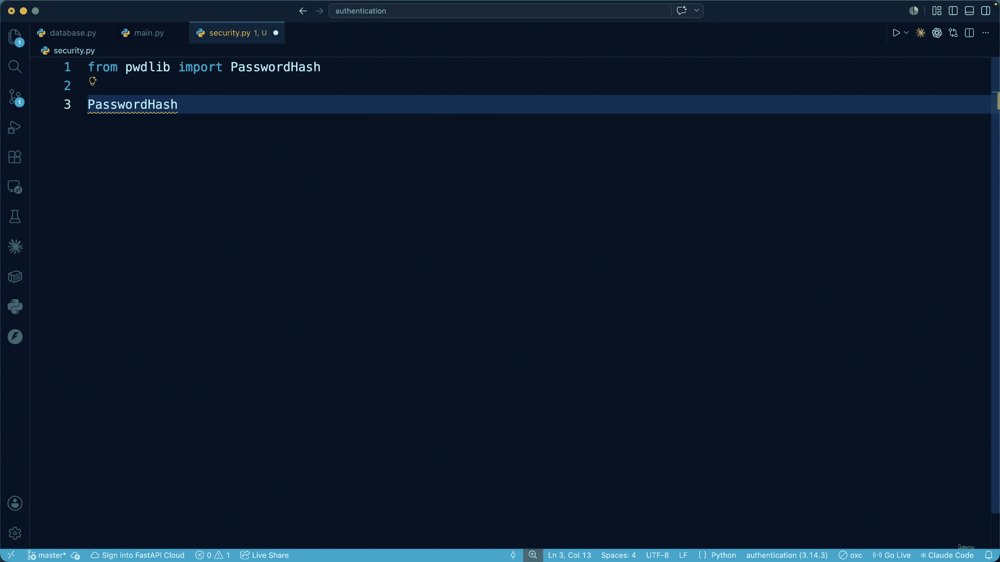
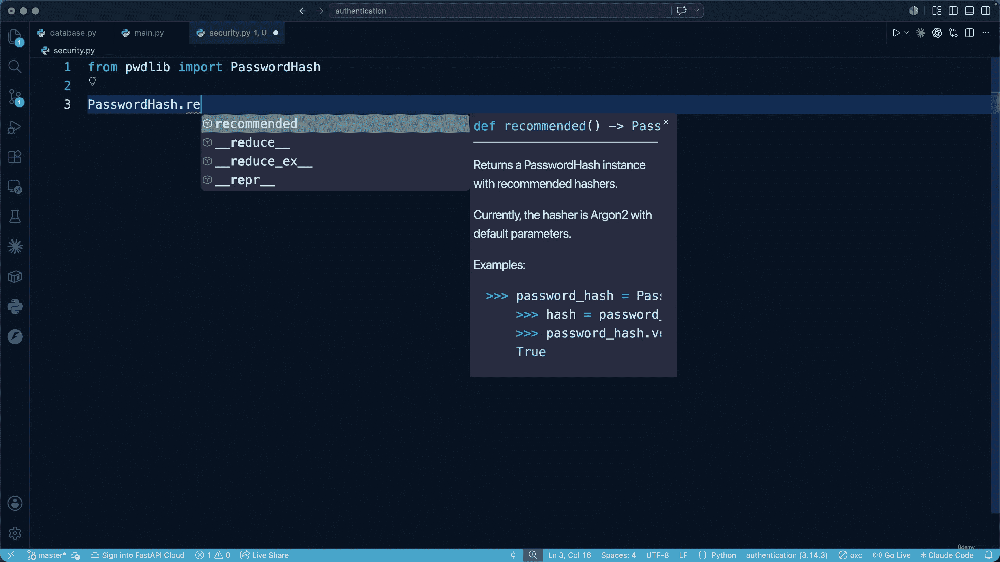
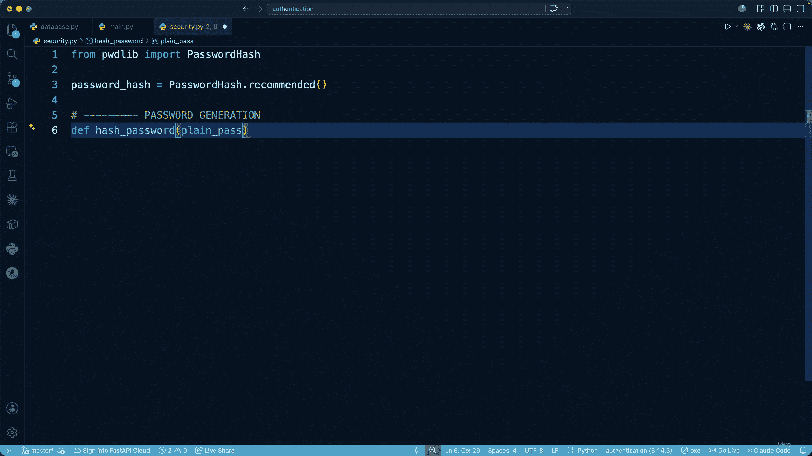
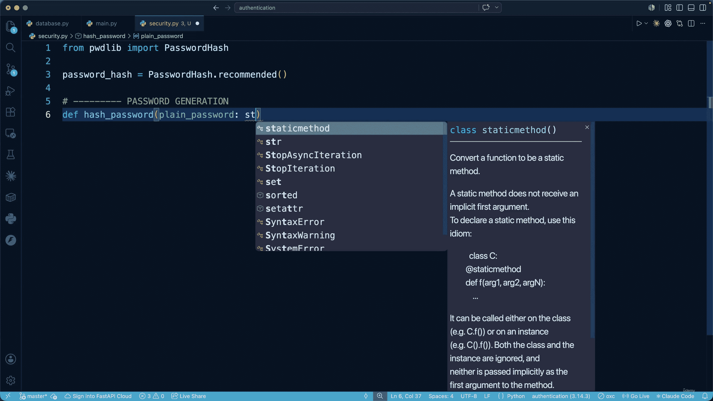
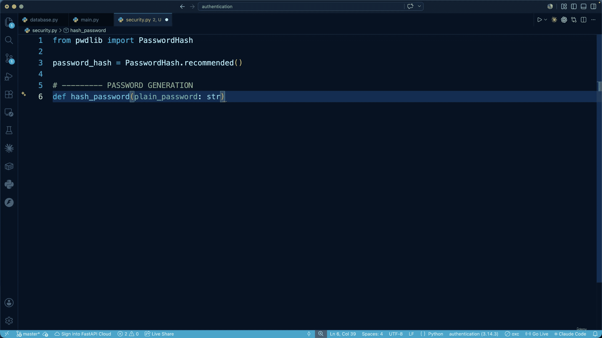
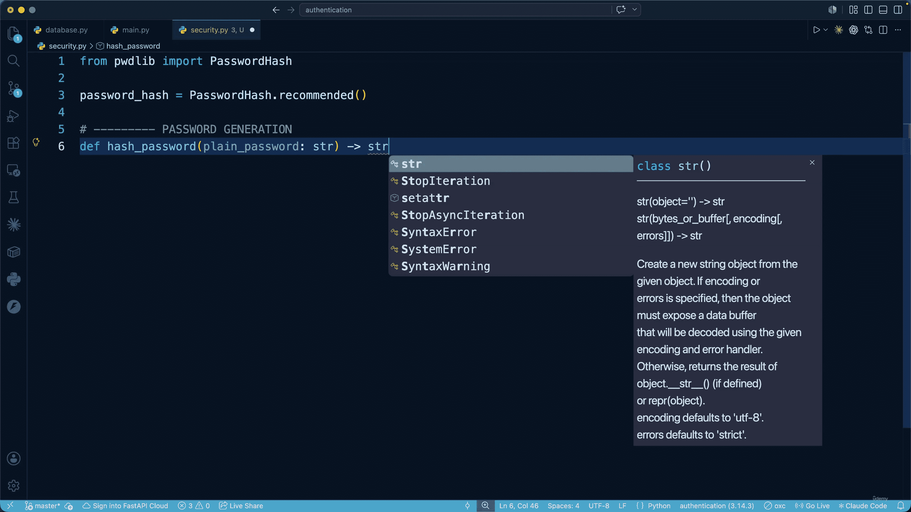
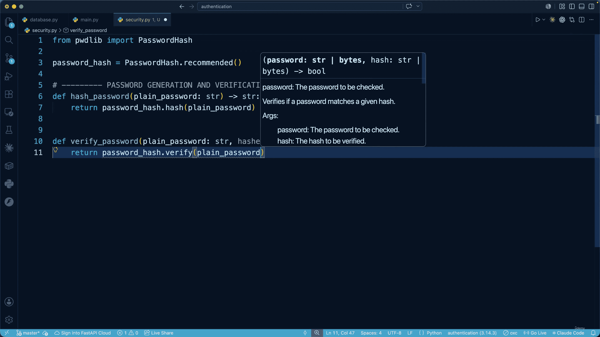
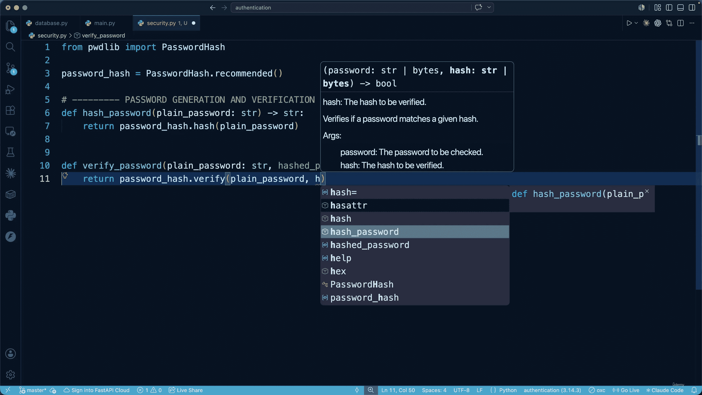
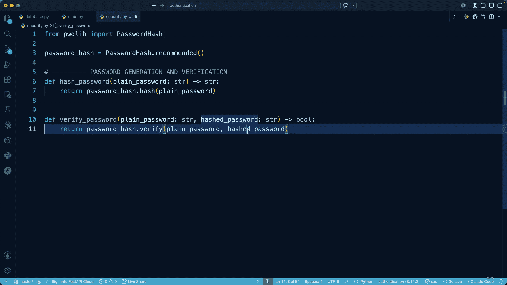

# 🔐 FastAPI Masterclass：132：密码哈希 I


在本节课中我们将要学习 FastAPI 项目中用户密码的安全处理方式，并借此引入一个非常重要的安全概念：哈希。课程会先讲清楚高层概念，再创建 `security.py` 文件，最后写出两个辅助函数，分别用于生成密码哈希和验证密码哈希。整个过程中我们会从“为什么不能保存明文密码”讲到“注册和登录时哈希如何工作”，帮助初学者建立完整的后端密码安全思路。


## 🧭 FastAPI Masterclass：132.1：本课目标与文件准备


上一节我们已经接触过认证相关的内容，本节中我们来看看用户密码应该如何处理。我们要攻克的第一个挑战是用户密码，这个挑战会引出一个非常重要的安全概念，叫作哈希。第一步是创建一个新文件，文件名为 `security.py`。


在这个文件里，我们最终会写两个辅助函数。本课会先花一点时间确保我们理解顶层概念，然后再进入代码。大家对密码并不陌生，平时都登录过网站。密码是一个秘密单词、短语或一串按顺序排列的字符，基本作用是让用户获得系统访问权限。每个用户都会有一个密码。


以下是本课要建立的核心安全规则，先把它放在最前面：


> 数据库中永远不要保存用户输入的原始明文密码。


## 🔒 FastAPI Masterclass：132.2：为什么绝不能保存明文密码


上一节我们说明了本课目标和要创建的文件，本节中我们来看看密码存储中最重要的规则。涉及数据库和用户时，密码存储最重要的规则是：永远不要以明文形式保存用户密码。用户提供的原始密码，无论他们选择什么内容，都不应该直接存进数据库。


例如，一个用户像 `bob@example.com` 这样注册，并使用 `topsecret1` 作为密码，那么永远不应该把 `topsecret1` 保存到数据库中。这样做是出于安全原因。想象一下，如果数据库发生数据泄露，而你保存了所有用户的明文密码，那么所有密码都会暴露给黑客。更进一步，很多用户会在不同网站重复使用同一个密码。这样一来，恶意行为者就能获得这些私密安全凭据，这些凭据可能不仅用于攻击你的网站，还可能被用于其他网站。


以下是明文密码存储可能带来的主要风险：


- 数据库一旦泄露，所有用户密码会直接暴露给攻击者。

- 用户经常在不同网站复用密码，一个站点泄露可能牵连其他账号。

- 攻击者拿到凭据后，可能不仅攻击当前站点，还会尝试登录其他服务。


理解这些风险后，就会引出一个很关键的问题：密码本来是用于认证、证明用户身份的，如果不能把明文密码保存到数据库，那应该保存什么，未来登录时又拿什么记录来比较。答案是走一条中间路径：对用户密码执行一个技术过程，叫作哈希，然后把哈希保存到数据库。数据库中保存的是哈希，不是原始明文密码。


## 🔁 FastAPI Masterclass：132.3：什么是哈希：单向数据变换


上一节我们解释了为什么不能保存明文密码，本节中我们来看看哈希到底是什么。哈希本质上是一种单向数据变换。我们有一个算法或公式，不需要自己关心其内部细节，因为 Python 库会替我们处理。这个算法会把现有密码转换成一个全新的字符串。


用上面的例子来说，如果输入是 `topsecret1`，让它经过哈希算法，算法会输出一个字符串，这个字符串就叫哈希。它看起来像一串连续排列的随机字符。之所以叫单向数据变换，是因为把完全相同的原始明文字符串再次输入哈希算法，总会得到相同的哈希值；但是，没有办法从这个哈希字符串回到原始文本。可以把它理解成一种单向翻译或秘密代码：公式总能从明文密码得到哈希，却没有办法从哈希回到原始密码。


核心概念可以写成下面这种形式：


```text
hash("topsecret1") = "一串难以预测的哈希字符"
hash("topsecret1") = 同一个哈希结果
无法从哈希结果反推出 "topsecret1"
```


从技术上说，原文作者并不是安全专家，从哈希回到原文在某种意义上可能做到，但只能靠暴力破解。也就是说，计算机或黑客必须尝试数百万种不同的明文组合，试图得到完全相同的哈希密码。假设真的发生数据泄露，攻击者拿到了哈希密码，他们仍然不知道原始密码是什么，因此不能直接登录，因为登录时必须提供原始密码。


即使数据泄露，黑客也必须不断尝试不同的明文字符组合，让这些组合最终哈希成那个哈希字符串。按照原文的理解，由于哈希过程的复杂性，这可能需要数百万甚至数十亿种组合。因此，从哈希回到原始明文密码或明文字符串基本不可能，或者说非常困难。这就是它被称为单向变换的原因：哈希算法把明文转换成哈希，而我们保存到数据库中的正是这个哈希。


以下是哈希概念中需要记住的几个要点：


- 哈希是单向变换，目标是把明文转换成不可直接还原的字符串。

- 相同明文经过同一个哈希算法会得到相同结果，这是后续比较的基础。

- 从哈希反推明文非常困难，通常只能依靠暴力尝试大量组合。

- 数据库中保存哈希，不保存用户输入的原始明文密码。


理解哈希的单向性后，我们就可以把它放进注册和登录流程中来看。


## 🧩 FastAPI Masterclass：132.4：注册与登录的整体流程


上一节我们介绍了哈希的基本含义，本节中我们来看看注册和登录时整体流程如何运作。未来我们会有一个用户注册端点，用户在这个端点提供想要使用的凭据，也就是邮箱和密码。系统拿到用户密码后，会对密码做哈希，然后把哈希保存到数据库，这就是注册流程。


然后会有第二个端点用于登录。用户登录时提供的不是“想要使用的凭据”，而是他们实际注册时使用的凭据。此时用户仍然会提供明文密码。登录端点要做的是再次对明文密码做哈希，得到同一个确定性字符串，然后把得到的哈希与数据库中保存的哈希进行比较。如果两者匹配，就说明用户是合法的。


整体流程可以用下面的伪代码表示：


```text
注册：
plain_password = 用户输入的明文密码
hashed_password = hash(plain_password)
database.save(hashed_password)

登录：
plain_password = 用户输入的明文密码
hashed_password_from_db = database.get_hashed_password(user)
if hash(plain_password) == hashed_password_from_db:
    登录合法
else:
    登录失败
```


这里的关键结论是安全最佳实践，也是最重要的细节：永远不要把用户输入的确切密码原样保存到数据库。安全和密码学的标准做法是先把密码转换成哈希。通过算法从明文到哈希很容易，但从哈希回到原始文本基本不可能。我们保存哈希；用户尝试登录时，取出请求中提供的密码，对它做哈希，再与数据库中保存的哈希比较。如果两者匹配，就认为登录合法。后端密码安全背后有很多复杂性，但基本工作方式就是这样。


## 🛡️ FastAPI Masterclass：132.5：哈希算法与 Argon2


上一节我们梳理了注册和登录流程，本节中我们来看看实际使用的哈希算法。哈希算法不止一种，安全技术也在不断进步。大约每五年或每十年，总会有新的算法出现。甚至还有安全竞赛，不同程序员竞争编写更有效的算法，让算法更难被破解。例如，让黑客需要提供 100 亿个输入才能得到某个字符串，而不是只需要 10 亿个输入。因此这个领域一直存在竞争。


我们具体要使用的算法叫 Argon2。同样，不需要担心它的密码学复杂性，Python 生态中的库会替我们处理。Argon2 是实际的哈希算法，也是把明文转换成哈希的实际策略。你可能听说过一个较老的算法叫 bcrypt，它今天仍然在使用，但 Argon2 在现代密码学中已经成为事实标准。


以下是本课涉及的算法背景：


- 哈希算法会不断演进，安全领域会持续推出新算法。

- 不同算法在抗破解能力上存在竞争，目标是让暴力破解成本更高。

- 本课使用 Argon2 作为实际哈希算法。

- bcrypt 是较老的算法，仍在使用，但 Argon2 是现代常见标准。


这里有很多复杂性。如果暂时不能完全理解，不用担心，后续教程会一步一步走完这些步骤。还需要强调一点：哈希密码和上一课讲过的令牌不是同一个东西。令牌是服务器发回给客户端的字符串，客户端会在后续每个请求中发送它。哈希密码永远不会发回客户端，它只是保存在数据库中的值。


## 🔑 FastAPI Masterclass：132.6：哈希密码与令牌的区别


上一节我们介绍了 Argon2 和算法背景，本节中我们来看看哈希密码与令牌的区别。这个区别很重要，因为两者都和安全有关，但用途完全不同。令牌是服务器返回给客户端的字符串，客户端后续请求会带上它。哈希密码不会返回给客户端，它只保存在数据库中。


以下是两者区别的简单对照：


- 令牌会从服务器发送给客户端，并在后续请求中由客户端携带。

- 哈希密码只保存在数据库，不会发送回客户端。

- 令牌用于后续请求的身份凭证传递。

- 哈希密码用于注册时保存、登录时比较。


理解这个区别后，我们就可以开始写代码。首先从项目依赖中的一个库开始，这个库叫 `pwdlib`，也就是密码库。这个库里有一个类叫 `PasswordHash`。在文件顶部，我们会调用 `PasswordHash` 上的类方法 `recommended`，它会给我们一个该类的实例，这个工具既能帮助我们对密码做哈希，也能帮助我们把明文与哈希版本比较，确认两者是否匹配。


`recommended` 会提供一组预配置、经过优化、推荐的哈希设置。下面是创建实例的代码：






```python
from pwdlib import PasswordHash

password_hash = PasswordHash.recommended()
```


这段代码看起来简单，但它为后面的哈希和验证提供了统一配置。接下来我们就在 `security.py` 中定义两个函数，分别完成注册时哈希密码和登录时验证密码这两件事。


## ⚙️ FastAPI Masterclass：132.7：编写 hash_password 函数


上一节我们创建了 `PasswordHash` 实例，本节中我们来看看第一个函数如何编写。在这个文件里，我们要定义两个函数来完成两件事。第一件事是用户创建账号或注册时，系统要拿到明文密码并做哈希，把它变成一串字母数字字符。这串字符从我们的感知看像随机字符，但它并不是真正随意生成，而是由密码学过程决定，我们无法预测。这个过程就是哈希，也是第一个函数要完成的工作。


先写注释说明这是密码生成部分。然后定义一个函数叫 `hash_password`。为了表达清楚，参数命名为 `plain_password`，它表示用户设置或提供的密码，例如 `topsecret1`，类型是字符串。这个函数的目标是返回哈希，也就是密码经过算法计算后的密码学变形版本。函数也会返回一个字符串，这个字符串就是哈希。这个库让实现非常简单，可以直接返回 `password_hash` 对象上名为 `hash` 的方法调用结果。


代码如下：


```python
def hash_password(plain_password: str) -> str:
    return password_hash.hash(plain_password)
```


这里把用户提供的明文字符串传给 `hash` 方法。表面上看代码很简单，但背后有很多复杂性。`hash` 方法会使用前面讨论的 Argon2 算法，把明文密码转换成哈希字符串。这个函数产出的哈希字符串，最终会保存到数据库的用户表中。






## ✅ FastAPI Masterclass：132.8：编写 verify_password 函数






上一节我们完成了密码哈希函数，本节中我们来看看登录时如何验证密码。验证是流程的另一半。用户想登录时，我们需要拿到用户提供的密码，这个密码仍然是明文，然后把它与数据库中实际的哈希密码进行比较。当前阶段先不担心从数据库取记录，我们可以写一个函数，假设它会接收用户的明文密码以及数据库中的哈希密码，然后比较两者是否匹配。


定义第二个函数，命名为 `verify_password`。可以把上面的注释扩展一下，因为现在不只是生成，还包括验证。验证密码时，我们会接收用户明文密码，用户登录时会在请求中提供它；同时假设在路由处理器中会访问数据库，通过邮箱找到用户，取得数据库中保存的哈希密码，然后把它传进来。


代码如下：


```python
def verify_password(plain_password: str, hashed_password: str) -> bool:
    return password_hash.verify(plain_password, hashed_password)
```


这个函数返回一个布尔值，告诉我们哈希是否有效。也就是说，拿到明文密码后，用完全相同的算法再次哈希，是否能得到传入的 `hashed_password`。`password_hash` 对象让这件事非常简单，它有一个 `verify` 方法，接受同样的输入：明文 `plain_password`，以及要比较的哈希 `hashed_password`。


这个函数背后的工作方式与 `hash` 很像：把明文传给 Argon2 算法运行。`verify` 方法会拿到明文密码，用完全相同的 Argon2 算法运行，不需要我们关心密码学复杂度。得到输出后，它会把由明文派生出的哈希与传入的实际哈希密码比较，并告诉我们两者是否相等。背后还有更多复杂性，但基本工作方式就是这样。


以下是两个函数在流程中的分工：


- `hash_password` 用于注册，把明文密码转换成哈希并准备保存。

- `verify_password` 用于登录，把明文密码与数据库哈希比较并返回布尔结果。

- 两个场景都涉及把明文字符串哈希。

- 当前还没有数据库、用户表和保存哈希的列，但这两个函数是后续端点的基础。


在两种场景中，我们都会拿到明文字符串并做哈希。在 `hash_password` 中，我们只是得到哈希；在 `verify_password` 中，我们比较派生哈希与最终会保存在数据库中的哈希。现在还没有数据库、用户表和保存哈希的列，但这就是这些端点未来工作的基础。因此本课先覆盖这些内容。


## 📌 FastAPI Masterclass：132.9：本课总结


上一节我们完成了两个辅助函数，本节中对本课内容做一个收束。本课要覆盖的内容到此为止，后续课程还会继续展开更多内容。






本节课中我们一起学习了用户密码的安全处理方式，核心是永远不要保存明文密码，而是保存密码哈希。我们了解了哈希是单向数据变换，相同明文经过算法会得到可比较的哈希结果，但从哈希反推明文非常困难。我们还梳理了注册时哈希密码并保存、登录时哈希用户输入并与数据库哈希比较的完整流程，介绍了 Argon2 算法，区分了哈希密码与令牌，并使用 `pwdlib` 的 `PasswordHash.recommended()` 创建实例，编写了 `hash_password` 和 `verify_password` 两个函数。


以下是本课要点回顾：


- 数据库中永远不要保存用户明文密码。

- 哈希是单向变换，用于保存密码的安全表示。

- 注册时保存哈希，登录时哈希输入并比较数据库哈希。

- 本课使用 Argon2，并通过 `pwdlib` 简化实现。

- 哈希密码不会返回客户端，只保存在数据库。



- `hash_password` 负责生成哈希，`verify_password` 负责比较验证。


