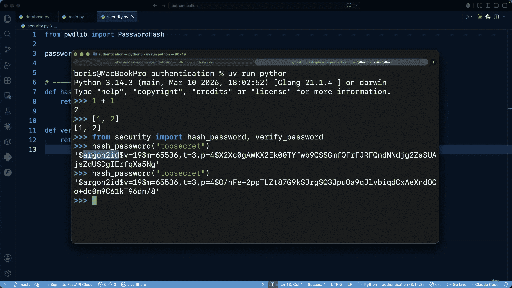
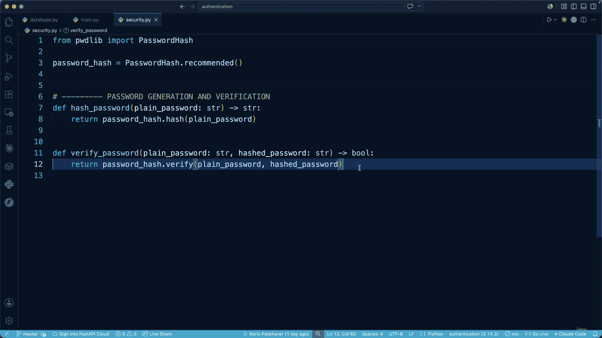
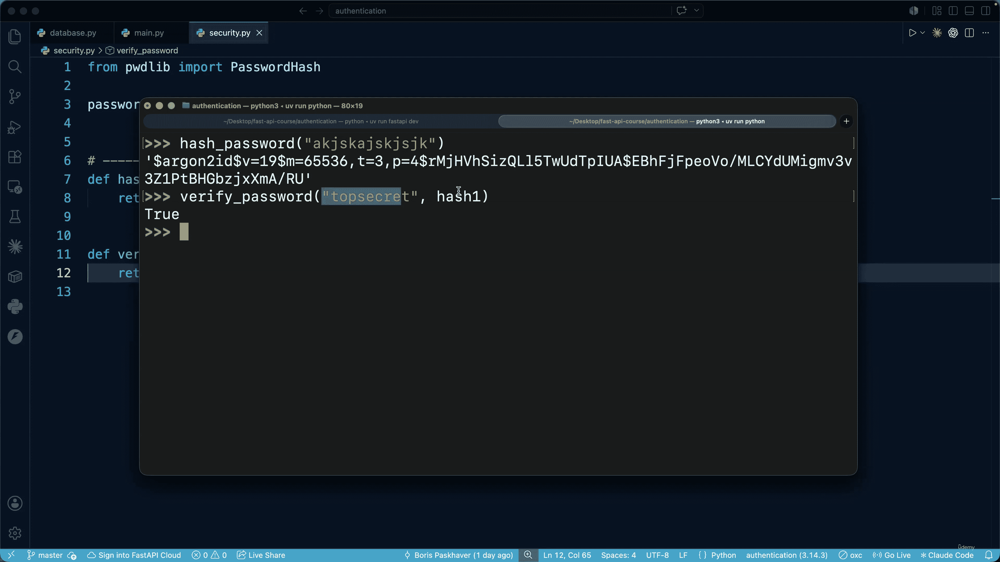

# 🔐 FastAPI Masterclass part2：133：密码哈希（二）

在本节课中，我们将继续学习密码哈希的第二部分。上一节我们已经写好了两个与密码哈希有关的函数，这一节不会急着创建模型或接口，而是先打开 Python 交互环境，把这两个函数真正跑一遍，看看它们返回什么、为什么这样设计，以及这些设计如何增加黑客猜密码的成本。我们会从 REPL 开始，观察 Argon2 哈希字符串的结构，再讨论服务器端限流、离线暴力破解的成本、`verify_password` 的工作流程，最后看 salt 如何让相同密码得到不同哈希。整节课的目标不是增加更多代码，而是把上一节写好的两个函数理解透，为后面的注册和登录接口打基础。

## 🧪 FastAPI Masterclass part2：133：进入Python REPL验证哈希函数

上一节我们写好了 `hash_password` 和 `verify_password` 两个函数，本节中我们来看看它们在真实 Python 环境里的表现。我们先进入 `authentication` 目录，然后运行 `uv run python`，这会启动 Python REPL，也就是“读取、求值、打印、循环”的交互环境。在这个环境里，我们可以直接执行合法的 Python 代码，不需要先写完整脚本，也不需要启动整个 FastAPI 项目，适合做小范围验证。

进入 REPL 后，我们先从 `security.py` 中导入这两个函数，代码如下。这样导入之后，就可以在当前交互环境里反复调用它们，观察输入和输出之间的关系。

```python
from security import hash_password, verify_password
```



导入完成后，我们直接调用 `hash_password`，传入一个普通文本密码，例如 `top secret`。函数会返回一段 Argon2 生成的哈希字符串，这段字符串就是后续要保存到数据库里的密码形式。这里要记住，数据库里不会保存 `top secret` 这个明文，而是保存这个哈希结果。

```python
hash_value = hash_password("top secret")
```

以下是本节会反复用到的两个核心函数，先列出来方便后续理解。这两个函数一个负责生成哈希，一个负责验证哈希，后面的注册和登录流程都会围绕它们展开。



- `hash_password`：接收明文密码，返回可以保存到数据库的哈希字符串。
- `verify_password`：接收明文密码和数据库里的哈希字符串，返回它们是否匹配。

## 🧩 FastAPI Masterclass part2：133：读懂Argon2哈希字符串

上一节我们实际调用了 `hash_password`，本节中我们来看看它返回的字符串到底包含什么信息。这个字符串看起来很长，也有很多符号，但它并不是随便拼接的乱码，而是把算法、版本、内存参数、salt 和最终哈希值都封装在了一起。也就是说，这个字符串是自包含的，后面验证密码时不需要我们另外告诉程序“请使用 Argon2”或“请使用某个版本”。

以下是哈希字符串中几个关键片段的含义，这些片段能帮助初学者理解为什么同一个函数可以自动完成验证。不同库的具体输出格式可能略有差异，但核心思路一致。

- 字符串开头会出现算法标识，例如 `argon2`，这个标识让库知道当前哈希使用的是 Argon2，而不是 bcrypt 等其他算法。
- `v=19` 中的 `v` 表示 version，也就是版本号，这里表示版本 19。随着 Argon2 继续发展，可能会出现不同版本或迭代。
- `m` 表示 memory，也就是内存参数，对应 64 MiB 内存。计算哈希时需要占用这部分内存。
- 字符串末尾是实际的哈希值，每次哈希时这部分可能变化，但开头表示算法和参数的片段会保持稳定。

也就是说，我们在代码里不需要手动指定具体算法，因为算法信息已经嵌入哈希字符串中。验证时，库会读取这个字符串里的算法、版本和参数，再用同样的方式处理用户输入的明文密码，最后进行比较。这个设计让哈希字符串本身携带了验证所需的信息，减少了调用方出错的概率。

## 🛡️ FastAPI Masterclass part2：133：服务器端限流与内存成本

上一节我们看到哈希字符串里有 `m` 参数，对应 64 MiB 内存，本节中我们来看看这个内存成本对服务器安全有什么意义。计算一次哈希并不是零成本操作，它需要占用计算机内存，也需要一点时间。单次看起来不算慢，但如果大量请求同时涌进来，每个请求都消耗 64 MiB 内存，服务器就可能变得很慢，甚至被压垮。

以下是服务器端可以采用的防御思路，这些做法不能改变哈希算法本身，但能减少黑客通过服务器反复尝试密码的机会。实际项目中，这些措施通常会和登录接口、注册接口一起考虑。

- 对登录和注册接口做限流，例如某个 IP 地址在每分钟内不能超过 5 次尝试，或者每小时不能超过 10 次尝试。
- 不同场景有不同限流比例建议，可以在线查找推荐值，再结合业务调整。
- 限流不一定全部由自己的服务器逻辑处理，云服务商如 AWS 或 Google Cloud 也可能提供相关能力。

从服务器端看，限流的意义很直接：黑客如果想通过我们的服务器猜密码，就必须反复请求登录接口，而限流会限制他们单位时间内的尝试次数。再加上每次哈希都要消耗 64 MiB 内存，大量并发尝试会变得昂贵且缓慢，严重时可能影响服务稳定性。因此，服务器端防御的目标之一，就是让攻击者不能轻易、快速地发起海量尝试。

## 🧮 FastAPI Masterclass part2：133：离线暴力破解的成本

上一节我们从服务器端讨论了限流，本节中我们反过来想：如果黑客不攻击我们的服务器，而是在自己的电脑上猜密码，会发生什么。假设用户表和密码哈希泄露了，黑客拿到了数据库里的哈希字符串。好消息是，他们不会直接知道原始密码是 `top secret`，因为数据库从来没有保存明文密码，只保存了哈希。

黑客拿到哈希后，可以在自己的电脑上不断尝试各种密码组合，希望某个组合哈希后正好等于泄露的哈希值。这里的关键是，每次尝试都需要计算一次哈希，而每次计算都需要 64 MiB 内存。尝试次数越多，内存消耗越大，最终黑客的电脑会耗尽内存，整个过程会变得非常慢、非常昂贵。

以下是理解暴力破解成本时可以用到的几个要点，这些要点能帮助初学者建立“为什么哈希能提高安全性”的直觉。这里的估算只是粗略说明，不是精确的攻击时间预测。

- `top secret` 一共有 9 个字符。
- 假设每个字符有 70 种选择，包括大小写字母、数字和符号。
- 那么候选组合数为 `70^9 ≈ 4.035 × 10^16`。
- 每次尝试大约消耗 `64 MiB` 内存。

公式可以写成下面这样，用来表达候选组合数量与内存成本的关系。这个公式说明，密码长度和字符种类会指数级增加可能性，而内存参数会增加每次猜测的成本。

```text
候选组合数 = 每字符可选字符数 ^ 密码长度 = 70^9 ≈ 4.035 × 10^16
每次尝试内存成本 ≈ 64 MiB
```

即使黑客按顺序尝试所有组合，每次尝试都要付出 64 MiB 内存成本，最终电脑会耗尽内存。黑客要么等待，要么增加更多电脑继续跑，这会显著提高攻击成本。更重要的是，从哈希字符串本身无法直接反推出原始密码，只能不断猜测，直到某个猜测哈希后正好得到相同的哈希值。也就是说，如果黑客只有数据库表和这些哈希字符串，想回到 `top secret` 这个明文，只能持续猜、持续试，直到碰巧得到与数据库中相同的哈希结果。

## ✅ FastAPI Masterclass part2：133：verify_password的工作流程

上一节说明了离线猜解为什么昂贵，本节中我们来看看第二个函数 `verify_password` 是如何工作的。我们先清空之前的输出和代码，然后定义变量 `hash1`，再次调用 `hash_password("top secret")`，得到一个哈希字符串。接着调用 `verify_password`，把原始明文密码和这个哈希传进去，观察返回值。

以下是 `verify_password` 在真实流程中的参数和返回含义，这些内容对应注册之后的登录验证环节。理解这个流程后，后面的登录接口就很容易实现。

- 第一个参数是用户提交的原始明文密码，例如 `top secret`。
- 第二个参数是数据库中保存的哈希密码，例如 `hash1`。
- 返回值是布尔值：匹配时返回 `True`，不匹配时返回 `False`。

公式可以写成 `verify_password(明文, 数据库哈希) -> True / False`。真实世界中，用户通过某个接口提交明文密码，接口拿到这个值，再从数据库里取出该用户对应的哈希，然后调用 `verify_password` 进行比较。如果明文密码哈希后与数据库哈希一致，就返回 `True`；任何其他字符组合都会得到不同的哈希，因此返回不匹配。

这里还要注意，密码验证对大小写和空格都很敏感。即使字符大体正确但大小写不同，或者多了一个空格，原始字符串就发生了变化，哈希结果也会完全不同，最终无法匹配数据库中的哈希。也正因为这样，用户输入的原始密码不会被保存，数据库只保存哈希，黑客必须猜出完全正确的字符序列，才有机会得到相同哈希。对于 9 个随机字符来说，可能性非常多，每个组合又会哈希成不同结果，所以猜中原始值的概率很低。

## 🧂 FastAPI Masterclass part2：133：salt让相同密码得到不同哈希

上一节我们看了验证函数，本节中我们来看看 Argon2 的另一个重要特性：salt。salt 可以理解为一点随机字符，Argon2 会把这些随机内容注入最终哈希中。即使原始明文完全相同，最终得到的哈希也会不同。这个特性对于多用户场景非常重要，因为现实中很可能有多个用户选择了同一个密码。

以下是 salt 带来的几个直接现象，这些现象能解释为什么相同密码在数据库中也会保存成不同字符串。我们仍然用 `top secret` 做例子，但两次调用 `hash_password` 会得到两个不同结果。

- 第一次调用得到 `hash1`，第二次调用得到 `hash2`，两个哈希字符串不同。
- 直接在 Python 里做字符串比较，可以看到 `hash1 != hash2`。
- 分别调用 `verify_password("top secret", hash1)` 和 `verify_password("top secret", hash2)`，两个都会返回 `True`。

也就是说，即使两个用户注册时都输入了 `top secret`，数据库中保存的哈希密码也会不同且唯一。对黑客来说，这带来了额外困难：假设黑客花了大量算力猜出某个用户的密码是 `top secret`，并得到了对应的哈希；另一个用户也使用了 `top secret`，但哈希完全不同，黑客不能复用之前的工作，只能从头开始重新猜。即使有 10 个或 100 个用户使用同一个密码，数据库中也会保存各自不同的哈希，而 `verify_password` 仍然能分别验证通过。

## 📌 FastAPI Masterclass part2：133：本节总结

前面我们从 REPL 开始，观察了哈希字符串，讨论了限流、暴力破解成本、验证流程和 salt 的作用，本节最后做一个总结。本节课的核心不是新增很多代码，而是理解上一节写好的两个函数，以及它们背后的安全设计。希望你现在能看出，密码哈希并不是简单地“把密码变成乱码”，而是在算法、内存成本、随机 salt 和验证流程共同作用下，显著提高攻击者猜密码的难度。

以下就是本节需要带走的关键点，这些点会在后续实现注册和登录接口时反复出现。记住这两个函数的分工，比记住哈希字符串长什么样更重要。

- `hash_password`：接收明文密码，返回实际要保存到数据库的哈希密码。
- `verify_password`：接收用户提交的明文密码和数据库中的哈希密码，匹配时返回 `True`。
- 哈希字符串中已经包含算法、版本、参数等信息，验证时不需要额外指定算法。
- 服务器端限流可以减少攻击者通过接口反复尝试的机会。
- 内存参数和 salt 会让离线猜解更昂贵，也会让相同密码得到不同哈希。



本节课中我们一起学习了密码哈希的第二部分：进入 Python REPL 验证函数、读懂 Argon2 哈希字符串、理解服务器端限流和离线暴力破解成本、掌握 `verify_password` 的用法，并看到 salt 如何让相同密码产生不同哈希。到这里，这两个函数的核心作用已经清楚了，下一节可以继续在这个基础上构建模型和接口。
