# 🧑‍💻 Udemy - FastAPI Masterclass part2：134：用户模型

在本节课中我们将要学习：在哈希函数完成之后，如何创建用户模型，并为后续“注册用户”和“登录用户”两个端点准备数据模型。课程会先创建顶层 `models` 包，再定义映射数据库表的 `User` 类，最后定义用于接收请求和返回响应的数据形状。整个流程围绕一个目标展开：让用户数据能够被安全地校验、保存，并在返回时不泄露密码。

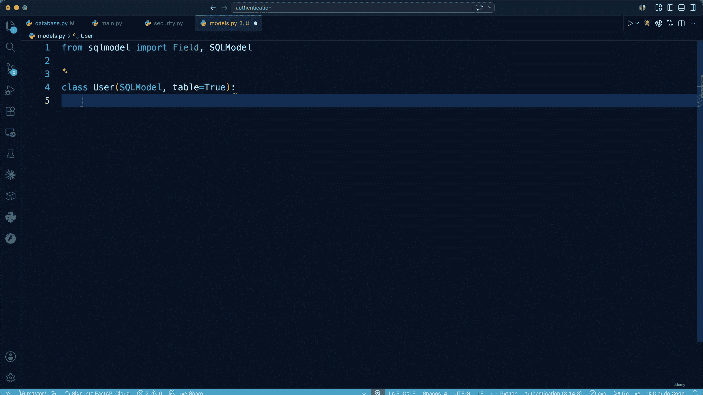

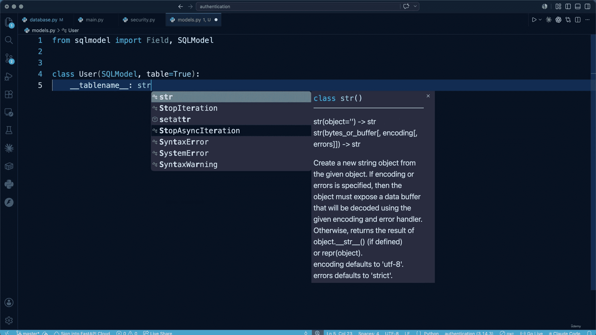

在进入模型代码之前，先把项目结构中最基础的一步做扎实。因为后面数据库要识别所有模型，所以需要先建立 `models` 包，并让 `database` 模块直接从 `models` 导入。这样模型注册和数据库创建的顺序才不会出问题。

## 📦 Udemy - FastAPI Masterclass part2：134.1：创建 models 包并注册模型

在项目顶层，我们先创建一个 `models` 包。这个包用来集中放置数据库模型。与此同时，在忘记之前，还要打开 `database` 模块，确保这里直接从 `models` 导入。这样做的目的只有一个：保证所有模型都在创建数据库之前完成注册。换句话说，数据库需要先“认识”这些模型，后面才能正常建表和读写。

在这个过程中，需要完成以下几个准备动作：

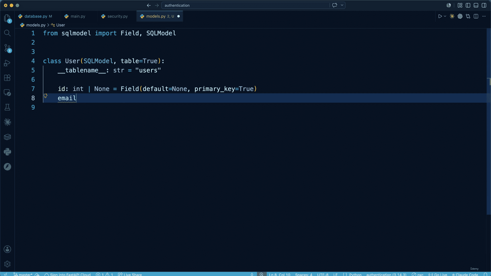

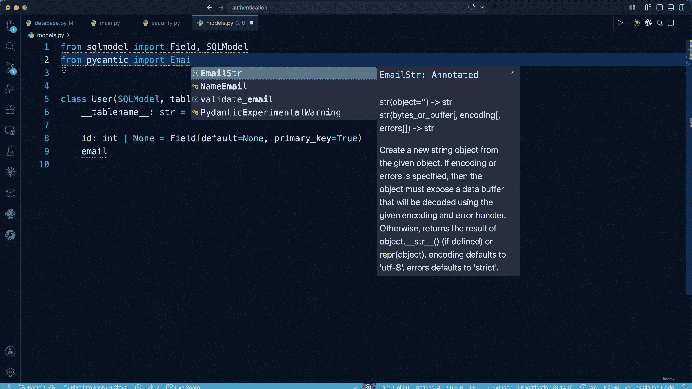

- 在顶层创建 `models` 包，作为模型文件的统一入口。
- 打开 `database` 模块，把模型导入方式调整为直接从 `models` 导入。
- 确认所有模型在创建数据库之前都已经注册完成，避免后面出现表不存在或模型未识别的问题。

这些准备工作完成后，就可以开始定义用户模型。接下来的内容会从 SQLModel 的导入开始，一步步把 `User` 表搭起来。

## 🧱 Udemy - FastAPI Masterclass part2：134.2：定义 User 数据库模型

定义用户模型时，需要从 SQLModel 导入 `Field` 类和 `SQLModel` 类。这个做法和之前使用过的模式完全一样。然后定义一个名为 `User` 的新类，让它继承 `SQLModel` 超类。这个类会直接映射到数据库表，所以需要设置 `table=True`。在类内部，还要添加双下划线形式的表名属性 `__tablename__`，类型可以标注为字符串，并把表名从 `user` 改成 `users`。

下面按字段拆开看 `User` 表的设计要点：

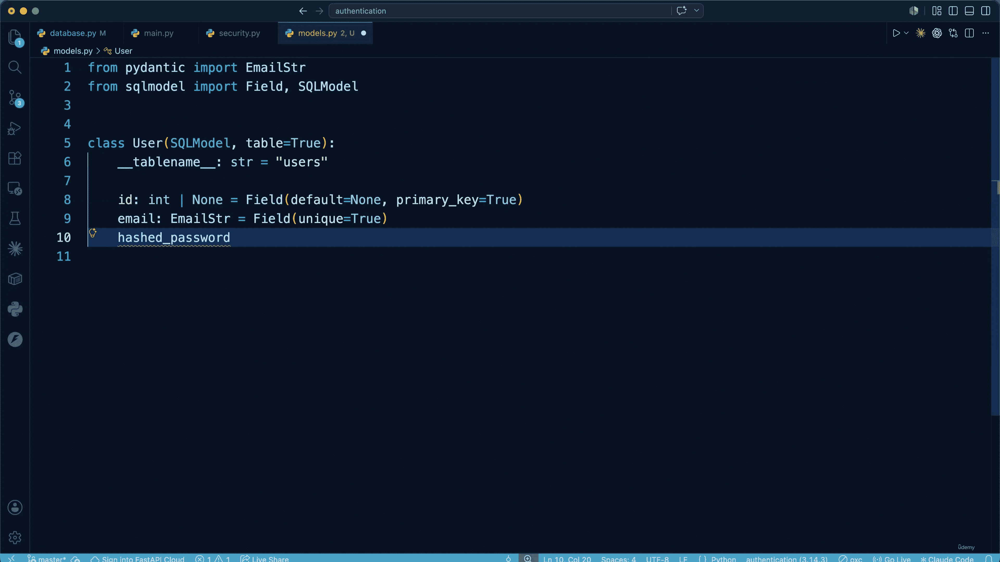

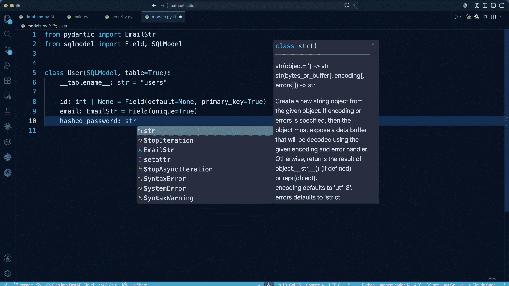

- `id`：每个用户都有一个 ID，类型可以是整数，也可以是 `None`。这里同样使用 `Field` 来实例化，默认值设为 `None`，并设置 `primary_key=True`。这个字段就是表的主键列。
- 凭据字段：这里可以在 `email` 和 `username` 中二选一，具体选哪个由你决定。本教程选择 `email`。这个字段的类型从 Pydantic 导入 `EmailStr`，它会增加额外校验，确保输入不只是普通字符串，而是符合邮箱格式的字符串，例如包含 `@` 等符号。
- `email` 的唯一约束：这个字段要使用 `unique=True` 参数，因为希望这一列中的每个邮箱都唯一，不允许两个用户用同一个邮箱注册。设置唯一约束后，如果尝试插入一条邮箱已存在的用户记录，数据库会拒绝。
- 路由层仍要先检查邮箱：以后编写路由处理函数时，仍然要优先检查邮箱是否存在。原因在于，直接给用户返回错误信息，比尝试保存一个数据库中已经存在的邮箱更合适。无论如何，`unique=True` 已经在数据库侧建立了校验。
- `hashed_password`：这是最重要的字段之一。字段名特意写成 `hashed_password`，用来明确提醒这里存放的永远不是明文密码，而是哈希后的密码。这个字段也可以叫 `hash`，名字完全由你决定。
- `role`：因为后面还会讨论用户角色，不同用户可能有不同角色或权限，所以现在先增加一个对应数据库列的字段 `role`，类型为字符串。当前系统中先设定两个角色：`user` 和 `admin`。暂时不处理管理员相关逻辑，但可以先给这个字段一个默认值 `user`。这样每次保存新用户记录时，`role` 列默认填入 `user`，而不是 `admin`。

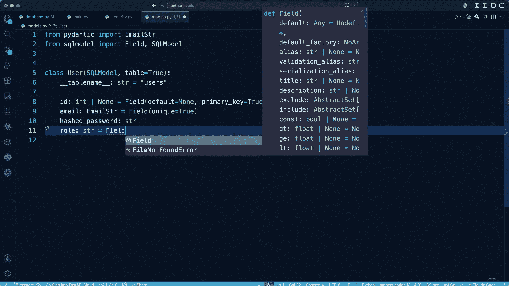

把这些字段落到代码里，大概就是下面的结构：

```python
from sqlmodel import SQLModel, Field
from pydantic import EmailStr


class User(SQLModel, table=True):
    __tablename__ = "users"

    id: int | None = Field(default=None, primary_key=True)
    email: EmailStr = Field(unique=True)
    hashed_password: str
    role: str = Field(default="user")
```

到这里，`User` 就是与数据库交互的核心模型。数据库表结构定下来以后，下一步需要定义请求和响应的数据形状。因为服务器不能直接把数据库模型原样暴露出去，也不能让用户随便提交字段，所以需要独立的数据模型来做校验和过滤。

## 🧩 Udemy - FastAPI Masterclass part2：134.3：定义请求与响应数据模型

接下来要定义几个 Pydantic 模型，用来表示进入服务器的数据形状，以及从服务器返回给客户端的数据形状。最终会有一个注册端点，用户需要提供邮箱和明文密码，因此先定义这个请求形状。这里定义一个类似 `UserCreate` 的类，让它继承 `SQLModel`，但它是一个普通的、基于 Pydantic 的模型，不与数据库建立连接。这个模型期望一个 `email` 字段，类型为 `EmailStr`，还期望一个 `password` 字段，也就是明文密码。这里的字段名特意和 `hashed_password` 区分开，目的是提醒我们：用户注册时提交的是明文密码，而不是哈希值。

这一节会定义三个独立的数据形状，它们之间没有子类关系，各自负责不同的场景。具体情况如下：

- `UserCreate`：用于注册请求，包含邮箱和明文密码。
- `UserUpdate`：用于更新请求，当前只包含可选的邮箱字段，为后面扩展密码更新留出位置。
- `UserResponse`：用于返回用户数据，只包含可以安全返回的字段，绝不包含密码或密码哈希。

`UserCreate` 的密码字段可以使用 `Field` 声明要求，例如设置最小长度。这里可以写成 `password: str = Field(min_length=8, max_length=16)`。密码长度要求可以写成下面这个范围：

```text
8 ≤ len(password) ≤ 16
```

这样做的原因是安全。通常明文密码越长，Argon2 能生成的哈希结果变化就越多，黑客需要猜测的字符数量也越多，破解难度会更高。举例来说，如果最小长度只有 2，反复猜测会容易得多；如果最小长度是 20，猜中的难度会高很多。这里选择一个合理范围：最小长度 8，最大长度 16。使用 Pydantic 还可以继续增加校验，例如必须包含大写字母、必须包含数字。当前先不处理这些额外要求，但在真实项目中，安全方案可以按需要做得更严格。如果希望增加密码的可能性，可以要求用户同时使用字母、数字和符号，这样每个字符的可能性更多，破解会更困难。这里先保留基础示例。

在 `UserCreate` 之后，再加两个类来处理更新和响应场景。`UserUpdate` 也继承 `SQLModel`，目前各个模型都是独立的，没有子类关系。这个类用于用户更新邮箱，后面甚至可能用于更新密码。更新请求的负载当前只包含一个 `email` 属性，类型为 `EmailStr | None`。这里要把所有字段都设为可选，因为后面可能一个用户有五个属性，用户可以只改其中一个，也可以全部修改。流进 PATCH 端点的每个属性都应当是可选的，所以没有提供值时使用默认值 `None` 作为回退。

`UserResponse` 是最后一种形状，也就是经典的用户响应模型，用来表示返回给用户的数据形状。这里非常明确：永远不要把密码返回给用户。更进一步，普通密码和哈希都不应该返回，因为没有意义，还会带来安全风险。以后从端点返回任何用户记录时，都使用这个响应模型，并限制所有允许返回的属性，确保密码不会泄露出去。这个模型可以包含用户 ID，这很合理；包含邮箱，类型为字符串，这里不需要邮箱格式校验，因为这是从数据库取出、再返回给客户端的数据；最后可以附上角色字段。

三个模型可以写成类似下面的代码：

```python
from pydantic import EmailStr
from sqlmodel import SQLModel, Field


class UserCreate(SQLModel):
    email: EmailStr
    password: str = Field(min_length=8, max_length=16)


class UserUpdate(SQLModel):
    email: EmailStr | None = None


class UserResponse(SQLModel):
    id: int
    email: str
    role: str
```

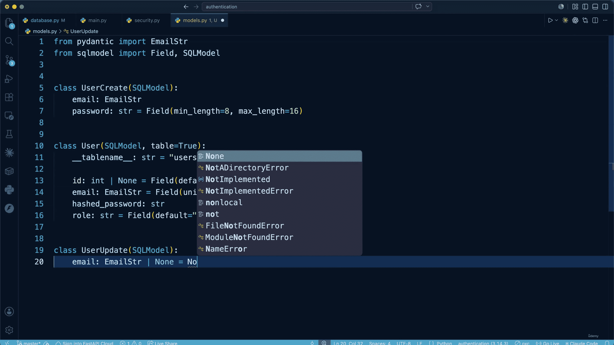

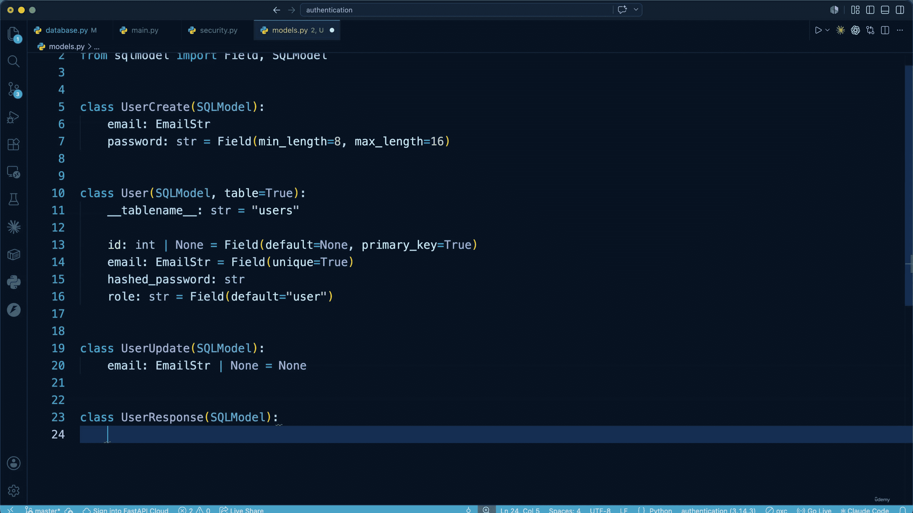

到这里，模型侧的内容已经完整。数据库模型负责表结构和持久化，请求模型负责校验输入，响应模型负责安全地返回数据。模型准备好之后，下一节课就可以继续构建端点，把注册和登录流程接起来。

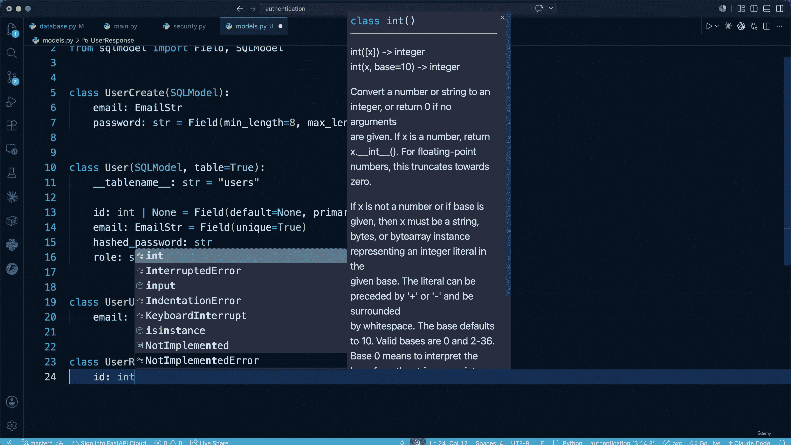

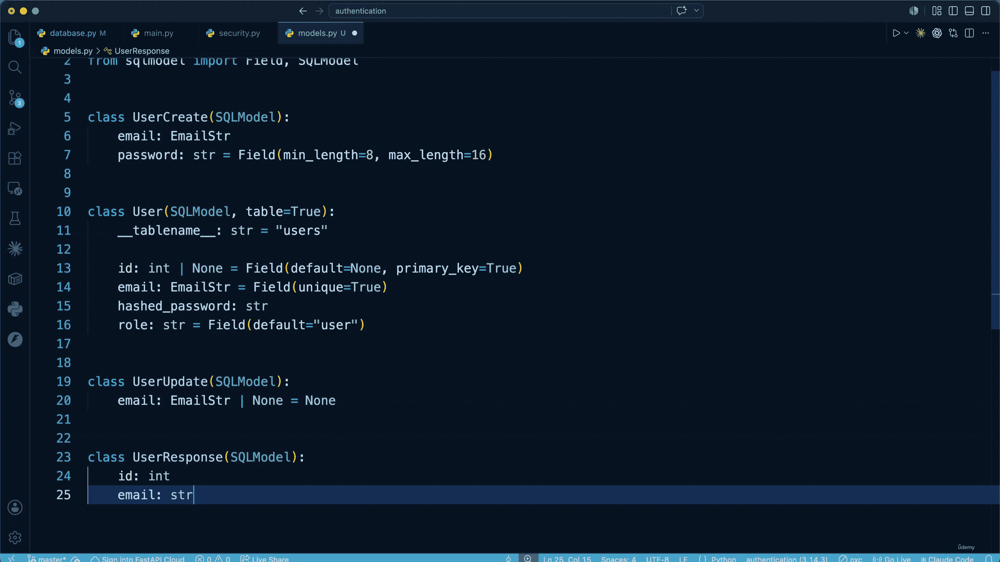

## ✅ Udemy - FastAPI Masterclass part2：134.4：本节总结

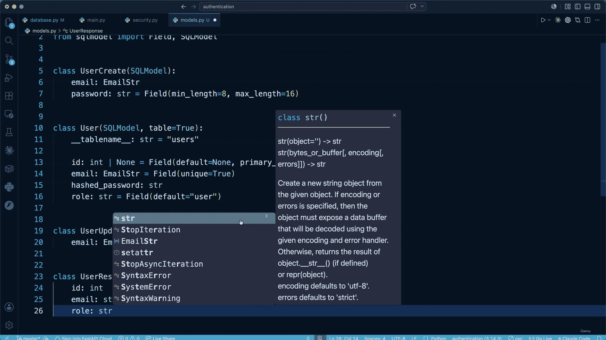

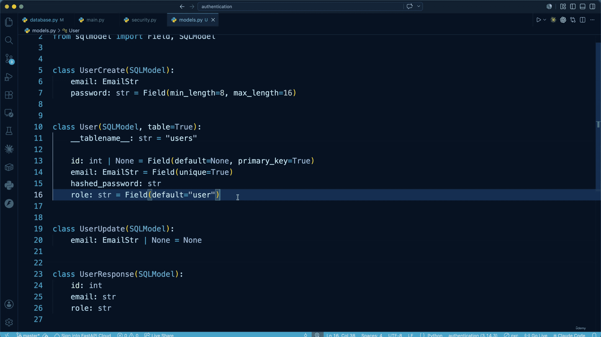

本节课中我们一起学习了用户模型相关的一套基础设计。我们先创建顶层 `models` 包，并让 `database` 模块直接从 `models` 导入，确保所有模型在创建数据库之前完成注册。接着定义了 `User` 数据库模型，设置表名为 `users`，主键 `id`，唯一邮箱 `email`，保存哈希值的 `hashed_password`，以及默认值为 `user` 的 `role` 字段。随后定义了 `UserCreate`、`UserUpdate` 和 `UserResponse` 三个独立数据形状，分别处理注册输入、更新输入和安全响应输出。模型侧完成后，下一节就可以进入端点构建，把这些模型真正用到注册和登录流程中。

