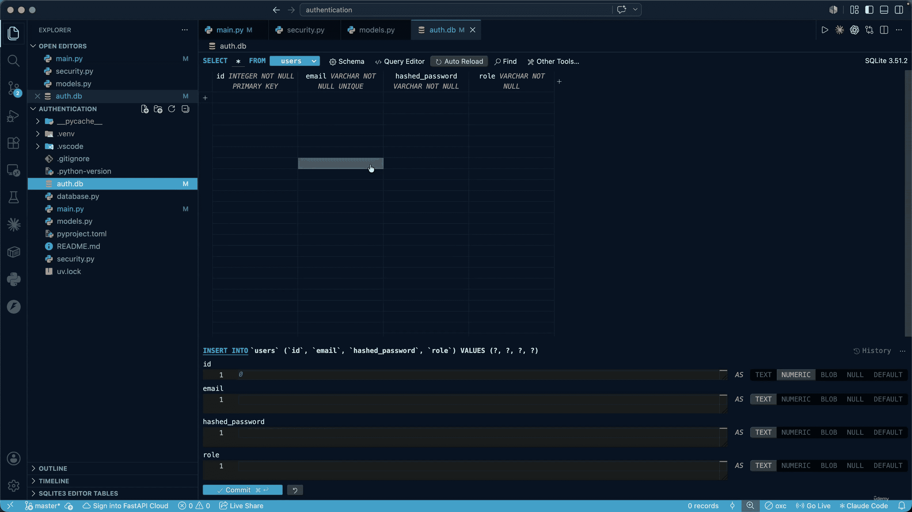
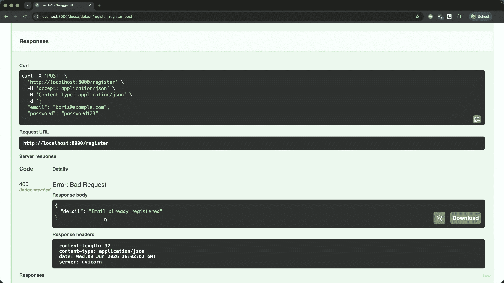
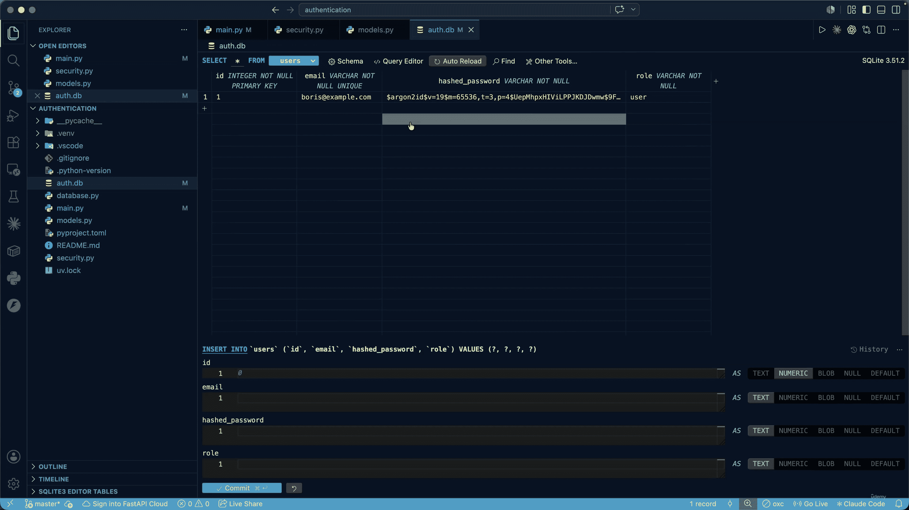

# 🚀 FastAPI Masterclass part2：p34 / 135：用户注册

在本节课中，我们将学习如何构建用户注册端点。这个端点会接收用户提交的邮箱和明文密码，对密码进行哈希处理，然后把用户记录保存到数据库。整节课会围绕“定义接口、校验请求、检查重复邮箱、哈希密码、保存数据库、测试接口”这条主线展开。下面我们先从清理旧路由和定义注册接口开始。

## 🎯 FastAPI Masterclass part2：p34 / 135：清理路由并定义注册接口

上一节我们已经完成了模型相关的调整，本节中我们来看看用户注册接口。当前 `main.py` 里只有一条指向根路由的接口，这条根路由不再需要，因此可以先删除它。接下来定义一个新的端点，使用 POST 请求，因为 POST 用于在服务器上创建新资源。

这个端点可以叫 `/users`，但这里选择 `/register`，因为从逻辑上看更符合“注册或创建新用户”的含义。如果创建成功，返回状态码 201，表示记录已经创建。这里从 `fastapi` 导入 `status` 模块，并使用 `201`，也就是 `201 Created`。响应模型使用面向外部返回的 `UserResponse` 模式，需要从 `models` 导入 `UserResponse`。后续还要与数据库交互保存用户，也需要导入用户载荷的模式，因此同时导入 `User` 和 `UserCreate`。

以下是本节涉及的主要导入与接口骨架，先从整体看一遍：


- 从 `fastapi` 导入 `status`、`HTTPException`，用于设置状态码和抛出错误。
- 从 `models` 导入 `UserResponse`、`User`、`UserCreate`。
- 从 `database` 导入 `SessionDep`，用于数据库会话。
- 从 `security` 导入 `hash_password`，用于密码哈希。
- 从 `sqlmodel` 导入 `select`，用于查询数据库。


接口骨架大致如下：


```python
@app.post(
    "/register",
    response_model=UserResponse,
    status_code=status.HTTP_201_CREATED,
)
def register(user_data: UserCreate, session: SessionDep):
    ...
```


这里先解释这段骨架的作用。`response_model=UserResponse` 表示返回给客户端的数据形状由 `UserResponse` 控制；`status_code=201` 表示资源创建成功；`user_data: UserCreate` 表示请求载荷包含邮箱和明文密码；`session: SessionDep` 表示数据库会话依赖，用来查询和保存数据。这样接口的输入、输出和数据库访问入口就都定义好了。

## 🧩 FastAPI Masterclass part2：p34 / 135：请求参数与 Pydantic 校验

定义 `register` 函数时，需要数据库会话参数，并把它标注为 `SessionDep` 类型，这样才能与数据库交互。还需要用户提交的载荷，可以命名为 `user_data`，类型是 `UserCreate`。`UserCreate` 是一个基础的 Pydantic BaseModel，包含 `email` 和 `password` 两个字段。

如果其中任何一个验证不满足，端点会在进入函数体之前自动抛出错误。也就是说，Pydantic 会先验证表示密码的字符串是否满足全部要求，然后再执行注册逻辑。核心概念可以用下面的代码表示：


```python
def register(
    user_data: UserCreate,
    session: SessionDep,
) -> UserResponse:
    ...
```


这段代码直白地说，就是“接口先接收一个符合 `UserCreate` 形状的请求体，再接收一个数据库会话对象”。只有请求体通过 Pydantic 校验后，函数体里的注册流程才会继续执行。

## 🔎 FastAPI Masterclass part2：p34 / 135：检查邮箱是否已经注册

请求体校验通过后，本节中我们来看看邮箱查重。进入创建用户之前，先验证用户提供的邮箱在数据库中不存在。技术上，邮箱列上有唯一约束，如果真的尝试保存重复邮箱，数据库会阻止操作并返回失败。但这里不想走到那一步，因为那仍然会向数据库发出一个逻辑上不应该发出的请求。因此第一步是查询现有用户表，看是否存在邮箱与 `user_data.email` 匹配的记录；如果存在，就立即返回错误响应。

查询会返回一个结果对象。可以用 `all()` 取出全部记录，但这里不关心全部记录，而且同一个邮箱理论上不应该超过一条记录。我们需要一种方式，从结果对象中得到具体的用户对象；如果邮箱不存在，则得到空值。因此使用 `first()` 方法，它会尝试取查询结果中的第一条用户对象。以下是查重的核心代码：


```python
existing_user = session.exec(
    select(User).where(User.email == user_data.email)
).first()

if existing_user:
    raise HTTPException(
        status_code=400,
        detail="Email already registered",
    )
```


这里的 `select` 从 `sqlmodel` 导入，`session.exec(...)` 执行查询，`where` 条件比较 `User.email` 和请求载荷中的邮箱。`first()` 的行为很适合这里：如果表里有一条或多条邮箱相同的用户记录，它会返回一个用户对象，说明邮箱重复；如果结果集为空，它不会报错，而是返回 Python 的 `None`。因此无论有没有匹配记录，`first()` 都不会失败。若 `existing_user` 存在，说明用户表中至少有一条邮箱等于请求邮箱的记录，此时不应该创建新用户，而是抛出 `HTTPException`。状态码选择 `400 Bad Request`，错误详情写为 `Email already registered`。关于这个状态码有一些争论，这里采用 400。

## 🔐 FastAPI Masterclass part2：p34 / 135：创建用户并保存哈希密码

确认请求载荷中的邮箱唯一后，就可以在数据库中创建用户。当前手里是 `UserCreate` 对象，需要转换成 `User` 对象，因为真正与数据库交互的是 `User` 模型。定义 `new_user` 时，可以直接实例化 `User` 对象。这个对象是普通 Python 对象，代表最终要写入数据库的记录，需要两个属性：`email` 和 `hashed_password`。

`email` 直接使用 `user_data.email`。密码这里非常关键：不能直接使用 `user_data.password`，因为那样会把明文密码保存到数据库。需要先对密码做哈希，得到哈希后的字符串。前面已经写了辅助函数 `hash_password`，它接收明文密码并返回哈希值，因此把 `user_data.password` 包在 `hash_password` 里。以下是入库的核心代码：


```python
new_user = User(
    email=user_data.email,
    hashed_password=hash_password(user_data.password),
)

session.add(new_user)
session.commit()
session.refresh(new_user)

return new_user
```


保存协议和之前一样：`session.add(new_user)` 把新用户加入会话，暂存变更；`session.commit()` 把变更提交到数据库；`session.refresh(new_user)` 刷新对象，以拿到数据库生成的 ID 等字段；最后返回 `new_user`。这里不需要担心 `password` 或 `hashed_password` 被返回，因为响应模型会过滤字段，只发送 `id`、`email` 和 `role` 这三个属性。可以用一个简单公式表示返回内容：


```text
响应 = {id, email, role}
```


这样接口逻辑就完整了：接收载荷、校验、查重、哈希密码、保存、刷新、返回安全字段。

## 🧪 FastAPI Masterclass part2：p34 / 135：同步数据库并测试注册接口

进入浏览器测试之前，还有一件事要做。上一课在 `models` 文件里加入了新属性，因此需要确保数据库与模型同步。第一步删除旧的 `off.db`，然后重启服务器，让服务器启动时创建一个新数据库。新数据库应该包含正确的表和字段，例如 `email` 和 `hashed_password`，这样用户注册才能按预期工作。

以下是测试步骤，按顺序操作即可：




- 打开 `http://localhost:8000/docs`。
- 找到 `register` 端点，点击 `Try it out`。
- 填写示例邮箱，例如 `boris@example.com`。邮箱必须通过 Pydantic 的邮箱字符串校验，必须是带 `@` 等格式的真实邮箱形式。
- 填写密码，例如 `password123`。密码有最少 8 个字符的要求。
- 执行请求。


执行后可以看到 POST 请求发往 `register` 端点，返回 201。响应体包含 `id`，这是系统中的第一个用户；还包含 `email`，以及预先分配的 `role` 为 `user`。关键点是响应中不包含密码。再次用相同邮箱发出完全相同的请求时，应该进入前面的查重 `if` 语句；数据库查询会找到已存在的用户，因此返回 400 Bad Request，错误信息为 `Email already registered`。这样就能阻止重复邮箱和重复用户被保存。

最后回到 VS Code 检查 `users` 表和 `off.db`，可以看到用户记录，并且保存的是 `hash_password` 生成的 Argon 哈希密码，而不是明文密码。注册功能到这里就正常了，接下来可以继续实现用户登录。



## 📝 FastAPI Masterclass part2：p34 / 135：本节总结



本节课中我们一起学习了用户注册的完整流程：删除根路由、定义 POST `/register`、用 `UserCreate` 校验邮箱和密码、先查询数据库防止重复邮箱、重复时抛出 400、用 `hash_password` 哈希密码、用 `session.add`、`commit`、`refresh` 保存用户、用 `UserResponse` 过滤返回字段、删除旧数据库并重启以同步模型，最后在 `/docs` 中测试 201 成功响应和重复邮箱的 400 响应。注册完成后，下一步就可以进入用户登录功能的实现。

