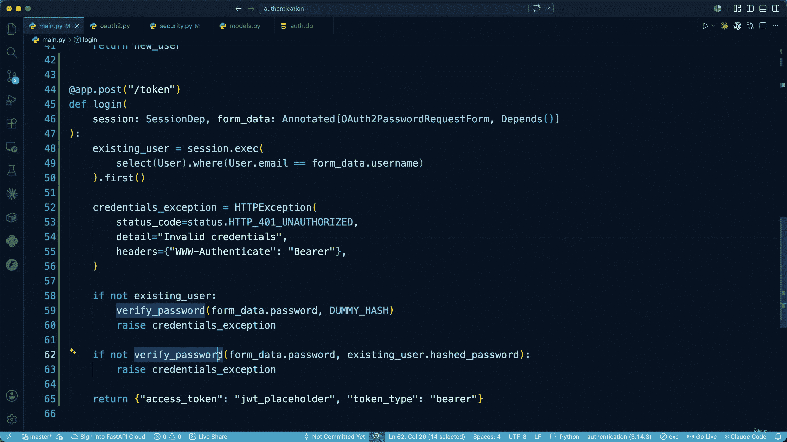
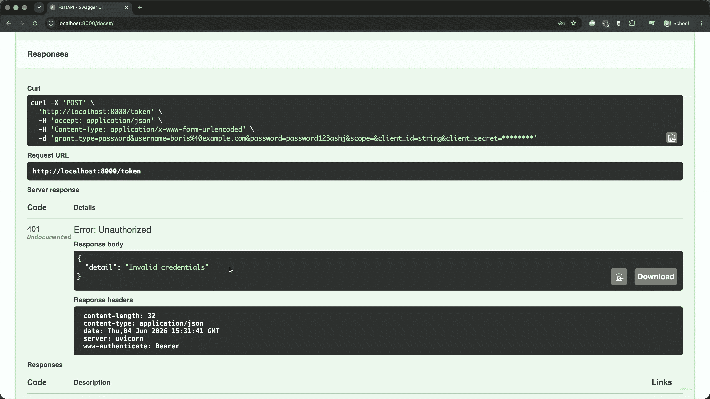

# 🚀 FastAPI 大师课：136：登录端点

在本节课中我们将要学习如何构建登录端点。上一节用户已经可以创建账户，本节要做的下一个端点就是登录端点：它接收用户凭据，也就是邮箱和明文密码，对它们进行验证，然后返回一个 JWT token，表示用户已经通过认证。JWT token 的具体生成会放到后面几节课处理；本节先用一个占位 token 把基本登录流程跑通，这个占位 token 就是一个随便写的字典。

> 提示：本节的核心目标不是完整实现 JWT，而是先理解登录端点的请求流程、OAuth2 表单约定、用户校验、密码校验和响应结构。

上一节我们介绍了注册端点，本节中我们来看看登录端点为什么要遵循 OAuth2 标准。这里用到的类和工具来自 OAuth2，它是行业里的授权标准。标准本质上就是协议，或者换一种说法，是一组人们为了保持一致而遵循的约定。OAuth2 标准定义了 token 应该如何请求、如何签发、如何使用，甚至为 JWT 中会出现的键或字段提供了占位符。标准不是技术上的硬性要求，不是说代码不遵循它就一定会坏掉；它只是一组规则，你可以选择实现多少，实现得越多就越接近这个标准。FastAPI 遵循 OAuth2 标准，因此我们如果也遵循它，就能获得一些开箱即用的额外工具。

例如，OAuth2 标准的一个约定是：负责让用户登录的端点，路由应该是 `/token`。技术上我们可以随便选路由，但如果想遵循标准，就应该使用 `/token`，这也正是本节要开始构建的内容。可以用一个简单的公式表示：

```text
登录端点路由 = /token
```

既然标准要求登录端点和表单字段，本节中我们来看看需要导入哪些工具。在 `main.py` 中滚动到顶部，再添加一个导入，它来自 FastAPI 的 `security` 嵌套模块。这个类叫 `OAuth2PasswordRequestForm`，因为 OAuth2 标准有几个版本，这里使用的是 OAuth2 密码请求表单。

```python
from typing import Annotated

from fastapi import Depends
from fastapi.security import OAuth2PasswordRequestForm
```

标准的工作方式是：它期望客户端、浏览器或网页渲染一个表单，并进行传统提交，也就是向服务器发送一个包含表单数据的基本请求。这个表单必须包含两个字段：用户凭据，以及密码。`OAuth2PasswordRequestForm` 是 FastAPI 提供的一个类，它会假定进入某个端点的数据形状里包含这两个字段：一个用于用户名或邮箱的凭据字段，一个用于明文密码的字段，并且它会自动从传入请求的表单中解析这两项数据。

之前我们没有处理过表单，也没有处理过任何客户端渲染，因为一直处理的基本都是进入服务器和从服务器返回的 JSON 数据。也就是说，我们并没有渲染一个带表单的 HTML 页面；但只要使用这个类，Swagger 实际上就能自动为我们渲染这个配套表单。这就是 FastAPI 和 OAuth 深度集成的一个例子：只要我们选择加入，就能开箱获得这些好用的功能。导入完成之后，下面我们来定义新的端点。

上一节我们准备好了表单类和依赖工具，本节中我们来看看如何定义 `/token` 登录端点。定义一个端点，路由叫 `/token`，这是为了遵循标准。函数名可以叫 `login`。关于状态码，虽然这是 POST 请求，而 POST 通常表示在服务器上创建某些东西，我个人也喜欢把登录理解成创建一次登录或登录会话；但这里并不会真的往数据库保存任何东西。需要提醒的是，基于 JWT 或基于 token 的认证是无状态的，所以不会涉及把任何内容保存到数据库。它仍然在心理上像一个 POST，因为它创建了某种之前不存在的对象或实体。

OAuth 标准实际上推荐使用 200 状态码，而不是 201，而 FastAPI 默认响应码也是 200，所以保持默认即可。如果想显式写出 `status_code=200` 也完全可以。登录时我们需要两个依赖：第一个是数据库连接，所以提供 `session`，类型写成 `SessionDep`；第二个是前端表单提交的数据，用户会在表单里提供凭据。这个参数叫 `form_data`，类型用 `Annotated` 包装 `OAuth2PasswordRequestForm`，并使用 `Depends()`。

```python
@app.post("/token", status_code=200)
def login(
    session: SessionDep,
    form_data: Annotated[OAuth2PasswordRequestForm, Depends()],
):
    ...
```

`Annotated` 方括号里的第一个值是 FastAPI 用来推断表单数据的核心类型，也就是 `OAuth2PasswordRequestForm`。后面的 `Depends()` 表示依赖注入。`Depends` 可以接收函数或类，准确说它可以接收任何能用括号调用并取得返回值或结果的可调用对象。`OAuth2PasswordRequestForm` 技术上是一个类，所以这里的意思是：在 `login` 路由处理函数运行之前，请先实例化这个类，并把实例作为 `form_data` 的类型和值。

如果省略 `Depends` 的参数，像上面这样直接写 `Depends()`，FastAPI 会推断你传入的类型或类就是它需要调用的依赖类。这算是刚才那种显式写法的快捷方式。显式写法更啰嗦，但完全没问题；快捷写法表达的是：运行某个函数或实例化某个类，返回值就是同一个类的实例，不需要在类型和 `Depends` 参数里写两遍。

`form_data` 对象是 `OAuth2PasswordRequestForm` 类型，它有一些顶层属性，是表单提交时应该封装或收集的信息。可以看到它期望有 `password` 属性，也就是用户在表单里填写的密码；还有一个 `scopes` 属性，涉及用户权限，后面会再回来讲；最后是 `username` 属性。这里有一点容易混淆：OAuth2 规范要求表单里有一个字段来标识实际用户，并且因为它是标准，是一组约定，所以要求这个字段叫 `username`。但这不意味着这个字段必须是字面上的用户名，也不意味着它必须是用户或凭据的主标识。

在我们的系统里，按照领域建模，用户表并不存储 `username` 列，而是存储 `email` 列，作为每个用户的唯一标识。我们甚至在这一列上加了唯一约束，所以不能重复。我们在这里访问 `username`，是因为这是 OAuth 标准，也是 FastAPI 的 `OAuth2PasswordRequestForm` 按照标准实现出来的字段。但要记住，虽然访问的是 `username`，它实际代表的是用户的唯一凭据，也就是邮箱。这里命名差异会让人有点困惑：一方面要遵循标准，另一方面要适配我们自己的系统设计，我们没有用用户名，而是用了邮箱。

可以用下面的对应关系理解：

```text
form_data.username  ⇒  实际业务中的 email
form_data.password  ⇒  用户提交的明文密码
```

拿到表单数据之后，本节中我们来看看登录流程的第一步：检查用户是否存在。用户登录时，第一件事是验证用户确实存在于系统中，然后再去处理明文密码哈希后与数据库记录比较的复杂逻辑。先要确保实际用户存在。这里写的代码会和注册端点中检查邮箱是否存在的代码非常相似：注册时如果邮箱存在就抛错；现在要做相反的事情，如果用户提供的邮箱，也就是技术字段 `username`，在系统中不存在，就抛错，因为它不可能是有效用户。

```python
existing_user = session.exec(
    select(User).where(User.email == form_data.username)
).first()
```

这里定义 `existing_user` 变量，使用 `session` 调用方法，传入 `select(User)` 查询用户表，再用 `where` 子句访问 `User.email` 属性，并把它与 `form_data.username` 比较。字段叫 `username` 是为了适配 OAuth2 规范，但我们预期它实际是邮箱。查询会返回结果对象，所以调用 `.first()`。此时 `existing_user` 要么是匹配到的有效用户对象，要么是 `None`，表示系统中没有这个邮箱对应的用户。

接下来如果 `not existing_user`，也就是 `existing_user` 为 `None`，说明这是无效条目。如果数据库中没有这个用户，就抛出异常。我会在这个代码块上方定义一个异常变量，因为后面打算复用它。这个变量叫 `credentials_exception`，是一个错误类实例。右侧创建 `HTTPException` 实例，状态码用 401，未授权时的标准状态码就是 401。用户未授权，不能登录，也没有权限执行这个操作，因为他们提供的邮箱不存在。`detail` 提供错误消息，比如 `invalid credentials`。

```python
credentials_exception = HTTPException(
    status_code=status.HTTP_401_UNAUTHORIZED,
    detail="invalid credentials",
    headers={"WWW-Authenticate": "Bearer"},
)

if not existing_user:
    raise credentials_exception
```

这里有一个在网络上经常讨论的问题：很多开发者主张，不应该过于具体地说明到底哪里出错了，这样做主要是为了对抗黑客。例如，要让黑客一直猜：是邮箱错了，是密码错了，还是用户根本不存在？你给潜在黑客的信息越多，他们越能推断下一步。比如他们知道邮箱有效但密码无效，至少找到了一个有效邮箱，就可以继续尝试不同密码；但如果错误消息像 `invalid credentials` 这样通用而模糊，黑客就不知道是邮箱问题、密码问题还是两者都有，这能起到威慑作用。代价是正常用户可能不知道自己哪里做错了，也许邮箱填错，也许密码填错；但这里愿意接受这个权衡，让黑客更难一些。

最后再加一个参数 `headers`。headers 是键值对，可以从客户端发送到服务器，也可以从服务器发送到客户端；这里指定的是从服务器响应发往客户端的头。如果我们遵循使用 bearer token 的认证方案，bearer token 基本上就是作为用户认证证明的字符串。按照 OAuth 和更广泛的 HTTP 标准，约定是提供 `WWW-Authenticate` 头，值为 `bearer`。这传达的是认证类型：我们使用的是涉及 bearer token 的认证方案。`bearer` 这个词有意思的地方是它表示携带，用户被期望携带一个 token 才能访问系统，所以叫 bearer token，用户必须承担携带它的责任。这个头实际上是服务器告诉客户端：你应该遵守的认证方案是 bearer token。不同认证协议下，这个值也会不同。

如果数据库中没有找到指定邮箱的用户，就抛出 `credentials_exception`，这是第一步。上一节我们完成了用户存在性检查，本节中我们来看看第二步：验证密码。如果能走到这里，说明已经有一个有效用户和有效邮箱。下一步是验证密码。为了完成这一步，需要依赖 `verify_password` 函数，因为它负责处理复杂度：把 `form_data` 中的明文密码与数据库中保存的哈希密码进行比较。需要从 `security.py` 导入这个函数。提醒一下函数签名：它期望传入用户提供的明文密码，以及从数据库刚取出的用户对象上的哈希密码。

```python
from security import verify_password

if not verify_password(form_data.password, existing_user.hashed_password):
    raise credentials_exception
```

调用 `verify_password` 时，第一个参数是明文密码，所以传 `form_data.password`；按照 OAuth2 标准，用户会在客户端网页或浏览器表单中填写密码字段。第二个参数是哈希密码，传 `existing_user.hashed_password`，这样 `pwdlib` 库就能比较两者。这个函数如果密码有效会返回 `True`，用户就应被视为已认证；如果返回 `False`，凭据无效，就返回和前面完全相同的错误。这里用 `if not`，意思是如果 `verify_password` 返回 `False`，`not` 会把它反转成 `True`，这个代码块就会执行。无论用户给的是无效邮箱，还是有效邮箱但无效密码，也就是哈希算法说这个明文密码和数据库里的哈希不匹配，不管哪里出错，都抛出同一个 `invalid credentials` 异常。

可以用一个公式概括登录成功的条件：

```text
登录成功 ⇔ 用户存在 ∧ verify_password(明文密码, hashed_password) = True
```

上一节我们验证了密码，本节中我们来看看认证成功后应该返回什么。如果能走到函数这一部分，说明用户已经在技术上通过认证，提供了正确的邮箱和密码。这里就想要返回一个有效的 JWT。不过暂时不处理那部分复杂度，先返回一个对象，让它扮演 JWT 的替身或占位符。OAuth2 标准的一个约定是：响应里要有一个顶层 `access_token` 键，用来存放真正的 JWT。现在没有 JWT，可以先假装有，所以先提供一个任意值 `jwt-placeholder`，提醒以后这里要填入 JWT token。

另一个由 OAuth2 标准指定的顶层键是 `token_type`。它和前面的响应头很像，用来指定 token 类型或认证方案类型，这里叫 bearer token。JWT 就是 bearer token 的一个例子，它是一种认证方案：用户或客户端携带 token，换一种说法，他们承担证明自己已认证的责任，方式是在后续每个客户端请求中把 token 发回服务器。这个 JWT token 现在还没有，但几节课后会有；客户端应该在所有未来请求中持续发回它，以便在每个独立、无状态的请求中向服务器证明自己已登录。

```python
return {
    "access_token": "jwt-placeholder",
    "token_type": "bearer",
}
```

在浏览器中测试代码之前，本节中我们来看看一个安全优化：防止时序攻击。当前代码里隐藏着一个微妙问题。想象你是黑客，想攻击系统。真正消耗计算能力的是 `verify_password` 里的哈希操作。假设黑客发起一万次请求，并观察到有些请求耗时更长，为什么会这样？如果黑客提供的邮箱在系统中根本不存在，代码会在真正执行哈希计算之前报错，所以这个分支的平均响应会更快；而如果执行昂贵的哈希计算，可能要多花几毫秒甚至十毫秒，然后才返回。黑客发起一万次请求，就能快速看出某批请求是不是比另一批快很多。

如果一批请求返回很快，黑客可以推测邮箱在系统中不存在；另一批请求返回更慢，因为服务器平均执行时间更长，黑客可以推测这些请求提供了有效邮箱但无效密码，因为服务器花时间做哈希才导致响应延迟。黑客收到的错误消息仍然是完全相同的 `invalid credentials`，但现在黑客可以利用两个 `if` 分支之间的时间差，大致估计到底哪里错了。这个思路很有创造性，也很聪明。

缓解这个问题的一种做法是：即使用户已经提供了我们明知不存在的邮箱，也仍然运行一次任意哈希。这样会给服务器增加额外负担，但可以让两个分支耗时接近。例如运行一次 `verify_password`，它没有机会通过，但仅仅运行它就会花费与真实验证大致相同的时间。这样这个分支和另一个分支的平均响应时间就大致相等，黑客更难判断问题到底是邮箱不存在，还是密码无效。FastAPI 文档也推荐这种做法。

在 `security.py` 中提供一个常量，名字随意，叫 `DUMMY_HASH`。它的意图是成为一个有效的哈希值，之所以叫 dummy，是因为它是一个一次性值，我们并不关心它对应什么。使用和前面哈希密码相同的方法，传入任意字符串即可，字符串内容不重要，因为真正昂贵的是哈希计算过程本身。例如：

```python
# security.py
DUMMY_HASH = password_hash.hash("dummy_password_for_timing_attack_prevention")
```

然后在 `main.py` 中从 `security` 导入 `DUMMY_HASH`。在 `if not existing_user:` 块里调用 `verify_password(form_data.password, DUMMY_HASH)`，即使知道它完全不可能成功，也要让服务器花时间计算，从而迷惑黑客。除非用户碰巧选择了这个傻密码，否则两者相等的概率接近零。关键点是：这个函数基本总是返回 `False`，我们并不关心它的返回值，只希望哈希过程发生，让服务器花时间哈希用户给的密码，并与一个永远不会相等的值比较。这样平均耗时与真实密码验证大致相同，黑客就很难从响应时间判断问题所在。

```python
from security import DUMMY_HASH, verify_password

if not existing_user:
    verify_password(form_data.password, DUMMY_HASH)
    raise credentials_exception
```

这样，无效邮箱请求和无效密码请求的响应时间大致相等，黑客不知道到底哪里填错了。这是一个有趣的安全设计，可以阅读 FastAPI 文档了解更多；它不是严格必需的，但能增加攻击者攻击系统的难度。可以用一个近似公式表示：

```text
响应时间(无效邮箱) ≈ 响应时间(无效密码)
```



上一节我们加入了 dummy hash 防护，本节中我们来看看如何在浏览器中测试登录端点。转到浏览器，这里有新的 `/token` 端点。如果忘记用户凭据也没关系，可以再次调用注册端点，给定邮箱和密码。这里尝试新的 `/token` 端点，会看到使用 `OAuth2PasswordRequestForm` 类的好处：FastAPI 知道我们使用了这个类，也知道我们遵循 OAuth2 标准，于是会自动渲染这些字段。这个客户端表单等价于普通 HTML 表单，用户首次登录时，普通 HTML 表单会打包 `username`、`password`、`scope` 等字段，用户输入的值会被捕获到路由处理函数里的 `form_data` 对象中。

提醒一下，OAuth2 规范里的名称叫 `username`，但它是用户的唯一标识，对我们来说实际是邮箱。例如使用邮箱 `Boris@example.com` 和密码 `password123`，填写凭据后执行。发出 POST 请求，返回 200，得到一个表示为 JSON 响应的字典。可以看到常规的 `access_token`，它现在还不是 JWT，但这就是用户成功认证后的大致响应形状。注意这是无状态的：用户登录时没有向数据库保存任何东西，认证状态也没有存储在服务器上，而是通过返回给用户的 token 来建模。我们期望用户或客户端在后续每个请求中继续发回这个 token。只要拿到 token，就已经真实验证了用户提供了有效邮箱，以及该邮箱对应的有效密码。

测试无效邮箱，例如 `randy@example.com`，会命中第一个 `if` 语句，同时仍然触发 `verify_password` 的执行，这是为了迷惑黑客，让服务器多花一些时间。关键点是它会命中第一个 `if` 语句，然后得到 `invalid credentials` 异常，用户不会登录，也无法获得 token。类似地，如果提供有效用户名但无效密码，比如在密码后面多加几个字符，就会命中第二个 `if` 语句：用户邮箱匹配数据库中的有效用户记录，但这个密码的哈希版本与数据库保存的哈希密码不匹配，所以同样得到 `invalid credentials` 错误。因为两类响应耗时大致相同，错误消息又通用，黑客无法知道是邮箱不存在、密码不正确，还是两者组合有问题。认证和错误消息都按预期工作。下节课再见。

## 📝 本节总结

本节课中我们一起学习了登录端点的完整基础流程：遵循 OAuth2 标准使用 `/token` 路由，导入 `OAuth2PasswordRequestForm`，使用 `Annotated` 和 `Depends()` 注入表单数据与数据库会话，先检查用户是否存在，再用 `verify_password` 校验密码，成功后返回包含 `access_token` 和 `token_type` 的占位 token 响应，并加入 `DUMMY_HASH` 来缓时序攻击。最后在 Swagger 中测试了成功登录、无效邮箱和无效密码三种情况。

可以用下面的公式作为本节收尾：



```text
登录成功 ⇔ 用户存在 ∧ verify_password(明文密码, hashed_password) = True
成功响应 = {access_token: 占位 token, token_type: "bearer"}
```

