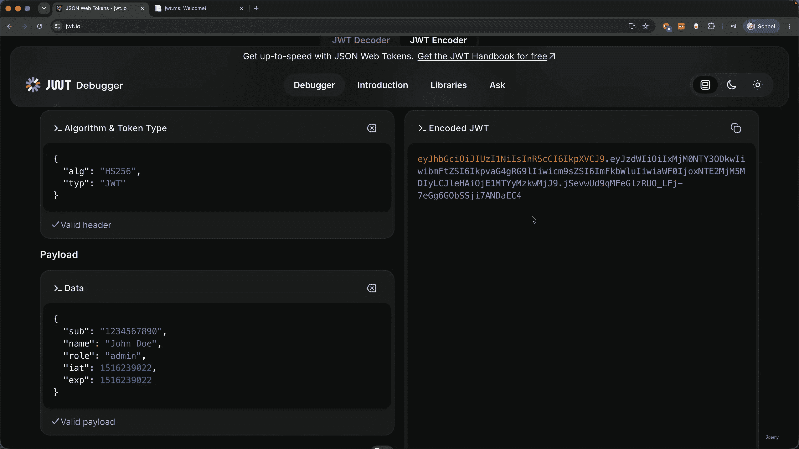
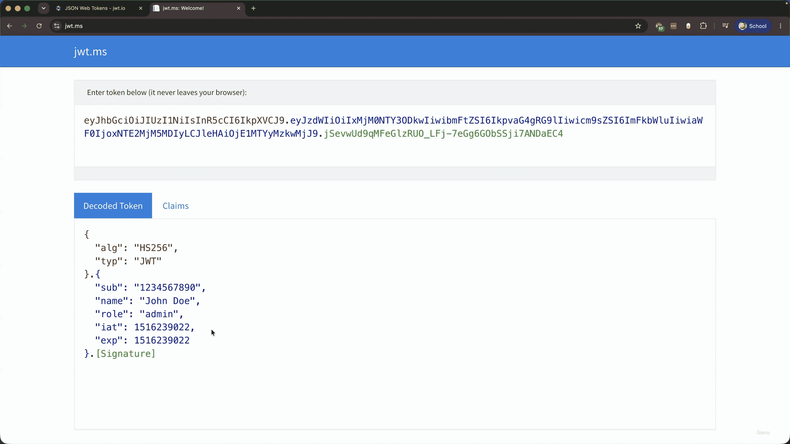
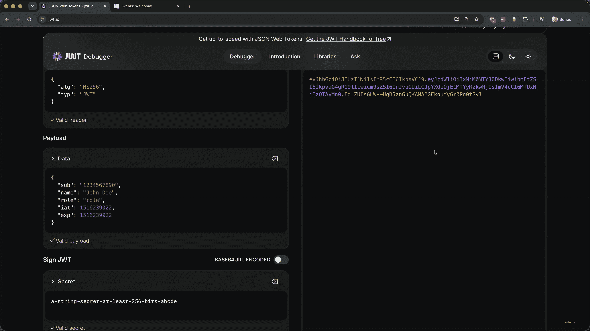

# FastAPI Masterclass part2：138：JWT 安全机制如何工作 🔐

在本节课中我们将要学习 JWT 的第三段，也就是签名，如何为 token 增加安全性。我们会借助 jwt.io 观察 header、payload、signature 与完整 JWT 字符串之间的关系，还会解释 claim、编码与哈希的区别、签名与加密的区别、secret key 的作用，以及服务器如何验证 JWT。学完这些内容，初学者也能理解 JWT 为什么可以公开传输，却又不容易被伪造。下面先看 JWT 的整体结构。

## FastAPI Masterclass part2：138：先看 JWT 的三段结构 🧩

上一段我们明确了本课目标，本节中我们来看看 JWT 到底由哪三段组成。jwt.io 是一个适合反复试验 JWT 的网站，它可以在 JWT 字符串与对应的 header、payload、signature 之间来回切换。你可以从实际的 header、payload 和 signature 开始，观察修改任意一段后，右侧生成的 JWT 会怎样变化。

JWT 的基本结构可以用下面的公式表示。

$$
JWT = Base64Url(header) + "." + Base64Url(payload) + "." + signature
$$

在 jwt.io 中，header 里放的是元数据，例如签名算法和 token 类型。payload 对应 JWT 的第二段，也就是页面中紫色的部分。你更新、添加或删除 payload 里的字符时，对应的 JWT 会同步更新。比如把 `admin` 改成 `role`，再改成 `admin`，每输入一个字符，payload 的内容都会变化。这个过程就是 Base64Url 编码正在进行，对应的 Base64 字符串会被编码成 JWT 中完全不同的 payload 段。右侧完整的那串内容就是 JWT，也就是最终要发送给客户端的 token。

以下是使用 jwt.io 时可以观察到的几个变化。

- 修改 header 中的算法或类型，右侧 JWT 会变化。
- 修改 payload 中的字段或字符，右侧 JWT 的第二段会变化。
- 修改 signature 或 secret key，右侧 JWT 的第三段会变化。
- 右侧完整 JWT 就是服务器签发、客户端保存并随后发送的 token。

上一节我们看了三段结构，本节中我们进一步看 payload 里的内容。payload 中的每一个键值对在术语里叫作 claim，也就是“声明”。每个 claim 的意图是携带一些用户信息。放哪些字段或 claim 由你决定，但一般不要塞入太多信息，因为信息越多，JWT 的体积越大。最低限度，你需要放一个能帮助识别用户的内容。

## FastAPI Masterclass part2：138：payload 里的 claim 与常见字段 🏷️

上一节我们提到 claim 是 payload 中的键值对，本节中我们来看看常见 claim 应该怎么写。JWT 通常需要一个唯一标识用户的键，这个键的常见名称是 `sub`，它是 subject 的缩写。`sub` 字段用来表示 token 是签发给谁的，可以是数据库中的用户 ID，也可以像本课示例中那样使用邮箱，因为邮箱同样唯一且可区分。

下面是一个 payload 示例，展示了常见字段的写法。

```json
{
  "sub": "user@example.com",
  "name": "Alice",
  "role": "admin",
  "subscription_date": "2025-01-01",
  "iat": 1700000000,
  "exp": 1700000600
}
```

除了 `sub`，还可以加入用户名、角色、订阅日期等可选属性。以下是 payload 中常见字段及其含义。

- `sub`：subject，标识 token 签发给谁，通常是用户 ID 或邮箱。
- `name`：用户名称，属于可选字段。
- `role`：用户角色，例如 `admin` 或 `user`，属于可选字段。
- `subscription_date`：订阅日期，属于可选字段。
- `iat`：issued at，token 创建时间的时间戳。
- `exp`：expiration，token 过期时间的时间戳；原文也把这个字段称为 `EP`，标准写法通常是 `exp`。

这些字段不是技术要求，而是常见标准。客户端在后续每次请求中提交 JWT 时，服务器会读取 token，拿到字符串表示，再把它转换回 payload，然后验证 token 是否过期。如果已经过期，用户就需要重新认证。过期时间这类信息会被嵌入 payload，并编码进 JWT 字符串，供服务器在后续请求中使用。

上一节我们说明了 payload 和 claim，本节中我们来看看编码解码与哈希为什么不是一回事。哈希可以看作一个相对昂贵的过程，因为把明文密码转换成哈希时，可能会消耗大约 64 MB 内存，它的目的之一是拖慢黑客在自己机器上运行破解的速度。编码和解码通常则便宜得多，不会像哈希那样计算昂贵。

## FastAPI Masterclass part2：138：编码解码与哈希的区别 ⚖️

上一节我们提到编码解码更便宜，本节中我们把这个区别讲清楚。用户后续每次请求都会把 JWT 发回服务器，服务器必须把 JWT 解码回 payload，才能使用其中的唯一用户标识去数据库查询该用户的记录。因此，编码和解码需要相对便宜、快速，不能像哈希那样故意消耗大量计算资源。

以下是哈希与编码解码的核心区别。



- 哈希：单向转换，计算昂贵，常用于密码存储，目的是增加暴力破解成本。
- 编码：可逆转换，计算便宜，常用于传输数据，例如 Base64Url 编码。
- 解码：把编码后的字符串还原，服务器每次验证 JWT 时都可能用到。
- JWT 是认证标志，会在后续请求中反复携带，所以编解码必须足够快。

可以用下面的公式概括两者的定位。

$$
\text{哈希：单向、昂贵、用于密码}
$$

$$
\text{Base64Url 编码：可逆、便宜、用于 JWT 传输}
$$

上一节我们区分了编码和哈希，本节中我们来看看 JWT 的签名与加密有什么区别。一个关键点是：JWT 是签名的，但不是加密的。加密意味着内容安全、私密，别人无法读取或理解。JWT 这种 Base64Url 编码字符串则可以完全翻译回 header 和 payload，因为这个转换过程可以反向进行。



## FastAPI Masterclass part2：138：签名不等于加密 ✍️

上一节我们强调 JWT 不是加密的，本节中我们把这个概念展开。把完整 JWT 复制到另一个 JWT 网站并粘贴，仍然可以解码出相同的 header 和 payload。这说明 JWT 中的信息不是秘密，也不是以“私密”为目的加密的。因此，不要在 payload 中放入密码、信用卡号等敏感信息。

> JWT 是签名的，但不是加密的。

签名不是为了隐藏内容，而是为了证明内容没有被篡改。JWT 会作为唯一标识在每次请求中发送，这当然存在安全风险：如果有人截获 token，就可能尝试冒用用户身份。但 token 通常只持续 10 分钟，而且黑客即使拿到 token，也不应该看到用户的信用卡或密码等高度私密信息。暴露邮箱的风险通常低于暴露社保号等信息，所以 payload 一般保持轻量，不要放入超级敏感的细节。

上一节我们解释了签名不是加密，本节中我们来看看 secret key 如何参与签名生成。页面下方有一个 secret key，它叫“秘密密钥”，原因是只有我们这一方可以访问它。它保存在服务器上，运行在我们的 FastAPI 应用中，绝不应该暴露给任何用户，包括正常使用网站的好用户。secret key 本质上只是一个随机字符串，你需要保管它并限制访问。

## FastAPI Masterclass part2：138：secret key 与签名生成 🔑

上一节我们认识了 secret key，本节中我们看看它怎样影响签名。签名是由 header、payload 和 secret key 共同影响生成的。你在 jwt.io 中修改 payload，例如把 `role` 改成 `user`，不仅紫色的 payload 会变化，绿色的 signature 也会变化。你修改 secret key 时，每增加或删除一个字符，签名都会变成完全不同的结果。因此，不是只有 secret key 在起作用，而是 header、payload 和 secret key 三者组合生成了唯一签名。

签名生成可以用下面的公式表示。

$$
signature = f(header, payload, secret\_key)
$$

以下是修改 header、payload 和 secret key 时会看到的现象。

- 修改 payload：payload 段变化，signature 段也跟着变化。
- 修改 secret key：即使只改一个字符，signature 也会完全不同。
- 修改 header：header 段变化，signature 也会重新计算。
- 只改签名本身：无法得到与 header、payload、secret key 匹配的有效 JWT。

签名设计的意图是让黑客难以猜中。header 相对容易猜，因为任何 JWT 的 header 都比较固定，虽然算法类型可能不同，但输出通常比较一致。payload 在不同应用中会有不同 claim，不过也存在一定规律，所以也不是最难猜的部分。真正几乎不可能猜中的，是 header、payload 和 secret key 三者组合出来的签名，尤其是在 JWT 只有 10 分钟有效期的窗口内。

上一节我们知道了签名由三者组合生成，本节中我们用数学看看为什么它难以被猜中。页面中签名这一段大约有 43 个字符；原文在这里把它称作 payload 段，但结合上下文，它展示的是绿色签名段。每个字符有 64 种可能，例如大小写字母、数字和下划线等，一共有 43 个字符位置。

## FastAPI Masterclass part2：138：为什么签名难以被猜中 🧮

上一节我们提到签名难以猜中，本节中我们用组合数量来解释原因。每个位置有 64 种可能，连续 43 个位置，组合数量就是 64 的 43 次方。这个数字等于 4 后面跟 77 个 0，数量级非常庞大。

$$
64^{43} = 4 \times 10^{77}
$$

也可以用一段简单代码理解这个计算。

```js
// 每个字符有 64 种可能
// 一共有 43 个字符
Math.pow(64, 43) // 约等于 4e77
```

在 10 分钟的有效窗口内，黑客基本不可能枚举所有组合并逐一测试，从而生成有效 JWT 来冒充用户。这个设计不会降低“真实 JWT 被窃取”的风险，但如果目标是盲猜、伪造，或者在没有用户凭据的情况下登录，那么签名段几乎无法生成有效条目。JWT 和 HTTP 是无状态的，所以恶意黑客可以发送请求，假装自己拥有用户的 header 和 payload，但第三段签名必须匹配。即使黑客尝试 4 万亿种组合，也很难得到有效签名。

上一节我们算出了签名的组合规模，本节中我们来看看服务器收到 JWT 后如何验证。我们的服务器使用 secret key 生成 JWT 时，会得到一个有效 JWT，其中签名段对黑客来说几乎不可猜。JWT 到达服务器后，服务器会用 secret key、header 和 payload 再运行一次签名算法，检查是否能得到相同的 JWT，从而确认 token 有效、没有被篡改，并且确实来自服务器。

## FastAPI Masterclass part2：138：服务器如何验证 JWT ✅

上一节我们说明了签名难以伪造，本节中我们把验证流程串起来。只要 secret key 不暴露，验证过程就类似哈希验证：服务器始终可以验证 token 是否有效，而不知道 secret key 的人很难创建有效签名。下面是一个简化的验证伪代码。

```python
def verify_jwt(token, secret_key):
    header, payload, signature = token.split(".")
    expected = sign(header, payload, secret_key)
    if signature != expected:
        raise InvalidToken
    return decode_payload(payload)
```

即使 JWT 中只有一个字符与服务器当初签发的原始 JWT 不匹配，服务器也会知道这个 token 无效。任何部分无效，都意味着 token 可能被篡改、不是服务器签发的，或者代表黑客正在尝试猜签名。secret key 就像一把钥匙，用来解锁验证过程，证明 JWT 是合法的并且来自我们。用这个 key 生成的 JWT 可以被编码和解码，并确认它确实由该 secret key 创建。黑客不知道 secret key，就无法在 10 分钟内从零生成有效签名，因为需要尝试的次数太多。下一节课我们会进入代码，实际生成 JWT。

## FastAPI Masterclass part2：138：总结 📝



本节课中我们一起学习了 JWT 第三段签名的作用。我们知道了 JWT 由 header、payload、signature 三段组成，payload 中的键值对叫 claim，`sub` 用来标识用户，`iat` 和 `exp` 用来表示签发时间和过期时间。我们区分了哈希与编码解码，理解了 JWT 是签名而不是加密，因此不能放入密码、信用卡等敏感信息。我们还看到 secret key 如何与 header、payload 一起生成难以猜中的签名，以及服务器如何用 secret key 验证 JWT 未被篡改。最后，签名段拥有巨大的组合空间，使黑客很难在有效窗口内伪造有效 token。下一节课我们将把这些知识落到代码中，开始生成 JWT。

