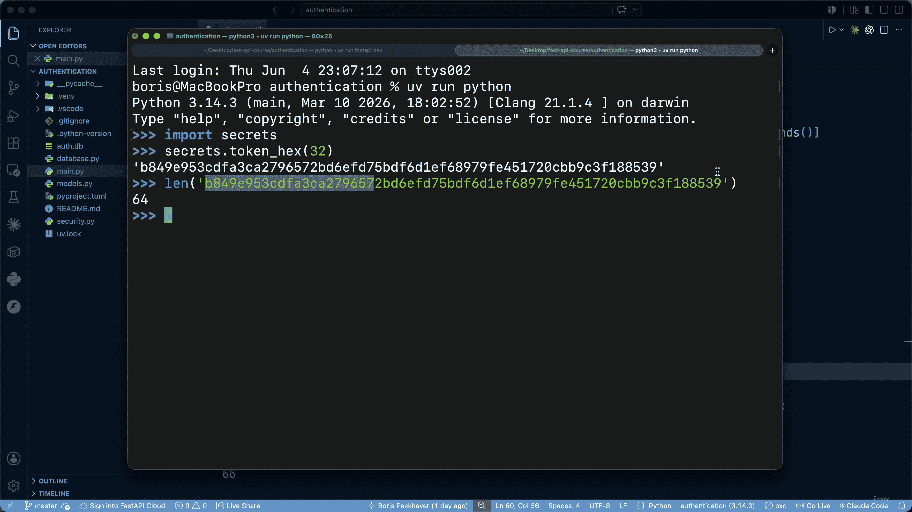
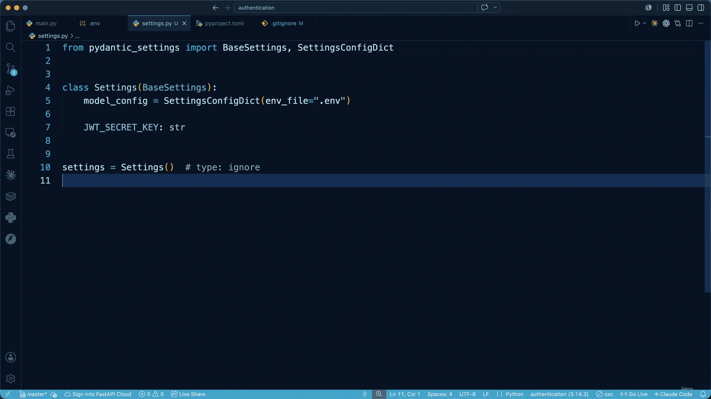

FastAPI Masterclass part2：p38 139：密钥与环境变量 🔐


在本节课中，我们要学习JWT生成过程中的第一个关键步骤：定义秘密密钥（Secret Key）。我们会讨论为什么不能把密钥直接写在代码里，以及如何用环境变量这个标准做法来安全地存储它。另外，我们还会介绍 Python 生态中的 `pydantic-settings` 库，看看它如何自动解析 `.env` 文件，让 FastAPI 在启动时顺利读取这些配置。学完这一课，你就掌握了真实项目中管理密钥和安全配置的标准流程。


## 🔑 为什么秘密密钥必须随机且不可猜测？


要生成 JWT，第一步永远是定义那个秘密密钥。我们上一次课已经聊过，这个密钥非常重要，因为它会直接影响最终生成的签名，让签名在本质上变得无法被猜测。也就是说，如果你用一个很弱的密钥，那么整个 JWT 的安全性都会崩塌。

为了让事情更加安全，我强烈建议你生成一个完全随机的秘密密钥。为什么不能自己随便想一个呢？比如说你选择了一句很常见的表达，像“how is the weather tape”，虽然它有 25 个字符，但这种常见的短语对黑客来说太容易猜了。万一黑客猜到了你的秘密密钥，他们就能推算出对应的签名，然后伪造一个完全合法的 JWT。这可不是我们想看到的结果。

所以，我们要用字母和数字的随机组合来生成密钥，让黑客在现实中不可能猜测得到。严格来说，随机密钥是必须的吗？其实也不是，但它会额外增加一层安全保护。既然成本这么低，我们当然要选更安全的路。

那具体怎么生成呢？一个特别简单的方法就是用 Python。你在终端里运行 `uv run python`，打开 Python 交互式解释器，然后使用标准库里的 `secrets` 模块。这个模块就是专门用来生成随机密钥的。我们调用 `token_hex` 函数，并且传入想要的字节数，比如传 `32`。由于每个字节最终会生成两个字符，所以你最后会得到一个 64 字符的字符串。

你可以用 `len()` 函数验证一下，得到的随机字符串长度恰好是 64。用公式表示就是：**字符数 = 字节数 × 2**。下面是在终端里操作的示例：

```bash
uv run python
```

```python
import secrets

secret_key = secrets.token_hex(32)
print(len(secret_key))  # 输出 64
```

这个随机生成的字符串就是我们的秘密密钥。世界上的任何其他字符串，都会在你的 JWT 中产生完全不同的签名。简单说，每一个用户拿到的 JWT 签名都是独特的，别人完全无法预测。


## 💻 秘密密钥应该放在哪里？环境变量与源码的区别



密钥已经拿到手了，接下来一个很自然的问题就是：我们把它存储在什么地方？一个最直觉的选项是直接写在源代码里，但这样做通常不被认为是安全的做法。

我们来设想一个具体的场景：你所在的团队有 300 名开发者，而你把密钥提交到了源码控制里面。只要这 300 个人里有一个人思想出了问题、心怀恶意，或者不小心把代码泄露给了别人，那么外面的人就可以轻松创建出你的服务器会接受的 JWT。到那时候，你的整个用户体系就形同虚设了。所以，为了再增加一层安全屏障，同时模仿真实世界项目中的操作习惯，我们通常不会把秘密密钥直接写进源代码。

那应该怎么做呢？一个非常常见的解决方案就是使用环境变量。环境变量听起来很高大上，其实它就像 Python 里的变量一样，有一个名字，也有一个值。区别在于，这个变量不是写在代码里的，而是来自外部环境。它可能来自操作系统，也可能来自运行程序的计算机本身。在部署场景下，你通常会在目标服务里定义环境变量，比如 AWS 或 GCP 这类托管平台，都允许你安全地在系统里配置环境变量。之后这些变量会流入你的程序，让程序可以在运行时读取它们。这样一来，它们就不会暴露在源代码里，也可以只让尽量少的工程师接触到。

我们要做的事情，就是创建一个专门存放环境变量的文件。这个文件常见的名字是 `.env`。我们会在里面定义一些变量，当应用启动的时候，Python 和 FastAPI 就会去读取这个文件，把变量加载进来。


## 📄 创建 .env 文件，并把它加入 .gitignore

现在我们来实际操作一下。首先在项目根目录创建一个新文件，名字就叫 `.env`。在这个文件里，你想定义什么变量都可以。我这里把它叫做 `JWT_SECRET_KEY`，当然这个名字完全由你自己决定。然后，把你刚才在终端里生成的随机密钥粘贴到等号后面。有一点非常重要：这里不需要加字符串引号，直接写值就可以了。

`.env` 文件的内容大致长这样：

```dotenv
JWT_SECRET_KEY=这里粘贴你生成的64位随机密钥
```

接下来这个细节绝对是重中之重：绝对不要把 `.env` 文件提交到源码控制。一旦提交，前面做的所有安全措施都白费了。我们最初的想法是，当任何一个工程师下载代码库的时候，你单独把 `JWT_SECRET_KEY` 发给他，或者发一个专门为他个人生成、带有个人标记的密钥。这样一来，你就能追踪到谁拿了哪个密钥，最大限度地阻止敏感数据被大面积公开。

所以，每次你创建了 `.env` 文件之后，第一件事就是去 `.gitignore` 里添加一行 `.env`。这个文件本质上就是一个纯文本文件，里面存着所有环境变量。加上之后，Git 就会完全忽略它。后面来跟你合作的其他工程师，都必须自己创建自己的 `.env` 文件，自己定义变量，自己填上对应的值。这个值甚至可以根据每个人的身份有所不同，正如我前面说的那样，这完全是可行的。

现在，我们有了一个定义好秘密密钥的 `.env` 文件，这个密钥对于生成 JWT 签名非常关键。但是，FastAPI 应用目前完全不知道这个文件存在。所以下一步，我们要做的是把应用和环境变量文件之间的桥梁搭建起来，让应用在启动时能读取这个密钥，并且在代码的任何地方都能使用它，而不需要关心它在现实世界里到底是什么值。


## 🛠️ 使用 Pydantic Settings 解析 .env 文件

环境变量文件这种实践在真实项目中太常见了，所以 Python 生态里专门有一个库来处理它，叫做 `pydantic-settings`。这个库所做的事很单纯：解析 `.env` 文件，然后把里面的每一个环境变量保存到 Pydantic 基模型对应的字段上。

你可能会想，这有什么好处？如果我们仔细琢磨一下，就会发现这个设计和 Pydantic 的核心思想完美契合。Pydantic 的目的是什么？是验证字段，确保字段存在、确保字段是必填的、确保字段的数据类型正确。在我们的例子里，环境变量只有一个，所以感觉不太明显。但你可以想象一个更复杂的场景：如果 `.env` 文件里一共有 50 个环境变量，我们只需要在源代码里全部声明出来。应用启动时，`pydantic-settings` 会自动解析这个 `.env` 文件，把这些变量的实际值抓取出来，存到对应的模型实例里面。这个设计确实很优雅，它可以发挥 Pydantic 的所有亮点。

除了读取值之外，Pydantic 还能做很多额外的操作。比如说类型转换。所有环境变量从外部世界进入 Python 程序时，最初都是以纯文本形式存在的，但 Pydantic 可以自动地把某个字符串转换成整数。这个优点我们之前已经见过了，现在可以把它继续用到这些外部数据上。再比如，我们可以给某些环境变量提供默认值，还能指定某些变量是可选的。如果某个变量没有出现在 `.env` 文件里，程序就会自动回退到代码中定义的默认值，这样应用也能正常启动。

现在开始写代码。我们在项目顶层创建一个新文件，名字叫 `settings.py`。在文件开头，从 `pydantic_settings` 库中导入两个东西：第一个是 `BaseSettings`，它是基础类，用来建模“设置”这个概念；第二个是 `SettingsConfigDict`，它是配置类，用来告诉 `pydantic-settings` 环境变量文件到底叫什么名字。

基本代码结构如下：

```python
from pydantic_settings import BaseSettings, SettingsConfigDict

class Settings(BaseSettings):
    model_config = SettingsConfigDict(env_file=".env")

    jwt_secret_key: str
```

这里有几个非常关键的点。首先，我们的 `Settings` 类必须继承自 `BaseSettings`。只有继承了它，这个类才能拥有解析环境变量的能力。其次，我们在类内部定义了 `model_config` 属性，并且必须用这种特殊的方式定义。我们将它设置为 `SettingsConfigDict` 的实例，然后传入一个参数 `env_file=".env"`。这个参数告诉库去哪里找 `.env` 文件。因为 `settings.py` 和 `.env` 文件在同一个文件夹里，所以我们可以直接写相对路径，不需要额外拼接目录。

但是，这只是整个过程的第一部分。`pydantic-settings` 会去扫描这个文件，不过我们仍然需要告诉它，具体期待哪些环境变量，这样它才能知道在什么时候抛出异常。比如它可以提示你：“你让我找的那个环境变量根本不存在”，或者“这个变量虽然存在，但它的数据类型不对”。所以，对于每一个我们期望在 `.env` 文件中出现的变量，我们都要在类里面声明它的类型。

如果你需要更复杂的验证或转换，也可以使用 `Field` 来声明，不过现在我们先保持简单。我声明了一个 `jwt_secret_key`，类型是 `str`。这里必须特别小心：这个变量名要跟 `.env` 文件里的 key 保持一致，也就是说，`.`env` 里的 `JWT_SECRET_KEY` 要和类属性 `jwt_secret_key` 对应起来。Pydantic 默认对大小写不敏感，所以 `JWT_SECRET_KEY` 和 `jwt_secret_key` 是可以匹配的。如果你有某个环境变量想从文本转换成整数，也可以这样声明：

```python
class Settings(BaseSettings):
    model_config = SettingsConfigDict(env_file=".env")

    jwt_secret_key: str
    some_number: int = 0  # 可选的，带默认值
```

这样一来，如果 `.env` 中没有定义 `SOME_NUMBER`，程序也会自动使用 `0` 作为默认值，不会报错。


## ⚙️ 创建 settings 实例，并处理类型检查器的误报

现在我们已经把 `Settings` 类写好了。不过，在这个文件里，我们还不能直接使用配置。我们需要在类的下面创建一个实例，方便其他文件导入后使用。于是我们写上这么一行：

```python
settings = Settings()
```

这时，类型检查器很有可能会弹出一个警告，提示你创建 `Settings` 对象时缺少了 `jwt_secret_key` 参数。从表面上看，它说得对，因为我们的类确实有一个必须填写的字段。但是，类型检查器完全不知道这个值其实是从外部环境文件里读取的，它以为我们必须像使用普通类一样手动传入参数。实际上，这个值会在应用启动时由 `pydantic-settings` 自动从 `.env` 文件中解析出来，然后自动填充到 `jwt_secret_key` 字段上，并完成验证。所以，这个警告本质上是一个误报，是类型检查器的一个局限性，因为它无法理解外部环境解析的机制。

为了让这个误报不要一直干扰我们，最简单的方法是在这行代码后面加上一个忽略注释：

```python
settings = Settings()  # type: ignore
```

这不会影响任何运行逻辑，因为当我们导入这个文件或导入 `settings` 变量时，`pydantic-settings` 已经成功运行了。它会自动解析 `.env`，自动把 `jwt_secret_key` 和对应的字符串值绑定到对象上，并且完成所有的数据验证。也就是说，这个对象在诞生时就已经是一个完整、合法、可用配置对象了。


## ✅ 在项目中使用 settings 对象

到此，核心的 `Settings` 类已经搭建完成，我们也成功地从外部世界解析了一个环境变量，这个变量保存了我们的秘密密钥。接下来我们要搞清楚，它到底怎么用？

方法其实非常简单。在任何其他文件中，只需要导入 `settings` 对象，然后用点号访问字段。因为这是一个 Pydantic 模型，所以访问字段的方式跟访问普通对象的属性完全一样。比如：

```python
from settings import settings

current_secret_key = settings.jwt_secret_key
```

这里的 `settings.jwt_secret_key` 的值，就是从 `.env` 文件中解析出来的那个秘密密钥。由于 `.env` 文件没有提交到源码控制，这个实际值对其他开发者、对所有人来说都不可见。我们在代码中通过 `settings` 对象读取它，然后就能直接使用了。

整个过程听起来有点绕，但核心逻辑非常简洁：我们不在代码里写死密钥，而是通过 `.env` 文件在外部提供，再交给 `pydantic-settings` 自动加载。这样既安全，又方便在不同工程师、不同环境之间灵活切换。


## 🎯 总结

本节课中，我们一起学习了如何生成一个足够随机的秘密密钥来保护 JWT 签名，深入理解了为什么不能把密钥直接写在源代码里，也学会了创建 `.env` 文件，并用 `.gitignore` 避免它被提交。我们还掌握了如何利用 `pydantic-settings` 库解析环境变量，定义 `Settings` 类，并在项目代码中直接读取这些安全配置。



这套流程是真实项目中的标准做法：密钥写入 `.env`，代码通过配置库读取。它既能保证安全性，也能让团队协作更加轻松。下节课，我们就会真正使用这个秘密密钥来创建 JWT 签名，敬请期待。
