# FastAPI Masterclass：第39节：创建 JWT 🔐

在本节课中我们将要学习如何在 FastAPI 项目里创建 JWT。上一节课已经配置好了 secret key，本节会继续打开安全相关代码文件，先定义常量，再编写 `create_access_token` 函数，把用户数据、签发时间、过期时间、secret key 和算法组合起来，最终生成一个 JWT 字符串。过程中还会解释 JWT 为什么通常设置较短有效期，以及 refresh token 的基本思路。

## 🧰 FastAPI Masterclass：第39.1节：准备安全模块与常量

上一节已经完成 secret key 配置，本节先进入 `security.py`。所有安全相关代码都放在这里。接下来会导入项目依赖中已经可用的 `JWT` 库，这个库负责 JWT 的编码和解码过程。编码时需要提供 payload、算法和 secret key，这些输入会共同影响最终生成的 JWT 字符串。

还需要使用上一课读取到的 secret key，因此从 `settings.py` 导入 `settings` 变量。这个变量来自上一课定义的 Pydantic Settings 实例。导入位置放在常量定义区域附近，方便后续函数直接引用。

为了在不同函数之间复用配置，这里定义两个常量。常量名由我们自己决定，但两个常量都与 JWT 有关，因此使用共同前缀 `token` 或 `access_token` 会让命名更清晰。

以下是本节需要定义的两个常量：

```python
# security.py

from datetime import UTC, datetime, timedelta
import jwt

from .settings import settings

ACCESS_TOKEN_ALGORITHM = "HS256"
ACCESS_TOKEN_EXPIRATION_MINUTES = 10
```

第一个常量是 `ACCESS_TOKEN_ALGORITHM`，它硬编码 JWT 编码使用的算法。社区常用标准是 `HS256`。JWT 的输入可以有不同的计算方式，类似哈希里的 bcrypt 和 argon，`HS256` 是常见标准算法。

第二个常量是 `ACCESS_TOKEN_EXPIRATION_MINUTES`，它声明 JWT 持续多少分钟。这里选择 10 分钟。含义是 JWT 从创建时刻开始计算，10 分钟后失效。后续函数会使用这个常量。

## ⏳ FastAPI Masterclass：第39.2节：JWT 有效期与刷新令牌

上一节定义了 10 分钟有效期，本节解释这个选择。JWT 的有效期通常较短，10 分钟是常见默认值。短时间跨度可以限制黑客窃取 token 后造成的潜在损害。

需要特别注意，10 分钟是 token 创建后的 10 分钟，不是用户不活跃后的 10 分钟。即使用户仍在点击 UI 或持续请求后端 API，token 仍会在签发后整 10 分钟过期。过期后，下一次 API 请求通常返回 `401 Unauthorized`。

JWT 的核心时间关系可以用公式表示：

```text
exp = iat + Δt
```

其中 `iat` 表示签发时间，`exp` 表示过期时间，`Δt` 表示有效期长度。本节中 `Δt = 10 分钟`。

> 注意：JWT 短有效期限制的是 token 被盗后的损害范围，不代表用户不操作才过期。

这带来一个问题：正常用户每 10 分钟就要重新登录会很不方便。常见解决方式是短寿命 JWT 搭配更长寿命的 refresh token。refresh token 可以设置一周左右，让用户在一周内保持认证状态。

refresh token 本身也是另一个 token，它授予生成新 JWT 的权限。每 10 分钟，refresh token 会请求一个端点，表达“上一个 JWT 要过期了，请给下一个 JWT”。JWT 只活 10 分钟，但 refresh token 会持续换取新的 JWT，直到 refresh token 自己过期。幕后逻辑稍复杂，本节先不深入，只需要知道 JWT 设置 10 或 15 分钟有效期是合理且常见的。

## 🛠️ FastAPI Masterclass：第39.3节：编写 create_access_token 函数

上一节说明了短有效期和 refresh token 的背景，本节开始编写函数。函数名为 `create_access_token`，名称尽量通用和抽象，不硬编码具体访问令牌类型。现阶段 access token 就是 JWT 的同义词。

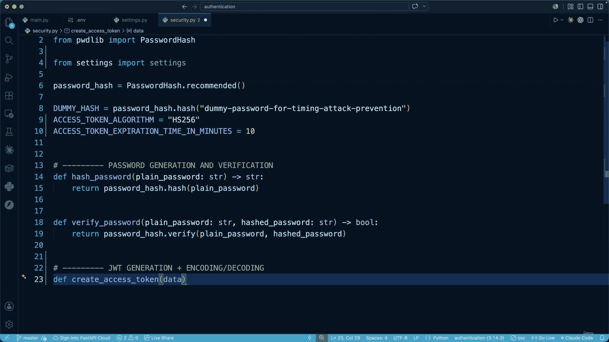

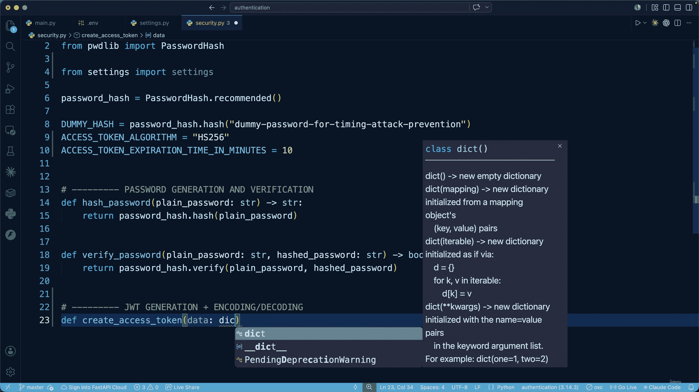

在密码生成代码上方添加注释区域，用于区分密码生成和 JWT 生成。这里可以写“JWT 编码与解码”作为补充说明。

函数需要足够通用，处理生成 JWT 的复杂细节，但不应该硬编码用户 payload。否则函数内部会塞入大量用户逻辑和用户数据。更合适的做法是假设路由处理器或其他代码先生成字典，也就是键值对形式的字段或 claims，然后作为输入传入。

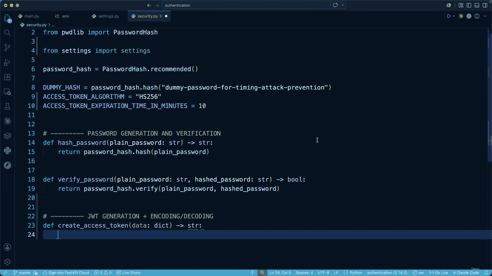

以下是函数的基本签名和返回类型：

```python
def create_access_token(
    data: dict,
    expires_delta: timedelta | None = None,
) -> str:
    ...
```

这里假设 `data` 是 Python 字典，包含键值对。JWT 编码过程会把 payload 转换成最终 JWT 的第二段。函数最终返回 JWT 字符串，因此返回类型注解为 `str`。

## 🕰️ FastAPI Masterclass：第39.4节：计算签发时间与过期时间

上一节写好了函数骨架，本节先写最简单版本，再逐步增加灵活性。第一步是生成当前时间和 10 分钟后的过期时间，后续会把它们作为 payload 字段。

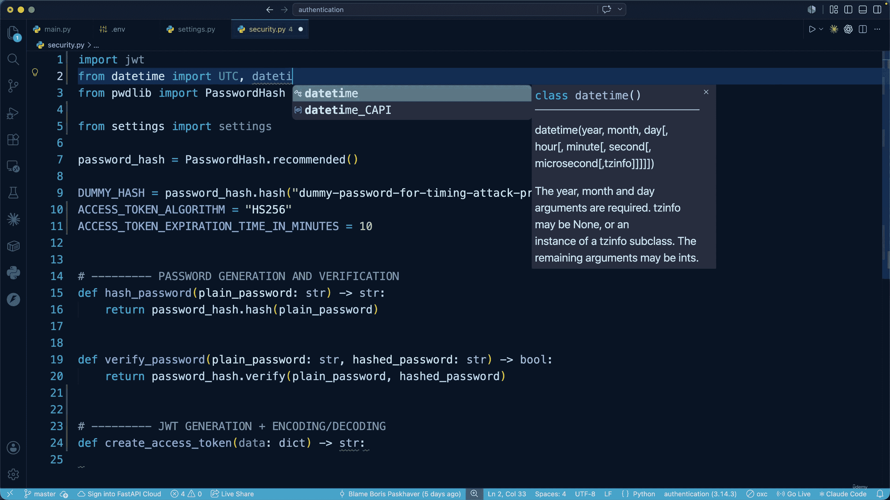

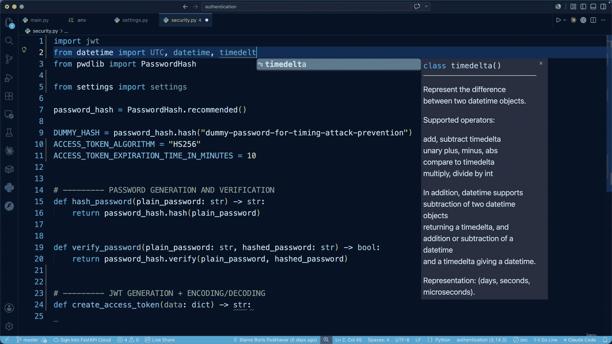

获取当前时间需要导入 `datetime` 模块。`datetime` 属于 Python 标准库。这里需要几个导出：`UTC` 表示时区，`datetime` 表示某个时间点，`timedelta` 表示时间跨度或持续时间。

当前时间通过 `datetime.now` 获取，返回代码运行位置的当前时间，精确到秒和毫秒。处理时间时经常遇到时区问题，例如巴黎时间、伦敦时间或纽约时间。为了指定时区，这里传入导入的 `UTC`。UTC 是常见标准时区，用于给时间一个一致锚点。

以下是计算当前时间和过期时间的代码：

```python
now = datetime.now(UTC)

expiration_time = now + timedelta(
    minutes=ACCESS_TOKEN_EXPIRATION_MINUTES
)
```

每次路由处理器调用这个函数，都会取得精确时刻。然后给 `now` 加上 10 分钟，表示 JWT 过期时间。Python 中可以直接把 `timedelta` 实例加到 `datetime` 对象上，得到一个新的 `datetime` 对象，表示向前推进指定时间跨度后的时刻。

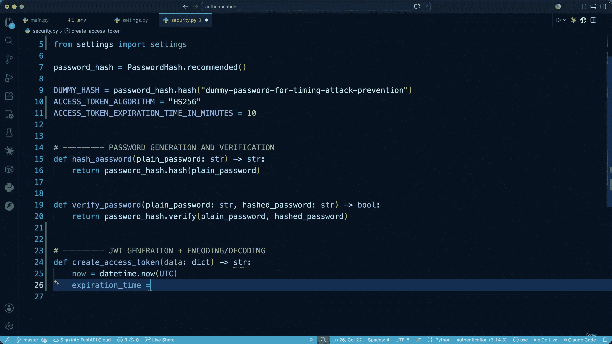

`timedelta` 构造参数包括 days、seconds、minutes、hours 等。这里指定 `minutes` 参数，并传入上面定义的 10 分钟常量。这样函数执行时就能得到 10 分钟后的时间。

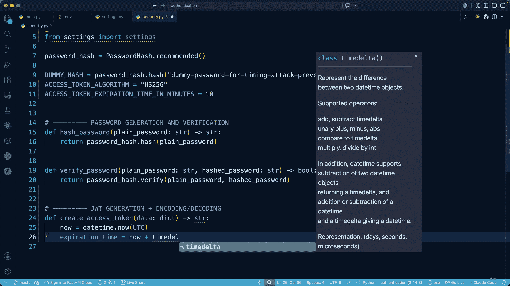

## 📦 FastAPI Masterclass：第39.5节：构造 JWT payload

上一节得到了签发时间和过期时间，本节把它们放进 payload。payload 变量首先包含外部传入的所有键值对，这些数据包括用户标识，例如 ID、email 或 username。这些属性与 JWT 直接相关，因此把外部数据和函数内部数据混合在一起是合适的。

如果有一个字典 `data`，想把所有键值对展开复制到新字典，可以使用双星号加字典名。无论 `data` 有两个键值对还是五个键值对，都会出现在 payload 中。

以下是 payload 构造代码：

```python
payload = {
    **data,
    "iat": now,
    "exp": expiration_time,
}
```

在外部数据基础上再加两个键值对。第一个是 `iat`，表示 issued at，声明 JWT 何时签发，值就是上面的 `now`，即函数运行的精确时刻。第二个是 `exp`，这是 expiration 的常见名称，标记过期时间，值就是上面的 `expiration_time`。

## 🔐 FastAPI Masterclass：第39.6节：调用 encode 生成 JWT 字符串

上一节准备好了 payload，本节进入关键部分：创建实际 JWT 字符串。导入的 JWT 库提供 `encode` 函数。编码过程会取 header、payload 和 signature，生成浏览器中看到的 Base64 URL 编码 JWT 字符串。

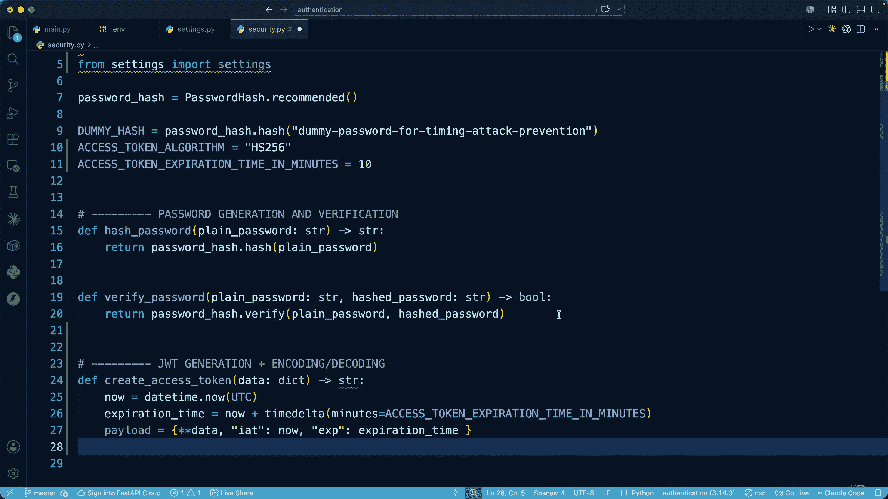

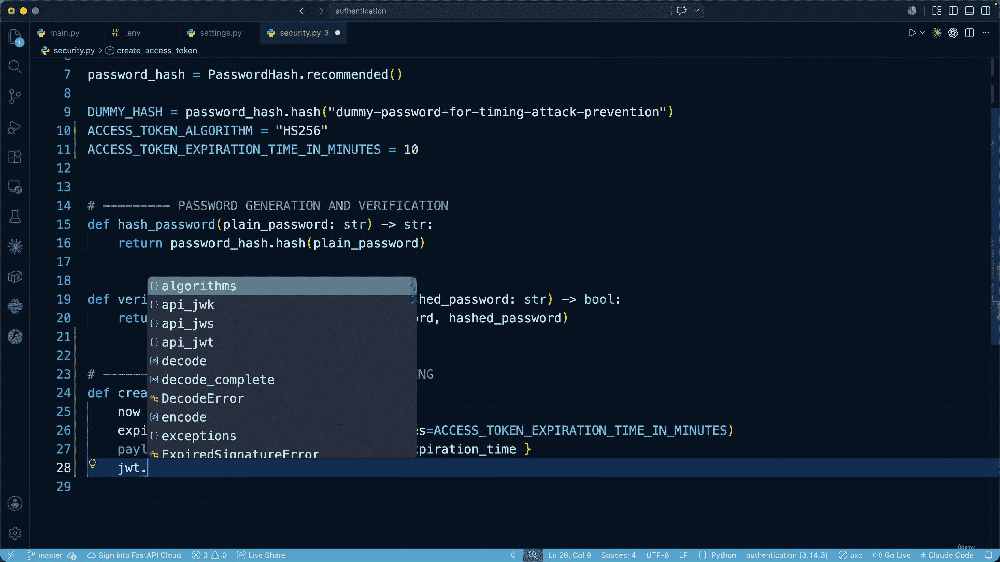

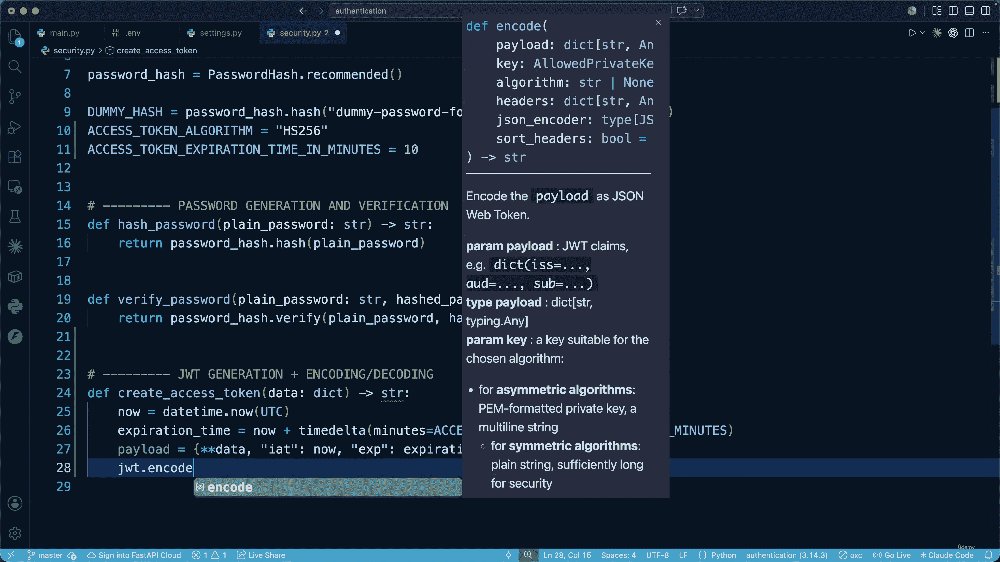

JWT 的基本结构可以用公式表示：

```text
JWT = base64url(header) + "." + base64url(payload) + "." + signature
```

调用 `encode` 时需要提供几个参数。第一个参数是实际 payload，用户数据会进入 JWT 第二段，参数名为 `payload`，传入上面的字典。字典会变成 JSON 对象，库负责把 JSON 对象转换成 JWT 字符串对应部分，复杂转换由库处理。

第二个参数是签名相关密钥，参数名为 `key`。secret key 来自导入的 `settings` 实例，这个实例由 Pydantic Settings 创建。引用 `settings.JWT_SECRET_KEY` 时，类型检查也能看到这个字段。secret key 会影响库最终生成的 JWT。

第三个参数是算法，参数名为 `algorithm`。JWT 库支持多种格式，这里传入上面定义的 `ACCESS_TOKEN_ALGORITHM` 常量。

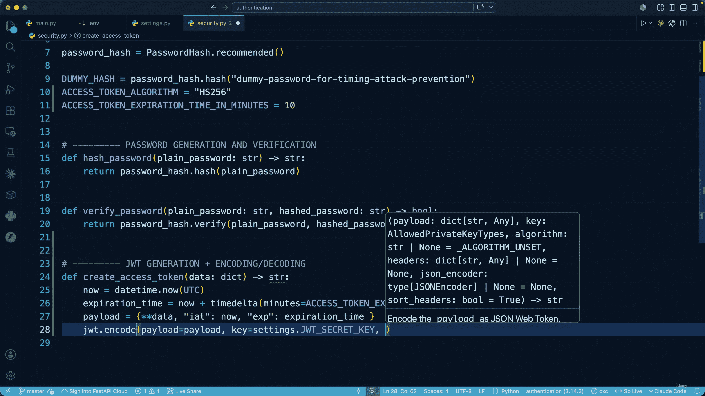

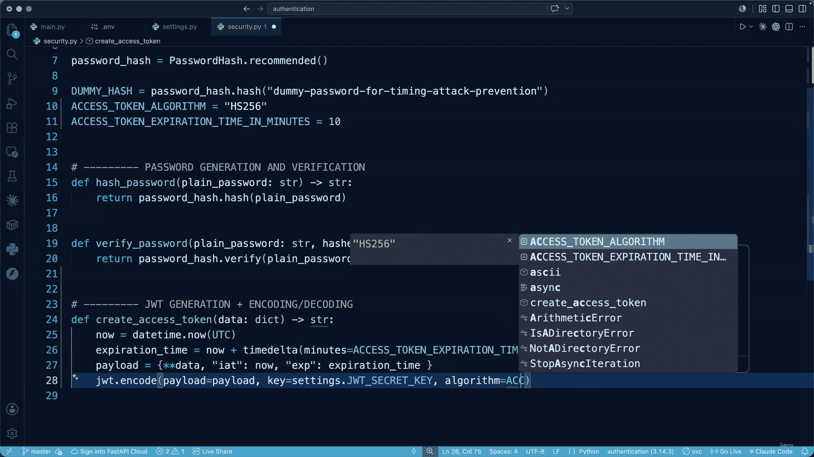

以下是完整编码调用：

```python
token = jwt.encode(
    payload=payload,
    key=settings.JWT_SECRET_KEY,
    algorithm=ACCESS_TOKEN_ALGORITHM,
)

return token
```

这样就会创建 JWT 本身，并作为函数返回值。最终字符串包含 payload 中的全部用户数据、两个附加 claims，以及受 secret key 和算法影响的签名。

## 🎛️ FastAPI Masterclass：第39.7节：用 expires_delta 增加过期时间灵活性

上一节的函数技术上已经可用，但过期时间总是硬编码为 10 分钟。本节增加灵活性，让调用方可以指定更短或更长的 JWT 有效期。这样路由处理器就能按需传入不同的过期时间。

这里参考 FastAPI 文档示例，增加参数 `expires_delta`，表示 JWT 过期前的时间跨度。它本质上是一个 `timedelta` 对象，但调用方可以自定义参数，修改分钟、小时或天数，从而形成灵活的时间跨度。

以下是支持可选过期时间的函数实现：

```python
def create_access_token(
    data: dict,
    expires_delta: timedelta | None = None,
) -> str:
    now = datetime.now(UTC)

    if expires_delta is not None:
        expiration_time = now + expires_delta
    else:
        expiration_time = now + timedelta(
            minutes=ACCESS_TOKEN_EXPIRATION_MINUTES
        )

    payload = {
        **data,
        "iat": now,
        "exp": expiration_time,
    }

    return jwt.encode(
        payload=payload,
        key=settings.JWT_SECRET_KEY,
        algorithm=ACCESS_TOKEN_ALGORITHM,
    )
```

参数类型声明为 `timedelta | None`，表示可选参数。调用方不传值时回退为 `None`。如果收到有效的 `expires_delta`，也就是具体的时间跨度对象，就用 `now + expires_delta` 计算过期时间。如果调用方传入 10 分钟或 4 小时，函数直接使用这个跨度。

如果 `expires_delta` 为 `None`，就回退到合理的 10 分钟标准。无论走哪个分支，都会声明同样的 `expiration_time` 变量，后续可以打包进 payload，再编码进 JWT 字符串。

## ✅ FastAPI Masterclass：第39.8节：本节总结

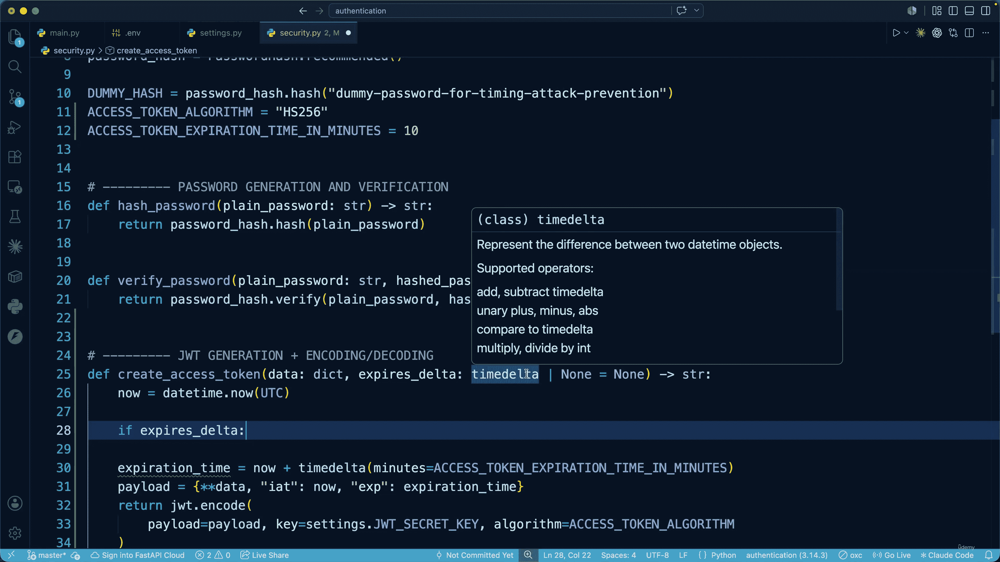

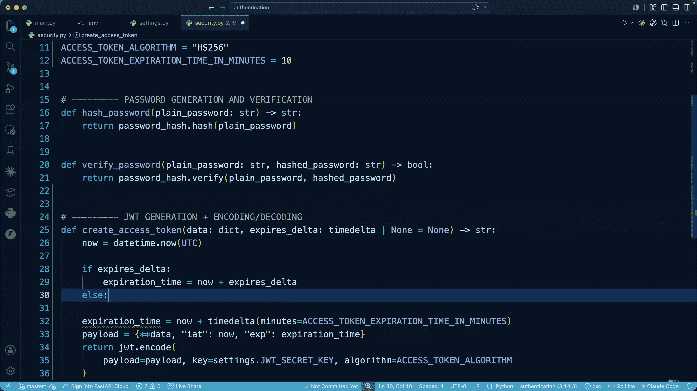

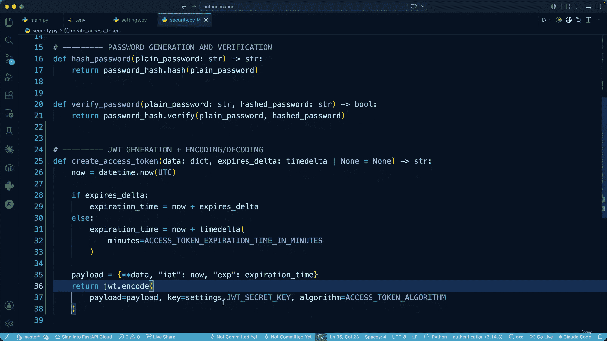

本节课中我们一起学习了如何创建 JWT。我们打开安全模块，导入 JWT 库和 settings，定义算法常量与过期时间常量，理解了短有效期和 refresh token 的关系，编写了 `create_access_token` 函数，使用 `datetime` 和 `timedelta` 计算签发时间与过期时间，把用户数据与 `iat`、`exp` 组合成 payload，并通过 `jwt.encode` 配合 secret key 和算法生成最终 JWT 字符串。最后还增加了 `expires_delta` 参数，让调用方可以灵活控制 token 有效期。

