# FastAPI Masterclass：141：测试JWT创建 🧪

在本节课中我们将要学习如何测试前面新写的 `create_access_token` 函数，并理解生成的 JWT 为什么能证明请求来自我们的服务器。我们会从普通 Python REPL 开始，调用函数生成一个 JWT，然后把它拆成 header、payload 和 signature 三部分来看。接着我们会把 JWT 粘贴到 jwt.io 的解码器里，观察解码结果和过期时间。最后我们会重点解释 secret key 的作用，说明为什么没有服务器上的密钥就无法伪造出能通过验证的 JWT。整个流程不需要复杂工具，目的就是让初学者也能直观看到 JWT 创建和验证的基本逻辑。


接下来我们先进入第一步，也就是在一个普通 Python REPL 中实际调用这个新函数。所谓 REPL，就是一个可以一行一行输入 Python 代码并立刻看到结果的交互环境。我们通过命令行启动它，然后导入刚刚写好的函数，这样就能直接观察函数返回的 JWT 字符串。


## 🐍 在 Python REPL 中调用 create_access_token

上一节我们介绍了 JWT 创建函数的基本用途，本节中我们来看看怎样在普通 Python REPL 中手动调用它。先运行下面的命令打开 Python shell：

```bash
uv run python
```

进入 Python shell 后，从自己的 `security` 模块中导入新写的函数 `create_access_token`。可以理解为，这个函数就是用来根据传入的数据生成 JWT 的工具。导入代码大致如下：

```python
from security import create_access_token
```

下面我们先回顾这个函数的参数规则。调用这个函数时，它最多接受两个参数，但只有第一个参数是必填的。第一个参数名为 `data`，表示要放进 JWT 的数据负载，它期望接收一个字典。这个字典里通常放用户凭证相关信息，例如可以提供一个名为 `sub` 的 claim 或字段，`sub` 通常作为用户的唯一标识。这里可以放一个示例邮箱，例如 `boris@exle.com`。第二个参数表示过期时间的时间差 `timedelta`，它是可选的。只传第一个参数也足够生成 JWT。


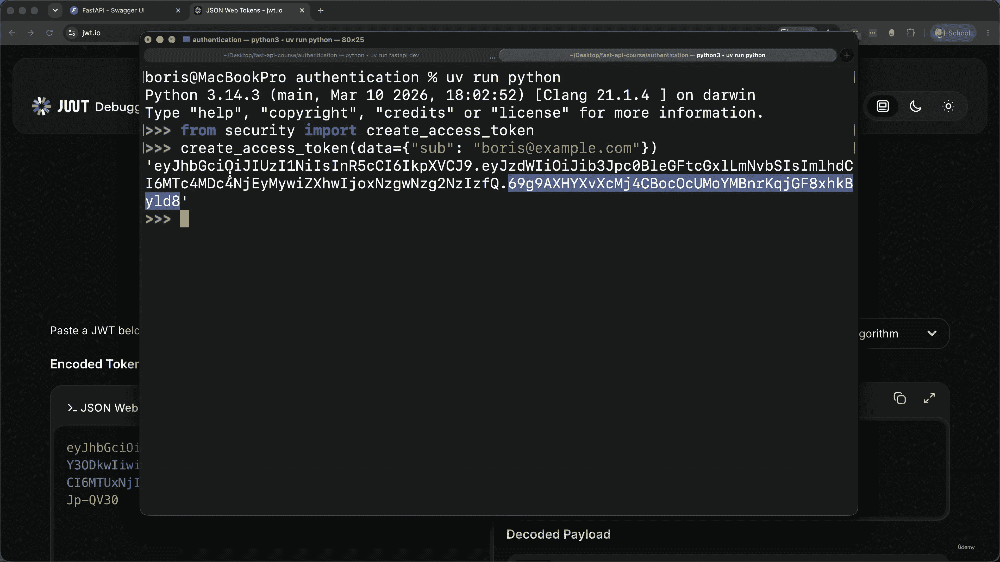

函数调用的核心概念可以用下面的代码表示：

```python
create_access_token(
    data: dict,
    expires_delta: timedelta | None = None
) -> str
```

调用之后我们会得到 JWT。再次说明，JWT 由三个组件组成。第一个组件是 header，它由算法决定。第二个组件是 payload，它是刚才设置内容的字符串化版本。第三个组件是 signature，它完全取决于实际使用的 secret key，同时也依赖 header 和 payload。需要记住，这三个组件中任何一个字符发生变化，包括 header、payload 或 secret key 变化，签名都会变化。因此签名不是固定值，而是和内容、密钥绑定在一起的结果。


JWT 的结构可以写成公式：

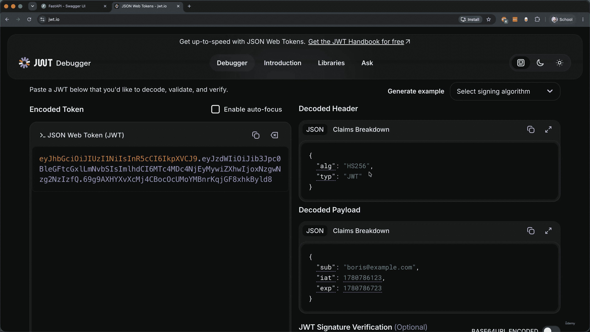

```text
JWT = base64url(header) + "." + base64url(payload) + "." + signature
signature = HMAC_SHA256(secret_key, base64url(header) + "." + base64url(payload))
```

为了证明生成的是一个有效 JWT，可以把完整 JWT 复制下来，但不要复制开头和结尾的单引号。然后打开 jwt.io 这样的真实网站，找到解码器功能，把 JWT 粘贴进去，右侧就会解码。这样我们能看到 header 中指定的算法，它对应代码里定义的常量，也就是 `HS256`。往下能看到 payload，里面有调用函数时提供的那个字段。还要记得，在 `create_access_token` 函数体内部还会声明过期时间和签发时间，这两个时间应该相差 10 分钟。例如查看 `iat` 时可以看到时间是 6:48 GMT，而另一个时间显示为 6:58 GMT，这正是 10 分钟之后。虽然时间可能以总秒数表达，但可以确认签发之后 10 分钟就是过期时间，因此这个 JWT 的有效期是 10 分钟。


前面我们看到了 JWT 的外在结构和时间字段，本节中我们进一步理解 header 与 payload 的可见性，以及真正提供安全性的 secret key。这里的关键点是：header 和 payload 里没有任何内容是真的私有或加密的，这正是网站能够解析这些细节的原因。真正增加安全性的部分是 secret key，而 secret key 只有我们的服务器知道。


## 🔐 理解 header、payload 与 secret key

在 jwt.io 下方会看到一个示例 secret key，它只是网站提供的一个替代字符串。此时页面会显示签名验证失败。

> Signature Verification Failed

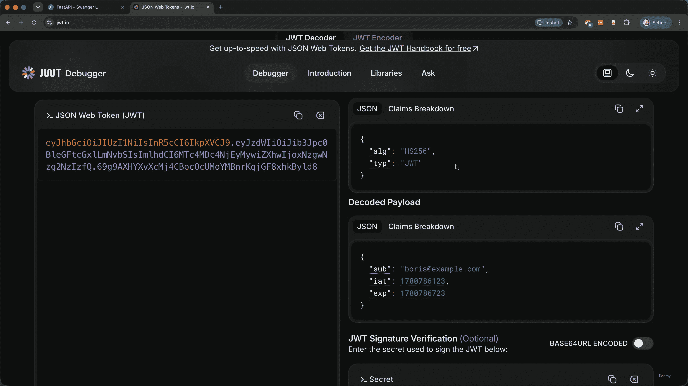

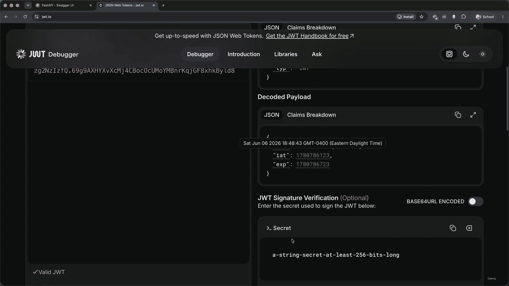

也就是说，除非提供服务器上保存的那个精确 secret key，其他任何字符串都不能让验证通过。原因是 secret key 加上所有字段的组合，才能让服务器理解这是一个来自我们的有效 JWT。我们自己的 secret key 是生成原始 JWT 的基础，同一个 secret key 才能确认该 JWT 来自我们。除了 `.env` 文件中声明的那个密钥，世界上任何其他 secret key 都会导致验证失败。


可以用一个简化公式描述验证逻辑：

```python
verify_ok = (signature == HMAC_SHA256(secret_key, header + "." + payload))
```

因此，如果攻击者能够模拟信息，提供正确的算法、header 和 payload，但没有 secret key，那么基本不可能创建一个能通过服务器验证的 JWT。原因是签名组件在每次提交时都会不同，而攻击者没有 secret key 就无法生成合适的 JWT。签名可能性的数量极其庞大，攻击者不可能在 10 分钟的有效期内猜中。真实用户持有有效 JWT，可以在每次请求中继续发送它，而我们的 secret key 可以持续验证这是来自服务器的有效 JWT。黑客签发的假 JWT 无法通过测试。服务器一旦发现验证不通过，就可以立即拒绝该请求。


理解原理之后，本节中我们来做一次动手验证。想在自己的环境里尝试时，可以打开 `.env` 文件，复制其中为环境变量定义的值，再粘贴到 jwt.io 的密钥输入区域。只有粘贴这个字符串时，页面才会显示签名验证通过。

> Signature Verification Passed

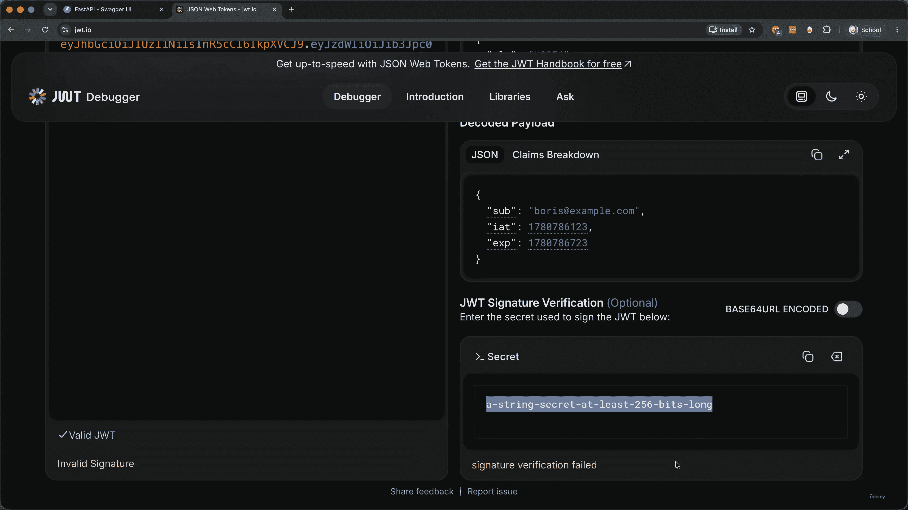

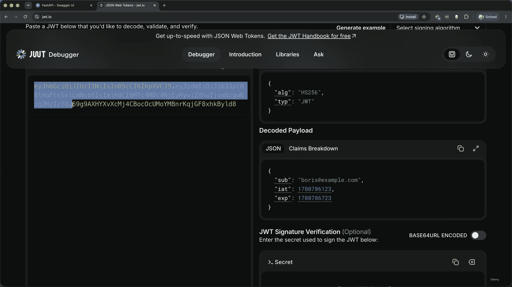

这就是 secret key 的作用：只有我们知道它，把它存储在服务器上，其他人无法访问，并且它同时作为创建 JWT 和验证 JWT 的基础。


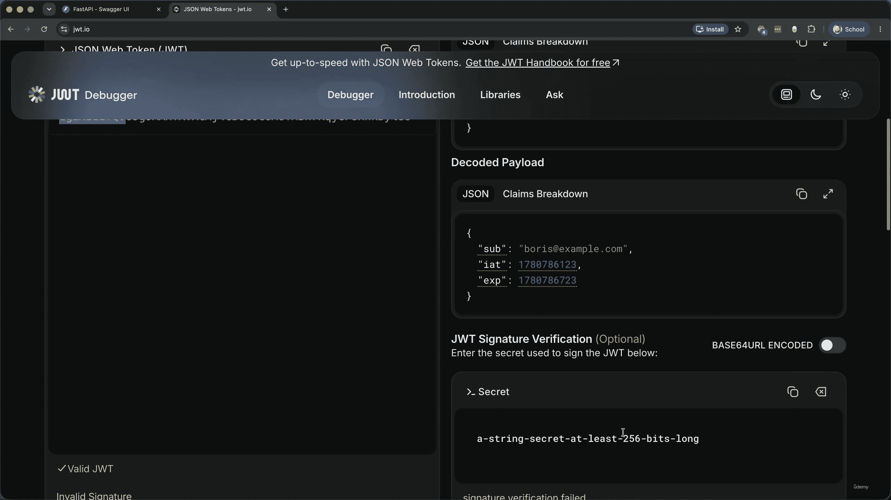

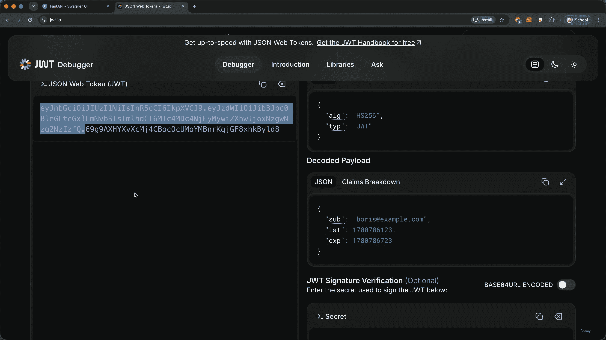

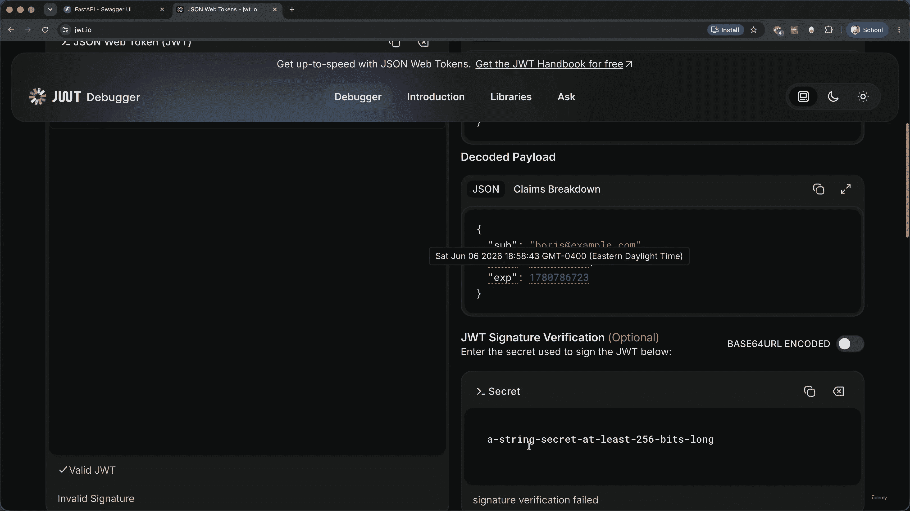

## ✅ 动手验证 secret key 的作用

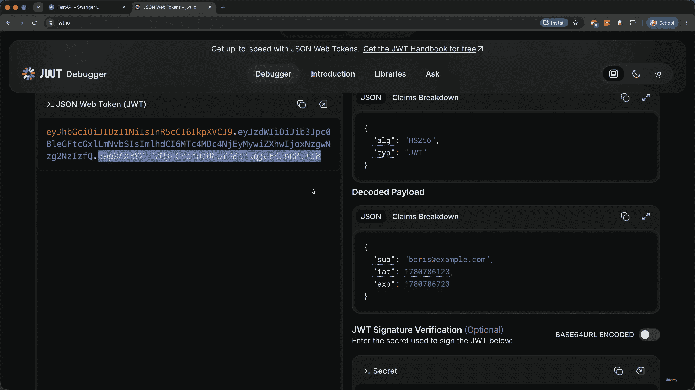

以下是本次动手验证的要点，方便你按步骤检查：

- 运行 `uv run python` 打开普通 Python REPL。
- 从 `security` 模块导入 `create_access_token`。
- 传入包含 `sub` 等字段的字典，必要时再传入过期时间差。
- 复制生成的完整 JWT，去掉开头和结尾的单引号。
- 在 jwt.io 解码器中粘贴 JWT，观察 header、payload、`iat` 和过期时间。
- 在 jwt.io 中尝试使用示例 secret key，确认签名验证失败。
- 复制 `.env` 中的真实 secret key 粘贴进去，确认签名验证通过。


这里再总结一下 secret key 的用途：它既用于创建 JWT，也用于验证从客户端返回服务器的 JWT 是否有效。只有服务器保存它，别人无法访问，所以伪造者即使知道 header 和 payload 的格式，也很难生成能通过验证的签名。希望通过这些步骤，能更清楚地理解 secret key 为什么是 JWT 安全性的核心。


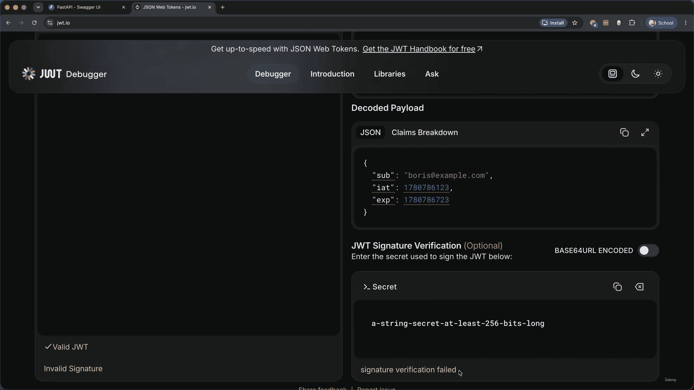

本节课中我们一起学习了如何测试 JWT 创建：我们在 Python REPL 中调用了 `create_access_token`，观察了 JWT 的 header、payload 和 signature 三部分，使用 jwt.io 解码并检查了 10 分钟有效期。我们还重点理解了 secret key 的作用，知道了没有服务器上的密钥就无法通过签名验证，也动手验证了示例密钥失败、真实密钥通过的过程。下一课我们继续学习后续内容。

