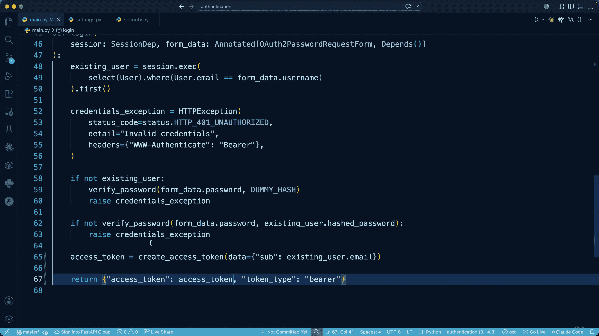
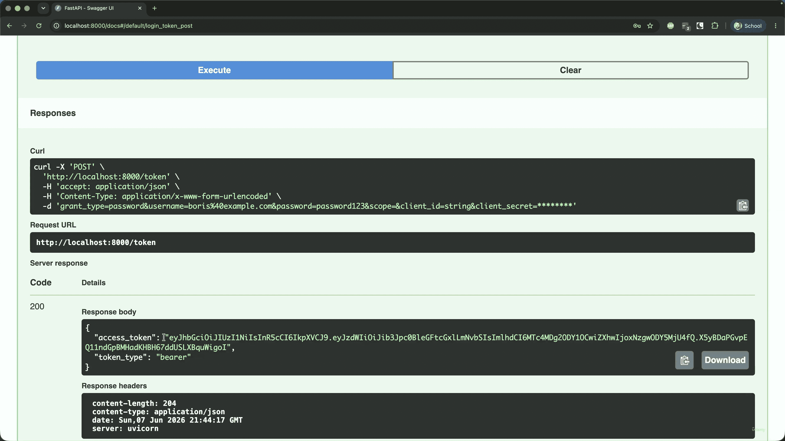

## 🔐 FastAPI Masterclass：第41节：登录时返回 JWT

在本节课中我们将要学习如何把前面写好的 JWT 创建函数真正接到登录路由里，让登录成功后返回一个 JWT 给客户端。上一节我们介绍了创建 JWT 的函数，本节中我们来看看如何在 `main.py` 的登录端点中使用它，并完成登录返回 JWT 的最后一步。

### 🧩 FastAPI Masterclass：第41节：在 main.py 中接入 JWT 创建函数

现在我们已经定义好了创建 JWT 的函数，最后的步骤就是在登录路由处理函数中使用它。回到 `main.py` 文件里，先导入这个新函数 `create_access_token`。然后在下面的 token 端点中，原来的代码都可以保留，同时要记得这里还有一个 JWT 占位符。接下来要做的，就是实际创建并返回 JWT 本身。

下面是接入时要做的事情，按顺序看即可。

- 在 `main.py` 中导入 `create_access_token`。

- 在 token 端点中保留原有代码，并找到 JWT 占位符。

- 定义一个新变量 `access_token`，用于保存创建出来的 JWT。

- 调用 `create_access_token`，传入表示 payload 的 `data` 字典。

- 在 payload 中加入用户的唯一标识符，后续请求里服务端才能解析出是谁在请求。

这里有一个关键点：JWT 里会编码用户标识，常见字段名或 claim 是 `sub`。所以可以这样写：key 是 `sub`，value 是上面已经从数据库取出的 `existing_user.email`，用邮箱作为唯一标识符。前面已经验证了用户存在，也验证了用户提供了正确密码，因此此时可以认为用户已经通过认证，可以返回真正的 JWT 访问令牌。

```python
access_token = create_access_token(
    data={"sub": existing_user.email}
)
```

> 后续请求中的身份识别，靠的就是 JWT 里的 `sub`，服务端解析后就能知道是哪个用户在请求。

完成函数导入和调用准备后，接下来进入真正的生成和返回步骤。这里要做的事情很直接：用上面的 `access_token` 替换原来的 JWT 占位符，而 `access_token` 应该就是 `create_access_token` 函数返回的 JWT 字符串。

```python
return {"access_token": access_token}
```

### 🧪 FastAPI Masterclass：第41节：在登录路由中生成并返回 JWT

上一小节我们准备好了函数和变量，本小节我们来看看登录端点最终如何返回 JWT。此时登录逻辑已经完整：先校验用户，再校验密码，认证通过后创建 JWT，最后把 JWT 返回给客户端。为了让 `sub` 和 JWT 结构更清楚，可以看下面这组要点。

- `create_access_token` 负责生成 JWT 字符串。

- `data` 字典表示 JWT 的 payload。

- payload 中的 `sub` 用来保存用户唯一标识。

- 这里使用 `existing_user.email` 作为 `sub` 的值。

- 返回给客户端的 `access_token` 就是 JWT 字符串。

JWT 的基本结构可以用下面的公式表示。

\[
\text{JWT} = \text{base64url(header)} + "." + \text{base64url(payload)} + "." + \text{signature}
\]

签名部分由 header 和 payload 计算得到，可以简单理解为下面的形式。

\[
\text{signature} = \text{sign}(\text{header} + "." + \text{payload}, \text{secret})
\]

到这里登录逻辑已经改好，接下来到浏览器里验证。现在可以打开浏览器测试代码，访问 `http://localhost:8000/docs`。这里数据库中已经有一个用户，因此可以直接进入 POST `/token`，点击 Try it out，然后填入用户凭据。如果忘记了自己的用户账号，也可以随时访问这个端点注册一个新用户。

下面是实际测试登录接口时可以照着做的步骤。



- 打开 `http://localhost:8000/docs`。

- 找到 POST `/token` 端点。

- 点击 Try it out。

- 用户名填入邮箱，例如 `Boris@example.com`。

- 密码填入 `password.123`。

- 假设输入正确，向下滚动并点击 Execute。

执行后可以看到，我们发出了 POST 请求并收到了 HTTP 200，响应里返回了 JWT。JWT 中可以看到 header、payload，以及末尾的 signature。需要记住，签名是使用 header 和 payload 计算出来的，而 payload 中还包含了当前时间，时间精确到秒，对应 `datetime.now()` 这类类方法。

### 🔄 FastAPI Masterclass：第41节：JWT 为什么会不断变化

上一小节我们完成了登录测试，本小节我们来看看为什么同一个账号连续登录时 JWT 会变化。因为 payload 中包含当前时间，所以即使只过一秒再访问同一个端点，当前时间也会不同，最终生成的 JWT 也会不同。连续点击几次 Execute 后，会注意到 JWT 一直在变化，原因就是每一秒时间都在变化，这会强制重新计算签名，从而得到完全不同的 JWT，变化主要体现在签名部分。

这个现象背后有几个关键点，可以按下面顺序理解。

- payload 中包含当前时间，时间精确到秒。

- 当前时间由 `datetime.now()` 这类类方法取得。

- 时间变化会改变 payload。

- payload 改变后签名需要重新计算。

- 签名变化后 JWT 整体就会不同。

- 变化最明显的位置通常是签名部分。

> 登录成功时返回 JWT 给客户端，后续每一个请求都需要客户端负责提供这个 JWT 字符串，也就是这个访问令牌。

### ✅ FastAPI Masterclass：第41节：本节总结



以上就是本节的主要操作和现象解释。登录时一切已经正常工作，服务端会把 JWT 返回给客户端，接下来就是客户端的责任：在后续每一个请求中提供这个 JWT 字符串，也就是这个访问令牌。本节课中我们一起学习了如何在 `main.py` 中导入 `create_access_token`，如何在 token 端点中创建 `access_token`，如何把用户邮箱写入 `sub`，如何替换 JWT 占位符，如何在 Swagger 页面测试登录接口，以及为什么 JWT 会随着时间变化而不断变化。

