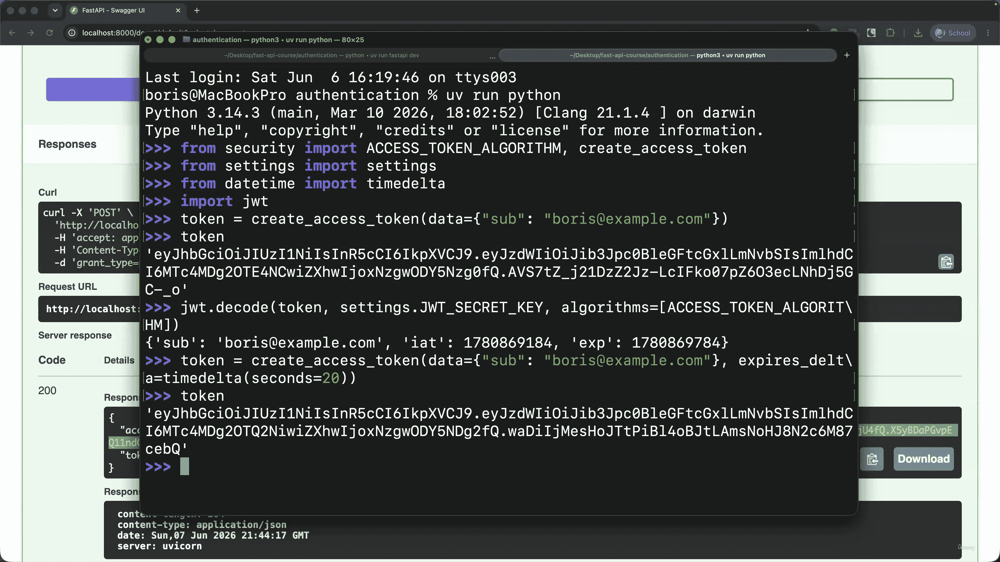
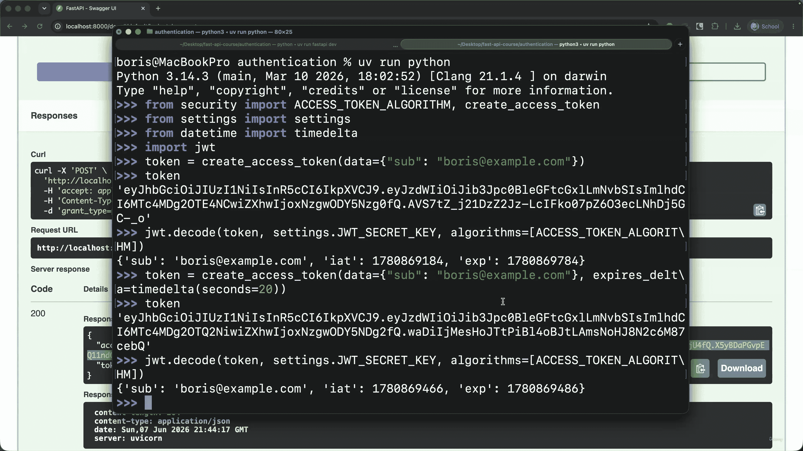
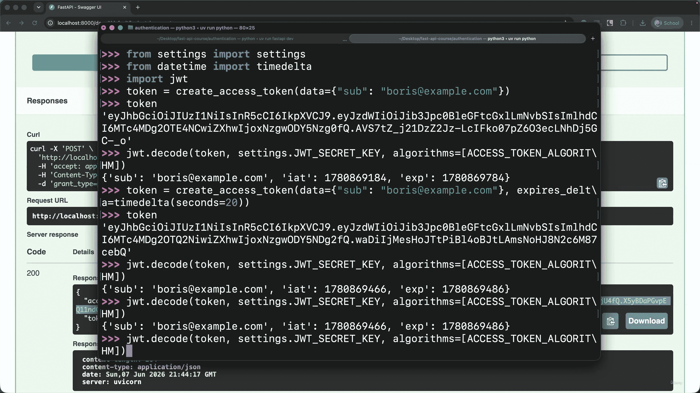
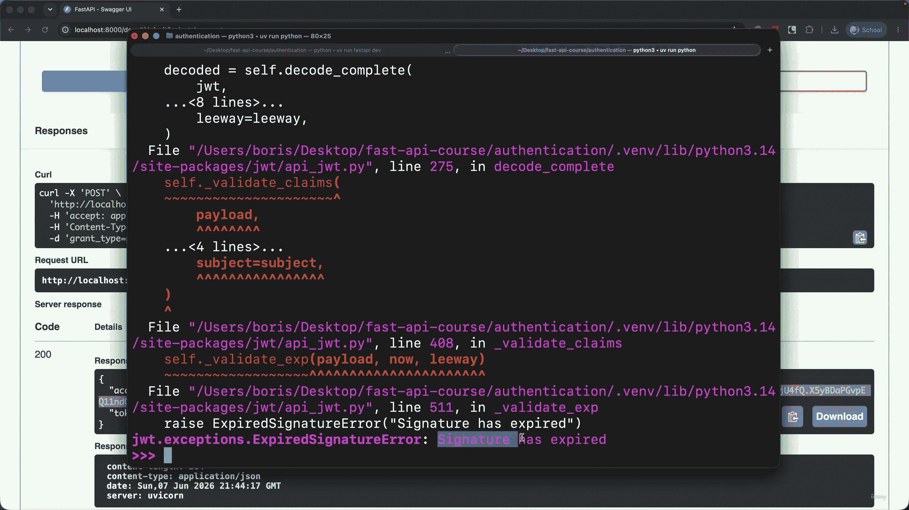

# 🔐 FastAPI Masterclass：p42-143：JWT 令牌过期

在本节课中我们将要学习 JWT 令牌过期是如何工作的。我们会先看 payload 里的过期声明 `exp`，再看 `encode` 和 `decode` 的区别，随后在 Python 交互环境里创建一个 JWT 并解码它，最后故意让 JWT 很快过期，观察解码失败时抛出的异常。学完本节，你就能理解后端为什么能在每次请求里判断令牌是否还有效，以及令牌过期后应该让用户重新登录。

在进入代码之前，先把最关键的概念说清楚：JWT 的 payload 里可以包含过期时间，这个时间决定了令牌从什么时候开始不能再被信任。下面我们来看看这个过期声明具体是什么。

## 🧩 FastAPI Masterclass：p42-143-1：过期声明 EXP 是什么？

当我们构造 JWT 的 payload 时，会包含一个过期声明，也就是 `exp`。这个字段用来指定 JWT 应该在哪个日期时间、或者说哪个以秒为单位的时间点过期。可以把它理解成下面这个关系：

```text
过期时刻 = 签发时刻 + 有效期
```

我们使用的库叫作 PyJWT。它会自动使用 `exp` 这个过期声明来判断 JWT 是否已经过期，并且会在尝试解码 JWT 时执行这项检查。换句话说，过期判断不是我们手写的，而是库在 `decode` 过程中帮我们完成的。

这里再提醒一下编码和解码的含义。编码 `encode` 是把 JSON 对象翻译成 JWT 字符串；解码 `decode` 是做相反的操作，也就是把 JWT 字符串转换成等价的数据 payload。例如，解码时会取出 JWT 的第二段，然后把原始 payload 作为 Python 对象返回，比如一个字典。理解了这一点，下面我们就可以在 REPL 里实际演示创建和解码令牌。

## 🧪 FastAPI Masterclass：p42-143-2：在 REPL 中准备令牌与依赖

接下来我会执行 `uv run python` 进入 Python 交互环境，并先导入几个依赖。以下是本节演示需要用到的导入项，每一项都有明确用途：

- 从 `security.py` 文件中导入 `ACCESS_TOKEN_ALGORITHM`，后面解码时会用到这个算法。
- 从同一个文件导入 `create_access_token`，用它创建令牌。
- 从 `settings` 文件导入 `settings` 对象，这个对象来自 Pydantic Settings，里面保存着 JWT 密钥；创建原始 JWT 和解码 JWT 都需要这个密钥，它用来验证 JWT 合法并且来自我们的服务器。
- 从标准库 `datetime` 模块导入 `timedelta`，后面自定义过期时长时会用到。
- 导入 JWT 库本身，也就是 `jwt`。

这些依赖准备好后，我们就可以创建令牌了。下面定义一个 `token` 变量，把 `create_access_token` 的调用结果赋值给它；`data` 参数传入一个示例 payload，也就是一个字典，其中 `sub` 键设置为一个任意邮箱地址，例如 `boris@example.com`。

```python
token = create_access_token(
    data={"sub": "boris@example.com"}
)
```

执行后可以看到得到一个有效的 JWT 字符串。这个字符串就是发送给客户端的令牌。当客户端在后续请求中把这个 JWT 带回服务器时，服务器需要解码它，把中间那段 Base64URL 编码的内容翻译回来，从而得到里面包含的 payload。接下来我们就来看解码过程。

## 🔄 FastAPI Masterclass：p42-143-3：解码 JWT 并验证签名

在实际代码里，JWT 库的编码函数叫 `encode`，对应的解码函数叫 `decode`。`decode` 的第一个参数接收 JWT 本身，也就是现在 `token` 变量里的字符串。但是只提供 JWT 还不够，解码时还必须提供密钥，因为只有使用这个特定密钥，才能生成前面看到的那种签名；反过来，没有密钥，服务器就无法验证这个 JWT 确实来自自己。下面列出 `decode` 调用中的关键参数：

- 第一个参数是 JWT 字符串，也就是 `token`。
- 第二个参数是密钥，使用 `settings.JWT_SECRET_KEY`。
- 第三个参数是算法，参数名是复数形式的 `algorithms`，这里传入 `[ACCESS_TOKEN_ALGORITHM]`。

这里 `algorithms` 使用列表，是因为这个函数在设计上可以处理多种不同算法，用来支持可能来自两个不同来源、使用不同编码格式或编码算法的 JWT。我们的场景不需要担心这种复杂性，只需要在列表里指定 `ACCESS_TOKEN_ALGORITHM` 即可。再次强调，执行反向转换时需要把内容都提供完整。对应的调用代码如下：

```python
payload = jwt.decode(
    token,
    settings.JWT_SECRET_KEY,
    algorithms=[ACCESS_TOKEN_ALGORITHM],
)
```

如果所有参数都提供正确，就会得到解码后的 payload。返回结果是一个字典，这说明 `decode` 函数成功执行，说明传入的内容正确，也说明当前仍然在过期窗口之内。默认情况下，创建 access token 时有效期为 10 分钟；原文在这里提到 1 分钟窗口，不过重点在于只要还在有效期内，解码就会成功。在服务器的每一次后续请求中，都可以运行类似这样的解码过程，从而验证 JWT 是真实的、合法的。由于已经用密钥验证了 JWT 确实来自真实用户，服务器就能在每次请求里识别用户身份，而不需要用户重新登录或再次输入用户名和密码。解码后的 payload 里仍然包含签发时间 `iat` 和过期时间 `exp`，当前时间处于这两个时间之间，所以解码成功。接下来我们看相反的情况：令牌过期后解码会失败。

## ⏰ FastAPI Masterclass：p42-143-4：让令牌过期并观察失败

现在来看反向场景，也就是 JWT 已经过期，导致解码失败。PyJWT 会使用 `exp` 字段判断过期，这是社区标准做法，用来知道一个 JWT 是否仍然有效。为了不等待 10 分钟，我们回到 `token` 声明的位置，使用 `create_access_token` 的第二个可选参数 `expires_delta` 来自定义过期时长。从 `datetime` 导入的 `timedelta` 对象正好可以传给它，例如设置 20 秒后过期。

```python
from datetime import timedelta

token = create_access_token(
    data={"sub": "boris@example.com"},
    expires_delta=timedelta(seconds=20),
)
```







执行后得到我们的令牌，同时时钟开始运行。再次执行解码函数时，只要还在 20 秒窗口内，JWT 仍然有效，解码就会正常工作。如果持续运行这个函数，最终会失败，也就是到达这个有效窗口的末尾；原文在这里提到 2 秒窗口，结合前面的设置应理解为 20 秒窗口。再次执行后，会看到完全不同的输出，此时 JWT 库的 `exceptions` 模块会抛出异常。异常信息类似下面这样：

> ExpiredSignatureError: The JWT's signature has expired

这段异常表示 JWT 的签名已经过期。放到真实世界的后端 API 中，这就是告诉用户“需要重新登录，你的 JWT 已经过期”的时机。因此，payload 里的 `exp` 声明或字段是一个关键组成部分，因为它指定了 JWT 什么时候过期；JWT 库会在每次解码时使用它来验证令牌，也就是每次把 JWT 字符串翻译回原始 payload 时都会检查。这个库把这些逻辑内置好了：当你从客户端带来的 JWT 字符串中获取 payload 时，如果操作无效，它会自动抛出异常，不需要我们手动处理这些细节。这就是使用该库时 JWT 过期的工作方式。



本节课中我们一起学习了 JWT 令牌过期机制：payload 中的 `exp` 声明指定过期时刻，PyJWT 在 `decode` 时自动检查过期并验证签名；我们看到有效期内解码会返回 payload，过期后解码会抛出 `ExpiredSignatureError`，后端应据此要求用户重新登录。下节课再见。
