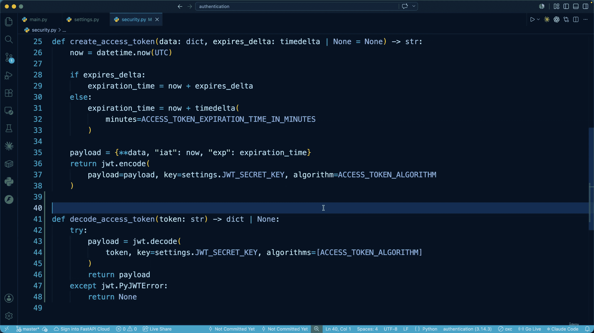
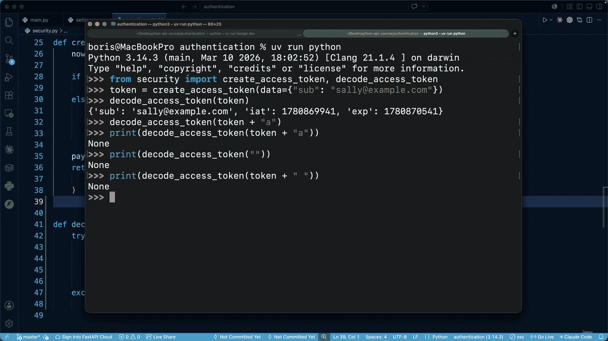

# FastAPI 大师课：第43节：解码 JWT 令牌 🔓


在本节课中我们将要学习如何在 FastAPI 应用里编写与“创建 JWT”配套的“解码 JWT”函数，并把令牌中的负载还原成 Python 字典。上一节我们在 Python REPL 里观察了解码过程，本节我们把这个过程封装进项目代码，并处理解码失败的情况。为了让初学者更容易理解，我们会从函数职责、参数、异常处理一直讲到 REPL 测试，确保每个环节都能对应到实际开发场景。


## FastAPI 大师课：第43节：编写解码函数 🛠️


上一节我们介绍了 JWT 在 Python REPL 中如何解码，本节中我们来看看如何把它写成 FastAPI 应用里的辅助函数。在 `security.py` 中，创建 JWT 的函数下面，我们新增一个互补函数，名字可以叫 `decode_access_token`。它执行与创建令牌相反的过程：接收一个 JWT 令牌，并把令牌里的负载转换回有效的 Python 字典对象。这样在路由处理器里就能拿到用户数据，例如用户唯一的邮箱标识。这个函数会比上面创建 JWT 的函数简单很多，因为签名、算法等复杂细节都由函数内部统一处理。


这个函数的核心思路可以用下面的公式概括：


```python
payload = jwt.decode(token, settings.JWT_SECRET_KEY, algorithms=[settings.ACCESS_TOKEN_ALGORITHM])
return payload
```


函数会接收一个字符串参数 `token`，这个参数通常由路由处理器传入。调用 JWT 库的 `decode` 时需要提供三个参数。下面是这三个参数的说明，先给出简短介绍，方便你逐个对照。


- 第一个参数是 `token`，也就是函数接收到的 JWT 字符串。

- 第二个参数是密钥，需要传入 `settings.JWT_SECRET_KEY`，这个值在项目配置中已经可用。

- 第三个参数是算法列表，需要传入访问令牌使用的算法，例如 `[settings.ACCESS_TOKEN_ALGORITHM]`。


可以看到，这个写法与创建 JWT 的写法非常相似，因为两个函数本质上在做互逆操作。创建函数把负载翻译成令牌，解码函数把令牌翻译回负载。我们先把解码结果赋给变量 `payload`，这个变量就是实际的字典，然后在函数末尾返回它。不过这里还没有考虑错误情况，所以下一步要补上异常处理。


## FastAPI 大师课：第43节：处理解码异常 🛡️


上一节我们写出了基本的解码流程，本节中我们来看看令牌无效时应该怎么办。在上一课中我们已经看到，如果令牌过期，或者令牌不匹配有效令牌，例如密钥判断它不真实，JWT 库就会抛出异常。其他类型的错误也可能让解码失败，因此函数不能假设永远成功。我们的处理方式是：如果得到有效负载，就返回负载；如果发生异常，就捕获错误并返回 Python 的 `None`。这里的 `None` 用作标识，表示 JWT 因为某种原因无法解码。


返回类型可以标注为字典或 `None`，对应代码如下：




```python
from jwt import PyJWTError

def decode_access_token(token: str) -> dict | None:
    try:
        payload = jwt.decode(
            token,
            settings.JWT_SECRET_KEY,
            algorithms=[settings.ACCESS_TOKEN_ALGORITHM],
        )
        return payload
    except PyJWTError:
        return None
```


在这段代码里，我们把整个解码操作包在 Python 的 `try` 语句中，这样就可以在下面用 `except` 捕获错误。异常类使用 JWT 库顶层的 `PyJWTError`，它是这个库抛出的各种错误的父类。也就是说，`decode` 函数是 `try` 块里唯一可能失败的部分；一旦它出错，库会抛出 `PyJWTError` 或它的子类，我们都能在这里捕获。捕获后直接返回 `None`，把结果交回给调用方，逻辑就完整了。


## FastAPI 大师课：第43节：在 REPL 中测试解码 🧪


上一节我们完成了带异常处理的解码函数，本节中我们来看看如何在 Python REPL 中验证它。这里运行 `python` 进入 REPL，导入两个需要的函数：先导入创建令牌的函数，再导入解码令牌的函数。因为密钥和算法等复杂性已经封装在函数内部，所以现在需要导入的内容少了很多。下面给出导入语句和测试步骤。


```python
from security import create_access_token, decode_access_token
```


先创建一个令牌。调用 `create_access_token`，传入一个数据负载，例如把 `sub` 声明设置为示例邮箱 `sally@example.com`。这个令牌会保存在变量里，然后调用 `decode_access_token`，把令牌传进去。正常情况下，我们会正确拿回字典，也就是令牌中的负载信息。这是“成功路径”，表示库没有抛出异常，JWT 是有效的。下面是成功路径的测试代码。


```python
token = create_access_token({"sub": "sally@example.com"})
decode_access_token(token)
```


接下来测试无效 JWT。例如在 JWT 末尾拼接一个随机字符 `a`。此时签名不再匹配，解码过程会知道这不是有效的 JWT 签名，因为它不符合密钥和预期的密码学校验。执行后会返回 `None`。这里看不到输出，是因为 Python 的 `None` 对象没有可见输出。可以把调用包在 `print` 里，让结果更清楚，证明函数确实返回了 `None`。这样就触发了“失败路径”：`except` 块捕获异常并返回 `None`。下面是无效令牌的测试示例。


```python
print(decode_access_token(token + "a"))
print(decode_access_token(""))
print(decode_access_token(token + " "))
```


除了末尾加字符，还可以测试完全无效的输入，例如空字符串，同样会返回 `None`。如果提供一个有效令牌但多了一个空格，也会返回 `None`。另外，如果超过过期时间窗口，例如等待 10 分钟后再解码一个原本有效的 JWT，它此时已经过期，同样会进入 `except` 块并返回 `None`。这些场景说明函数既能在成功时返回负载字典，也能在任何错误、问题、失误或过期情况下返回 `None` 给路由处理器。


## FastAPI 大师课：第43节：本节总结 📝




本节课中我们一起学习了如何在 FastAPI 项目中编写 `decode_access_token` 函数。我们让它接收 JWT 字符串，使用 `jwt.decode` 和配置中的密钥、算法把负载还原成 Python 字典；同时用 `try/except PyJWTError` 捕获解码异常，并在失败时返回 `None`。最后我们在 REPL 中验证了成功路径和各种失败路径，包括签名不匹配、空字符串、多余空格和令牌过期。这样路由处理器就能优雅地拿到用户负载，或者在令牌无法解码时得到明确的 `None` 结果。本课内容到这里就讲完了，我们下节课再见。


