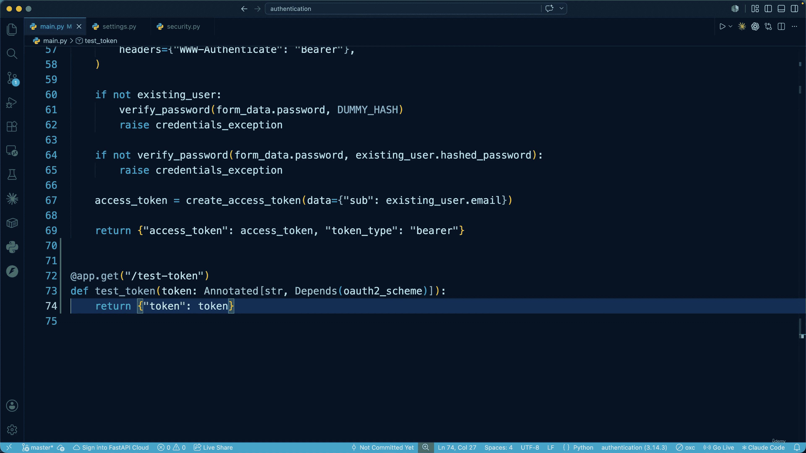
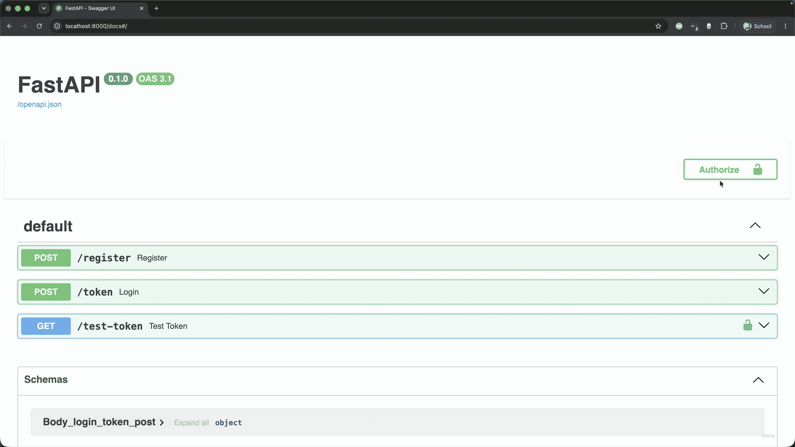
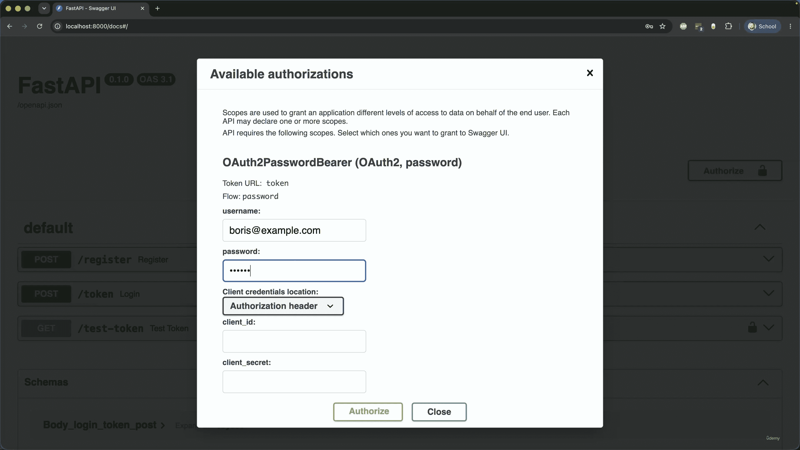
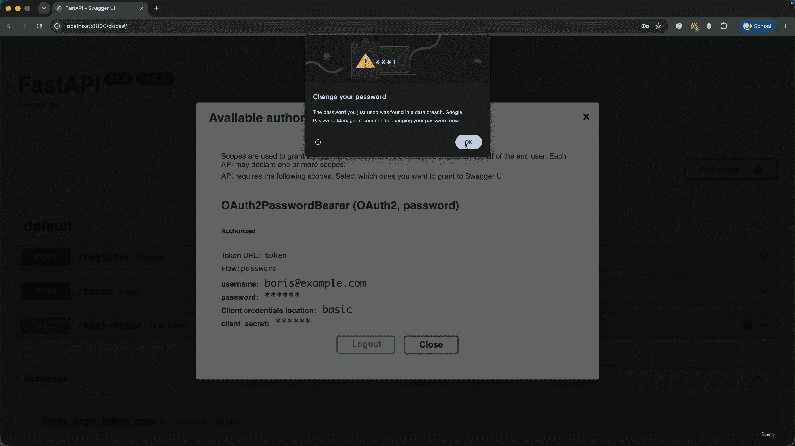
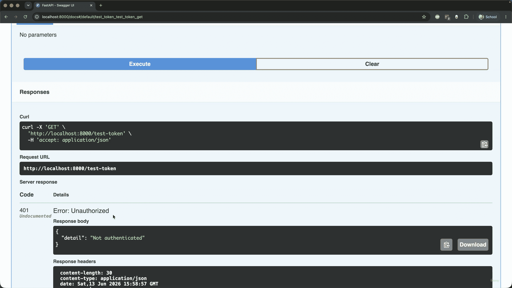
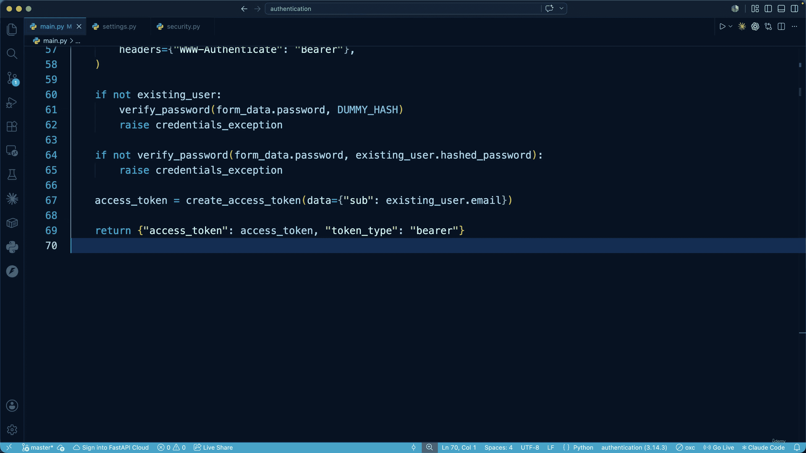

# FastAPI 大师课：第 44 节：OAuth2PasswordBearer 类 🚀

在本节课中，我们将学习如何让 FastAPI 路由真正接受 JWT，并了解一个名为 `OAuth2PasswordBearer` 的内置类是如何帮助我们解析令牌的。我们会先配置好这个类，然后用一个示例路由来演示认证保护的完整流程。在课程结束时，你将会看到客户端（在这里由 Swagger 扮演）是如何自动携带令牌，以及服务端又是如何在路由执行前拦截未认证请求的。

上一节我们实现了两个函数：一个用于创建 JWT 令牌，另一个用于解码 JWT 中的 payload。函数虽然写好了，但我们的路由还没法真正使用它们。接下来的任务就是让路由能够接受 JWT，并在收到后解码 payload，利用里面的信息做一些事情。让我们回到 `main.py` 文件，把这些能力接入到 FastAPI 的请求处理流程中。

首先，我们得搞明白 JWT 在实际请求中是怎么传递的。在典型的 JWT 认证流程中，JWT 并不是放在请求体里，也不是放在 URL 参数里，而是通过请求的头部（header）传递的。所谓 header，本质就是一个键值对，它可以附着在请求上，也可以附着在响应上。对于 JWT 认证来说，这个 header 的键名固定叫做 `authorization`，而对应的值则是一个字符串，格式如下：

```text
Authorization: Bearer <JWT>
```

这里的 `Bearer` 表示客户端正在“持有”这个令牌（bear 有“携带、持有”的意思）。在 `Bearer` 后面，紧跟着的就是真正的 JWT 令牌字符串本身。这种格式是 JWT 认证中一种非常常见的约定，几乎所有后端服务都认得这种写法。

那么，服务器的责任就变得很清晰了：当一个请求到达某个端点时，服务器需要查看这个请求的 headers，也就是那些由客户端传过来的元数据键值对。然后，从 `authorization` 这个键对应的值中，去掉开头的 `Bearer ` 前缀，把真正的 JWT 提取出来。拿到 JWT 之后，就可以对它进行解码，从而得到我们想要的、属于用户的那份 payload 信息。

幸运的是，FastAPI 提供了一个内置类，让我们轻而易举地就能测试这个流程，这个类就是 `OAuth2PasswordBearer`。不过，这里要先强调一下：在目前这个应用里，我们并没有真正的前端客户端。没有服务器渲染的 HTML 页面，也没有像 React 应用那样独立的客户端。但在现实世界中，客户端的职责是很明确的：当用户完成认证、拿到 JWT 之后，客户端要把这个令牌妥善地保存起来，并在之后每一次向服务器发请求时，都把这个令牌通过 `authorization` header 携带上。为了模拟这样一个客户端，我们就可以借助 Swagger UI（也就是 FastAPI 自动生成的交互式文档页面）来扮演这个角色。启用 `OAuth2PasswordBearer` 这个类之后，Swagger UI 就会变得像那个前端应用一样，自动帮你保存 JWT，然后在后续请求中自动把令牌放进去。这样一来，我们就能直观地看到整套机制是如何运转的。

先从导入开始。我们从 `fastapi.security` 这个模块中，把 `OAuth2PasswordBearer` 这个类引入到 `main.py` 文件里。

```python
from fastapi.security import OAuth2PasswordBearer
```

接下来，在代码的下方，我们要创建这个类的一个实例。创建实例的时候，这个类会接受一个必填参数，叫做 `tokenUrl`。我们要告诉 Swagger 的，就是这个参数：一个实际的端点 URL，Swagger 应该去请求这个 URL 来完成认证。换句话说，就是客户端去获取 access token（也就是我们说的 JWT）的 URL。回到我们的代码，下面确实有一个路由，它的路径就是 `token`，我们就用这个字符串来作为 `tokenUrl` 的值。

```python
oauth2_scheme = OAuth2PasswordBearer(tokenUrl="token")
```

这行代码就像是在 Swagger 和我们的认证路由之间搭建起了一根“导管”，让 Swagger 知道：要获取 JWT 令牌，请先访问 `token` 这个路径。之后，只要我们在 Swagger 文档页面上发起任何请求，Swagger 都会自动在请求头中加上一个 `authorization` 字段，字段的值就是之前拿到的 JWT 令牌。只需要这么一行配置，整个“客户端自动携带令牌”的流程就被模拟出来了。

现在，这个对象有一点非常有意思：它是可调用的（callable）。在 Python 里，可调用对象指的是任何可以使用一对括号 `()` 来调用或触发的东西。函数是一个典型的可调用对象，类也是。但除此之外，Python 还允许把一个普通的对象实例也变得可调用——也就是说，我们创建的 `oauth2_scheme` 这个实例，也可以直接被调用，就像调用函数一样。这个功能是怎么实现的呢？如果你去看这个类的源码，会发现开发者在定义这个类的时候，定义了一个特殊的“双下划线”方法，也就是魔法方法 `__call__`。只要一个类里定义了 `__call__` 方法，那么它创建出来的实例就可以用括号语法直接调用。每次用括号调用这个实例时，Python 都会在幕后把调用转发给这个 `__call__` 方法去执行。

看到这里你可能会问，这个特性跟我们有什么关系？这就要说到 FastAPI 的依赖注入机制了。FastAPI 的 `Depends` 函数需要一个可调用对象作为参数。它并不一定要求是一个普通函数或者类，虽然那两种也完全没问题，但 `Depends` 其实接受“任何可调用对象”，并且在真正运行路由处理函数之前，会自动先执行这个可调用对象。所以，正因为 `oauth2_scheme` 这个对象是可调用的，我们就可以把它直接传给 `Depends`。它被执行之后，会做两件非常关键的事情：

首先，它会在你真正调用路由处理函数之前，确保用户已经完成了身份认证。如果用户没有认证，那后面的路由逻辑根本不会执行。

其次，这个可调用对象还会负责解析 JWT 令牌本身。它会帮你找到请求头里的 `authorization` 键，取出对应的值，去掉开头那个 `Bearer ` 前缀，然后把真正干净的 token 内容返回给你。

除此之外，这个返回值还能以函数参数的形式直接注入到路由处理函数里。这真的是非常方便，省去了我们在每个路由里手动解析 header 的麻烦。

理论铺垫得差不多了，下面我们就来定义一个示例路由，演示一下这个机制是怎么工作的。我打算在 `main.py` 的最底部添加一个实验性的路由，这个路由以后可以随时删掉，纯粹为了演示。让我们把它定义成一个 GET 请求的路由，路径就叫做 `test_token`，这个名字完全是个占位符，你可以随便换。

对应的处理函数也叫 `test_token`。这个函数接收一个名为 `token` 的参数。刚才那个可调用对象 `oauth2_scheme` 会把解析出来的 JWT 令牌字符串交给我们。所以，这个 `token` 参数的类型就是 `str`，不过目前它还是未解码的原始 JWT 字符串，因为我们还没有调用之前那个用于解码 payload 的函数。这里我们使用 FastAPI 中非常熟悉的 `Annotated` 写法，把依赖注入进来：

```python
from typing import Annotated
from fastapi import Depends

@app.get("/test_token")
def test_token(token: Annotated[str, Depends(oauth2_scheme)]):
    return {"token": token}
```

你注意看，这里传给 `Depends` 的并不是一个类，也不是一个函数，而是一个对象。正因为这个对象支持括号调用，`Depends` 才能在幕后放心地调用它。这个对象将负责解析 JWT 令牌，同时确认用户确实是已认证状态，然后把解析好的令牌以 `token` 参数的形式传给我们。在函数体里，我们就简单地返回一个字典，键名是 `"token"`，值就是那个 JWT 令牌本身。这样，我们就能直观地看到，令牌是怎么从请求头一路传到路由函数里的。





现在，我们可以在浏览器里测试一下这个功能。打开 `localhost:8000/docs`，进入 Swagger 文档页面。你会发现页面上多了一个全新的按钮——“Authorize”。这是因为我们创建了 `OAuth2PasswordBearer` 这个类的实例，Swagger 侦测到之后，就自动把这个认证按钮显示了出来。现在，Swagger 文档页面就像是我们模拟出的一个前端客户端，它能够自动存储并保存 JWT，然后在之后我们对任何端点发起的每一个请求中，都自动加上这个令牌。不过这里有两个要点需要记住：



第一，这个自动携带令牌的机制，只在你完成认证之后才会生效。也就是说，你得先点击 “Authorize” 按钮，走一遍认证流程。

第二，这个状态是有“保质期”的，只要你还停留在当前页面上，它就一直有效。一旦你刷新了页面，状态就会重置回“未认证”，你需要重新执行一次授权操作。



所以，现在让我们点击那个 “Authorize” 按钮。点击之后，会弹出一个模态框。这个模态框里的一切，都是由那个类自动处理好的，它已经知道要去请求 `token` 这个端点——这就是我们刚才传入的 `tokenUrl` 参数的作用。接下来，我在这个模态框里输入我的测试用户凭证：用户名是 `boris@example.com`，密码是 `password123`。输入完成之后，点击下方的 “Authorize” 按钮，再跳过那个安全提示，就完成了授权。现在，页面右上角会显示已授权状态，而 Swagger 会自动在后续每一个请求的 `authorization` 请求头里附带上 JWT 令牌。

回到页面主体，你会注意到 `test_token` 这个路由旁边出现了一个小锁图标。目前，这个示例路由是唯一一个真正在处理 token 的路由，而那个锁的图标说明该路由目前是受保护的，如果没有通过认证，你是无法真正访问它的。也就是说，除非你提供了有效的 JWT 令牌，否则路由处理函数的代码就不会被执行。这是一种非常有效的保护方式。

让我们来验证一下。点击该路由旁边的 “Try it out” 按钮，然后再点击 “Execute” 按钮，发起请求。首先看响应区域，你会得到一个 JSON 响应，里面就包含着完整的 JWT 令牌。再看请求的 curl 命令，那里面有一个 `-H` 参数，这个 `-H` 就是 “header” 的缩写。在 `-H` 后面，我们可以看到 `authorization` 这个 header 字段确实被加进去了：左边的 `authorization` 是键名，后面跟着的值是 `Bearer`，再后面就是实际的 JWT 令牌字符串。而这个令牌正是我们传给 `Depends` 的可调用对象所解析的目标。它把这段完整值中的 `Bearer` 前缀剥掉，只留下 token 本身，然后作为 `token` 参数传入路由函数，最后我们又在返回值里把它原封不动地发了出来。

如果你想看到更底层的证据，我们还可以在浏览器的开发者工具里查看网络请求。右键点击页面，选择“检查”，然后切换到“网络”标签页。接着再次点击 “Execute” 按钮发起请求。你会看到在请求列表里出现了刚才那个发送到 `test_token` 端点的请求。展开这个请求，这次我们不要看响应头（response headers），我们要看的是请求头（request headers），也就是从客户端（浏览器）发给服务器的那些头部信息。往下滚动，你就会看到同样的 `authorization` 请求头，它的值同样是 `Bearer` 后面跟着 JWT 令牌。

到这一步，整个标准流程已经跑通了：客户端按约定发送请求头，服务端知道如何从中读取令牌。虽然我们现在还没有对令牌进行解码，但我们已经可以访问这个令牌信息了，之后如果愿意，随时可以调用之前写好的辅助函数来解码它。

接下来，我想演示一下“未认证”的情况。让我刷新一下页面。刷新之后，我们又回到了初始的未认证状态。现在，我再次尝试访问同一个端点：点击 “Try it out”，然后点 “Execute”。这个时候，我们手里还没有 JWT，因为我们没有通过授权流程去获取过令牌，所以就无法提供它。结果就是，`authorization` 请求头要么压根不存在，要么就是一个没有填充的空值。于是，当 `Depends` 调用的那个可调用对象开始运行时，它根本找不到有效的 JWT 来解析，它知道我们没有 JWT，知道我们尚未认证，于是会立刻抛出一个错误。这样一来，路由处理函数的逻辑根本不会被执行，我们也就永远走不到返回字典那一步。你可以看到在请求详情里，`authorization` 请求头真的是没有被传过去，服务器返回的错误就是 `Unauthorized`（未授权）。

这个结果其实非常理想。我们成功地在应用中构建了一道“认证防护墙”，凡是需要 JWT 才能访问的端点，现在都会被这道防护墙挡住。而 JWT 在这里就是“你已经登录”的凭证证明。没有这个凭证，谁也进不来。



最后，我们回到 VS Code 编辑器，把这个示例路由删掉，毕竟它只是为了演示而临时加的。删掉之后，代码就恢复干净了。有了这个基础，下一节课我们就可以开始构建一个真正能用的真实端点，以及一个更强大的依赖项。那个依赖项不会仅仅停留在“解析令牌”这一步，而会进一步对令牌进行解码，并从里面取出用户信息来使用。



本节课中，我们一起学习了 `OAuth2PasswordBearer` 类的使用方法，理解了 JWT 在请求头中的传递格式，通过 `tokenUrl` 让 Swagger 扮演客户端来自动携带令牌，并利用可调用对象和 `Depends` 实现了对令牌的解析与端点保护。我们还在浏览器里验证了认证成功和认证失败两种场景。最后，我们清除了示例路由，为下一节构造真实端点和解码用户信息打下了基础。
