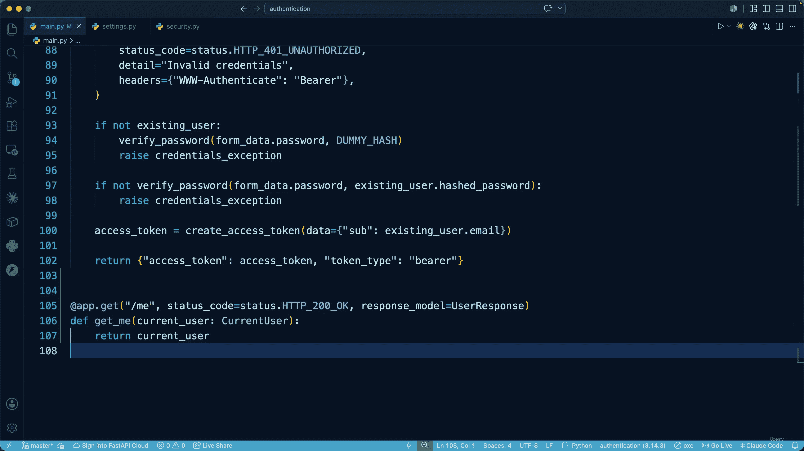
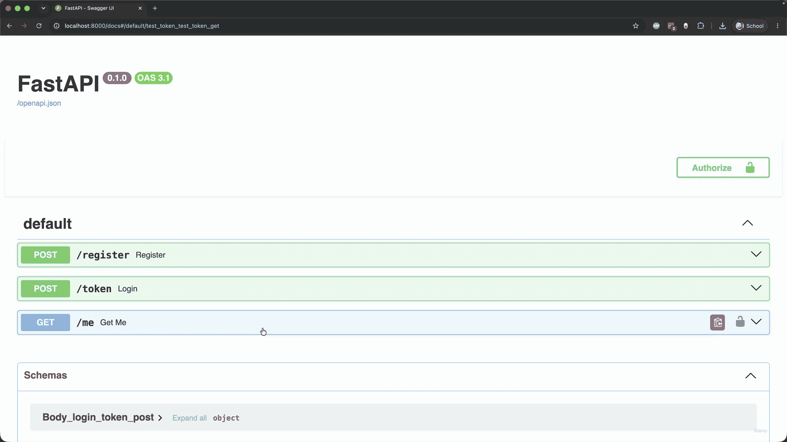
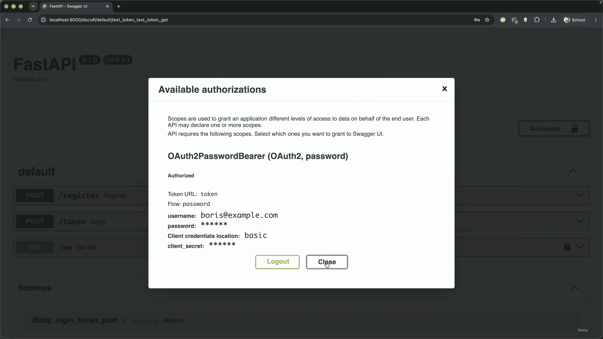
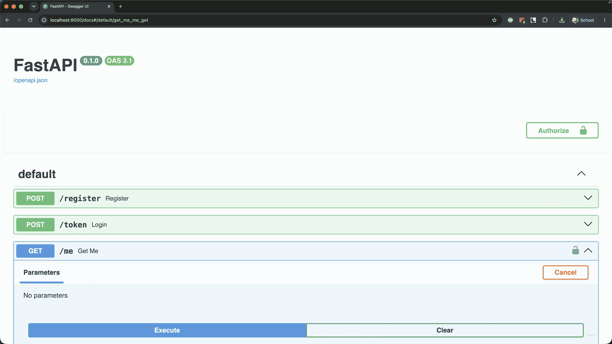

🔐 FastAPI Masterclass：第146讲：get_current_user依赖

在本节课中，我们将学习如何创建一个名为`get_current_user`的依赖函数。这个依赖专门负责验证JWT、解析用户信息、从数据库取出用户对象，并把所有相关逻辑集中在一处。这样一来，任何需要当前用户身份的路由处理器，只需要声明一个依赖参数，就能自动完成一系列原本繁琐的验证工作。我们还会动手创建一个`/me`端点来演示依赖的实际效果。

## 为什么需要 get_current_user 依赖

在之前的课程里，我们已经在API中使用了JWT来实现认证。但是，大家不妨设想一下：如果一个API中有很多不同的路由处理器都需要用到当前用户信息，那么每个路由都要重复写一遍JWT解析和校验流程吗？显然不行。一个比较聪明的做法是，把“从请求中解析JWT、解码JWT、检查邮箱标识、查询用户记录”这一整套动作封装成一个依赖函数，所有路由共享这一个函数。这样做能有效避免代码重复，也让路由处理器变得简洁。

具体来说，这个依赖函数需要依次完成以下任务：从Authorization请求头中解析出JWT字符串；对JWT进行解码；检查解码后的payload是否包含用户邮箱；如果JWT有效且邮箱存在，则用邮箱去数据库查找用户；如果以上任意一个环节出了差错，就抛出一个统一的错误响应。我们把函数命名为`get_current_user`，它的职责边界就是这样。

## 定义 get_current_user 依赖函数

下面我们开始写代码。首先，因为最终需要从数据库获取用户，所以需要数据库会话依赖。这里我们定义一个名为`session`的参数，类型为`Session`，并通过`Depends(get_db)`注入会话。为了照顾初学者，这里我们假设数据库会话的获取函数已经按之前的课程配置好了。

接下来，和上一节课一样，我们需要一个`token`参数。这个参数的类型需要用`Annotated`来标注，具体写法是`Annotated[str, Depends(oAuth2Scheme)]`。其中`oAuth2Scheme`就是我们在第12行代码中创建的`OAuth2PasswordBearer`实例。当FastAPI看到这个注解时，它会在后台自动调用`oAuth2Scheme`去提取Authorization头中的令牌，并把原始JWT字符串赋值给`token`。这样一来，依赖函数内部就同时拿到了数据库会话和JWT字符串。

直接看代码可能会更清楚。下面是依赖函数的初始骨架：

```python
from typing import Annotated
from fastapi import Depends, HTTPException, status
from sqlalchemy.orm import Session
from database import get_db
from security import decode_access_token, oAuth2Scheme

def get_current_user(
    session: Session = Depends(get_db),
    token: Annotated[str, Depends(oAuth2Scheme)] = None
):
    # 后续代码
    pass
```

注意，这里的`token`参数仍然只是一个JWT字符串，不是已经解码的数据。所以接下来的第一步，是调用我们之前写好的辅助函数`decode_access_token`来解码这个JWT。我们需要先导入这个函数，然后定义一个变量`payload`，把`token`传进去。如果一切正常，`decode_access_token`会返回一个字典，字典里包含JWT的payload信息，其中就包括用户邮箱。

但这里有一个容易踩坑的地方：`decode_access_token`函数在出错时并不会抛异常，而是返回`None`。也就是说，如果JWT格式不正确，或者JWT已经过期，我们拿到的`payload`就会是`None`，而不是一个字典。因此，在继续往下操作之前，必须先检查`payload`是否为空。

以下是这一段的代码示范：

```python
def get_current_user(
    session: Session = Depends(get_db),
    token: Annotated[str, Depends(oAuth2Scheme)] = None
):
    payload = decode_access_token(token)
    if not payload:
        raise invalid_token_exception
    # 后续代码
```

上面代码中的`invalid_token_exception`还没有定义，我们马上就来定义它。

## 定义统一的无效Token异常

由于这个异常可能在多个地方被抛出，为了方便复用，我们把异常对象提取成一个独立的变量。这个变量命名为`invalid_token_exception`，类型是`HTTPException`。在创建这个异常实例时，需要提供状态码`401`，对应HTTP协议中的“未授权”（Unauthorized）。通俗地说，就是用户没有携带有效令牌，系统不允许他继续操作。

对于异常中的`detail`字段，我们使用一个通用的提示消息，比如`"Invalid token"`。这里刻意不写“你的JWT格式错误”或者“令牌已过期”这种具体信息，而是把消息保持得尽可能模糊。这样做的目的是增加黑客的猜测难度，避免他们利用错误提示来探测系统内部细节。除了状态码和详情，按照OAuth2规范，我们还应该在响应头中返回一个`WWW-Authenticate`字段，值为`Bearer`。这个头的作用是告诉客户端，这个API使用的认证方案是Bearer Token。

这部分的代码写法如下：

```python
invalid_token_exception = HTTPException(
    status_code=status.HTTP_401_UNAUTHORIZED,
    detail="Invalid token",
    headers={"WWW-Authenticate": "Bearer"},
)
```

现在，只要有无效令牌传入，我们就可以在依赖函数中直接`raise invalid_token_exception`，不需要在多个地方重复创建异常对象。

## 从payload中提取邮箱并验证

假设我们已经通过了`if not payload`这关，说明JWT有效，`payload`是一个字典。接下来要做的，就是从这个字典中取出用户邮箱。回顾一下登录时的逻辑：我们在生成JWT时，把用户邮箱放在了payload的`sub`键中。也就是说，`sub`就是存放用户邮箱的唯一标识键。

但是在提取时，如果直接使用`payload["sub"]`这种方括号语法，万一`sub`键不存在，Python会抛出`KeyError`，最终导致整个路由处理函数失败。为了代码更健壮，更好的做法是调用字典的`.get()`方法，传入键名`"sub"`。`.get()`的行为是：如果键存在，返回对应的值；如果键不存在，返回`None`，而不会抛异常。这样做可以避免因为键缺失而让整个请求崩掉。

理论上，从有效JWT中提取出来的`sub`键就应该是用户邮箱。但为了防御一些极端情况，比如JWT有效且未过期，但payload里偏偏没有`sub`键，我们还需要再做一次判断：如果`email`为`None`，就继续抛出同一个`invalid_token_exception`。这种概率其实很小，因为一个JWT既然能被服务端解码，说明它当初生成时一定包含了`sub`键。但既然我们想要处理所有可能出错的情形，多写一行防御代码也无妨。

相关代码示意如下：

```python
def get_current_user(session, token):
    payload = decode_access_token(token)
    if not payload:
        raise invalid_token_exception

    email = payload.get("sub")
    if not email:
        raise invalid_token_exception
    # 后续代码
```

## 从数据库中获取用户

到目前为止，我们已经确认了三件事：JWT有效、payload字典存在、email字段存在。剩下的工作就简单了，直接用这个email去数据库里查用户。我们可以使用SQLAlchemy的`select()`函数，配合`where()`条件语句来构造查询。具体的做法是：用`session.execute(select(User).where(User.email == email))`执行查询，然后调用`.first()`获取结果集中的第一行记录。之所以要`.first()`，是因为`execute`返回的是一个`Result`对象，里面可能包含多行数据，而我们只需要满足条件的第一条用户记录。

如果数据库中存在该邮箱对应的用户，那么`user`变量会是一个`User`对象；反过来，如果邮箱在数据库中根本不存在，那么`user`会被赋值为`None`。因此，我们沿用之前一模一样的防御模式：再次检查`user`是否为空。如果真的找不到用户，就继续抛出`invalid_token_exception`。这样一来，无论哪里出错，客户端收到的都是同样的“无效令牌”错误，不会暴露数据库里是否有这个邮箱。

查询并返回用户的代码大致如下：

```python
def get_current_user(session, token):
    payload = decode_access_token(token)
    if not payload:
        raise invalid_token_exception

    email = payload.get("sub")
    if not email:
        raise invalid_token_exception

    user = session.execute(
        select(User).where(User.email == email)
    ).first()
    if not user:
        raise invalid_token_exception

    return user
```

到了这一步，所有必要的信息都已经齐备，就可以把`user`对象返回给调用方了。调用方拿到这个用户对象后，既可以执行后续的数据库关联查询，也可以直接把用户信息作为响应数据返回。

## 抽取 current_user 类型别名

现在，`get_current_user`依赖已经可以工作了。任何路由只要能调用这个依赖，就能自动完成JWT校验和用户获取。但这里有个小麻烦：在路由处理函数中，如果每次都要写一长串`user: Annotated[User, Depends(get_current_user)]`，虽然不算复杂，但总归显得冗长。为了解决这个问题，我们可以把这段注解抽取成一个类型别名。

在Python的类型注解中，`Annotated[类型, 依赖]`的第一个值是参数的实际类型，第二个值是FastAPI的`Depends`，而`Depends`接受一个可调用对象。这个可调用对象就是我们的`get_current_user`函数，执行后返回真实的用户对象。我们把这个整体赋给一个变量，命名为`current_user`，于是就有了下面这一行代码：

```python
current_user = Annotated[User, Depends(get_current_user)]
```

这里面的设计模式跟课程中反复出现的其他类型别名一模一样。定义好之后，任何需要用当前用户的路由，只需要把参数声明为`current_user`类型，FastAPI就会在后台运行`get_current_user`依赖以及它内部的所有校验逻辑。我们不仅减少了重复代码，还把“如何获得当前用户”这件事完整地隐藏在一个地方，后续维护起来非常方便。

## 创建 /me 端点作为示例

光说不练假把式，现在我们用这个依赖来创建一个真正能用的路由。我们的目标是这样：用户只有在成功登录且JWT有效的情况下，才能访问一个查看个人信息的端点。这个端点不妨叫做`/me`，含义就是“我自己”。

首先，为这个GET端点指定成功状态码为`200 OK`。同时，由于我们不想把所有数据库字段一股脑暴露给客户端，可以借助之前定义好的Pydantic响应模型`UserResponse`来过滤掉不必要的字段。在FastAPI中，只要在路由装饰器里写上`response_model=UserResponse`，返回的数据就会自动按照该模式进行序列化。

实现部分非常简单。我们定义一个名为`get_me`的函数，它接收一个`user`参数，而这个参数的类型恰好就是刚才抽取出来的`current_user`类型别名。看到这里，你可能会惊讶于代码量如此之少，但请记住，这一行小小的参数声明背后，已经调用了`get_current_user`依赖，依赖内部又执行了解码JWT、校验payload、查询数据库等一系列操作。正是这些隐藏起来的逻辑，让路由函数本身显得格外干净。

假定以后我们有10个路由都需要得到当前用户，只需要在每个路由中写上同样的`current_user`参数，然后直接使用即可。根本不需要把JWT解析代码复制来复制去，这正是抽象和封装的威力所在。因此，这里的`get_me`函数只需要一行`return user`，不需要再添加任何额外逻辑。

示例代码如下：





```python
from fastapi import APIRouter, Depends, status

router = APIRouter()

@router.get("/me", response_model=UserResponse, status_code=status.HTTP_200_OK)
async def get_me(user: current_user):
    return user
```

这里还要特别说明一点：由于`get_current_user`内部依赖了我们在上节课中使用的同一个`oAuth2Scheme`，所以这个`/me`端点会自动要求认证。也就是说，如果用户没有登录或者JWT无效，这个端点就绝不会被访问；只有携带了有效JWT的登录用户才能获取自己的信息。

## 在Swagger UI中测试依赖

代码写完之后，自然要检验一下效果。我们在浏览器中打开`http://localhost:8000/docs`进入Swagger UI。这里先提醒一下，为了让Swagger在发送请求时自动附加JWT到Authorization头，我们必须先完成授权操作。具体来说，就是点击页面右上角的“Authorize”按钮，在弹出的对话框中输入测试账号的用户名`Boris@example.com`和密码`password123`，然后点击“Authorize”关闭对话框。完成这一步后，`/me`端点就会从锁定状态变为可访问状态。

接下来，我们展开`/me`端点，点击“Try it out”按钮，再点击“Execute”按钮发送请求。这时你会在请求信息中看到Swagger已经自动把JWT放在了Authorization头里，随后页面下方会出现响应结果。看到这个响应，说明整个链路是通的：`get_current_user`函数成功执行，JWT有效且未过期，从解码后的payload中提取出的`sub`键正好对应数据库中的用户邮箱，数据库里也能找到这个用户，最终`get_me`函数拿到了`current_user`对象并成功返回。



为了证明未登录用户无法访问，我们可以做个对照实验。刷新Swagger页面，让我们回到未认证状态。此时再次尝试请求`/me`端点，不出意外的话，你会收到一个`Not authenticated`错误。原因很简单：我们没有登录，Swagger也就不会在请求中带上Authorization头，FastAPI在依赖层就拦截了这个请求。这样一来，一切表现都符合预期。

## 总结



在本节课中，我们一起学习了如何编写`get_current_user`依赖。我们创建了一个包含数据库会话和JWT字符串参数的依赖函数，通过`decode_access_token`解码JWT，并用防御性的`.get("sub")`从payload中提取邮箱。为了统一错误行为，我们定义了`invalid_token_exception`，用模糊的提示信息避免泄露细节。随后，我们用邮箱查询数据库，并在用户不存在时抛出同一个异常。我们还抽取了`current_user`类型别名，让路由写起来更简洁。最后，通过一个`/me`端点，我们实际验证了依赖在Swagger UI中的效果，也确认了未登录用户会被拒绝。这个依赖把复杂的认证逻辑隐藏在了单个函数背后，堪称可复用设计的典范。本节课就到这里，我们下节课再见。

