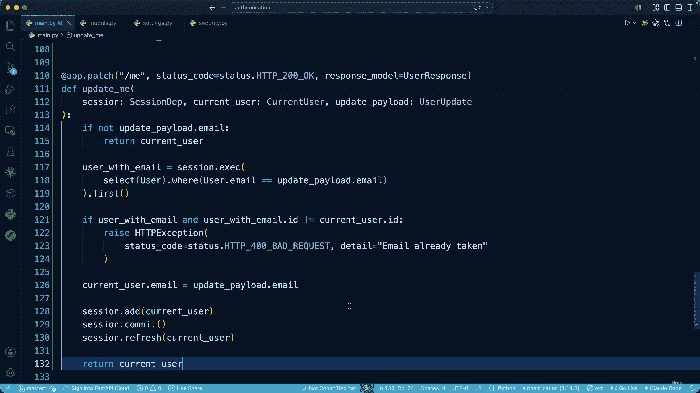
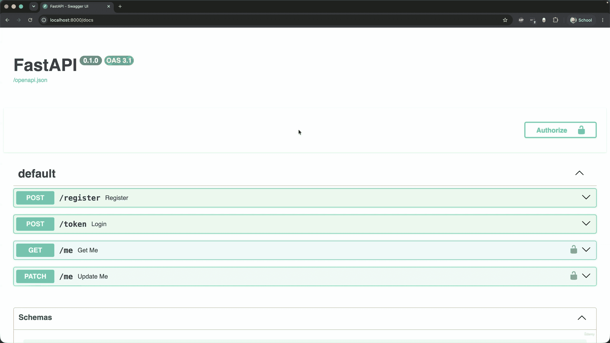
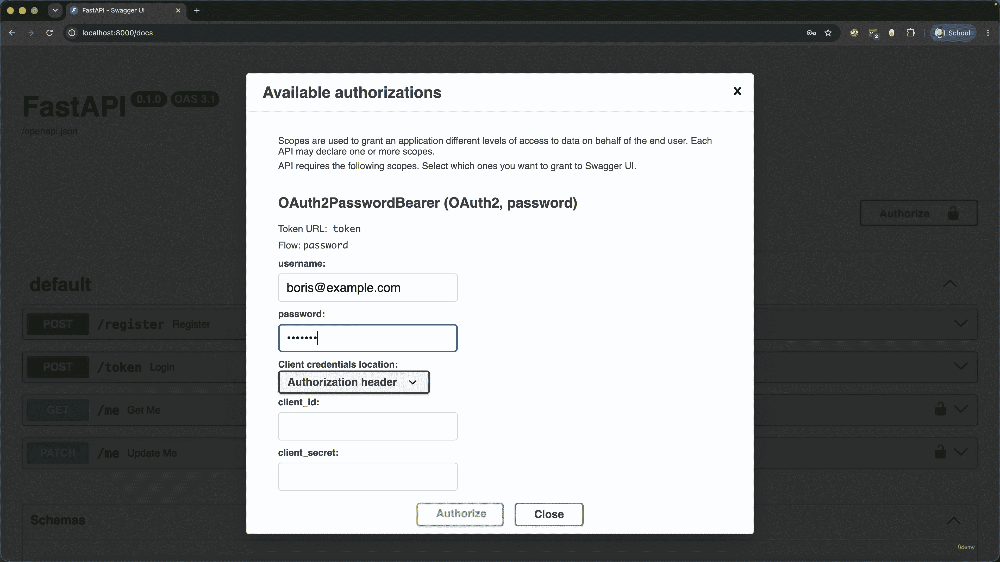
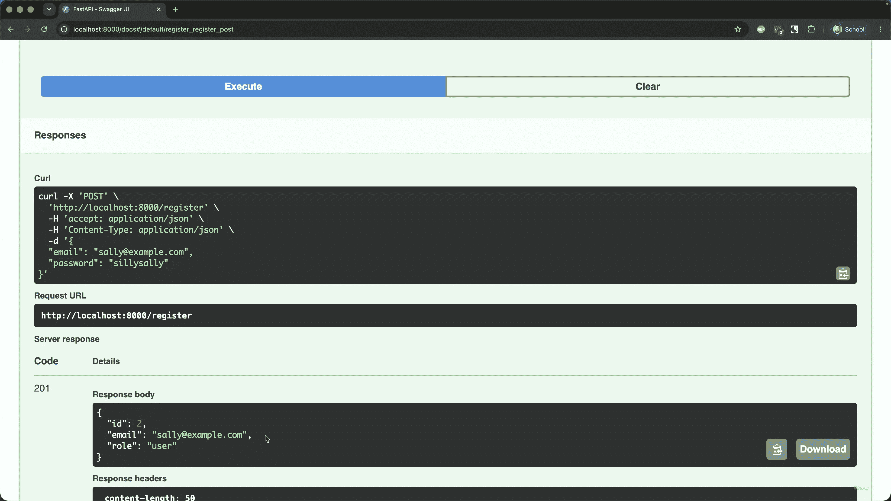
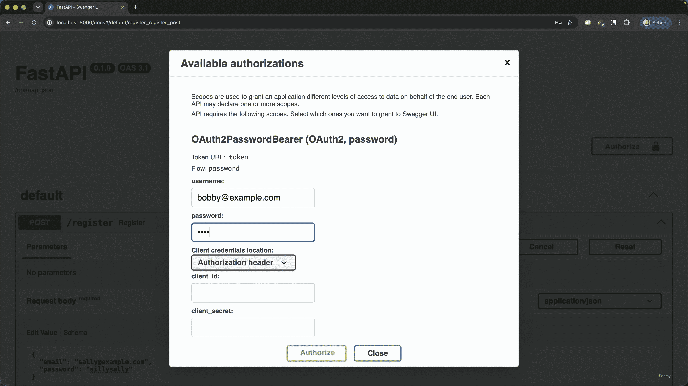
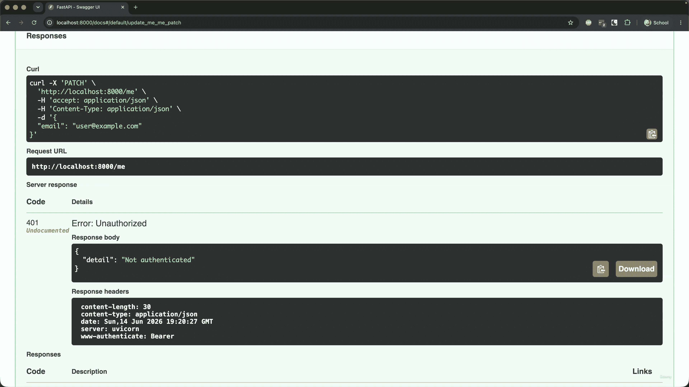

# FastAPI Masterclass：第46节：保护路由 🔒

在本节课中，我们将学习如何利用 FastAPI 的依赖注入系统来保护路由。我们会看到，只要在路由处理函数的参数中把类型标注为 `current_user`，FastAPI 就会自动要求用户必须先完成认证，否则无法访问这个端点。我们还会动手实现一个 `PATCH /me` 端点，让已经登录的用户可以更新自己的邮箱，同时处理重复邮箱、JWT 失效等实际问题。通过这节课，你会彻底理解“受保护路由”背后的工作原理，并能在自己的项目中灵活使用。


## 定义受保护的路由 🛡️

现在，我们已经有了一个可复用的“当前用户”类型。有了它之后，定义需要认证的端点就变得极其简单：只需要把路由处理函数中的某个参数类型标注为 `current_user`，FastAPI 就会在后台自动完成认证检查。也就是说，用户必须已经登录并且携带有效的 JWT，才能真正执行这个路由处理函数。

我们来实际操作一下。在应用里定义一个 `PATCH /me` 端点，让用户可以更新自己个人信息中的某些字段。目前，我们只开放邮箱的修改。提醒一下，邮箱字段已经在用户模型上存在了，我们确实有 `email` 这个属性。我们绝对不应该允许用户任意发送 `PATCH` 请求去修改自己的角色，因为那样的话，普通用户有可能把角色改成管理员，获得本不该有的权限。所以，这个 `PATCH /me` 端点要严格限制为只能修改自己的邮箱。

在 `main.py` 的下方，我们可以直接复制大部分现有代码，因为新端点和已经写好的 `/me` 端点结构非常相似。这里我会定义一个 `PATCH` 请求，指向同一个 `/me` 端点。成功时仍然返回 `200` 状态码，响应体也还是 `UserResponse` 这种结构。下面我定义一个函数，名字叫 `update_me`。

这一次，为了更新用户数据，我们需要和数据库交互，因此要提供一个 `session` 参数，类型标注为 `SessionDep`。同时，我还想拿到当前登录用户的信息，所以这里再加一个 `current_user` 参数。最关键的是这个 `current_user` 的类型标注，它背后依赖 `Depends` 函数和 `get_current_user` 依赖。正是这个标注，在后台强制要求用户必须先通过认证，才能执行路由处理函数。之前的那些复杂逻辑，比如解析 JWT、查询用户、验证有效性，全部都被封装到了一个地方。我们只要把这个参数写上，就自动获得了完整的认证校验。

```python
@app.patch("/me", response_model=UserResponse)
async def update_me(
    session: SessionDep,
    current_user: User = Depends(get_current_user),
    update_payload: UserUpdate,
):
    # 业务逻辑
    pass
```

除了和数据库交互、确保用户已经登录之外，我们还需要一个请求体，让用户在这里提供想要修改的新邮箱。我们把这个参数叫做 `update_payload`，类型标注为 `UserUpdate`。你可能需要在上方导入这个类，它是在前面某个课程中定义好的。你可以看到，`UserUpdate` 就是一个请求体模型，里面只有一个可选的 `email` 字段。这也是目前唯一允许更新的字段。如果以后你想让端点支持同时修改五个不同的属性，你当然可以扩展这个模型，让请求体能够接收任意数量的字段。


## 实现更新逻辑 ✏️

进入路由处理函数的实际逻辑后，第一步就是确认请求体里确实有 `email` 属性，并且它不是 `None`。我写的判断是 `if not update_payload.email`，这其实就是在检查 `email` 是否等于 `None`，也就是用户没有提供这个字段。在这种情况下，与其抛出一个错误，不如直接返回用户当前的信息。用户明明发起了更新请求，但如果没有给新邮箱，与其说“你哪里弄错了”，不如说“好的，完全没问题，这是你现在的用户信息”。所以这里我直接返回 `current_user` 对象。这样一来，就确保我们继续往下走时，手里已经有一个实际存在的 `email` 值了。

接着，我要验证一个关键问题：用户提供的新邮箱，是否已经被系统中的另一个用户占用了。比如，我的邮箱是 `boris@example.com`，我想把它改成 `bobby@example.com`，但系统里已经有一个用户的邮箱是 `bobby@example.com`，那这次操作就应该被禁止。具体做法是：拿到用户请求的邮箱，在数据库里查找是否存在使用这个邮箱的用户。

```python
user_with_email = await db.execute(
    select(User).where(User.email == update_payload.email)
).scalar_one_or_none()
```

这里我们用 `select` 函数查询 `User` 表，并用 `where` 子句匹配邮箱列是否等于 `update_payload.email`。这又会返回一个结果对象，所以我调用 `scalar_one_or_none()` 来获取单个用户。现在，`user_with_email` 要么是一个用户对象，要么是 `None`。

接下来做校验。我首先检查它不等于 `None`，也就是说，数据库中确实存在一个用户使用了这个邮箱。如果存在，我就需要判断是不是当前用户自己。这里有一个细节：用户请求更新的邮箱，有可能和他当前已经使用的邮箱完全相同。这种情况下，我想允许操作，因为把一个值更新成完全相同的值，并不会造成任何危害。所以我要多加一个检查，用 `and` 关键字：如果数据库中拥有这个请求邮箱的用户，他的 ID 不等于当前用户的 ID，那就说明这个邮箱属于其他人，我要立刻拒绝这次请求。其他任何情况，无论是请求的邮箱在系统中不存在，还是虽然存在但恰好属于当前请求者本人，我都允许操作继续进行。

```python
if user_with_email is not None and user_with_email.id != current_user.id:
    raise HTTPException(
        status_code=400,
        detail="email already taken"
    )
```

所以，当数据库中确实存在一个用户使用了请求的邮箱，并且这个用户不是当前认证用户时，我就抛出异常。状态码用 `400 Bad Request`，错误信息是 `email already taken`。这样，重复邮箱的逻辑就处理完了。



只要代码执行到这里，说明一切检查都通过了，我们可以放心更新。幸运的是，当前用户模型已经作为参数传进来了。我可以直接访问 `current_user.email`，把它设置为 `update_payload.email`。无论请求里的邮箱和原来不同还是完全相同，这个操作都能正常执行。现在，我已经在内存中更新了模型对象，但还需要把变更真正写入数据库。流程和之前完全一样：先调用 `db.add(current_user)` 把变更排队，再调用 `db.commit()` 提交到数据库。另外，在把用户信息返回给客户端之前，我还想刷新一下 `current_user`，让它的邮箱和数据库里的条目保持一致。所以我调用 `db.refresh(current_user)`。现在数据已经是最新的了，最后返回 `current_user`。





```python
current_user.email = update_payload.email
db.add(current_user)
db.commit()
db.refresh(current_user)
return current_user
```

到这里，我们就成功实现了一个允许已认证用户修改邮箱的端点。


## 浏览器演示 🌐

现在我们打开浏览器，刷新一下页面，就可以看到新出现的 `PATCH /me` 端点。但要想使用它，必须先登录。我先使用 `boris@example.com` 和密码 `123` 进行登录。登录成功之后，我就有权限发起请求了。点击 `Try it out`，这个端点只要求提供新邮箱。比如，我把邮箱改成 `bobby@example.com`，然后执行请求。往下看，会发现请求头里始终带着 JWT。这正是因为我们在参数中标注了 `current_user` 类型，FastAPI 会自动解析这个 JWT，并确保在路由处理函数执行时用户是有效的。客户端每次请求都会把这个头信息发送到服务器。

继续往下看，你会发现数据库里的用户邮箱确实变成了 `bobby@example.com`。现在我们已经是 `bobby@example.com` 了。这个结果带来一个非常现实的问题：它实际上让我们之前的令牌失效了。回忆一下，每次登录时，我们都会在 JWT 的 payload 中创建一个 `sub` 声明，这个 `sub` 的值就是用户的邮箱。但现在，旧邮箱 `boris@example.com` 已经不存在了，新的邮箱是 `bobby@example.com`。当我们拿着旧 JWT 里的 `boris@example.com` 去数据库寻找用户时，找不到任何匹配的用户，于是验证函数就会认为这个 JWT 无效，直接抛出一个错误。自然而然，这个端点在旧令牌的情况下就无法使用了。

举个例子，如果我现在不刷新页面，理论上仍然是“已认证”状态，但 JWT 里保存的还是旧邮箱。假如我继续访问这个端点，把邮箱改成 `sally@example.com`，就会看到请求失败了，报的是 `invalid token`，而不是邮箱相关错误。这个错误其实来自 `update_me` 函数执行之前的验证逻辑。也就是说，我们在前几节课程中写的 JWT 验证逻辑，会根据 JWT payload 里编码的邮箱去数据库定位当前用户；现在邮箱已经变了，找不到用户，自然就判定令牌无效。


## 测试重复邮箱逻辑 🔁





接下来，我们测试一下重复邮箱的逻辑。刷新页面，让系统彻底退出登录。首先在系统里创建第二个用户，访问注册端点，这个端点不需要认证。我输入一个邮箱 `sally@example.com`，密码随便写一个，比如 `sillysally`，然后执行。现在可以看到，数据库里有了第二个用户，ID 为 `2`，邮箱是 `sally@example.com`。

然后，我们用第一个用户的账号登录，也就是 `bobby@example.com`，密码还是 `123`。登录之后，我们尝试把邮箱改为 `sally@example.com`。这时候，路由处理函数里的 `if` 分支就会触发，也就是拒绝这次操作。我们登录成功后，发起 `PATCH /me` 请求，新邮箱填 `sally@example.com`。因为我们已经是登录状态，所以不会收到无效令牌的错误，而会收到我们刚才写好的那个错误：`email already taken`。我们正在请求把当前认证用户（ID 为 1，邮箱是 `bobby@example.com`）的邮箱改成数据库中另一个用户已经占用的邮箱，而这个用户不是我们自己。于是，服务端返回了 `400 Bad Request`，也就是 `email already taken`。

为了以后课程的方便，我决定把邮箱恢复成最初的 `boris@example.com`。仍然以 `bobby@example.com` 登录，这次操作应该可以正常执行。执行之后，邮箱就变回了起始状态。另外，我再演示一次：如果完全退出登录，不携带任何 JWT，直接请求这个端点，无论你填什么邮箱，都会因为未认证而失败。这时，`current_user` 参数解析会直接报错，根本不会进入 `update_me` 的函数体。因为请求者没有 JWT，`get_current_user` 函数里就没有令牌可以解析，所以最终会看到 `not authenticated`。我们甚至连 `update_me` 函数体都没机会执行。


## 总结 📌



本节课我们一起学习了如何通过 FastAPI 的依赖注入来保护路由。核心做法就是：在路由处理函数的参数中，把某个参数类型标注为 `current_user`，FastAPI 会自动检查请求头中的 JWT，并验证用户是否有效。我们还实现了一个 `PATCH /me` 端点，允许已登录用户修改自己的邮箱，并对重复邮箱进行了检查。此外，我们还看到，当用户修改邮箱之后，原先 JWT 里的 `sub` 声明会失效，导致旧令牌无法继续使用。最后，我们验证了未登录状态下访问受保护端点会直接返回 `not authenticated`。掌握这套模式，你就能在任意 FastAPI 项目中快速、安全地添加受保护接口了。

