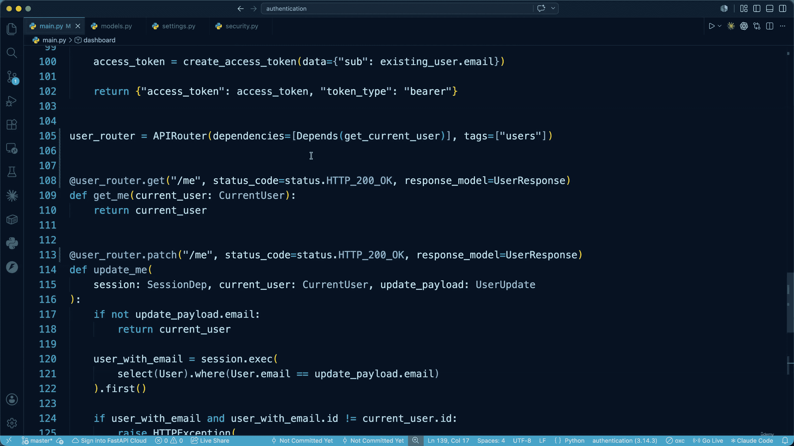
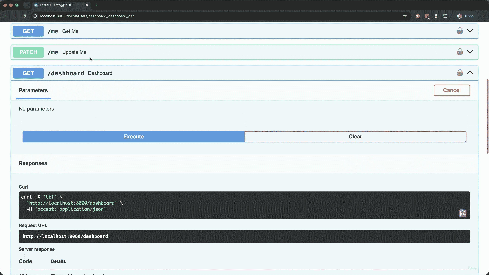
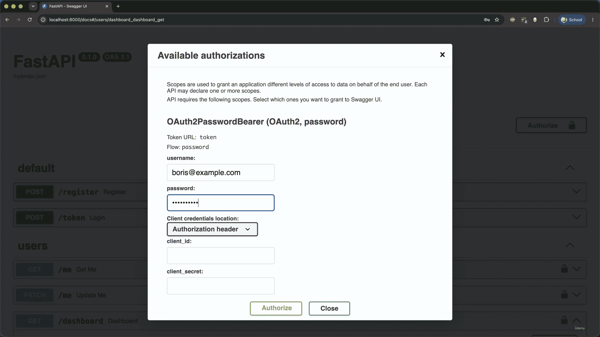
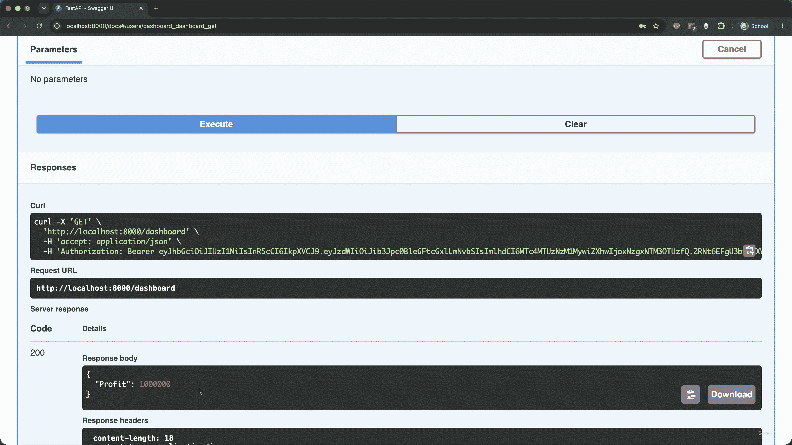

# FastAPI 大师课：第47节：使用路由器管理需要认证的路由 🚦

在本节课中我们将要学习 FastAPI 中如何管理需要认证的路由。我们会先看清“需要认证”和“不需要认证”的路由到底差在哪里，然后让同一个端点兼容已登录和未登录用户，接着用 `APIRouter` 给一组路由统一加上认证要求，最后新增一个不直接使用 `current_user` 对象、但仍然受认证保护的 `dashboard` 端点，并在浏览器中验证效果。整节课的重点不是记一堆零散写法，而是理解认证要求到底由谁建立、在哪里生效。

## FastAPI 大师课：第47节：本节概述 🧭

到这里，我们已经在应用里定义了两类路由：一类要求用户已经登录并通过认证，另一类不要求用户登录。判断一个路由到底属于哪一类，并不是看路由名字，也不是看函数名字，而是看这个路由有没有声明 `current_user` 依赖。可以把它理解成一句很直白的公式：

```text
路由需要认证 ⇔ 路由声明了 current_user 依赖
```

下面用大白话把这个规则拆开说明：

- 在 `register` 函数里，我们没有声明 `current_user` 依赖，因此不会对 JWT 是否存在做校验；任何用户，包括已经登出的用户，都可以访问 `register` 端点。这正是想要的效果，因为第一次创建用户的人显然还没有登录。
- 往下看另一个类似的路由，只要这里出现了 `current_user`，并且参数使用了对应的类型，这个路由就要求请求方必须是已认证用户。
- 所以，认证要求的关键不在于路由本身写了多少业务代码，而在于它是否声明了 `current_user` 这个依赖。

从上面的对比可以看出，`current_user` 依赖就像一道门槛：有它，请求必须带着有效身份；没有它，请求就可以匿名进入。理解了这个区别之后，我们自然会想到另一个问题：如果希望一个端点既能服务已登录用户，也能服务未登录用户，应该怎么做？下一节就来处理这种兼容场景。

## FastAPI 大师课：第47节：让同一个端点兼容已登录和未登录用户 🎛️

上一节我们分清了“需要认证”和“不需要认证”的路由，本节中我们来看看如何让同一个端点同时照顾两种用户。我们可以继续复用前面已经建立好的同一个 OAuth2 scheme。这里先把 `get_current_user` 依赖和 OAuth2 scheme 的区别讲清楚。

`get_current_user` 依赖比较“严格”，因为它不仅会要求 JWT access token，还会继续检查 `sub` 声明等内容。相比之下，前面建立的 OAuth2 scheme 只负责检查 JWT 是否出现在 `Authorization` 请求头里，并把 token 提取出来；如果 token 不存在，它不会直接抛错，而是返回 `None`。用公式表示就是：

```text
OAuth2 scheme 提取结果 = JWT 字符串（请求头存在 token）或 None（请求头缺失 token）
```

如果想让端点同时服务已认证用户和未认证用户，就可以把这段 OAuth2 scheme 代码作为参数类型来使用。下面是一个临时示例路由，它只用于说明思路，演示完成后会被删除，不需要复制到项目里：

```python
@app.get("/whatever")
def whatever(token: str | None = Depends(oauth2_scheme)):
    # 前提：oauth2_scheme 在缺失 token 时返回 None
    if token:
        # 用户已认证时走的逻辑
        ...
    else:
        # 用户未认证时走的逻辑
        ...
```

在这个示例里，`token` 参数要么是从 `Authorization` 请求头里解析出来的真实 JWT 字符串，要么在请求头完全缺失时等于 Python 的 `None`。这里调用 `Depends` 时传入 OAuth2 scheme 可调用对象，并让缺失时得到 `None` 作为默认结果。这样进入路由处理函数体之前不会因为缺少 token 而直接失败。接下来就可以用最简单的 `if` 语句做条件判断：`if token` 基本表示“用户已经认证”，于是走已登录分支；`else` 则服务未认证用户。这样同一个端点就能根据用户是否登录给出不同体验。换句话说，我们移除了对 `current_user` 的硬性要求，回退到更早的 OAuth2 scheme 依赖。演示完成后，把这段临时代码删掉即可。

单个路由的兼容写法解决后，下一节我们把视角放大到一组路由，看看如何一次性给一组路由加上认证要求。

## FastAPI 大师课：第47节：用 APIRouter 为一组路由统一加认证要求 🧱

上一节我们处理了单个端点的兼容认证，本节中我们来看看如何为一整组路由要求已认证用户。现在代码本身没有问题，但每一条需要认证的路由都要手动、显式地写上 `current_user` 参数，才能强制要求认证用户，这样写多了会比较重复。课程前面提到过 `APIRouter` 类，它允许我们创建一个子路由器，效果有点像在大型 FastAPI 应用里再放一个子应用。创建 `APIRouter` 时，可以把所有属于该路由器的路由的共性统一建立起来，例如统一标签、统一依赖等。

下面先看创建路由器时需要设置哪些公共项：

- `tags` 参数可以为该路由器下所有路由加上统一标签，例如都标记为 `users`。
- `dependencies` 参数可以接收一个依赖列表，列表里的函数或可调用对象会在该路由器下任何路由之前运行。
- 如果依赖列表里放的是 `get_current_user`，那么从这个路由器构建出来的所有路由都会要求认证才能工作。

具体代码可以写成这样，先在文件顶部导入 `APIRouter`，再在原来两个 `me` 端点路由的上方创建 `user_router`：

```python
from fastapi import APIRouter, Depends

user_router = APIRouter(
    tags=["users"],
    dependencies=[Depends(get_current_user)],
)
```

这里声明一个变量 `user_router`，实例化 `APIRouter` 类，并传入配置选项。`dependencies` 里调用 `Depends` 并传入 `get_current_user`，这与在路由参数里写 `current_user` 类型所表达的认证要求本质上是一回事。不过这里不能直接把 `current_user` 的类型注解写进 `dependencies`，因为那里接收的是可调用依赖，不是类型注解；所以改用 `Depends(get_current_user)` 来表达同样的要求。创建好路由器后，要更新原来的两个路由，让它们不再注册到主应用，而是注册到 `user_router` 上。

只改装饰器还不够，还需要把这个路由器包含进大型应用。下面保持在一个文件里，取出表示主 FastAPI 应用的 `app` 变量，调用 `include_router` 方法并传入 `user_router`：

```python
app.include_router(user_router)
```

完成这一步后，属于该路由器的这两个路由就会在路由处理函数执行之前自动运行认证校验。需要注意，这两个示例路由里仍然保留了 `current_user` 参数，但这不是为了做实际验证，因为验证已经由路由器先完成了；保留它是因为路由处理函数体里还要使用 `current_user` 对象。上面的路由需要返回当前用户，下面的路由需要用当前用户去更新数据库里的邮箱。

路由组统一认证的基础打好后，下一节新增一个不直接使用 `current_user` 对象、但仍然受到认证保护的 `dashboard` 端点。

## FastAPI 大师课：第47节：新增受保护的 dashboard 端点 📊

上一节我们把两个 `me` 路由挂到了带认证依赖的 `user_router` 上，本节中我们来看看一个更典型的例子：某个端点不需要在函数体里使用 `current_user` 对象，但仍然要求用户已经登录。可以在 `user_router` 下再建立一个端点，方法用 GET，路径随意取名为 `dashboard`。这个示例 `dashboard` 方法返回一个简单字典，例如把 `profit` 设为 `1000000`：

```python
@user_router.get("/dashboard")
def dashboard():
    return {"profit": 1000000}
```

关键点在于：这个路由连接到了 `user_router`，而 `user_router` 建立了 `get_current_user` 依赖，所以该依赖逻辑会在开始执行这个路由处理函数之前运行。也就是说，访问 `dashboard` 端点必须先通过认证。这里容易出现困惑，因为第一眼看去，这个路由处理函数上没有任何额外的 `current_user` 注解；这时要提醒自己回到路由器定义处，查看路由器建立了哪些要求。可以把这个关系记成一句公式：

```text
dashboard 的认证要求 = user_router 的 dependencies 中是否包含 get_current_user
```

理论说清楚后，下一节通过浏览器实际验证未登录和登录后的不同结果。

## FastAPI 大师课：第47节：在浏览器中验证路由认证效果 🌐

上一节写好了受保护的 `dashboard` 端点，本节中我们到浏览器里实际看看效果。切换到 Chrome，刷新页面后可以看到新的 `dashboard` 路由。当前处于未认证状态，如果直接正常访问这个地址，就会得到预料之中的未授权问题，也就是 `401 Unauthorized` 一类的结果。出现这个结果的原因不是这个路由自己写了认证逻辑，而是持有这个路由以及其全部逻辑的路由器上建立了 `Depends(get_current_user)` 依赖。同样的逻辑也会作用于该路由器下的其他路由。



下面用列表梳理浏览器里的验证步骤：





- 未登录时访问 `dashboard`，请求会在进入路由处理函数之前被拦下，返回未授权响应。
- 登录时提供示例凭据，例如 `boris@example.com` 和密码 `123`，然后再次访问。
- 登录成功后，就获得了 `user_router` 内三个路由的访问权限，此时再次访问 `dashboard` 就能真正进入路由处理函数并返回响应。

这里最舒服的地方是：如果不想在路由处理函数体里使用 `current_user` 对象，就不需要再显式提供 `current_user` 参数和对应类型，因为 API 路由器已经承担了认证检查的责任。当然，另外两个路由仍然需要 `current_user`，因为它们的业务逻辑依赖这个对象。FastAPI 在底层会做优化，确保同一个依赖不会运行两次：它发现 `get_current_user` 既在路由器上使用，又在路由处理函数里使用，但只会获取一次当前用户，从而让端点尽可能保持高效。

到这里，浏览器里的验证过程就完成了；下面我们对本节课的内容做一个整体总结。

## FastAPI 大师课：第47节：本节总结 🧾



本节课中我们一起学习了 FastAPI 中如何用路由器管理需要认证的路由。我们首先明确了一个核心规则：路由是否需要认证，取决于它是否声明了 `current_user` 依赖。然后我们看到了如何用 OAuth2 scheme 让同一个端点兼容已登录和未登录用户，并通过 `if token` 分支给出不同体验。接着我们使用 `APIRouter` 的 `dependencies` 参数为一组路由统一加上 `get_current_user` 认证要求，并通过 `include_router` 把这个路由器注册到主应用。最后我们新增了不需要使用 `current_user` 对象、但仍然受认证保护的 `dashboard` 端点，并在浏览器中验证了未登录会被拦截、登录后可以访问的效果。掌握这些内容后，就可以把认证逻辑集中到路由器层，减少重复参数，同时保持路由处理函数简洁清晰。

