# 🚀 FastAPI Masterclass part2：p48：刷新令牌（Refresh Tokens）

在本节课中，我们将要学习刷新令牌（refresh token）为什么存在、它和访问令牌（access token）的区别、它带来的安全价值，以及如何在 FastAPI 项目里生成刷新令牌，并让登录接口同时返回访问令牌和刷新令牌。课程还会在 `get_current_user` 依赖中加入一个关键校验：业务端点只能接受有效的访问令牌，不能把刷新令牌当作访问令牌使用。下一节课会继续实现真正接收刷新令牌并签发新访问令牌的端点。

先看当前系统的问题。当前项目里的 JWT 访问令牌用来证明用户已经通过认证，它的过期时间是 10 分钟。用户使用 10 分钟以后，再请求任何需要认证的端点时，PyJWT 库会因为令牌已经过期而抛出异常。这样一来，用户就必须重新登录：用户再次提供邮箱和密码，服务器再签发一个同样只有 10 分钟寿命的新 JWT。

在现实应用中，10 分钟其实很短，用户每 10 分钟就重新登录一次会很不方便。解决思路是给用户签发一种叫做刷新令牌的东西，让用户可以在更长时间内保持登录状态。下面先说明刷新令牌到底是什么，然后再动手构建它。

## 🧭 FastAPI Masterclass part2：p48：为什么需要刷新令牌

上一段已经看到，访问令牌只有 10 分钟寿命，过期以后用户必须重新认证。刷新令牌就是为这个问题准备的：它让用户不必频繁输入邮箱和密码，同时又不把访问令牌的寿命直接拉得很长。理解这个背景以后，才能理解后面两种令牌的分工。

当前 JWT 访问令牌是用户已经认证的证明，寿命为 10 分钟。10 分钟之后，用户请求任何需要认证的端点，PyJWT 库都会因为令牌过期而抛出异常，用户必须重新登录。重新登录时，用户提供邮箱和密码，服务器签发一个新 JWT，这个新 JWT 仍然只持续 10 分钟。

现实世界里 10 分钟很短，频繁登录对用户很不方便。为了让用户保持登录更长时间，系统可以签发刷新令牌。刷新令牌的基本作用是：访问令牌过期后，客户端可以用刷新令牌换取新的访问令牌，而不需要用户重新输入密码。

刷新令牌本身也是系统里的另一个令牌、另一个标识符。它通常也是 JWT，不过从技术上说并不一定必须是 JWT。它和主访问令牌是分开的两个令牌，这一点是理解整套机制的关键。

## 🔍 FastAPI Masterclass part2：p48：访问令牌与刷新令牌的区别

上一节说明了刷新令牌要解决的问题，本节把访问令牌和刷新令牌放在一起对比。两者虽然都可能是 JWT，但寿命和职责完全不同。先把两种令牌写清楚，后面写代码时就不会混淆。

访问令牌和刷新令牌都可以是 JWT，也就是说，它们都可以是 Base64 URL 编码的字符串。关键区别在于：访问令牌是短寿命令牌，用来授予系统访问权限；刷新令牌是长寿命令牌，例如 7 天，它的全部目的是授予获取新访问令牌的权限。

以下是两种令牌的分工对比：

- 访问令牌：短寿命，当前设置为 10 分钟，用来证明认证并授予系统访问权限。

- 刷新令牌：长寿命，例如 7 天，用来在访问令牌过期后换取新的访问令牌。

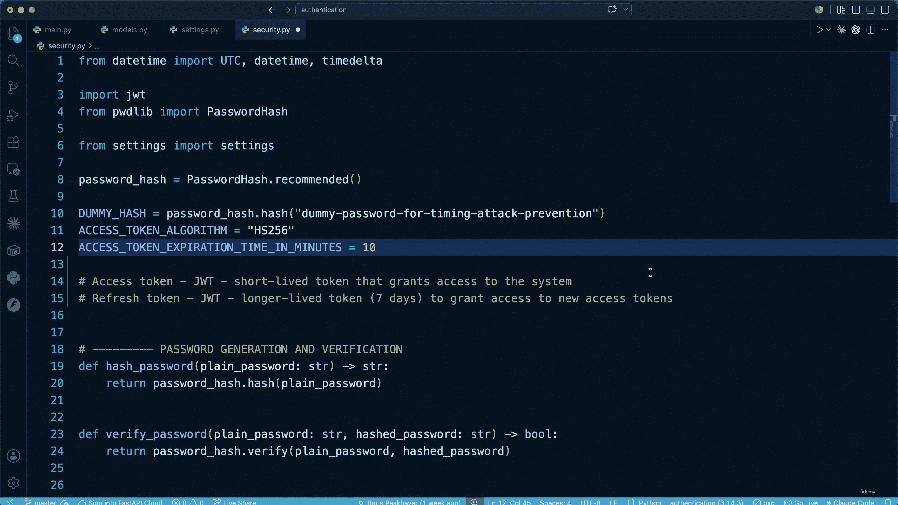

- 访问令牌过期后，客户端可以用刷新令牌请求新的 JWT 访问令牌，新访问令牌仍然只有 10 分钟寿命。

- 在一小时的使用过程中，用户可能先后拿到多达 6 个不同的 JWT 访问令牌，但刷新令牌是持续存在的那个令牌。

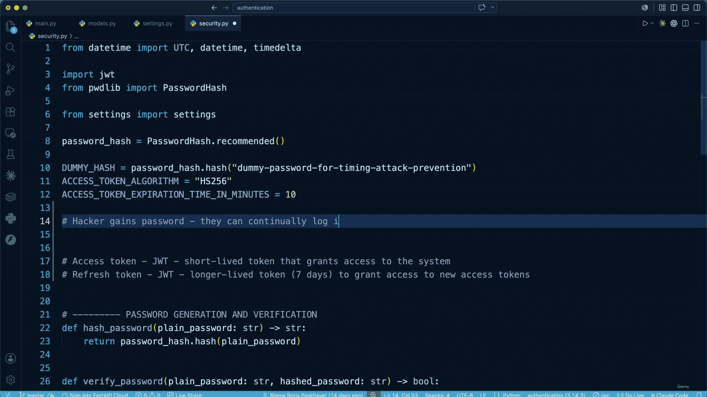

- 刷新令牌会在 JWT 过期时持续授予获取新 JWT 的权限，因此它的核心目的就是刷新真正的访问令牌 JWT。

可以用公式把寿命关系写清楚：

\[
T_{\text{access}} = 10\text{分钟},\qquad T_{\text{refresh}} = 7\text{天}
\]

从公式可以看出，访问令牌短，刷新令牌长。刷新令牌不是拿来直接访问业务端点的，它的职责是换取新的访问令牌。理解了这个分工以后，下一个问题自然就是：为什么不直接把访问令牌的过期时间设成一周，而要额外引入刷新令牌。

## 🛡️ FastAPI Masterclass part2：p48：为什么不直接延长访问令牌

上一节对比了两种令牌的寿命和职责，本节解释设计动机。有人可能会问：既然希望用户登录一周，为什么不把原始 JWT 的过期时间直接改长，比如改成一周，而是要多做一个刷新令牌步骤。简短答案是安全，下面展开说明。

JWT 的一个优势是：用户不必每次请求需要认证的端点时都发送密码。密码如果被黑客拿到，黑客就可以持续登录系统，并持续以用户身份执行操作。JWT 虽然每次请求都会发送，仍然存在被拦截的风险，但即使黑客拿到了 JWT，也只能在 10 分钟内造成损害，因为 10 分钟后 JWT 会过期。

如果黑客拿到了 JWT 但没有拿到密码，JWT 过期后黑客就不能再以用户身份访问系统，因为他没有原始密码，无法重新登录并获取新的 JWT。JWT 的一个重要好处就是不必在每个请求里发送密码。

刷新令牌遵循完全相同的原则。客户端只在访问令牌过期时，才使用刷新令牌去获取新的 JWT。如果黑客拿到了原始访问令牌，也只能使用 10 分钟。

从技术上说，如果黑客拿到了刷新令牌，风险会更大，因为黑客可以在更长时间内持续使用刷新令牌请求新的 JWT，这个风险仍然存在。但是刷新令牌每 10 分钟才用于请求一次新 JWT，向服务器发送刷新令牌的总次数更少，因此平均被拦截的机会也更少。刷新令牌使用频率更低，暴露机会也就更少。

以下是从安全角度理解这种做法的几个要点：

- 访问令牌寿命很短，即使泄露，损害窗口也只有 10 分钟。

- 刷新令牌寿命更长，但使用频率低，每 10 分钟才用一次。

- 刷新令牌相当于多加了一层安全机制，而不是简单把访问令牌寿命拉长。

- 访问令牌负责证明认证和授予访问权限，刷新令牌负责换取新的访问令牌。

关键结论是：刷新令牌是多出来的一层安全机制。访问令牌的过期时间保持很短，同时给用户一个刷新令牌，让用户可以在访问令牌每次过期时刷新它。这个刷新操作通常由客户端应用在后台自动完成，用户不需要手动参与。

## 🔁 FastAPI Masterclass part2：p48：客户端怎样自动刷新

上一节从安全角度解释了刷新令牌的价值，本节看客户端实际怎么使用它。刷新并不需要用户每次手动点击，大多数情况下是前端自动处理。下面用 React 应用作为例子说明流程。

例如前端是一个 React 应用。React 应用请求一个需要认证的端点时，端点可能返回拒绝，表示用户的 JWT 已经过期，并返回 401 状态码。客户端收到 401 后，会尝试使用刷新令牌，请求一个新的端点，在这个端点提供刷新令牌，以获取新的未过期 JWT。服务器验证后返回新的 JWT，这个新 JWT 又可以继续使用 10 分钟，然后客户端再向原来返回 401 的端点发起请求。

以下是客户端自动刷新的大致流程：

- 客户端携带访问令牌请求需要认证的端点。

- 服务器发现访问令牌过期，返回 401。

- 客户端使用刷新令牌请求刷新端点，换取新的访问令牌。

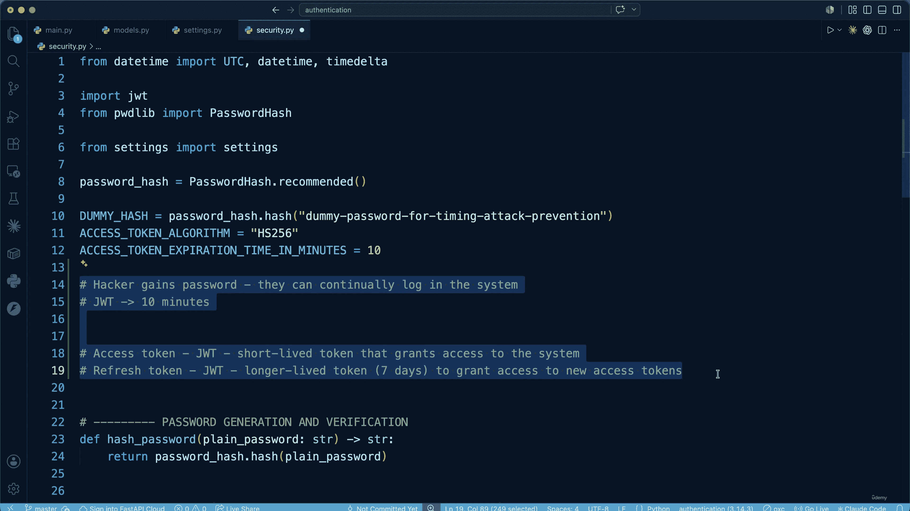

- 服务器返回新的访问令牌，新访问令牌继续有效 10 分钟。

- 客户端带着新访问令牌重新请求原来的业务端点。

大多数时候，这个过程由客户端代替用户自动完成。用户只登录一次，就会感觉自己在一周内都保持登录。后台实际上每 10 分钟都会用刷新令牌申请一个新的 JWT，让用户继续获得另外 10 分钟的使用时间。这个过程对用户是透明的，用户不需要理解背后的令牌交换。

## 🧱 FastAPI Masterclass part2：p48：本课要构建的内容

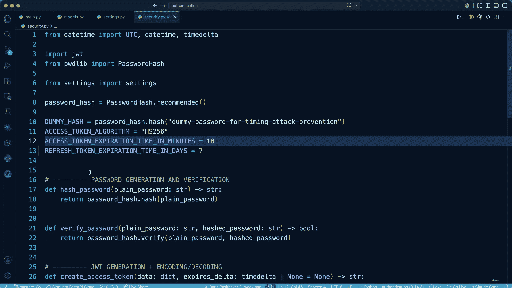

上一节说明了客户端如何自动刷新，本节明确代码层面的任务。本课不会一次性实现完整刷新端点，而是先完成生成刷新令牌、登录接口返回刷新令牌，以及阻止刷新令牌冒充访问令牌这几件事。下一节课再实现真正的刷新端点。

本课要在 `security.py` 中新增一个函数，用来生成 JWT 刷新令牌。生产级应用还可以采取更多安全措施，例如加密 JWT，让浏览器无法直接读取或访问它，刷新令牌只在每 10 分钟换取新访问令牌时发送。不过当前课程保持简单，直接把刷新令牌作为普通 JSON 发送到一个新端点。

这个新端点的职责将在下一节课构建：接受刷新令牌，验证刷新令牌是否合法，如果合法，就返回新的 JWT 访问令牌，授予接下来 10 分钟的访问权限。

以下列出本课要完成的具体内容：

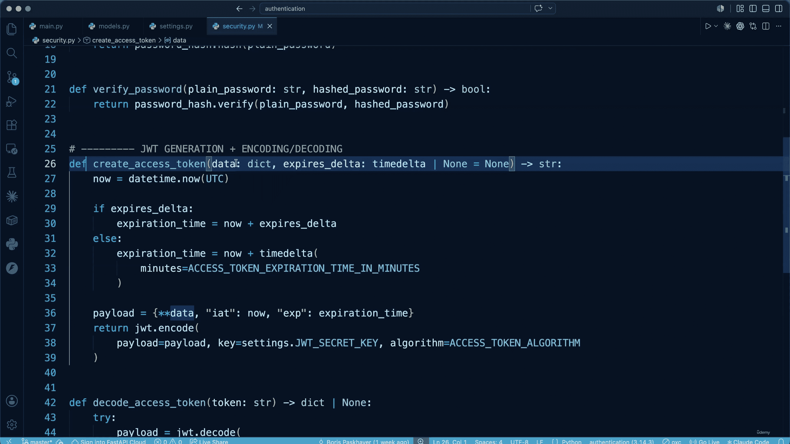

- 在 `security.py` 中声明刷新令牌的过期时间常量。

- 新增 `create_refresh_token` 函数，生成带 `type=refresh` 标记的 JWT。

- 在访问令牌 payload 中加入 `type=access` 标记。

- 在登录端点中同时返回访问令牌和刷新令牌。

- 在 `get_current_user` 中校验令牌类型必须是 `access`。

完成这些内容以后，系统就具备了签发刷新令牌和区分令牌类型的基础。下一步进入代码实现，先处理 `security.py`。

## ⚙️ FastAPI Masterclass part2：p48：在security.py中新增刷新令牌生成函数

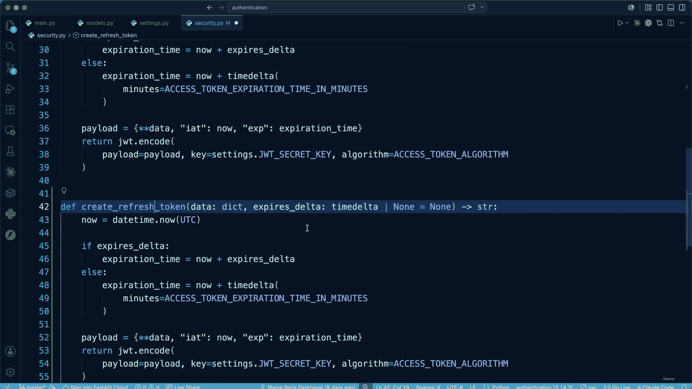

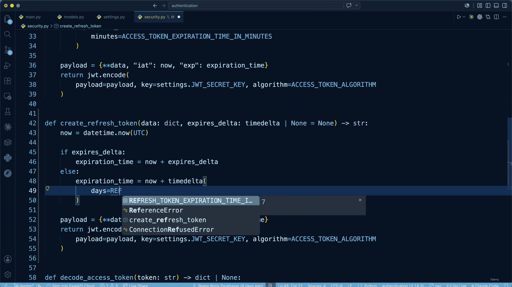

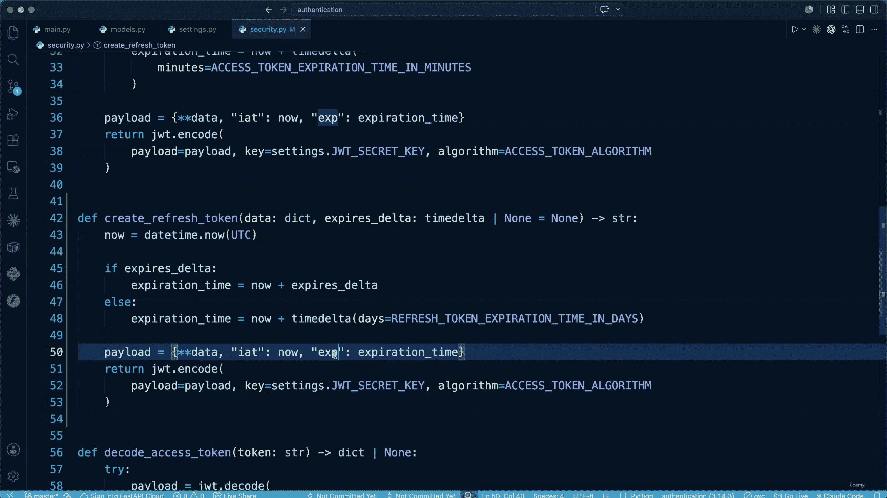

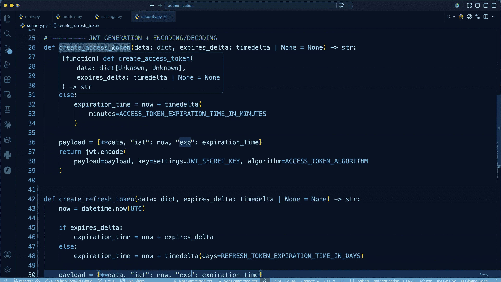

上一节列出了本课任务，本节开始修改 `security.py`。这里会先声明刷新令牌的过期时间常量，再复制原有的访问令牌生成函数，改造成刷新令牌生成函数。两个函数结构相似，但过期单位和 payload 类型标记不同。

在 `security.py` 中，先移除之前的注释。然后声明一个常量，表示刷新令牌的过期时间。访问令牌是短寿命的，刷新令牌是长寿命的，因此这个常量可以用天数表示，例如 7 天。

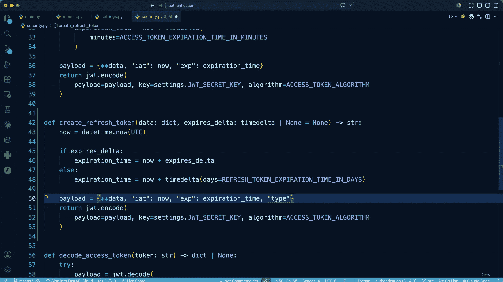

```python
ACCESS_TOKEN_EXPIRE_MINUTES = 10
REFRESH_TOKEN_EXPIRE_DAYS = 7
```

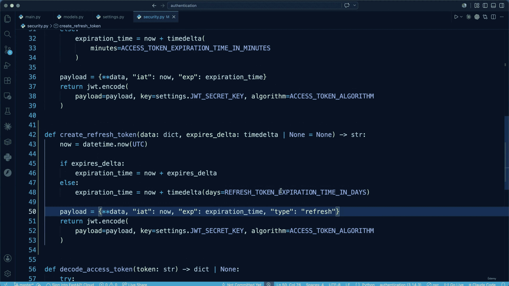

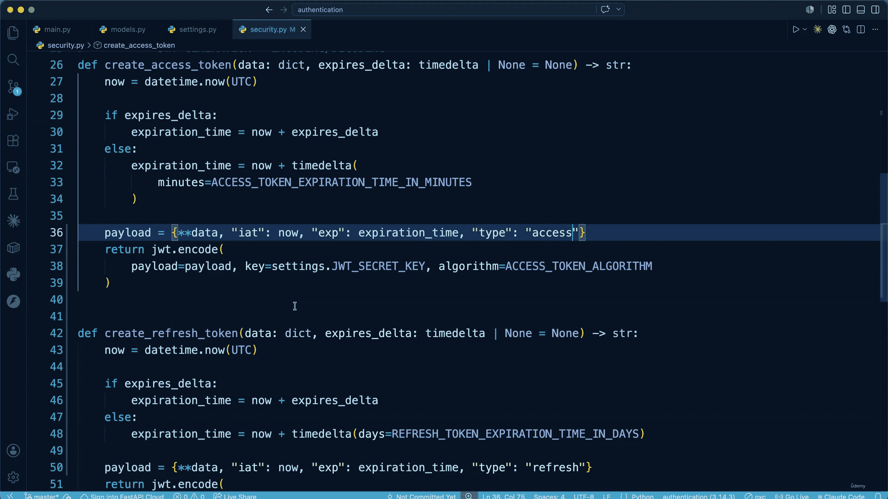

接下来在下方创建新函数。现有代码中已经有 JWT 生成函数，这里要再次区分术语：两个函数都会返回 JWT，但用途不同。原来的函数生成 JWT 访问令牌，用来授予系统访问权限；新函数生成 JWT 刷新令牌，用来授予获取新 JWT 的权限。

可以复制原来的函数，因为两者非常相似。把新函数改名为 `create_refresh_token`。新函数逻辑仍然接受一个 data payload，也接受一个可选的 `timedelta` 参数来表示持续时间。区别在于：如果没有传入 `expires_delta`，过期时间不再按分钟计算，而是按天计算，并使用刷新令牌过期时间常量。

```python
def create_refresh_token(
    data: dict,
    expires_delta: timedelta | None = None,
):
    ...
```

刷新令牌的 payload 仍然会嵌入最终 JWT 字符串中，仍然包含刷新令牌签发时间，以及刷新令牌的过期时间。刷新令牌的过期时间是从签发时刻算起 7 天。

关键区别是：后端必须能够区分一个 JWT 是 10 分钟寿命的访问令牌，还是 7 天寿命的刷新令牌。做法是在 payload 字典中增加一个 `type` 属性。刷新令牌中写入 `type=refresh`，访问令牌中写入 `type=access`。

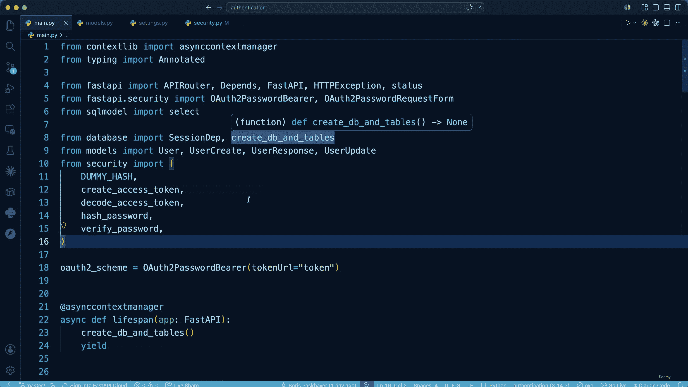

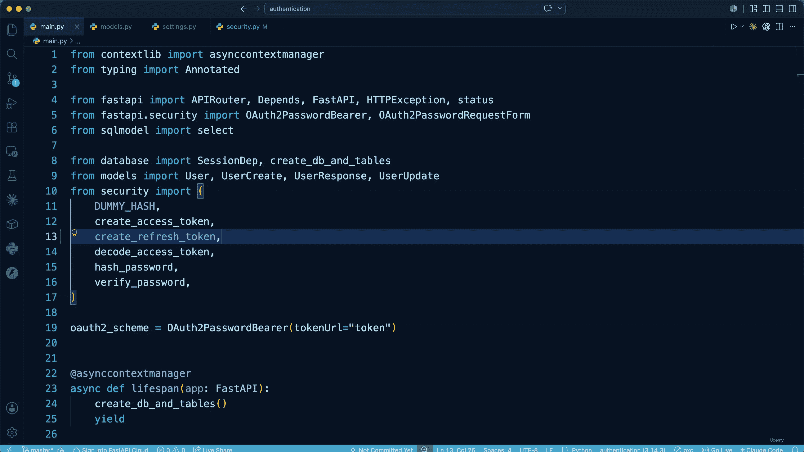

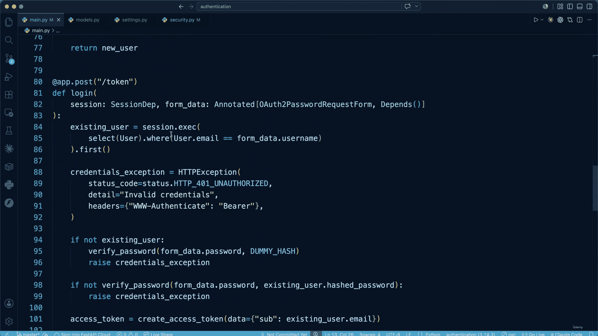

```python
# 访问令牌中的 payload 增加类型标记
payload["type"] = "access"

# 刷新令牌中的 payload 增加类型标记
payload["type"] = "refresh"
```

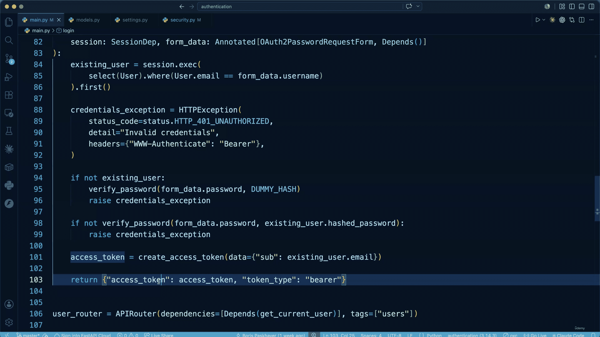

这样，令牌类型会直接嵌入 payload，并编码进 JWT 字符串。服务器收到令牌后，就能知道它是访问令牌还是刷新令牌，并验证它是否被用于正确用途。完成 `security.py` 的修改后，下一步进入 `main.py`，把刷新令牌接入登录流程。

## 🔑 FastAPI Masterclass part2：p48：在登录端点同时返回刷新令牌

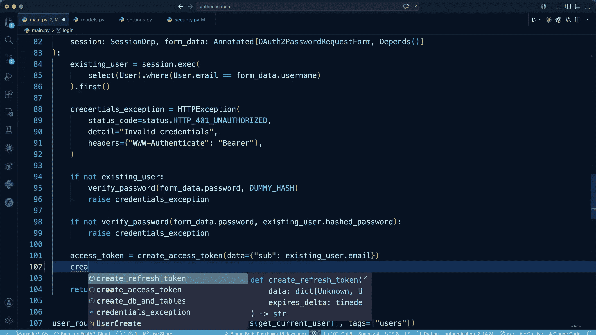

上一节完成了刷新令牌生成函数和类型标记，本节把刷新令牌接到登录接口。登录是用户提供凭证的入口，也是同时发放访问令牌和刷新令牌的最佳位置。这样客户端登录一次以后，就拥有了后续自动刷新所需的凭证。

进入 `main.py`，导入新的 `create_refresh_token` 函数。然后给登录用的 `post_token` 端点增加逻辑。当前这个端点只给用户一个普通 JWT 访问令牌，有效期 10 分钟。用户登录时，还应该同时拿到刷新令牌。

这样做的原因是：客户端拿到了刷新令牌以后，就拥有了在访问令牌过期后获取新访问令牌的凭证。用户不必再次访问登录端点，也不必再次提供用户名和密码。刷新令牌本质上就是“在 10 分钟后换回新 JWT 的许可”，这个许可一直持续到刷新令牌在 7 天后过期。

这里使用刚才写的 `create_refresh_token` 函数。传给它的 data payload 可以和传给 `create_access_token` 的输入完全相同。可以先把完整字典提取到一个变量中，例如叫 `data`，然后分别传给两个函数。

```python
data = {"sub": user.email}

access_token = create_access_token(data)
refresh_token = create_refresh_token(data)

return {
    "access_token": access_token,
    "refresh_token": refresh_token,
}
```

上面的代码只是示意结构，实际字段以项目为准。两个返回值都是 JWT 字符串，都嵌入了 payload。区别是：访问令牌 payload 中 `type=access`，刷新令牌 payload 中 `type=refresh`。服务器收到令牌时，就能理解它是哪一种令牌，并验证它是否服务于正确目的。

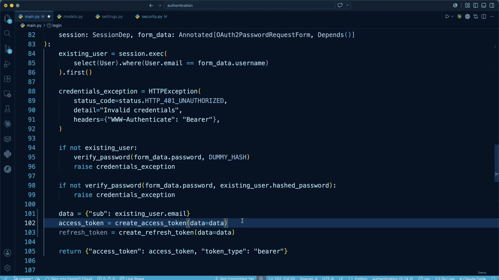

普通访问令牌不能当作刷新令牌使用，刷新令牌也不应该当作访问令牌去访问某个端点。它们是两个互补的令牌：访问令牌真正授予权限并证明认证，刷新令牌的唯一职责是获取新的访问令牌。这个唯一职责就是刷新令牌在系统里的全部用途。

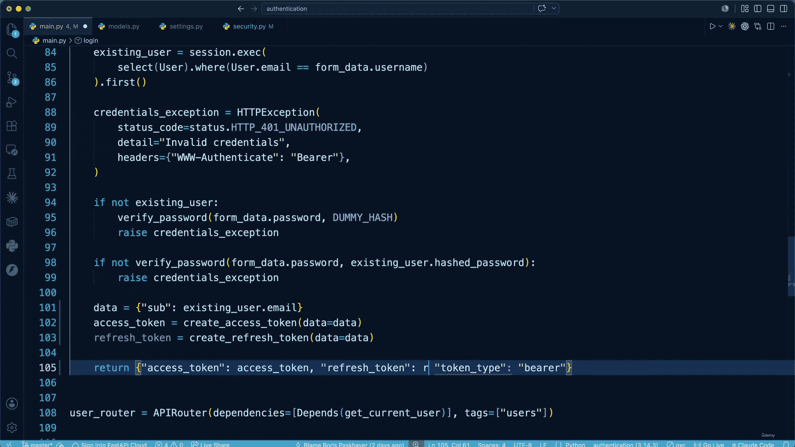

现在用户登录时，服务器会发送一个有效 10 分钟的访问令牌，同时发送刷新令牌。客户端在收到 401、被告知用户 JWT 已过期时，就可以使用刷新令牌去换取新的访问令牌。这个换取操作发生在一个尚未编写的新端点中，下一节课会实现它。

## ✅ FastAPI Masterclass part2：p48：在get_current_user中校验令牌类型

上一节让登录接口同时返回访问令牌和刷新令牌，本节补上关键安全校验。只有能区分“这是访问令牌”和“这是刷新令牌”，才能防止刷新令牌被拿去访问业务端点。这个校验要放在 `get_current_user` 依赖函数里。

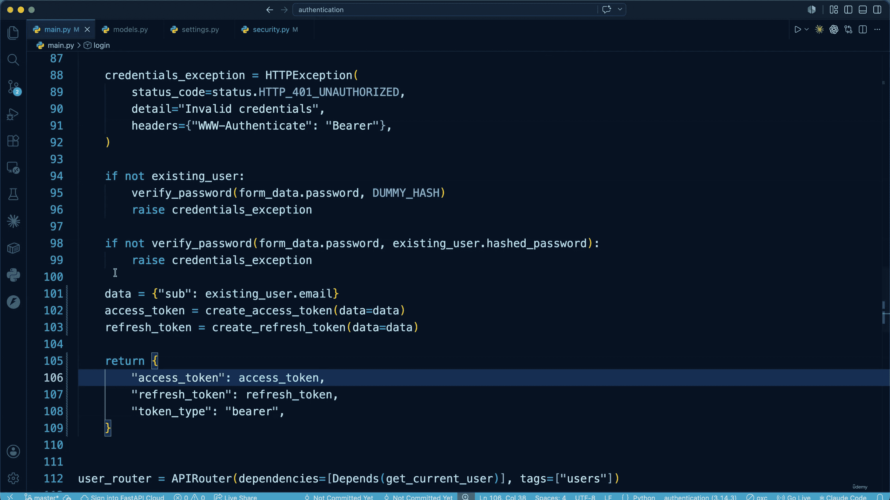

本课最后再加一个校验，位置在 `get_current_user` 依赖函数中。先看这个函数定义的位置。这个函数会解码访问令牌。仍然可以继续依赖这个解码函数，因为它做的事情是确保传入的是一个有效 JWT，并且这个 JWT 使用正确密钥和正确算法签名。刷新令牌同样是使用相同密钥签名的 JWT，所以这部分逻辑仍然适用。

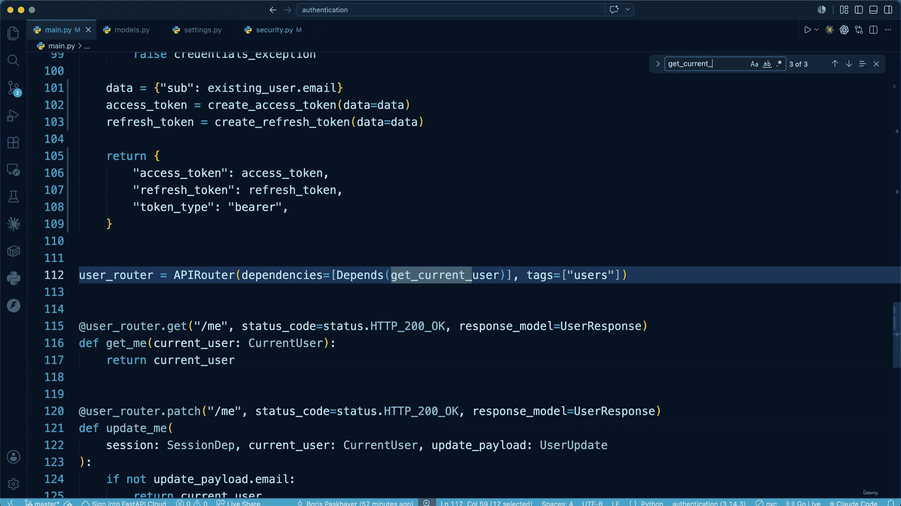

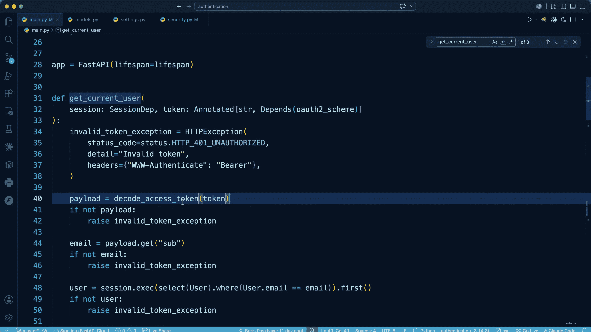

刷新令牌的过期时间更长，是 7 天，这个过期时间会编码在 payload 的 `exp` 声明中。因此，只要刷新令牌还在 7 天窗口内，解码刷新令牌时就不会因为过期而报错。这个解码函数可以复用于访问令牌和刷新令牌，它只负责解码 payload，并确保给定令牌还没有过期。

回到 `main.py` 的 `get_current_user`。这里要增加一个验证：获取当前用户是为了认证，因此要验证客户端提供的是有效且未过期的 JWT 访问令牌。额外的安全检查是：即使某个 JWT 本身有效，它也必须是一个有效的访问令牌，而不能是刷新令牌。

可以在 payload 上访问两个函数中新声明的 `type` 键。这个值要么是 `access`，要么是 `refresh`。如果客户端试图发送刷新令牌来证明自己已经认证，这是不允许的。只有当令牌类型是 `access` 时，才允许继续处理。

```python
payload = decode_access_token(token)

if payload.get("type") != "access":
    raise InvalidTokenError()
```

如果 payload 中的 `type` 不等于 `access`，说明收到的是一个有效 JWT，但它是刷新令牌 JWT，而不是访问令牌 JWT。这不是合法操作，因此要抛出与前面相同的无效令牌异常。

这样就能确保：任何使用 `get_current_user` 的端点，都只接受有效且未过期的访问令牌 JWT，不接受刷新令牌 JWT。这个校验完成了整套机制的前半部分。下一节课会接上后半部分：实现一个端点，接收刷新令牌，并返回一个新的 JWT 访问令牌，让用户再获得 10 分钟访问时间。

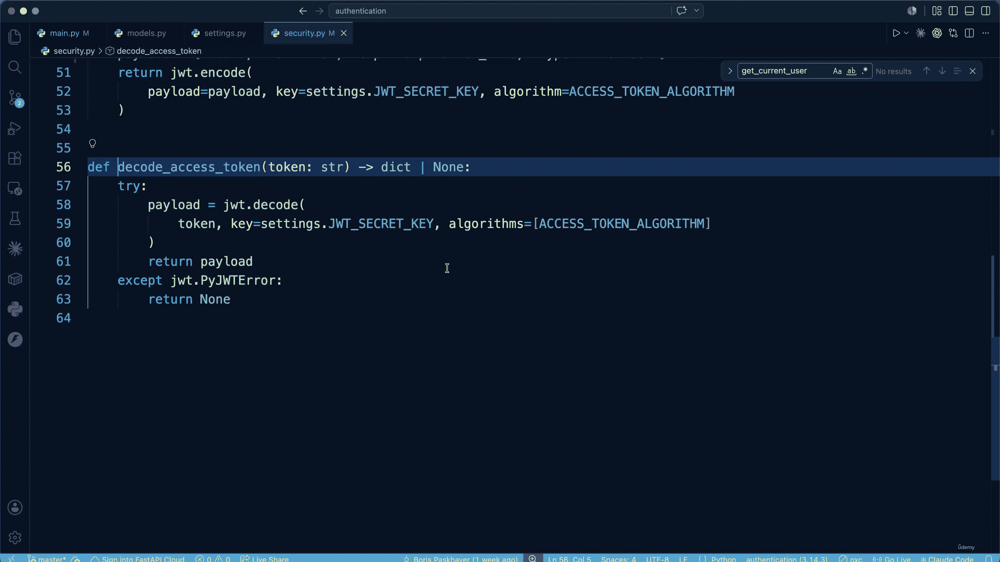

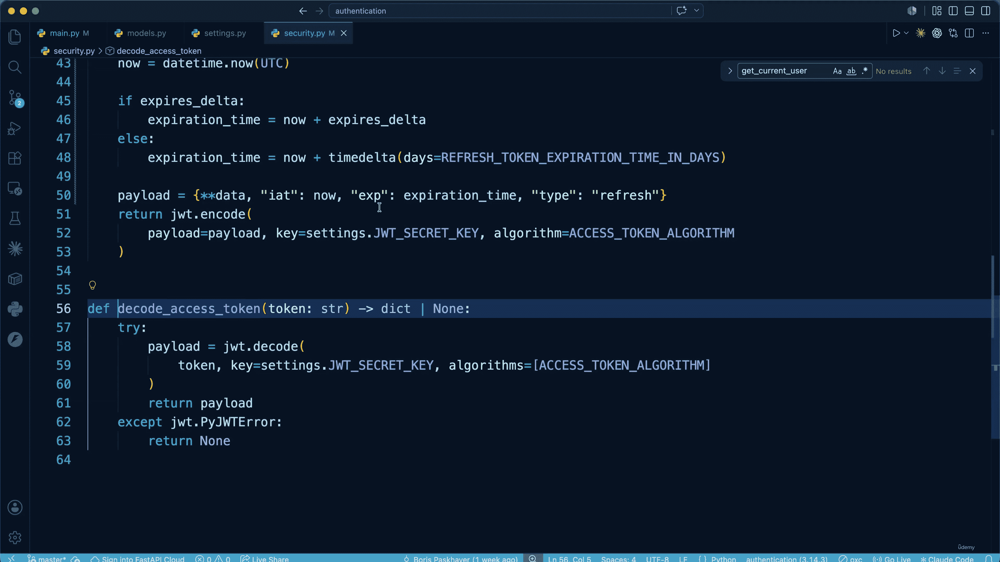

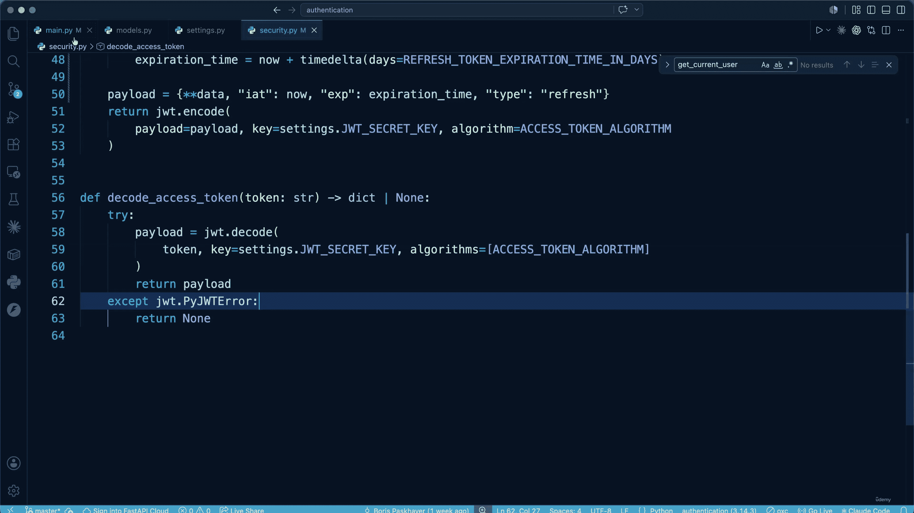

## 📝 FastAPI Masterclass part2：p48：总结

本节课中我们一起学习了刷新令牌的完整背景和第一阶段的代码实现。我们理解了访问令牌只有 10 分钟寿命，过期后用户会收到异常并被迫重新登录；为了减少频繁登录，系统引入长寿命的刷新令牌，用它在访问令牌过期后换取新的访问令牌。

以下是本课关键内容的汇总：

- 访问令牌寿命短，用来证明认证并授予系统访问权限。

- 刷新令牌寿命长，例如 7 天，唯一职责是换取新的访问令牌。

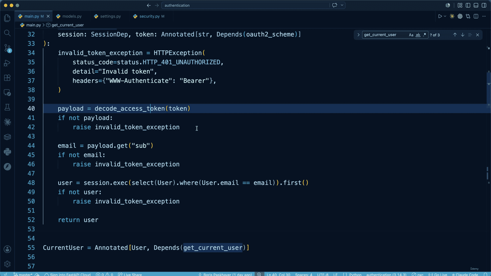

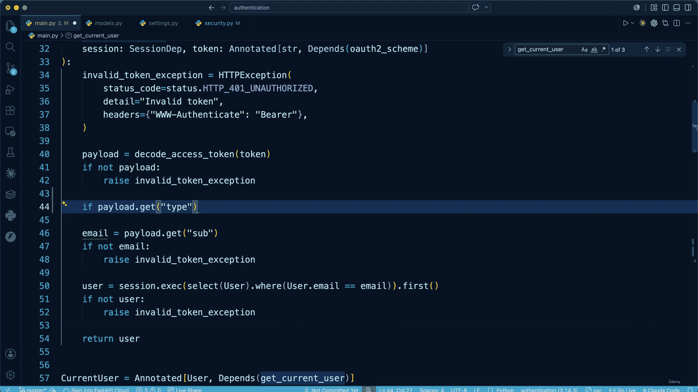

- 不直接延长访问令牌，是为了保留短泄露窗口并增加一层安全机制。

- 在 `security.py` 中声明刷新令牌过期常量，并新增 `create_refresh_token`。

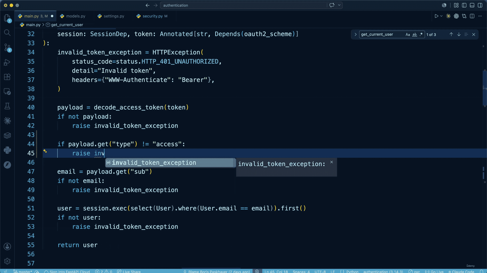

- 在 payload 中用 `type=access` 和 `type=refresh` 区分两种 JWT。

- 登录端点同时返回访问令牌和刷新令牌。

- `get_current_user` 只接受 `type=access` 的未过期 JWT，拒绝刷新令牌冒充访问令牌。

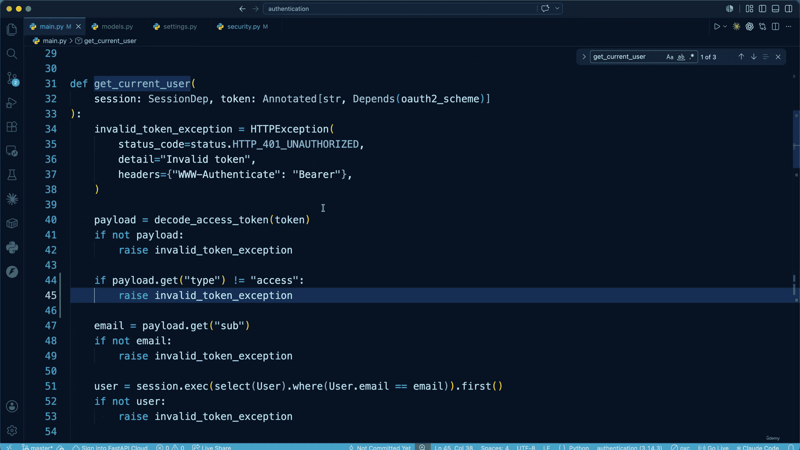

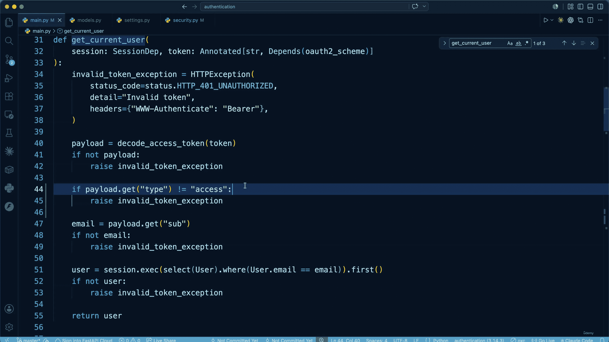

本节课完成了刷新令牌的生成、发放和类型校验。下一节课将继续实现刷新端点，让客户端可以把刷新令牌发送给服务器，并换回一个新的、有效期 10 分钟的访问令牌 JWT。

