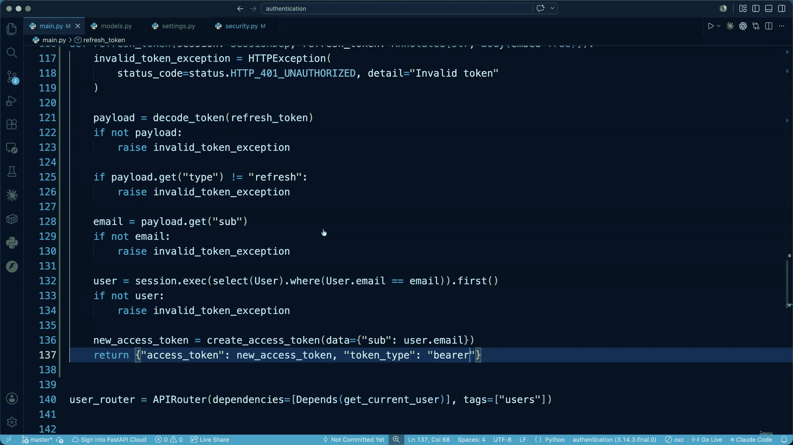
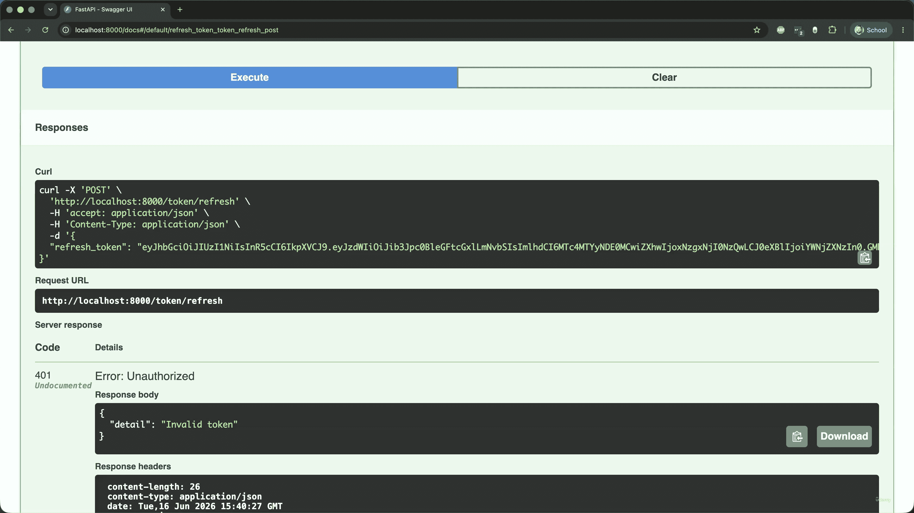

## 🚀 FastAPI 大师课：第49节：刷新令牌端点

在本节课中我们将要学习如何新增一个刷新令牌端点：客户端把 JWT 刷新令牌发过来，服务器验证通过后返回一个新的 JWT 访问令牌。上一节我们已经实现了登录和访问令牌相关逻辑，本节中我们来看看如何把“刷新”这一环补上，让客户端在访问令牌过期后仍然可以自动续期，而不需要用户反复输入账号密码。整个教程会从函数重命名开始，一步一步走到 Swagger 测试和安全测试，尽量用大白话把每个细节讲清楚。

### 🔁 FastAPI 大师课：第49.1节：重命名解码函数

上一节提到 `decode_access_token` 这个函数可以从访问令牌或刷新令牌中提取 payload，所以当前代码本身是有效的。不过这个函数现在不只会解码访问令牌，还会解码任意 JWT，包括刷新令牌，因此把它改名成更通用的名字更合理。

我们需要把函数名从 `decode_access_token` 改成 `decode_token`，然后在整个代码库中查找旧名字并更新调用处。原文中旧函数只在 `main.py` 中使用，所以只需要更新 `main.py` 里的两处调用即可。这样改名之后，函数名和实际用途就一致了，后面用它验证刷新令牌是否过期也更自然。

下面是重命名前后的核心代码示意，用来说明这个函数现在处理的是“任意 JWT 令牌”：

```python
# 原来的函数名
def decode_access_token(token: str):
    ...

# 改名后的函数名
def decode_token(token: str):
    ...
```

### 🛠️ FastAPI 大师课：第49.2节：定义刷新端点

上一节我们完成了函数重命名，本节中我们来看看如何新增刷新端点。我们找到当前用于创建或获取 JWT 令牌的登录端点，在它下面定义新端点。这个新端点同样使用 POST 请求，可以把它理解成“在服务器上创建一个新资源”，也就是创建一个新的 JWT 来替换刚刚过期的 JWT。

端点路径可以定义为 `/token/refresh`，路由处理函数可以命名为 `refresh_token`。因为后面要在路由处理函数里访问数据库，所以需要提供 session 依赖，例如 `session=Depends(get_session)`。同时，客户端需要把当前持有的刷新令牌发送过来，这个刷新令牌就是用户第一次登录时服务器发给客户端的那个；它在这里充当“权限证明”，证明客户端有资格申请新的访问 JWT。

下面是端点定义的核心代码示意，用来说明路径、函数名和依赖：

```python
@app.post("/token/refresh")
def refresh_token(
    session=Depends(get_session),
):
    ...
```

### 📦 FastAPI 大师课：第49.3节：用请求体接收刷新令牌

上一节我们定义了刷新端点，本节中我们来看看刷新令牌参数应该放在哪里。这里有一个关键点：如果把参数类型直接标注成 `str`，FastAPI 默认会认为这个参数不在路径中，于是把它当成查询参数。也就是说，FastAPI 会以为客户端要通过 URL 查询参数传刷新令牌，但敏感数据一般不应该放在查询参数里。

更合适的做法是把刷新令牌作为普通请求体数据发送到这个端点，就像创建新用户时发送 POST 请求体一样。FastAPI 提供了 `Body` 函数，用法和 `Query`、`Cookie`、`Header` 很相似，用来声明某个路由处理函数参数应该从请求体里解析。我们之前用 Pydantic 模型表示过同样的概念：路由处理函数看到 Pydantic 模型参数时，会自动认为数据来自请求体。这里只有一个字段，直接用 `Body` 更简单，不必额外定义模型。

下面是从 `fastapi` 导入 `Body` 并使用它的核心代码示意：

```python
from fastapi import Body

refresh_token: str = Body(..., embed=True)
```

不过这里还有一个细节：默认情况下，FastAPI 会认为 `refresh_token` 这个参数本身就是请求体里的一个字符串，也就是说 JSON 请求体可能直接就是一个字符串。JSON 请求体可以是对象、数组、数字或字符串，但直接发一个字符串不够清晰。更清晰的做法是发送一个对象，里面有 `refresh_token` 这个键，值才是 JWT 字符串。`Body(..., embed=True)` 就是告诉 FastAPI：请从请求体对象里的 `refresh_token` 键中提取值。这样服务器期望的请求体形状就是 `{"refresh_token": "..."}`。

也可以用一个只包含 `refresh_token` 字段的 Pydantic 模型达到同样效果，本课只是选择了另一种更轻量的写法。下面是 `embed=True` 所期望的请求体形状示意：

```json
{
  "refresh_token": "客户端持有的刷新令牌"
}
```

### ✅ FastAPI 大师课：第49.4节：验证刷新令牌

上一节我们解决了刷新令牌放在请求体里的问题，本节中我们来看看路由处理函数的内部逻辑。第一件事是使用刚改名后的 `decode_token` 函数接收刷新令牌并提取 payload。这个函数在令牌无效或过期时会返回 `None`。注意这里检查的是刷新令牌是否过期，而不是访问令牌那 10 分钟的过期时间；刷新令牌通常有一周的有效期。

这个端点故意不使用 `current_user` 依赖，因为客户端来刷新时，当前访问令牌应当已经被认为过期了。某种意义上，在拿到新访问令牌之前，用户可以暂时被视为已登出，不能操作系统里的受保护动作。下面我们先把 payload 赋给变量 `payload`，它要么是包含嵌入数据的字典，要么是 `None`。

接下来会采用和 `get_current_user` 类似的验证协议：在签发新访问令牌之前，必须确认一系列条件都满足。如果 payload 提取失败或已经过期，就立即抛出异常。由于刷新过程可能以很多方式失败，可以创建一个可复用的 `invalid_token_exception`，它是 `HTTPException` 的实例，状态码用 `401 Unauthorized`，详情写 `invalid token`。因为刷新失败意味着用户基本完全登出，需要重新走登录流程。

还需要检查令牌类型。用户登录时服务器会发两个 JWT：访问令牌和刷新令牌，之前验证过令牌类型是否正确，现在要反过来做同样的检查：普通访问令牌不能当刷新令牌使用，只有刷新令牌才能在这个端点中使用。我们之前在两种令牌的 payload 里都加了 `type` 声明，所以这里用 `payload.get("type")` 取出类型，如果不等于 `refresh`，就抛出同一个无效令牌异常。

另外还要检查 payload 里是否有 `sub` 键，`sub` 是 subject 的缩写，刷新令牌里嵌入了用户邮箱。如果某个 JWT 虽然有效但缺少这个关键信息，也要抛出异常。这既是安全检查，也有助于类型检查器理解代码。我们用 `payload.get("sub")` 取出邮箱并赋给 `email`，如果 `email` 为空，同样抛出无效令牌异常。下面是验证逻辑的核心代码示意：

```python
payload = decode_token(refresh_token)

invalid_token_exception = HTTPException(
    status_code=401,
    detail="invalid token",
)

if payload is None or not payload:
    raise invalid_token_exception

if payload.get("type") != "refresh":
    raise invalid_token_exception

email = payload.get("sub")
if not email:
    raise invalid_token_exception
```

### 🗄️ FastAPI 大师课：第49.5节：在数据库中查找用户

上一节我们验证了刷新令牌本身，本节中我们来看看还要不要查数据库。答案是需要的：拿到用户邮箱后，还要在数据库里查一下这个邮箱是否存在。因为这是一个安全端点，它会授予继续使用系统的 JWT 访问令牌，所以要尽量安全、精确，多一层检查就多一层保障。

查询方式和之前类似：调用 `session.exec`，用 `select(User).where(User.email == email)` 在用户表的邮箱列中查找匹配项，然后调用 `.first()` 把结果赋给变量 `user`。如果数据库中存在这个邮箱的用户，就得到用户模型对象；否则得到 `None`。如果 `user` 为空，同样抛出 `invalid_token_exception`。下面是数据库查询的核心代码示意：

```python
user = session.exec(
    select(User).where(User.email == email)
).first()

if not user:
    raise invalid_token_exception
```

走到这一步，说明刷新令牌有效且未过期，类型确实是 `refresh`，`sub` 键提供了邮箱，并且数据库中确实存在这个用户。此时条件都满足了，可以继续生成新的访问令牌。

### 🔑 FastAPI 大师课：第49.6节：生成新访问令牌并返回

上一节我们确认了用户存在，本节中我们来看看如何签发新令牌。这里使用和登录路由中完全相同的 `create_access_token` 函数来创建 10 分钟有效期的访问 JWT。可以传入数据参数，其中 `sub` 键设置为用户邮箱；虽然这个邮箱理论上和 payload 里的值相同，但这里依赖数据库查询结果来设置更稳妥。



生成的新访问令牌就是接下来 10 分钟内可用的 JWT，用来替换刚刚过期的那个。返回值是一个字典，形状尽量和登录端点返回的类似。这里不会返回新的刷新令牌，因为那会让用户在每次刷新时再获得七天有效期，反复刷新就会让刷新令牌永远不过期。基础实现只返回新的访问令牌，让客户端继续使用原来登录时拿到的刷新令牌，再过 10 分钟继续请求新访问令牌。

如果对安全实践感兴趣，可以研究更高级的刷新令牌策略，例如同时更新访问令牌和刷新令牌、给刷新令牌更短的过期时间、让旧刷新令牌失效并在数据库保存状态等。本课走的是最基础的实现路径。返回字典里包含 `access_token` 和 `token_type`，`token_type` 设置为 `bearer`，提醒客户端遵循标准。下面是生成并返回新令牌的核心代码示意：

```python
new_access_token = create_access_token(data={"sub": email})

return {
    "access_token": new_access_token,
    "token_type": "bearer",
}
```

### 🧪 FastAPI 大师课：第49.7节：在 Swagger 中测试刷新端点

上一节我们完成了刷新端点逻辑，本节中我们来看看如何在浏览器里测试。切换到 Swagger 页面并刷新后，可以看到新的 `/token/refresh` 端点。Swagger 的 Authorize 按钮会模拟常规认证流程，在后续请求中自动带上 Authorization 头，为需要认证的端点提供 JWT，但它不会自动处理刷新令牌，所以刷新端点需要手动测试。

下面是手动测试登录和刷新的步骤，用来说明如何拿到刷新令牌并调用新端点：

1. 展开登录端点 `/token`，点击 Try it out。
2. 输入用户名 `Boris@example.com` 和密码 `password123`。
3. 执行请求，确认返回 payload 中有当前 10 分钟有效的 JWT 访问令牌，以及 7 天有效的刷新令牌。
4. 复制返回的刷新令牌。
5. 展开 `/token/refresh` 端点，点击 Try it out。
6. 把复制的刷新令牌粘贴到请求体的 `refresh_token` 字段中。
7. 执行请求，确认返回新的访问令牌。

登录成功后，响应里会包含当前 JWT 访问令牌和新的刷新令牌。刷新令牌有效期为一周，应该能让我们在比如 10 分钟后申请新的访问令牌。现在马上请求也没有限制，但前端客户端应用，比如 React 应用，通常会在请求受保护端点收到 401 或“JWT 已过期”时，使用本地保存的刷新令牌调用这个新端点，拿回新的访问令牌，然后继续请求。这个过程最好在后台自动完成，用户在一周内不需要重新登录。

当刷新令牌也过期后，刷新端点会因为 PyJWT 库把该令牌标记为过期而返回无效令牌，此时用户既没有有效访问令牌，也没有有效刷新令牌，只能重新登录。测试时把复制的刷新令牌粘贴进去后，如果它仍在七天内且签名正确，服务器会用密钥验证签名并确认未过期，然后返回新的 10 分钟访问令牌。连续执行多次会得到不同的 JWT，因为过期时间 `exp` 会按秒变化，payload 不同，最终 JWT 也不同。

### 🛡️ FastAPI 大师课：第49.8节：验证刷新端点的安全行为

上一节我们测试了正常刷新流程，本节中我们来看看几种出错情况。下面是几个应该被拒绝的测试场景，用来说明端点是否按预期保护系统：

1. 提供一个完全无效的 JWT：`decode_token` 会因为 PyJWT 抛错而返回 `None`，端点返回 `invalid token`。
2. 提供一个有效但类型为 `access` 的 JWT，并把它当作刷新令牌发送：类型检查会发现 `type` 不是 `refresh`，端点返回同样的 `invalid token`。
3. 等待一周后使用已经过期的刷新令牌：PyJWT 会标记过期，端点同样返回 `invalid token`。

测试有效访问令牌时要注意，请求体仍然是对象形状，`refresh_token` 的值是完整 JWT 字符串。这也是 `embed=True` 的意义：服务器收到的完整请求体是一个带键值对的 JSON 对象，而不是裸字符串。客户端无论使用 React、Vue 还是 Angular，都需要负责把刷新令牌保存在 Cookie 或 localStorage 等位置，不同方案安全性不同，生产环境需要进一步研究。核心点是：客户端需要在需要时把刷新令牌发送到这个新端点，每 10 分钟换取新的访问令牌，让用户在前端感知上保持登录状态。刷新令牌就是那个“我有权限申请新令牌”的证明。

### 📌 FastAPI 大师课：第49.9节：本节总结



本节课中我们一起学习了刷新令牌端点的完整实现：先把 `decode_access_token` 改名为更通用的 `decode_token`，再新增 `POST /token/refresh` 端点，用 `Body(..., embed=True)` 从请求体对象中接收刷新令牌，验证令牌有效且未过期、类型为 `refresh`、包含 `sub` 邮箱，并在数据库中确认用户存在，最后用 `create_access_token` 生成新的 10 分钟访问令牌返回给客户端。我们还用 Swagger 手动测试了正常刷新和多种失败场景，并说明了客户端保存刷新令牌、自动续期的职责。基础实现只返回新访问令牌，不延长刷新令牌有效期；更复杂的安全策略可以在后续深入学习。

