# 🔐 FastAPI Masterclass：152：密码重置——请求重置

在本节课中我们将要学习如何为“忘记密码、无法登录”的用户设计并实现密码重置流程的第一部分，也就是“请求重置”端点。这个主题看起来涉及很多安全细节，但拆开以后并不神秘：用户提交邮箱，服务端生成一次性令牌，保存令牌并模拟发送邮件，为下一步真正修改密码做好准备。我们会先回顾已登录用户修改密码的常规做法，再重点讲解未登录用户的重置流程、数据模型和第一个端点。

---

## 🧭 一、先看已认证用户修改密码的常规端点

上一节我们已经接触过认证用户和 JWT 相关概念，本节先看一个相对简单的场景：用户已经登录，我们想让他修改密码。这个端点可以设计成普通的 `PATCH` 请求，用户提交新密码，同时最好再提交当前密码，作为认证之外的一层安全校验。

服务端收到请求后，会先计算当前密码的哈希版本，确认它和数据库里保存的哈希值一致。确认通过以后，再把新密码哈希化，并保存到已有的用户记录上。原文也提到，实现这个端点所需的工具我们已经都学过了，它基本涵盖了目前讲过的概念，并且只处理已认证用户。也就是说，这个端点可以作为练习，但它不是本课最有趣的问题。

真正更值得解决的问题是：用户没有登录，比如忘记了密码，无法生成证明身份的 JWT，这时怎样安全地重置密码。下面我们进入未认证用户的标准重置流程。

---

## 🔁 二、未认证用户密码重置的整体流程

未认证用户的标准密码重置流程，核心是使用用户注册时留下的邮箱地址。这个邮箱已经绑定在用户记录上，因此可以作为验证控制权的一个通道。整个流程分为两个端点：第一个端点接收重置请求，第二个端点接收令牌和新密码并真正修改密码。

下面是这个流程的关键步骤，按顺序列出：

1. 用户在新端点提交自己的邮箱地址，请求重置密码。

2. 服务端生成一个令牌，并把令牌发送到该邮箱。

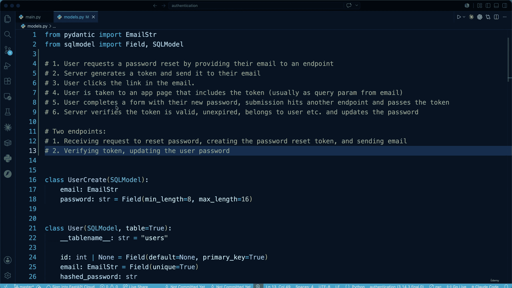

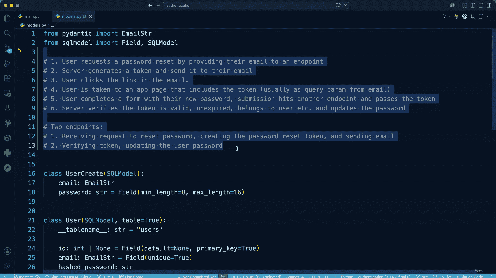

3. 用户点击邮件里的链接，回到我们应用中的一个新页面，链接中通常带有令牌查询参数。

4. 用户在该页面填写新密码，表单把新密码和令牌一起提交到第二个端点。

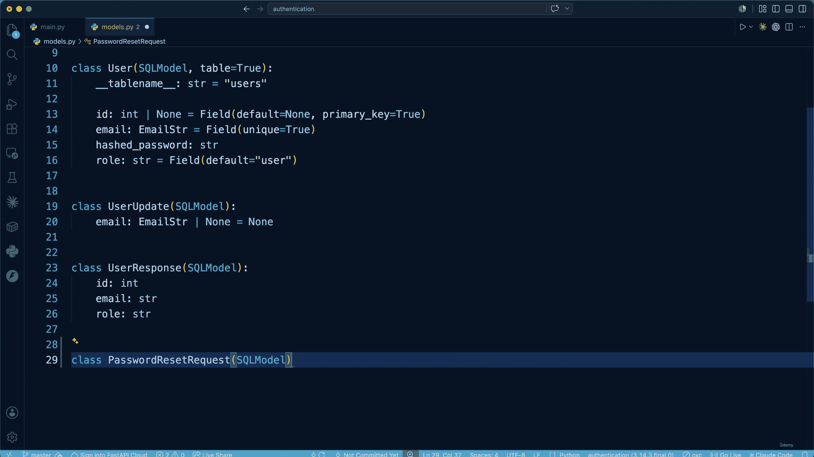

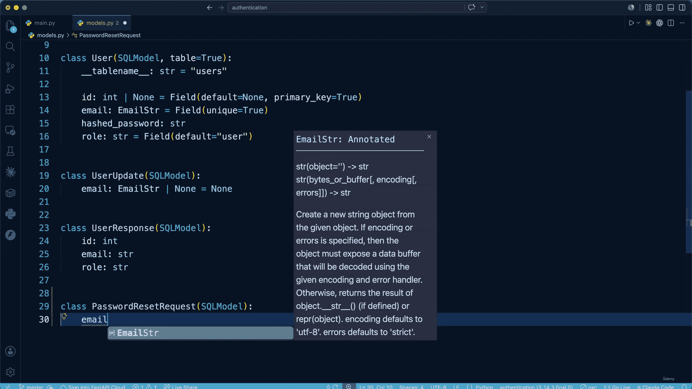

5. 服务端验证令牌有效、未过期、属于该用户、且尚未使用。

6. 验证通过后更新密码，用户随后可以用新密码登录。

这里的“令牌”不是字面意义上的 JWT。它是一个普通字符串，作用类似于访问令牌或权限凭证，表示允许在系统中执行某个动作。普通 JWT 的意图是让客户端在后续每次请求中携带它，证明用户已经认证；而密码重置令牌的意图是只使用一次，用来证明用户是合法用户，并且正在尝试保存新密码。

我们把这个令牌发送到用户邮箱，就增加了一层安全验证。即使用户无法登录我们的系统，至少他通常还能登录自己的邮箱，而邮箱本身往往也有认证机制。这样我们就能验证用户提供的邮箱确实是他能控制的邮箱。用户从邮件中拿到令牌，再回到我们的站点修改密码。即使黑客在站点上发现了某个用户的邮箱地址，只要黑客无法登录该用户的邮箱，就无法完成这个恶意操作。

用户点击邮件链接后，会进入我们域名下的应用页面，链接中带有令牌查询参数。用户在该页面填写新密码，然后提交到第二个端点，同时把邮件中收到的同一个令牌传回来。令牌在这里再次证明用户身份：用户只有能访问自己的邮箱，才能拿到令牌并提交给后端修改密码。

从某种意义上说，认证被转移到了邮箱系统：用户无法登录我们的系统时，我们把“在系统中执行动作的权限”发送到用户邮箱，而邮箱本身在认证之后。第二个端点会验证令牌有效、未过期、属于该用户、尚未使用；满足条件后更新密码。这样用户就能用新密码重新登录。

为了不让流程过于复杂，本课不会引入真实邮件服务器，因为本地开发或购买云邮件服务都会增加复杂度。我们会模拟大部分流程，保持一个接近真实世界的密码重置流程，但不处理实际发送邮件的工程细节。下面是整个设计的要点总结：

- 第一个端点负责接收重置请求、创建一次性密码重置令牌、把带令牌的邮件发送给用户。

- 第二个端点负责接收令牌和新密码，验证后把新密码哈希并更新到用户记录。

- 令牌只能使用一次，并且有有效期，以降低风险。

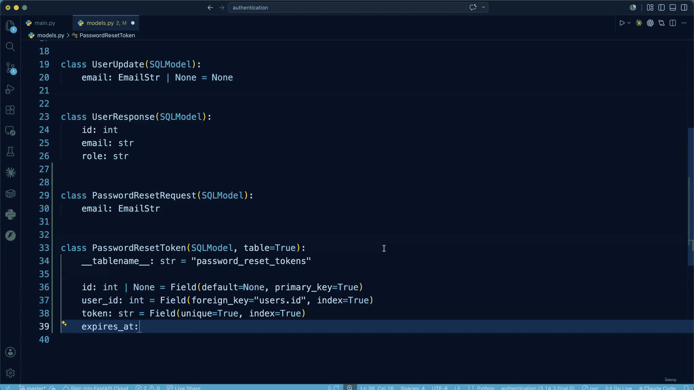

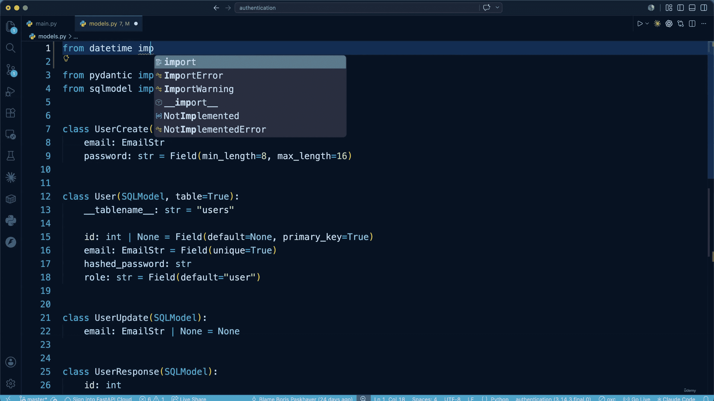

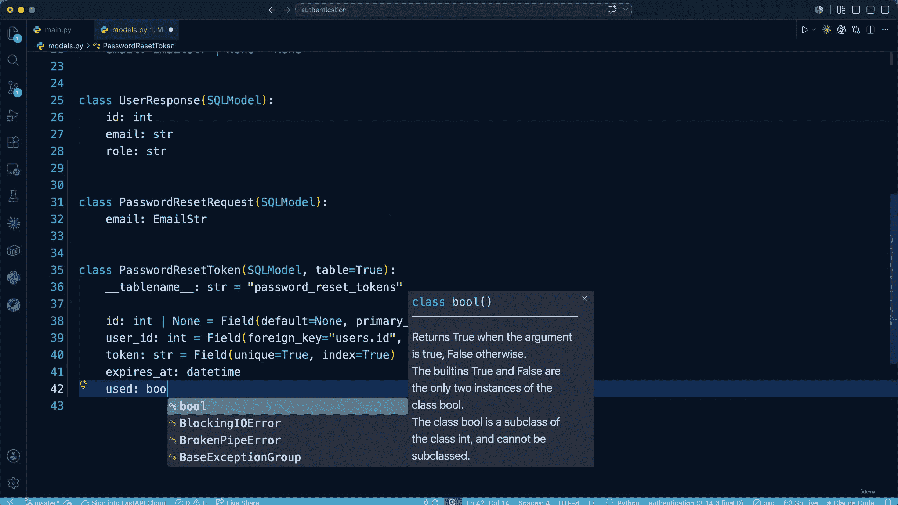

- 令牌与具体用户绑定，不能用来修改其他用户的密码。

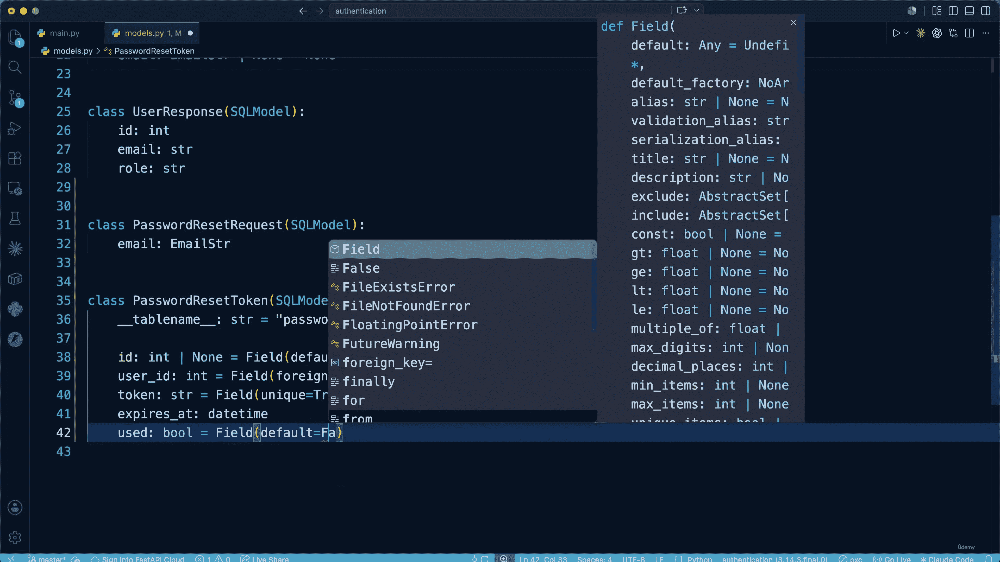

接下来我们看看为了支撑这个流程，需要在模型层定义哪些数据结构。

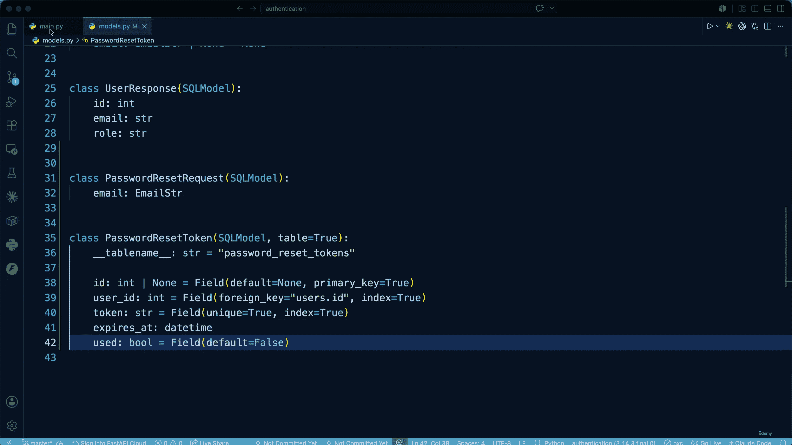

---

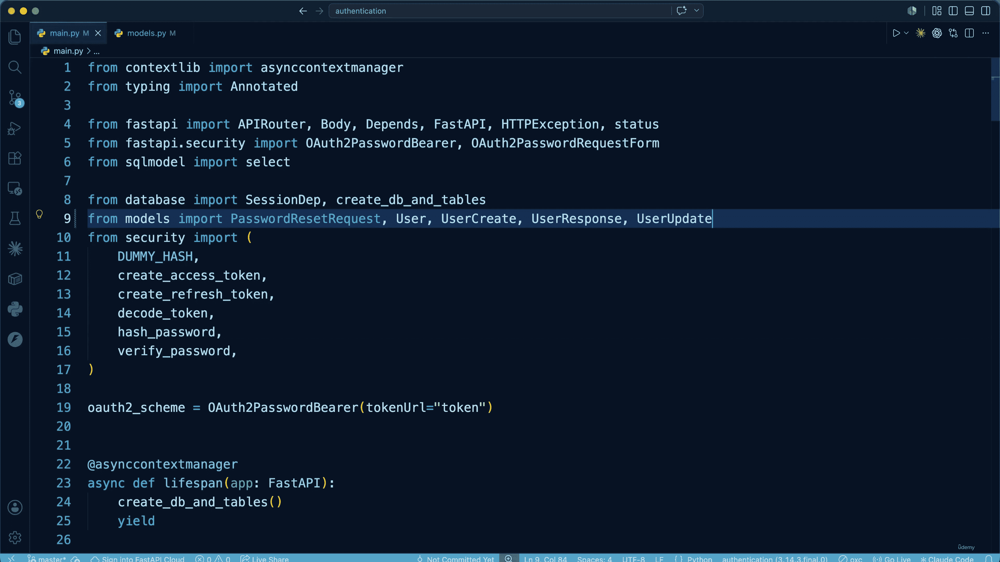

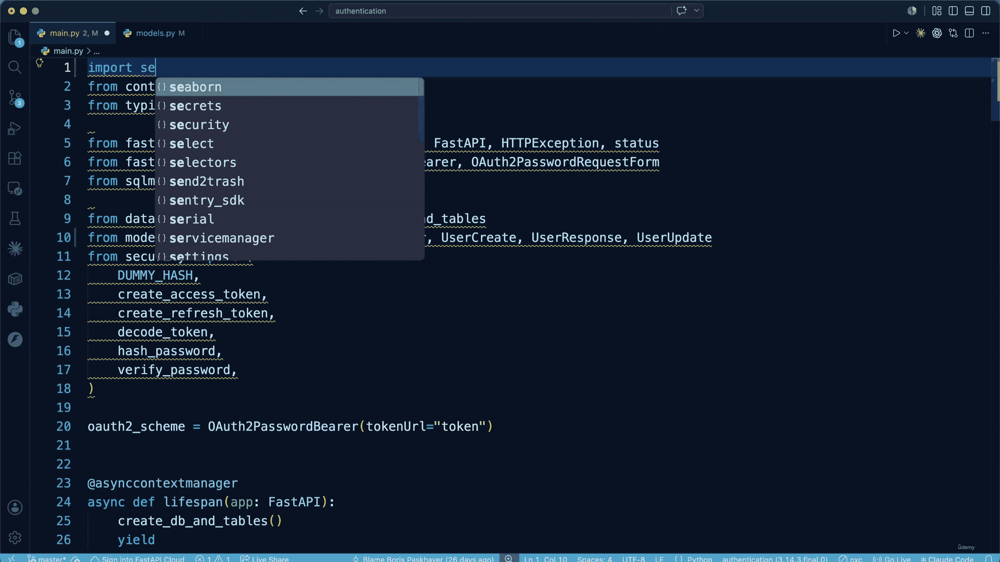

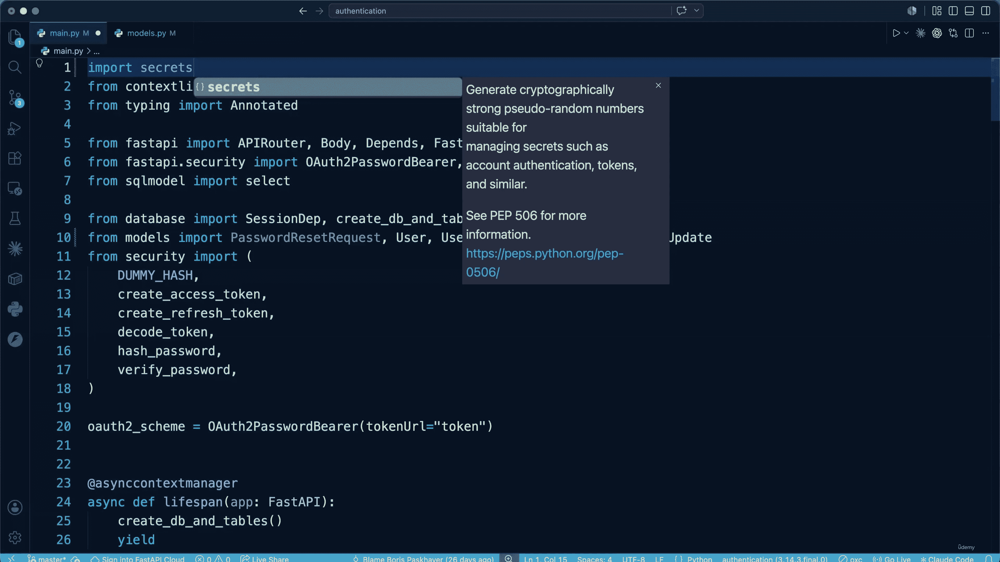

## 🧱 三、定义请求模型和令牌表模型

上一节我们梳理了流程，本节来看看数据库和请求模型怎么设计。打开 `models.py`，我们需要定义两个模型。第一个模型表示用户提交重置请求时传入的数据，也就是邮箱地址。这个模型不需要对应数据库表，只是一个基于 Pydantic 的基础请求模型。

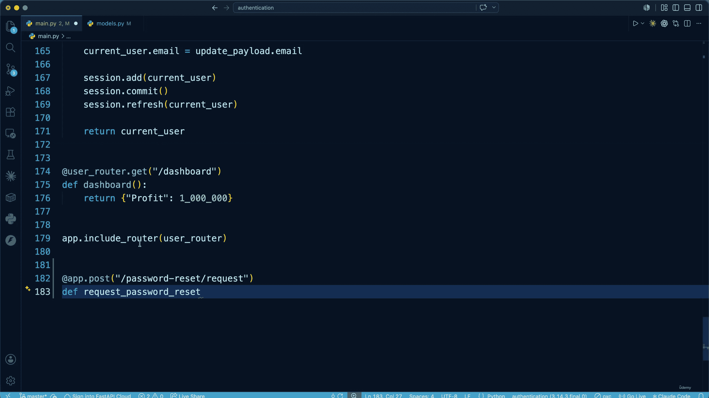

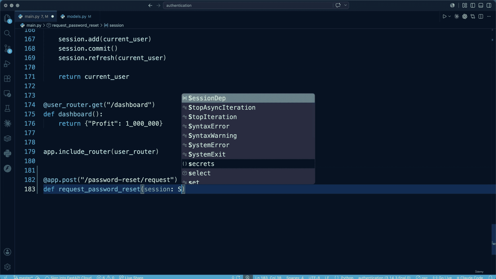

第二个模型表示密码重置令牌，它需要保存到数据库表中，因为令牌要保留状态，例如过期时间以及是否已经使用。为了安全，我们希望任意一个令牌只允许使用一次来重置密码，用户不能拿同一个令牌连续改五次密码。这样做的目的是尽量降低黑客可能造成的损害。因此数据库必须记录令牌是否已经使用。

下面是两个模型分别承担的任务：

- `PasswordResetRequest`：只包含邮箱字段，用来接收第一个端点的请求体。

- `PasswordResetToken`：对应数据库表，保存令牌本身、所属用户、过期时间和使用状态。

可以先定义请求模型如下：

```python
class PasswordResetRequest(SQLModel):
    email: EmailStr
```

这个模型不从数据库表读取数据，也不写入数据库表，它只负责校验请求体里的邮箱格式。接下来定义令牌表模型：

```python
class PasswordResetToken(SQLModel, table=True):
    __tablename__ = "password_reset_tokens"

    id: int | None = Field(default=None, primary_key=True)
    user_id: int = Field(foreign_key="users.id", index=True)
    token: str = Field(unique=True, index=True)
    expires_at: datetime
    used: bool = Field(default=False)
```

这里每个字段都有明确作用。`id` 是每条记录的唯一标识，并作为主键。`user_id` 是指向用户表的外键，因为令牌必须绑定到具体用户记录。即使用户处于登出状态，我们也要确保他只能修改自己的密码，不能修改别人的密码。令牌只给用户一次修改自己邮箱对应账户密码的权限，不能用于其他邮箱或其他账户。为了更快查询，我们给 `user_id` 加索引。

`token` 字段保存令牌字符串，并设置唯一约束。我们不希望出现重复令牌，因为每个令牌都应该是唯一的一次性访问凭证。如果出现重复令牌，追踪哪个令牌对应哪个用户会变得困难，甚至可能出现同一令牌在一行中已使用、在另一行中未使用的情况。为了快速查询令牌，也给 `token` 加索引。索引有写入成本，但查询这两个字段时会更快。

`expires_at` 是过期时间，类型为 `datetime`。用户不能拿一个令牌过一年再改密码，我们希望只给一个较短的时间窗口，例如 10 分钟。`used` 是布尔字段，默认值为 `False`，表示新建令牌一开始尚未使用。只有用户成功用这个令牌修改密码后，第二个端点才会把它改成 `True`，之后该令牌不再有效。

模型确定后，下一步进入 `main.py`，实现第一个端点。

---

## 📨 四、实现“请求重置”端点

上一节我们定义了请求模型和令牌表模型，本节开始实现第一个端点。在 `main.py` 中，我们需要导入 `PasswordResetRequest`，还要从 Python 标准库导入 `secrets` 模块，用来生成令牌。然后定义一个 `POST` 请求端点，路径可以写成 `/password/reset/request`。

这个端点的含义是：用户说“我目前是登出状态，这是我的邮箱地址，请把重置密码的令牌发给我”。处理函数可以命名为 `request_password_reset`。注意这里不能使用 `current_user`，因为我们的前提是用户未登录，无法访问当前用户记录。函数参数需要数据库会话，通过依赖注入得到 `session`。同时需要请求体参数 `payload`，类型是 `PasswordResetRequest`，里面包含邮箱字段。

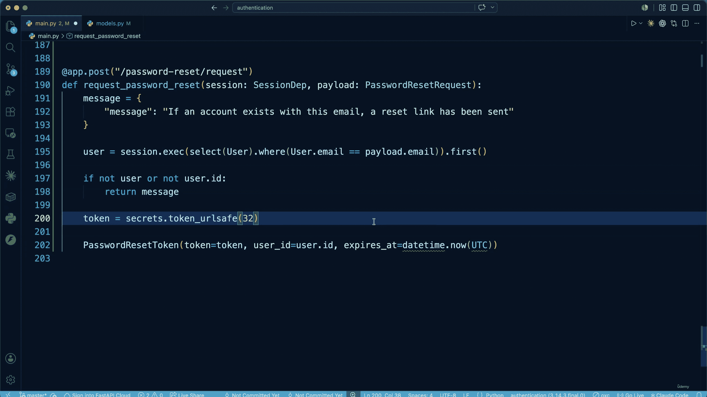

下面是请求重置端点的关键实现代码，展示主要逻辑：

```python
@app.post("/password/reset/request")
def request_password_reset(
    payload: PasswordResetRequest,
    session: Session = Depends(get_session),
):
    message = {
        "message": (
            "If an account exists with this email, "
            "a reset link has been sent."
        )
    }

    user = session.exec(
        select(User).where(User.email == payload.email)
    ).first()

    if not user or not user.id:
        return message

    token = secrets.token_urlsafe(32)

    reset_token = PasswordResetToken(
        token=token,
        user_id=user.id,
        expires_at=datetime.now(UTC) + timedelta(minutes=10),
        used=False,
    )

    session.add(reset_token)
    session.commit()

    # 真实项目中在这里调用邮件服务发送带 token 的链接
    return message
```

代码里先定义一个通用消息字典，键是 `message`，内容是“如果该邮箱存在账户，重置链接已发送”。这个措辞故意保持模糊，目的是不向潜在黑客泄露系统中是否存在某个邮箱。黑客提交一个存在或不存在的邮箱时，我们都不告诉他哪种情况为真。这样就不会意外暴露系统里的邮箱地址。无论邮箱是否存在，接口返回的消息都保持相同。

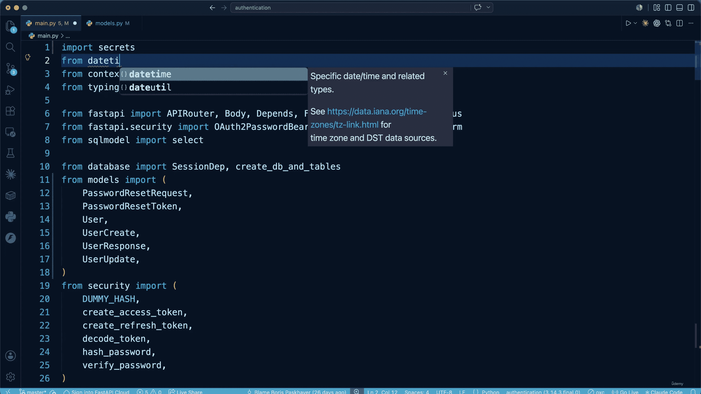

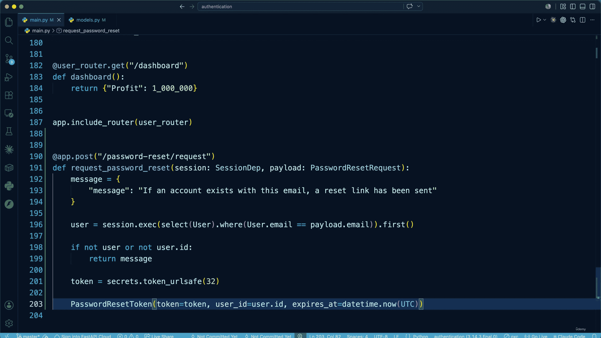

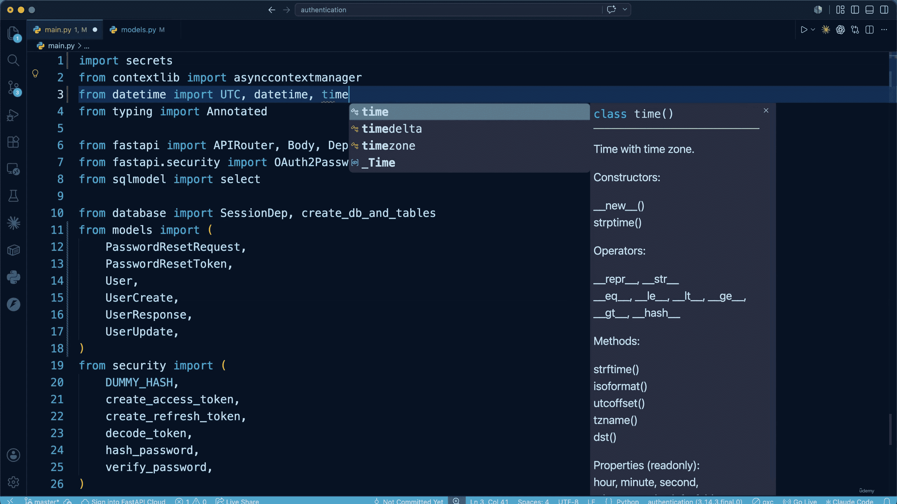

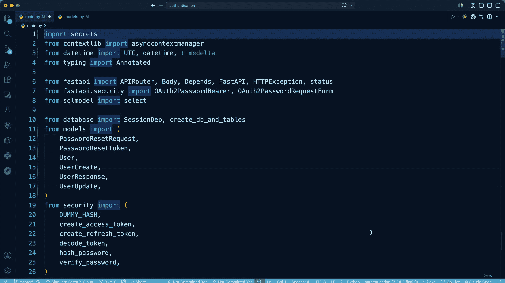

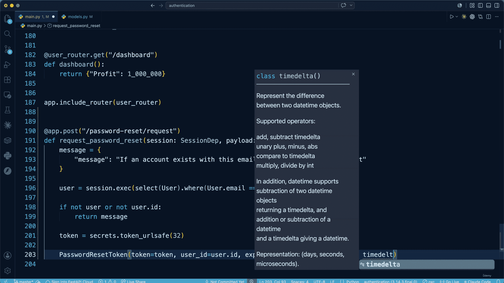

在正常路径下，用户行为良好，只是忘记了密码并提交邮箱。第一步是查询数据库的用户表，确认该邮箱对应一条用户记录。查询结果使用 `first()` 返回，可能是一个有效用户对象，也可能是 `None`。如果查不到用户，或者用户没有有效 ID，就直接返回上面的通用消息。此时我们不会告诉调用方“这个邮箱不存在”，只是返回同样的模糊提示。

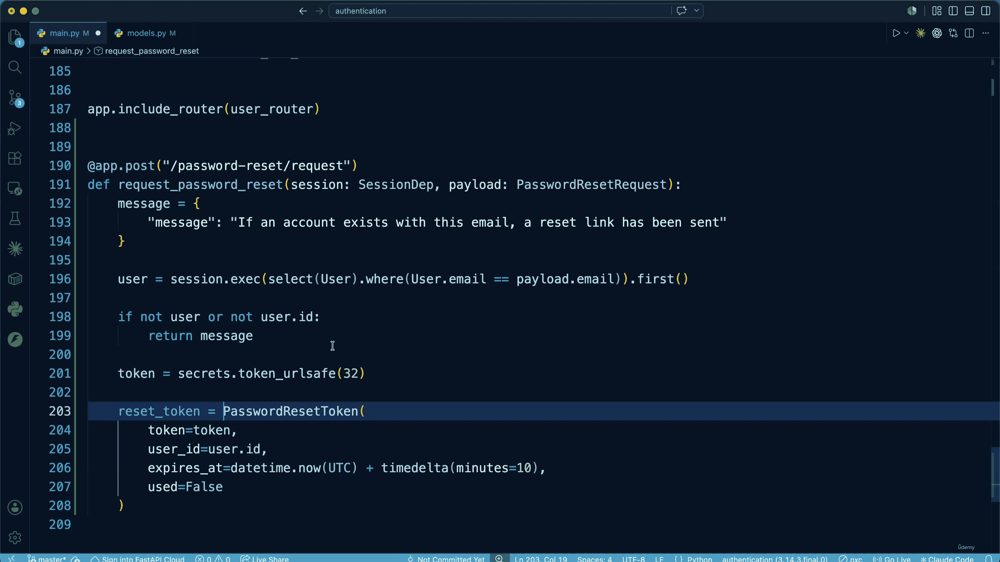

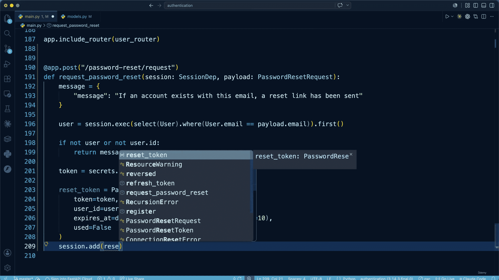

如果找到了对应用户，就生成令牌。这里使用 `secrets.token_urlsafe(32)`，生成一个随机字符串。参数 32 表示字节数，会影响字符串长度。这个令牌是一个唯一标识，用来授予合法用户在没有登录的情况下修改密码的权限。它就像一张一次性权限凭证，会在第二个端点中使用。使用 URL 安全函数的原因是：令牌之后要放到邮件链接的查询参数中，用户点击链接后浏览器地址栏需要能正常保存它。URL 安全字符串使用字母、数字、下划线和连字符等浏览器支持的字符，避免井号、插入符、与号等可能破坏 URL 的字符。

生成令牌后，需要向 `password_reset_tokens` 表插入一条记录。创建 `PasswordResetToken` 实例时，传入令牌本身、对应用户的 `user_id`、过期时间和使用状态。`user_id` 很重要，因为令牌只对应一个用户和一个账户，因此也只对应一个邮箱，不能修改其他账户的密码。`expires_at` 使用 `datetime.now(UTC)` 取得当前 UTC 时间，再加上 `timedelta(minutes=10)`，表示令牌只有 10 分钟有效期。真实项目中时区可能引入一类 bug，本例保持简化，但仍然显式使用 UTC。`used` 字段默认是 `False`，这里也显式写出来，提醒我们新建令牌尚未使用。只有用户成功用该令牌修改密码后，第二个端点才会把它改成 `True`。

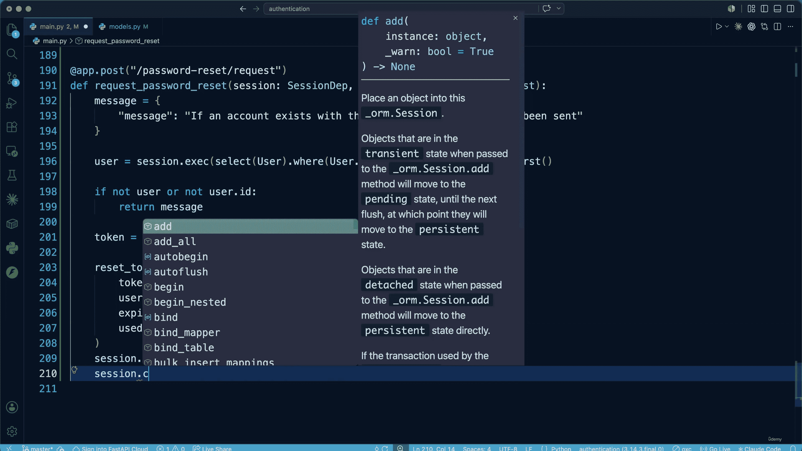

随后把模型实例加入会话，调用 `commit()` 写入数据库。现在数据库里有了持久化记录。真实生产环境中，下一步会调用邮件服务，把包含令牌的链接发送到用户邮箱。邮件内容可以是“这里是重置密码的链接”，链接指向我们网站上的某个页面，例如 `/reset?token=...`，令牌作为查询参数。用户只有能登录自己的邮箱，才能拿到这个令牌，因此这个令牌可以作为一次性修改密码的权限证明。

本课不实际发送邮件，只模拟这一部分，但仍然保留真实流程的结构：第一个端点接收用户邮箱，验证它属于有效用户记录；如果有效，就生成并保存密码重置令牌；令牌带有过期时间，绑定到具体用户，初始状态为未使用；最后返回通用消息。这个端点完成后，我们只完成了整个流程的前半部分，下一节需要实现第二个端点，接收令牌和新密码并真正完成修改。

---

## ✅ 五、本节总结

本节课中我们一起学习了未认证用户密码重置流程的第一部分。我们回顾了已认证用户修改密码的常规端点，明确了未认证场景更复杂的地方在于无法依赖登录状态。随后设计了标准重置流程：用户提交邮箱，服务端生成一次性令牌并发送到邮箱，用户从邮件链接带回令牌，再提交新密码到第二个端点。

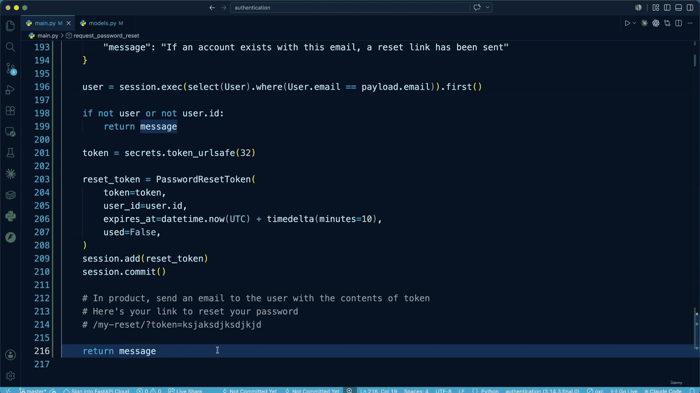

我们还定义了 `PasswordResetRequest` 和 `PasswordResetToken` 两个模型，理解了请求模型不对应数据库表，而令牌模型需要保存到数据库以跟踪过期时间和使用状态。最后实现了 `/password/reset/request` 端点：查询邮箱对应用户，使用 `secrets.token_urlsafe(32)` 生成 URL 安全令牌，通过 `datetime.now(UTC) + timedelta(minutes=10)` 设置 10 分钟有效期，绑定 `user_id`，以 `used=False` 保存到数据库，并返回不泄露账户存在性的通用消息。下一节我们将继续实现第二个端点，验证令牌并真正更新用户密码。

